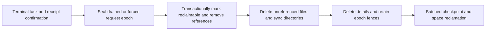

# App-CLI Request, Authorization and Storage Lifecycle Design

> Language: English | [简体中文](../zh-cn/docs/app-cli-storage-lifecycle-design.md)

- Status: design proposal, associated with InfiniCenter ProjectGroup-2 decision **0035 proposed**. Implemented as paired release `0.3.0-sparkclaw.24` (App-CLI branch `codex/lifecycle-v3`, lifecycle 3.0, ledger 2) with the SparkClaw product outbox, ACK, user resolution and the standalone `progress-anchor` service; not yet deployed.
- Date: 2026-10-15; revised 2026-10-16 (the progress anchor is limited to dispatch release and rollback detection, epochs are sealed after product drain, reserved and released dispatch are separated, users can resolve unknown sends, and parameters are derived from measurement).
- Inspected baseline: SparkClaw `b637c5c8`, paired App-CLI `0.3.0-sparkclaw.23`, runtime digest `734f49377026d9a6977e505147cd16693d0abf68c7236aa042e7266c17457eb0`.
- Scope: public requests, task recovery, authorization renewal, events, results, send journals, temporary artifacts, garbage collection, capacity control, migration and rollback. Business mailboxes, user-retained files and conversation history continue to follow product retention policies.

This design places long-term duplicate-execution protection in a small set of monotonically advancing request-generation fences. Unresolved tasks retain the contents needed for recovery. Delivered terminal contents, individual deduplication records and expired authorizations can be reclaimed once their fences are effective. Capacity grows with active tasks, recovery windows and unresolved issues, rather than the lifetime number of requests.

“No duplicate sends” means that retries, restarts, cleanup and supported recovery never trigger another send for the same user operation. When a provider has no idempotent sending API, automatic completion of an unknown send and an absolute no-duplicate guarantee cannot both be provided. Only an attempt whose dispatch token was actually released to the sending worker can become `uncertain`; it allows reconciliation only and may require user action. A crash before release is provably undispatched and continues automatically. An explicitly requested second send is a new operation; matching message bodies do not establish duplication.

## 1. Current Gaps and Design Goals

The implementation covered by the current [paired release configuration](../configs/app-cli-release.json) and [acceptance record](app-cli-implementation-validation.md) has these growth paths:

| Object | Current behavior | Target |
| --- | --- | --- |
| `tasks.request/data` and request keys | Every invoke retains a complete row, without terminal reclamation | Retain active tasks in full; reclaim resolved tasks by delivery and epoch |
| Events | At most 1,000 per task, while task count keeps growing | Rolling byte budgets per task and owner, with explicit expired-cursor gaps |
| Authorizations and `.next` indices | Creation and renewal append files and chains | Fixed authorization slots and direct indices per active task |
| Send journals and collected artifacts | Separate task directories without a coordinated reclamation transaction | Reference accounting, explicit send-evidence retention conditions and recoverable deletion |
| 512 MiB admission gate | Counts allocated database pages plus the new request; excludes other storage | Count actual storage, reservations for admitted tasks and filesystem headroom |
| Request admission | Client authorization indices may be persisted before server admission | Explicit prepare distinguishes admitted, definitively rejected and unknown outcomes |

Preserve Python Registry as the sole public entry point, application adapter responsibilities, Browser Host page/lease ownership and the existing UI. Direct handler calls, database resets and newly allocated request IDs must not bypass recovery.

Goals: reclaimable data reaches a steady state during continued operation; cleanup never reopens an old send; crashes recover the same task; renewal storage is independent of renewal count; capacity pressure gives completion, cancellation and reconciliation of admitted tasks priority; only external dispatch depends on the independent progress anchor, so its outage never blocks admission, reads, ACK or cleanup.

## 2. Required Invariants

1. A product send operation ID, request identity, immutable intent and task ID have a one-to-one binding. Retries, credential replacement, renewal, upgrades and reconciliation cannot allocate a new send identity.
2. Before details are deleted, the request's epoch is durably sealed. Every admission boundary validates the fence; a missing record never means “not executed.”
3. Sealing an epoch prevents new execution admission. It neither deletes active tasks in that epoch nor prevents authorized status/cancel/resume/reconcile of the original task.
4. Before an external side effect, persist a dispatch record that cannot be consumed twice. Where an independent progress anchor is deployed, it confirms the release of that record to the sending worker; no other state change waits for the anchor. After release, an unknown outcome prohibits automatic redispatch unless section 7 proves that attempt never dispatched.
5. Nonterminal tasks, unproven cleanup, unknown send outcomes and send receipts without durable delivery never lose recovery evidence through TTL or disk pressure.
6. Authorization expiry stops execution. Retaining a task does not extend permission to execute. Current authorized identities may receive new, restricted authorization for reading, cancellation or reconciliation.
7. Deleting original content changes neither task state nor the fact of sending. Expired history must be reported explicitly, never disguised as completed, not_found or not_sent.
8. Finite disk cannot unconditionally accommodate unlimited permanently unresolved tasks. Once the product holds the business copy, unresolved sends are compacted to small reconciliation records, and users may resolve them explicitly (section 7.3). Only if records still exceed the budget does admission pause by account/owner with an actionable reason.

## 3. Request Identity and Epoch Fences

### 3.1 Identity

New request identity is `(owner_id, namespace_generation, request_epoch, nonce)`, encoded as an `operation_id` containing no business data. Generation and epoch advance monotonically and are never reused; exhausting them rejects allocation rather than wrapping to zero. The nonce is 128 bits from a cryptographically secure random source in the trusted product outbox, transmitted as fixed-length lowercase hexadecimal. Without an allocator counter, restoring an old product database cannot reissue an identity that was already used. The scope also binds the principal, application, command and resource digest.

Before any network call, the product persists user send intent and operation_id in its own durable transaction. App-CLI send `invocation_id` must equal that operation_id. Old formats use an explicit legacy import table; an old invocation_id cannot be wrapped in a new request epoch. Each explicit new user send receives a new identity; automatic retries only read an existing outbox record.

The product entry point also checks the original operation credential and generation. A retry from an old client whose business record has expired returns `OPERATION_RETIRED`, without creating another send. Deleting product history cannot remove generation fences. Devices submit through one trusted product allocator; individual devices must not reinterpret old sends as new operations.

Scheduled occurrences do not draw random nonces. Their operation_id is derived deterministically from `(owner_id, namespace_generation, schedule_id, schedule_revision, occurrence_time)`; the timezone-converted occurrence_time is fixed when scheduled. A schedule_id is itself an ordinary identity allocated in the epoch where the schedule was created. The runtime keeps one `schedule_fences` row per live schedule with its highest revision and `fired_through`. An occurrence that already has a record returns that task; one at or before `fired_through`, at or before the owner's `schedule_floor_time` (section 10), or from an older revision returns `OPERATION_RETIRED`; otherwise admission advances `fired_through` in the same transaction. The product submits each schedule's occurrences in time order. An older missed occurrence arriving after a newer one is retired and shown as missed; a manual rerun must be an explicit new user action.

Restoring a product database from before a trigger re-derives the same identity and receives the original task or retired, so scheduled sends need no product progress anchor. A deleted schedule's fence row is removed only after the epoch that allocated its schedule_id is sealed; then an absent row plus a sealed creation epoch also means retired.

### 3.2 Constant State per Owner

`owner_meta` retains the current generation, single open request_epoch, at most one draining epoch, `sealed_through`, seal reasons, `schedule_floor_time`, execution_epoch, commit_sequence, authorization revision high-water marks and GC progress. Only the current generation's open epoch, and its draining epoch for identities already issued there, accept new prepare calls. Older generations reject new execution wholesale. Application/account authorization remains isolated without creating a new owner for every historical request.

Rotation has two phases and is driven by the product allocator, the only party that knows which identities it has issued:

1. Issuance switch: when the open epoch E reaches its candidate age of 24 hours, or its reclaimable terminal details reach 10% of the owner's usable budget, the runtime opens E+1 and marks E `draining` in one exclusive write transaction. The product issues new identities only in E+1. A draining epoch still accepts prepare for identities the product already issued in it.
2. Drained seal: once the product outbox holds no E identity in the allocated-but-unsubmitted state (each was admitted, received a definitive rejection, or was cancelled by the user before submission), the product calls `seal(E, drained_digest)`. The runtime sets `sealed_through=E` with reason `drained`.
3. Forced seal: the runtime may seal a draining epoch without product confirmation only after the maximum offline window (section 9) has elapsed, or when 95% storage pressure cannot be relieved otherwise. The reason is `forced`.

At most one epoch is draining. If E has not been sealed when E+1 reaches rotation age, E+1 stays open; the forced-seal window bounds that delay. Time only triggers rotation; durable integer fences decide sealing, and clock rollback cannot reopen an epoch. Long watches and unresolved sends do not prevent rotation. Previously prepared tasks keep their original task IDs.

A user-confirmed send queued in the product while offline is therefore admitted under its original identity if it arrives within the maximum offline window; no blanket promise covers longer outages. After a forced seal, the product receives `OPERATION_RETIRED(forced)` and asks the user to confirm again; confirmation creates a new identity carrying `supersedes=<old operation_id>`. If the product holds as unsubmitted an identity retired with reason `drained` or `recovery`, its own state was rolled back or the runtime ran recovery, so it presents the send as possibly sent, not as a plain reconfirmation. The product never re-keys an operation automatically. Scheduled sends receive execution identities when due.

### 3.3 Admission Order

Authenticate owner/principal and request signature, then look up the existing task by identity. If present, compare intent/resource digests: a match returns the original task; a mismatch returns a conflict. If absent, scheduled occurrences check their schedule fence and floor. Otherwise an old generation, sealed epoch or unknown future epoch cannot create a task; only the current open or draining epoch may create one after successful capacity reservation. Retired responses carry the reason `drained`, `forced`, `recovery`, `schedule` or `legacy`.

```text
authenticated request
  existing operation -> matching intent ? same task : REQUEST_KEY_CONFLICT
  absent + scheduled occurrence -> fence/floor/revision passed ? OPERATION_RETIRED(schedule) : validate + reserve + atomic prepare
  absent + retired generation / sealed epoch -> OPERATION_RETIRED(reason), no execution
  absent + open or draining epoch -> validate + reserve + atomic prepare
  absent + future/invalid epoch -> REQUEST_EPOCH_INVALID, no execution
```

A sealed epoch rejects replay without individual request tombstones. An active exception table retains older-epoch tasks that still need recovery; its entries permit control of the original task, never a new invoke. Issuing a new authorization for an old key after sealing cannot bypass admission fences.

## 4. Public Lifecycle and Durable Receipt

Proposed versions are Lifecycle **3.0**, Host **2.0**, execution binding **2.0** and ledger **2**, with required capabilities declared by the paired release. Phase one freezes concrete JSON Schemas and cross-language fixtures. Current 2.0 consumers must not silently interpret the new semantics.

| Operation | Proposed semantics |
| --- | --- |
| `prepare` | Validate trusted authorization, complete intent, identity and resource budget; atomically create the task, recovery inputs and reservation, without side effects |
| `invoke` | Start only the original prepared task; repeated calls return its current state and cannot implicitly create a new task |
| `lookup` | Return `known`, `not_admitted`, `retired` or `unresolved`; these outcomes are not interchangeable |
| `status/events` | Query the original task/bounded events; read-only control creates neither tasks nor authorization revisions |
| `renew/resume` | Update authorization for the original task; resume must satisfy recovery-state, original-intent and safety checks |
| `cancel/reconcile` | Record stop intent/query evidence; neither permits another send |
| `ack_result` | A durable receiver confirms task, result digest, terminal revision and receiver identity, allowing policy-governed content reclamation |

`not_admitted` is returned only when authoritative storage is healthy and no admission record exists in an open or draining epoch. The response contains generation/epoch/commit_sequence and permits retrying the same prepare only within that epoch. It expires when the epoch is sealed. A runtime restored from an old backup may answer not_admitted for an operation it once admitted; because the product retries only the same identity and every release requires anchor confirmation (section 10), this can at worst recreate the same task, never release a second dispatch. An authoritative query that cannot complete returns unresolved or a retryable service error. Capacity rejection creates no admitted row; a lost response still requires lookup, because timeout does not prove rejection.

Minimum new envelope fields: `operation_id`, `request_epoch`, `namespace_generation`, `intent_digest`, `resource_digest`, `task_id` after prepare, and `authorization_revision`. Results add `terminal_revision`, `result_digest`, `retention_until` and `recovery_class`; retired lookup responses carry their reason and no successful TaskResult. ACK includes those task/result identities and the durable receiver's receipt-record ID. Every field requires schema validation and signature binding.

Product receipt order: commit the result, send state and ACK outbox in one business-database transaction → asynchronously send ack_result → App-CLI records the ACK. Lost ACKs can be retried. Displaying a result, keeping it in memory or receiving a WebSocket packet is not durable receipt. Gateway receives mail results; this does not change decision 0031 for non-mail content handled by clients.

The product needs no progress anchor. Its identities are random or deterministically derived, and it never re-keys an operation automatically. Restoring an old product database can therefore lose recent history entries but cannot create another send: restored pending operations look up their original identity and receive the task, its result or retired; a result for an operation the restored database does not know is imported into history as an orphan result before ACK. Retired send operations are shown as archived and possibly sent, never as resendable. The product still needs ordinary business backups.

The product and App-CLI do not pretend that their separate databases share a distributed transaction. Original identities, outboxes, idempotent prepare/ACK and startup scans provide convergence. Lookup recovers a task after a lost prepare reply; client crash recovery must not first allocate a new ID.

## 5. Storage Layers and Reclamation Conditions

A single state service per owner is the sole writer, using SQLite WAL/FULL for tables and transactions. Clients and Hosts cannot write arbitrary SQL. Trusted issuer signatures and permission boundaries remain independent; consolidating databases does not authorize the Executor to expand permissions. Bulk data lives under a controlled blob root, connected through digests and reference records.

Bindings explicitly declare the recovery class `pure_read`, `replay_safe_local`, `external_write` or `subscription`, determined by reviewed adapter capabilities and signature binding. A command named read is not sufficient proof of no side effects. Rejected admission does not durably create grants, indices or temporary copies. Necessary temporary uploads first require a bounded upload reservation; after timeout, release content without task references. Failed requests must not create another unlimited growth path.

| Table/object | Required fields or responsibility | Lifecycle |
| --- | --- | --- |
| `owner_meta` | Generation, open/draining/sealed epochs and seal reasons, `schedule_floor_time`, execution authority, release sequence, commit and migration/GC high-water marks | Constant size; ordinary cleanup never deletes it |
| `operations` | Original identity, task, immutable digests, state, phase, deadline, recovery class, result references and ACK | Active tasks retained in full; terminal records reclaimed by epoch and delivery |
| `authorization_heads` | Current/candidate/transition authorization, revision and revocation state per task | Fixed slots per active task |
| `effect_records` | Task, attempt, effect token, dispatch phase (reserved/consume_pending/released), draft and provider correlation, evidence digests | Unresolved records compacted and pinned; resolved records reclaimed by delivery and epoch |
| `schedule_fences` | Highest revision and `fired_through` per live schedule | Removed after schedule deletion once its creation epoch is sealed |
| `events` | Task, sequence and compact payload | Rolling task/owner budgets, retaining gap high-water marks |
| `blobs` / `blob_refs` | File digest, size, purpose, references and deletion phase | Deletable after active/delivery references are gone |
| `gc_jobs` / `reservations` | Reentrant deletion progress and resource commitments for admitted tasks | Compact into high-water marks after completion |
| Product `operation_outbox` | Original operation identity, task, user intent/result, delivery and ACK state | Reclaimed in coordination with the product's generation fences |

The values below are initial placeholders in a versioned policy; section 9 derives deployed values from shadow measurements. The safety conditions above cannot be relaxed:

| Data | Proposed rule |
| --- | --- |
| Ordinary terminal read-only inputs/results | Retain one hour after durable ACK; without ACK, at most 24 hours, then explicitly expire the result without reexecuting the original ID |
| Locally collected results/files | Wait for Gateway to validate digests and durably ingest/take references; remove temporary copies one hour after ACK |
| Terminal send bodies/temporary attachments | Retain 24 hours after durable receipt of the send conclusion and required business copies; files referenced by other active tasks remain |
| Minimal terminal send receipts | Retain 30 days after ACK; individual control records may be removed only after epoch sealing; the product retains user-visible send history |
| Unacknowledged send receipts | Preserve compact known conclusions and recovery material; a 30-day timeout cannot erase the sole send evidence |
| Unfinished/unproven cleanup | No automatic eviction TTL; keep the original task and necessary inputs/evidence/references pinned |
| Uncertain sends | No automatic eviction TTL. After the product durably holds the business copy of body and attachments, compact to a reconciliation record (identities, digests, recipient digest, draft/provider correlation, attempt and phase, timestamps; target at most 4 KiB); reconciliation does not need the payload |
| User-resolved unknown sends | Delete payload, authorization slots, events and effect detail immediately; keep the resolution in a compact row until the epoch is sealed; the product keeps the user-visible conclusion under business retention |
| Events | At most 1,000 records and 2 MiB per task, with a 32 MiB owner event budget; trim excess and report gaps |
| Transitional authorization versions | Current, one candidate and one unexpired old version; remove the old version after transition |
| Diagnostic logs/audit details | Bounded rotation, proposed seven days and 64 MiB; safety facts reside separately in tasks/anchors and do not depend on logs |

Delete terminal task details only after content-policy and send-delivery obligations are satisfied, the epoch is sealed, and no active execution, Host lease or file reference remains. Short-lived terminal tasks in an open or draining epoch retain at least a compact deduplication record until sealing. Events are not the source of recovery truth; critical phases must first be written to operations/effect_records.

Business history and runtime caches have different policies. Runtime GC must not delete mail the user requested to keep permanently or claim to solve that history's unlimited growth. The product needs a separate visible retention/export policy. The runtime must not move its own growth to another directory through unlimited cold archives.

## 6. Fixed Authorization Slots and Safe Renewal

Replace `.next` chains with a direct `task_id -> authorization_head` index. Signed authorization includes owner/generation, original operation/task, intent/resource digest, revision, allowed operations, execution/access deadlines and current credential generation. Resources hold controlled credential references rather than persistent copies of raw tokens.

Renewal uses CAS on `(task_id, expected_revision, renewal_id)`: issue and persist candidate r+1 → Registry/Executor/Host verify its signature, same task/intent/resources and valid execution permission → atomically switch the head → acknowledge. After a lost response, query the head. Repeating a renewal_id still retained in the three slots returns the same r+1 instead of producing more revisions. Only one candidate may remain unfinished; another renewal cannot start before the required Host confirmation.

Store renewal_id only in current/candidate/transition slots, without a permanent renewal-deduplication table. An older expected_revision returns `AUTHORIZATION_STALE` and points to the current head. Clients converge by reading that head, without republishing old versions. Delete a task's authorization head when the task meets reclamation conditions. Even a mathematically valid old signature cannot acquire resources without a current task/head or valid lease. Access-only credentials use short-lived signed permissions, without creating durable authorization rows for each status/lookup.

Terminal state immediately prohibits execution renewal and revokes the execution head. Release version slots after old leases exit/expire and cleanup is proven. Thirty-day result retention does not require thirty-day execution-authorization file retention. Terminal queries and receipt delivery use separate access authorization for the current principal.

Each live Host lease references a specific revision. Old authorization may only let an existing lease finish before its original expiry; it cannot acquire a new lease. Remove transition versions after all leases confirm exit, or after original expiry with proven cleanup. Missing confirmation occupies the fixed slot and stops further progress; it cannot grow the version list. Host caches are constrained by short leases and revocation high-water marks. Reconnection synchronizes revisions first; disconnected caches cannot extend execution.

Retain the current five-minute watch execution window, renewal 60 seconds early and maximum 30-second Host lease as starting values. Authorization heads may advance indefinitely, but execution stops without valid continuing permission. Resume after expiry requires new explicit, valid authorization. Thirty-day query credentials may be replaced without changing task identity or historical intent; replacement does not restore execution permission automatically. Cancellation and read-only reconciliation have separate permissions.

Revocation first durably increases the relevant owner/account/task revocation high-water mark, then notifies resource endpoints and stops new execution. Offline Hosts stop no later than expiry of their existing leases. Account rebinding advances its generation; old account credentials become invalid wholesale before account details are deleted. Rebuilding an entire owner must advance generation, never delete and reuse its old identity. Authorization audit retains current control facts and bounded detailed history.

## 7. Unfinished Tasks and Send Recovery

### 7.1 Recovery by Phase

| Durable phase | Action after restart | Reclamation condition |
| --- | --- | --- |
| Prepared, not started | Recover the original task; queue within valid execution authorization/business deadline, otherwise await reauthorization or explicit failure | Not eligible for terminal cleanup |
| Read-only running | Fence old execution/pages first; continue from a checkpoint or reread within the same task, reporting explicit gaps | After durable business-result delivery |
| Local artifact write in progress | Deterministic artifact ID, temporary file + validation + atomic commit; validate existing results and continue the original step | After reference handoff |
| External write, dispatch not yet reserved | Continue under original permission only after the old worker is fenced and non-dispatch is provable | Preserve the original request |
| Dispatch reserved or consume_pending, not released | Advance execution_epoch so the old token can never be released; the attempt is provably undispatched; continue automatically with a new attempt token under the same operation | Preserve the original request |
| Released/outcome unknown | Enter uncertain; perform only side-effect-free reconcile, never resend without the evidence in section 7.2 | After a trusted conclusion or user resolution, and completed delivery |
| Resolved by user | Terminal; no execution | Section 7.3 |
| Known sent, result not delivered | Reconstruct/read the original receipt and retry delivery without calling send | Durable ACK plus retention window |
| waiting_confirmation / cleanup blocked | Preserve the task; await its existing approval or resource-recovery process | Terminal rules apply only after completion is proven |

### 7.2 Send Critical Section

1. Validate the current task, user-approved immutable message, account and attachment digests; verify old execution is fenced. Where the provider supports drafts, first save the reviewed message as a draft and record its draft correlation.
2. In one state transaction, create the attempt number, a unique `effect_token` and `dispatch_reserved`. This step does not wait for the anchor.
3. At the actual dispatch boundary, Host requests release from the sole state service with the token, execution epoch and lease. The state service (a) persists `consume_pending` with release sequence n+1; (b) where an anchor is deployed, advances it from n to n+1 by CAS, bound to operation_id, attempt and token digest; (c) persists `released`; (d) only then replies to Host. Host then performs exactly one send. Repeated consumption grants no execution authority; a local Host cache cannot replace release. Sending clicks, network submissions and SDK automatic retries cannot be transparently retried.
4. Persist `sent` and provider evidence after obtaining a receipt, then complete business-result delivery.
5. A crash before `released` is persisted is provably undispatched, because Host never received release. After restart: if the anchor is still at n, void the pending release; if the anchor is at n+1 with the same digest, adopt n+1 and void the token as consumed but never released. In both cases advance execution_epoch and continue with a new attempt token. Only a crash after `released` and before step 4 enters uncertain. Each operation has a bounded number of attempts (candidate 3); exhaustion fails the task as not sent.

A provider query that finds no message, a timeout, expired credentials or a missing journal cannot prove non-sending. After release, `not_sent` requires evidence bound to the original task, attempt and execution epoch, with old execution fenced:

- A Host abort record for that token, persisted before any send input event, for example the existing `EMAIL_REPLY_TARGET_UNVERIFIED` stop before the effect boundary, together with revocation of the lease.
- Qualified draft evidence: after a provider-specific settle period, the recorded draft still exists unchanged in Drafts, no matching item exists in Outbox or Sent, and the old page and lease are fenced. Only providers whose qualification suite has established this evidence as reliable may use it; for other providers it is information shown to the user.

A Host abort record permits automatic continuation with a new attempt under the same operation. Qualified draft evidence permits automatic continuation only where the provider policy explicitly enables it; otherwise the user sees the evidence and may choose to continue this send, which resumes the same operation with a new attempt rather than creating a new operation. Without such evidence the attempt stays uncertain. Sending a specific API draft ID, where the provider rejects a second send of the same draft, would make release itself idempotent; it is a separately approved future extension that this version does not enable.

### 7.3 User Resolution of Unknown Sends

When reconciliation reaches no conclusion within the policy limit (candidate: three rounds over 24 hours), the product asks once, through the original send-history entry, for a user decision. It does not ask earlier and adds no permanent status display. The user may record `confirmed_sent` after checking the mailbox, `confirmed_not_sent`, or `accept_unknown`. A combined action resolves the task and creates a new send operation carrying `supersedes`, with an explicit warning that the original may have been delivered; recovery logic never makes that decision for the user. The decision requires the current principal's send permission for that account and is signed and bound to operation_id and attempt.

Resolution makes the task terminal as `resolved_by_user`, with `{operation_id, attempt, resolution, principal, time, evidence digests}`. The runtime never turns `confirmed_not_sent` into an automatic resend; it only closes the task. Payload, attachments, temporary artifacts, authorization slots, events and effect detail beyond the resolution record may be deleted immediately. The task leaves the active exception table; a compact row rejects replay until its epoch is sealed, after which the epoch fence (or schedule fence) rejects it without a tombstone. Evidence that arrives after resolution only annotates product history and triggers no runtime action.

Preserve original journals until migration into effect_records. After migration, one Executor owns provider evidence and task phase. Recovery cannot depend on in-memory objects, old authorization file paths or trimmed events. Each checkpoint records adapter/binding versions; an incompatible upgrade permits reconciliation of existing evidence only, never a guessed rerun with a new script.

## 8. GC Transactions and Crash Consistency

The background single writer owns GC. Queries remain read-only; status/lookup must not opportunistically delete data. Each batch has byte, row and time budgets, giving foreground recovery and cancellation priority. Execution, renewal, ACK and GC share task revision/CAS so an old candidate snapshot cannot delete newly referenced contents.

Shared blobs also have their own revisions and `LIVE -> DELETING -> DELETED` states. In one transaction, confirm refcount=0 and no upload/execution pins, then CAS to DELETING. Every new reference must verify the blob remains LIVE; deleting objects cannot be revived. New demand for the same digest creates a new blob instance ID/physical path, referenced only after revalidation. Deletion jobs bind instance ID and revision rather than deleting a new file solely by its digest path. This covers reference races between different tasks.



First transactionally mark deletion candidates and write gc_job/reference changes; then delete files; finally complete the batch and remove rows. Failures at any stage allow idempotent retries. Physical deletion is permitted only after the database records that content is no longer needed. Files created but not registered become reclaimable orphans only after a creation grace period and proof that no upload/preparation task references them. Never scan unknown directories and delete by file age.

Do not assume atomicity between database and files. A missing deletion candidate means that deletion step is complete. A missing file with an active reference is a recovery error: keep the task blocked/uncertain and never resend. GC errors prevent batch completion without rewriting task conclusions.

SQLite uses batched deletion, WAL checkpoints and controlled incremental vacuum; verify auto_vacuum mode during migration. Free pages can serve later transactions but still count toward physical storage. Never run a full VACUUM requiring a full database copy during low-disk conditions; reserve maintenance space in advance and allow pausing. GC jobs and completed migration markers also compact into high-water marks instead of creating another unlimited history.

## 9. Capacity Budgets and Protection of Admitted Tasks

There is no cumulative request-count gate. Admission uses current usage and committed resources:

`admissible = used_actual + reserved_unwritten + request_peak + maintenance_headroom <= owner_budget`

Also check filesystem free bytes, inode/file-count levels and commitments across all owners on the host. Actual usage includes DB/WAL/SHM, authorizations, journals, temporary/final artifacts, GC quarantine files, logs and the current maintenance copy. Charge shared files to explicit physical owners without releasing capacity twice. Transactional reference handoff transfers ownership to the product, while the physical file still consumes host disk.

Each binding declares input, maximum result, temporary artifact, recovery-evidence and WAL peaks. Prepare reserves the worst reasonable peak before admission; actual writes consume that reservation, stopping safely before exceeding the declaration. Before dispatch, a send must have room for its minimal final receipt and unknown-outcome evidence; it cannot send first and request space later. Continuous watches reserve a fixed event ring and authorization slots.

This design fixes formulas, not budget values. Phase P1 runs shadow measurement on the current deployment for at least 14 days, recording per-owner request rates by recovery class, per-task peak bytes by binding, ACK latency, uncertain-send rate, product-to-runtime disconnection durations, WAL peaks and anchor round-trip latency. Deployed values are then derived as:

- `owner_budget = max(min_budget, ceil(P99(active + pinned working set) × 2)) + recovery_reserve + maintenance_headroom`
- `recovery_reserve = max(64 MiB, owner_budget × 10%)`, included in the total budget and unavailable to new tasks
- `max_offline_window = max(24 hours, P99(disconnection duration) × 2)`
- `receipt_retention = max(max_offline_window, client_retry_horizon, user_dispute_window)`

Until measurement completes, 2 GiB per owner, 32 MiB for events, 64 MiB for logs, 30 days of receipt retention and a 7-day offline window are test placeholders only. Deployed values are published as a versioned policy together with the measurement report. Artifact limits are configured per binding and host deployment. The budget is not a cumulative lifetime quota. If migration estimates show that old pinned data exceeds the budget, revise capacity planning first; never delete old evidence to fit defaults.

| Level | Behavior |
| --- | --- |
| 70% | Run eligible GC, epoch rotation and checkpoints early |
| 85% | Coalesce compatible same-account probes/synchronization; defer nonessential new requests while retaining original-task controls |
| 95% or insufficient commitments | Prepare returns `STORAGE_PRESSURE` and retry-after without creating a task; recovery, cancellation and ACK use their separate reserve |
| Other processes fill the disk | Stop new side effects and state transitions requiring persistence; preserve unknown outcomes and await recovery |
| Anchor unavailable | Only release pauses; reserved sends wait with backoff and remain provably undispatched; prepare, reads, renewal, ACK and GC continue |

Levels include actual usage plus unwritten reservations and use recovery hysteresis. GC failure triggers backoff, not rapid new-request retries. Admitted requests always retain their identities. Compacted unknown-send records are small, so their limit is a safety signal rather than storage: when an account's unresolved sends exceed a policy count (candidate 20), new sends for that account pause and the user is asked to resolve them (section 7.3). Exhausted owner/host budgets widen the admission restriction.

Metrics include total/category bytes, unwritten reservations, oldest unresolved task, unacknowledged receipts, GC delay, open-epoch age, authorization versions per task and free disk. Preserve original UI entry points; show “insufficient space” or “send result needs confirmation” only when user action is needed, without a permanent technical status bar.

## 10. Progress Anchor and Backup Recovery

Owner exclusive process locks, execution_epoch, Host generation and authority high-water marks remain. Request epochs reject old requests; execution_epoch fences old workers. They are separate concepts.

Ordinary crashes can recover using WAL and independent local authority markers. If every local file is rolled back together, none can independently prove that rollback happened. The only harm such a rollback can cause under this design is releasing a dispatch for the same operation a second time. Rolled-back admission or authorization at worst recreates the same task, rolled-back GC restores more records, and rolled-back ACKs are retried against original identities. The independent progress anchor therefore covers dispatch release only.

### 10.1 Anchor Interface

The proposed separate SparkClaw control store implements `compare_and_advance(owner, generation, previous_seq, next_seq, release_digest)`, where release_digest binds operation_id, attempt and token digest. Each owner has one runtime slot holding generation, release sequence, digest, a fixed ring of the last K releases `(seq, operation_id, attempt)` (candidate K=256) and the minimum storage protocol. The record is constant size and contains no request bodies. The interface authenticates the runtime writer, rejects cross-owner updates, differing digests at the same sequence and unauthorized generation advancement, and returns success idempotently for a repeated identical CAS. There is no product slot (section 4).

Only step 3 of section 7.2 advances the anchor; admission, authorization, ACK, GC, queries and event reads never wait for it. Each release costs one round trip; P1 measures its latency against a p99 target of at most one second. A timeout is retried with the same CAS and never treated as release. If the anchor is unreachable, the task stays in consume_pending or reserved, which remains provably undispatched; an anchor outage produces no uncertain sends. A reserved send past its business deadline fails normally as not sent.

### 10.2 Rollback Detection and Automatic Fence-Forward

The runtime reads the anchor at startup and after any CAS failure:

- Anchor equal to the local sequence: normal.
- Local exactly one consume_pending ahead, whose previous sequence/digest matches the anchor: retry that original CAS.
- Anchor ahead of the local sequence: the runtime was rolled back.
- Anchor behind the local sequence, or a different digest at the same sequence: the anchor was lost, or both were rolled back to different points.

In the last two cases, the runtime performs fence-forward automatically, in one exclusive transaction and before any new release:

1. Advance execution_epoch and the credential generation. Every execution authorization becomes invalid, and the trusted issuer reissues from its current revocation state, because a rollback may have lost revocations.
2. Seal every epoch up to the current one with reason `recovery`, open a new epoch, and set `schedule_floor_time` to the anchor service time at detection (the restore time in profile C).
3. Classify nonterminal external_write tasks. If the anchor is ahead by at most K, tasks whose operation_id appears in the ring after the local sequence become uncertain, and the rest are proven not released since the backup and continue normally. If the gap exceeds K, the anchor is behind, or digests differ, every nonterminal external_write task becomes uncertain.
4. Adopt the anchor sequence, or reseed the anchor under a new anchor generation when it was behind or mismatched, and write a recovery record. Profile C has no anchor step.

Fence-forward never blocks waiting for manual action. Users see only the resulting uncertain sends, through the existing send-history entry and section 7.3.

### 10.3 Deployment Profiles

| Profile | Anchor location | Guarantee |
| --- | --- | --- |
| A: Gateway and runtime on different hosts | Gateway control store on its own host, excluded from runtime backups; restoring the control store from its own backup looks like an anchor behind and triggers fence-forward | Detection of whole-set runtime rollback |
| B: Gateway and runtime on the same host | Anchor on another host in a separate failure/recovery domain, such as a cluster hub, or a hardware monotonic counter such as a TPM 2.0 NV counter on Linux/Windows; macOS Keychain and files covered by Time Machine do not qualify | Detection of whole-set runtime rollback |
| C: no independent anchor | Ordinary crash recovery; backups may be restored only through the supported restore command, which always performs fence-forward with every nonterminal external_write task uncertain | Crash safety and supported restores only; raw file restoration outside the command is unsupported |

Backups include a consistent task/authorization/reference/artifact manifest and anchor sequence. Keep a bounded number, for example the last two verified snapshots, within deployment storage budgets. Old backups cannot directly start as online ledgers. Backup privacy retention after body deletion follows the same policy; unlimited backups are not a steady-state design.

## 11. Existing-Data Migration and Rollback

1. Inventory ledger, grants/index, journals, captures, Host leases and product outboxes. Calculate task classes, references, capacity and per-record identities/digests; create a consistent cold backup. Separately enumerate orphan authorizations, old indices without tasks, uncertain tasks and cleanup fences.
2. Build ledger 2 in an isolated copy and calculate shadow GC candidates. Do not delete production files or change current Lifecycle 2.0 semantics. Place old random request keys in a read-only `legacy_generation` index while retaining original task IDs/intents/states; never automatically allocate new identities to old writes.
3. Validate old authorization-chain signatures, resources and revisions; extract the current head and versions still used by valid leases. Unknown chains cannot be assumed invalid. Bind old send journals to tasks individually and preserve unknown files.
4. Drain new admission, fence old workers/Hosts, durably close legacy admission, establish a new generation and, where deployed, the independent anchor, then atomically switch matched Registry/Runtime/Host/product consumers. Existing legacy tasks use dedicated task-bound controls. Unadmitted old requests return retired and cannot be sent retroactively.
5. Unfinished legacy tasks remain pinned. Current authorized principals may issue restricted recovery authorization for expired old grants without changing task identity. Enable GC only after real recovery, ACK and epoch-rejection validation.
6. Reclaim completed legacy content only when the new contract explicitly permits it, the product has received it, the old namespace permanently rejects new execution, and retention windows are satisfied. Preserve and report records whose conditions cannot be proven rather than forcing storage to zero.

Once schema 2 enables cleanup, `.23` and other ledger 1 writers may no longer open that state directory. Package manifests and an external minimum-storage-protocol fence jointly prevent downgrade. An old binary that cannot interpret new fields must still be unable to obtain the startup lock/Host execution authority. Before first activation, migration can be cancelled and intact v1 resumed. After activation, rollback is limited to corrective releases compatible with v2 storage. Restoring an old database/authority to roll back the package is prohibited.

The fence is enforced by a bootstrap/authority gate that is not rolled back with application packages or state backups. It fixes the minimum protocol and permitted releases; all supported launchers start through it. Cutover revokes old Host registrations/leases and proves old processes and page actions are fenced. A controlled service identity owns new state and Host control credentials, so the old installation user cannot directly write the new directory or acquire pages. A manifest, new database fields or a file lock released at process exit is insufficient to guarantee downgrade rejection. Deployments without these permission/startup constraints may claim compatibility checks for supported launch paths only, not prevention of arbitrary old programs. An administrator deliberately removing isolation or sending outside the product is outside this protocol's guarantee.

Directory backups, historical artifacts and migration copies also follow bounded maintenance policy. Old backups may be removed only after acceptance, effective rollback detection for the deployment profile and the agreed retention period. This design initiates no production cleanup and does not replace authorization for each node's rollout.

## 12. Acceptance and Evidence

| Scenario | Required result |
| --- | --- |
| Duplicate prepare/invoke with the same ID, changed arguments, cross-owner requests | Same task, explicit conflict or rejection; no additional external sends |
| Replay after epoch sealing and deletion of every reclaimable individual record | Retired, including reissued old-key authorization, old devices and new processes |
| Old outbox/business-database backup; old invocation_id wrapped in a new request | Product fence or protocol binding rejects it without creating another send |
| Product backup from before a scheduled trigger; product rollback after submission or ACK | The same occurrence re-derives the same identity and receives the original task or retired; restored pending operations receive task/result/retired; no automatic re-key; unknown results are imported as orphans |
| Product offline across epoch rotation | Queued sends within the maximum offline window are admitted under original identities; after a forced seal, retired(forced) asks the user to confirm again; retired(drained/recovery) for an unsubmitted identity is shown as possibly sent |
| New epoch continues while old epochs retain pending/uncertain tasks | Original tasks can be legally recovered/reconciled; missing old IDs cannot be newly admitted |
| Every boundary around prepare/DB commit/response | Recover the original task or retain unresolved; never create a duplicate send |
| Crash at reserved, consume_pending, anchor CAS, released, Host send input and provider reply; lost provider reply | Before released: automatic continuation with a new attempt and exactly one send; after released: uncertain unless a Host abort record or qualified draft evidence exists; zero duplicate sends |
| Anchor unreachable for an extended period | Prepare/reads/ACK/GC continue; reserved sends wait and fail as not sent after their deadline; the outage produces no uncertain sends |
| Old worker, Host restart, lease expiry, SDK retry | At most one actual dispatch per effect token; surviving executions are fenced |
| Renewal concurrent with GC/revocation/crash; lost renewal reply | Same task, monotonic revision, at most three slots; old authorization cannot acquire new resources |
| Crashes around ACK; duplicate/forged/cross-principal ACK | Release only matching durable results; retain undelivered send evidence |
| Every GC mark/file deletion/row deletion/checkpoint boundary | Idempotent convergence; active inputs/attachments preserved and replay still rejected |
| Another task references the same digest while a shared blob enters DELETING | Old instance rejects new references; the old GC job cannot delete the new instance |
| WAL/temp-file/log/inode pressure and real ENOSPC | Never cross the send boundary without evidence capacity; recovery reserve works; original tasks continue after recovery |
| All history resolves normally; repeat for at least two complete longest-retention cycles | At a fixed input rate/size, database, WAL, authorization-file count and total disk reach a plateau |
| Continually produce unreconcilable sends | Compact evidence preserved; the user is asked to resolve; new writes for the account pause at the count limit, without infinite expansion or automatic resend |
| User resolves an unknown send; replay before and after sealing; late evidence | Payload deleted and resolution retained; replay retired; late evidence only annotates history |
| Migrate every v1 data class, restart failures, start an old binary | Original identities/intents/results match record by record; legacy stays permanently sealed; downgrade rejected |
| Whole-set old runtime backup; anchor ahead/behind/mismatched; profile C restore command | Automatic fence-forward before any release; ring-based classification; authorization reissued; zero duplicate releases |
| Original UI and real mailboxes | Preserve original pages/menus/actions; separately verify collection, long watches, send receipts and disconnect recovery |

First exhaust critical interleavings with a fault-injected fake provider that counts sends. For each injection point of section 7.2, report sends performed, automatic continuations, uncertain outcomes and how many uncertain outcomes evidence resolved; the uncertain rate of the release-to-receipt window is the measured availability cost of conservative deduplication. Qualify draft evidence per provider against real mailboxes before enabling it. Then use isolated real Registry/Python/Unix socket/SQLite/Host components. Advance test clocks through the configured retention window, alongside real-clock load and disk-quota environments. Load reports include logical row counts, physical file bytes, WAL peaks, authorization-file counts, free disk and failure reasons. A test suite without errors is not evidence of a storage plateau.

A million completed requests can establish that lifetime history no longer determines storage; it is not a fixed throughput commitment. Stability assumes input rate within service capacity, the active/pinned working set within configured budgets, and eventual progress of receipt and GC. Fully unwritable or lost media requires a safe stop, without promising recovery of nonexistent data.

## 13. Implementation Order and Responsibilities

| Phase | Deliverables | Exit condition |
| --- | --- | --- |
| P0 Contracts | 0035 review, versioned Schemas/states/retention formulas and release-anchor interface, cross-language conformance fixtures | Acceptance by SparkClaw and App-CLI maintainers; no presumed upstream acceptance |
| P1 Identity and recovery | Shadow measurement; product outbox, random and derived identities, two-phase epoch rotation, prepare/lookup, reserved/released dispatch, independent anchor and fence-forward | Replay/crash/old-worker/rollback validation passes before cleanup is enabled; measurement report and derived parameters published |
| P2 Authorization and receipt | Fixed heads, revocation, lease handoff, task-bound recovery, ack_result, user resolution of unknown sends, provider draft-evidence qualification | Long-watch and send-receipt failure matrix passes; version count remains bounded |
| P3 Capacity and GC | Classified storage, reservations, reclamation transactions, WAL/file reclamation and monitoring | Complete-retention-window steady-state and ENOSPC tests pass |
| P4 Migration and staged rollout | Legacy import, shadow candidates, paired release, controlled single-node activation | Original-data comparison, real business flows and old-package rejection pass before authorized expansion |

App-CLI owns the public protocol, Registry, Executor, authorization-head validation, evidence/artifact references, GC and paired release. SparkClaw owns product intents/outboxes, epoch drain confirmation, user resolution, durable receipt/ACK, trusted authorization, independent progress anchors, the generic Host and integration with the existing UI. Both share protocol fixtures and the failure matrix; neither may add a separate send retry engine.

Capacity values are proposed configuration. Deduplication, unresolved-evidence retention, ACK, epoch sealing and rollback protection are mandatory semantics to accept and test. Decision 0035 separately resolves differences from the [original extraction design](app-cli-email-extraction-design.md). Non-mail delivery proposal 0031 independently remains proposed, and deployed facts from 0032–0034 remain unchanged.
