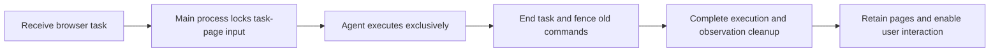
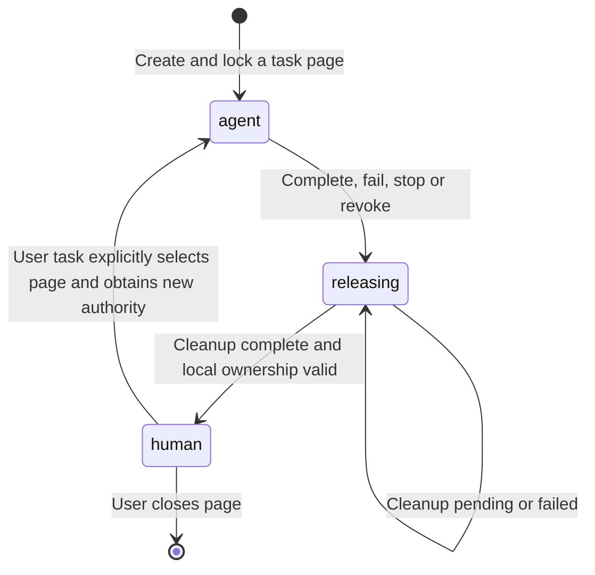

# SparkX embedded browser read-only execution and handback after completion

> Language: English | [简体中文](../zh-cn/docs/desktop-browser-interaction-control-design.md)
>
> Date: 2026-11-13. Status: source implementation and isolated macOS native checks completed; not installed or deployed.
> Source baseline: `codex/sparkx-website-url-lookup` at `194da714`.
> Scope: the generic SparkX embedded browser, local Controller and Gateway workflow.

## 1. Decision and design chain

**While the agent operates, users can view the task pages. Once the browser task has ended and
execution cleanup has completed, retain those pages and allow user interaction.** This delivery
does not support concurrent agent and human interaction on a task page or add pause/takeover/continue controls.



Keep the current input shield, focus protection and read-only notice during execution. Afterwards,
unlock the existing page without recreating it as a personal page or losing live form state and
history. Preserve task provenance and conversation association; the main process grants user capabilities.

The lock covers only this task's pages and execution-owned popups. Conversation switching,
viewing other tabs, panel collapse/widen and the existing Stop action remain available. Unrelated
personal pages keep their behavior. Input attribution, edit-conflict revisions, focus/viewport
cooperation and generic pause/resume checkpoints are outside this delivery.

The [Controller design](desktop-embedded-browser-controller-iscp-design.md) remains the baseline for
ISCP, authorization, journals and unknown-write protection. This proposal replaces the earlier
shared-interaction design with a narrower relationship between input rights and page lifetime.
Preserve pages, menus, layout, styles and address drafts; add no permanent technical status panel.
InfiniCenter, mail business flows, provider scripts, AI chat export and new remote CDP/LAN paths are out of scope.

## 2. Reference research and its limits

The earlier reference research is retained below. Codex shared interaction is not a product
requirement for this delivery; section 1 defines the exclusive-operation decision. Separation
of ownership and lifetime, and cleanup after execution, remain useful. Shared-input and
structure experiments are not acceptance evidence for this SparkX feature.

The research examined the locally installed Codex app, bundle `com.openai.codex`, version
`26.1106.51428`, build `26605`, and the human-assisted IAB test on 2026-11-13.

| Evidence | Established behavior | Design consequence |
|---|---|---|
| Static analysis | Page association, `isBrowserUsePage`, `isBrowserUseActive` and `browserUseTabLifetime` are separate | Keep ownership, activity and lifetime separate |
| Static analysis | No general active-agent keyboard lock or webview `inert` policy was found; the agent cursor overlay uses `pointer-events:none` | Describes Codex only; SparkX explicitly retains its input lock during execution, and the static audit did not cover all native readers |
| Human test | Two mouse clicks, paste and individual keystrokes reached the page; later agent actions continued | Codex allows concurrent input; SparkX does not adopt that behavior in this delivery |
| Human test | Shared field changed `AGENT-A → HUMAN—B → AGENT-C` | Codex did not protect this field from later overwrite in this test |
| Human test | Agent heartbeat clicks pulled the viewport toward their target and interfered with locating the shared field | Shared input needs additional coordination, which is outside this delivery |
| Human test | Of 30 additional clicks, 2 ran; the count stayed at 32 about a minute after explicit stop; the turn was interrupted | Stop can prevent subsequent actions; this is not proof of atomic cancellation of already dispatched commands |
| Bundled API | `markHandoff` preserves a temporary tab for a later turn; `markDeliverable` preserves output | Retention is not transfer of control |
| Bundled API | `requestUserTakeover` is a Cloud Browser operation; it and `requestManualHandoff` list IAB as unsupported by default | Does not establish IAB takeover support; this delivery adds no pause/resume protocol |

An independent IAB takeover entry and simultaneous keystroke collision were not verified.
Some annotation/editing helpers are restricted during agent activity; this does not establish
a restriction on ordinary website input. Initial IAB unavailability was followed by successful
testing; its recovery cause is unknown. The first stop trial had already finished and is not
evidence of cancellation. Attribution used human confirmation, dedicated controls, tool calls
and event order, not `isTrusted` alone.

Static sources are `app.asar` under the local app's `Contents/Resources`, particularly
`.vite/build/early-bootstrap-615-24f1d3fc72897a7a.js`,
`webview/assets/async/514766.2d2f1ddc86.js` and `.vite/build/browser-page-preload.js`.
Bundled documentation is under `plugins/openai-bundled/plugins/browser/docs/`, in
`api.json` and `tab-cleanup-iab.md`. These are version-specific observations.

Private test evidence remains at
`~/Documents/Codex/2026-11-13/mac-codex-iab-agent-agent-iab/outputs/` and is not copied into the
repository. The initial input/stop test's temporary page and server were removed; pre-existing
tabs were preserved. The later structure/navigation test's final results and separate cleanup
record are in section 2.1.

| File | SHA-256 |
|---|---|
| `iab-test-summary.json` | `a0d1f8099a41b65cc5dbafb9949d72e3d4941a40e21f5f8b57475000f0a3c758` |
| `iab-events.json` | `39da74013f58df8a48ab4d8b3937663cc3e0bc9d3329980fdb8a56688aee5f30` |
| `iab-stop-audit-2.json` | `913cc46a821d392b4a5f5d8f11fdc48cbf2e417ed9f37139c96dfe7cb017aa59` |
| `iab-stop-observation.json` | `79634c2dd3dc149745417a07f4a2dbe2d29a8c2ed1e617f7d0ba982c7d45cd54` |

DeepSeek Harness is a secondary reference for
[session resource ownership and serialized execution](https://github.com/deepseek-ai/deepseek-harness/blob/e8f7b93a344964de3dca1ace9e72b6e4d6de87cb/packages/experimental/browser-use-runtime/src/index.ts).
Its reservation mechanism is not the default user-input policy for SparkX.

### 2.1 Completed structure and navigation follow-up

This follow-up uses the same Codex version. In A1/A2 a human control scheduled a DOM change
12 seconds later; the original click began about 1.4 seconds before the actual change. No automatic error
recovery script was prepared. Times below are on 2026-11-13 in Asia/Shanghai (UTC+08:00); the
JSONL sources store UTC.

| Case | Command and page event order | Supported conclusion |
|---|---|---|
| A1 Equivalent target rebuilt elsewhere | Original same-name `getByRole` click began 17:04:35.780; old node removed/new node created 17:04:37.181; new node clicked 17:04:37.288; original command succeeded 17:04:37.505; model `domSnapshot` began only at 17:05:00.640 | The locator resolved the new node within one call; success did not require a prior model-level full-page reread. The task continued |
| A2 Original name disappeared | Original click began 17:07:12.202; old target removed 17:07:13.602; command failed 17:07:15.228; model explicitly called `ax.get` at 17:07:21.762, then `ax.click` on new index 23 at 17:07:32.491; replacement received the click at 17:07:32.518 | One operation failed. The model chose to reread and recover; the task was not stopped. This is not a client guarantee of automatic replanning |
| B Same-tab, same-origin navigation | Human-triggered `/nav-start → /nav-dest` committed at 17:13:02.586; new document loaded at 17:13:02.624; model explicitly called `ax.get` at 17:13:57.489, then clicked fresh index 14 at 17:14:12.897; the page recorded success at 17:14:12.931 | The task continued after the model read the new URL/document/target; no client-initiated task interruption was observed. Navigation occurred between calls, not during an old-page click |

A2's complete error was:

```text
Error: Error: Playwright selector deadline exceeded
waiting on click for selector internal:role=button[name="确认目标 A2"s]
Locator diagnostics: {"kind":"no_matches","action":"click","locator":"internal:role=button[name=\"确认目标 A2\"s]","matchCount":0,"matches":[],"visibleCount":0,"truncated":false}
```

The earlier approximately three-second disabled-control timeout occurred before the human
mutation and is not evidence that a DOM change caused failure. A1's replacement was defined as
equivalent by the test; matching an arbitrary button name does not establish business equivalence.
These IAB semantic-locator observations do not establish SparkX opaque snapshot-ref behavior.

B's navigation occurred after read-only command 30 ended at 17:12:55.382 and before scheduler
command 31 began at 17:13:03.773. The old-page click was never issued. The new document did not
contain the old document's trigger log, so scheduler 31 returned `waitingForHuman`; this was a
test-scheduler limitation, not evidence that the human had not navigated. Command 32 and page
events established the new document, and commands 33–34 acted on and verified it. The destination
remained inside the admitted test scope, so continuation did not require a new user grant.

The A1/A2/B follow-up is complete. Navigation colliding with an in-flight old-page operation,
stale AX-index reuse, cross-origin navigation and general business pages remain untested. Some
click errors occurred after about three seconds despite a requested 45-second timeout; the
reason was not established. Do not infer a universal timeout or automatic recovery guarantee.

Final evidence in the same private directory: `iab-structure-report.txt`,
`iab-structure-summary.json`, `iab-structure-commands.jsonl` (A1 IDs 14–15, A2 IDs 20–23, B IDs
30–34), `iab-structure-page-events.jsonl`, the three `iab-structure-a1-result.png`,
`iab-structure-a2-result.png`, `iab-structure-b-result.png` screenshots and retained fixture
`iab-structure-fixture.py`. Test tab 3 was closed, original tab 1 preserved, the server exited,
ports 60715/60741 were confirmed closed and temporary work sources removed. Evidence remains in
`outputs`; no client configuration, permissions, installation or business pages were changed.

| Final follow-up file | SHA-256 |
|---|---|
| `iab-structure-report.txt` | `586deb9db1769c6aa0ab51648ebc80023cbacfea2db998ac6a65f278128aae90` |
| `iab-structure-summary.json` | `3a12774f5c4b943ed8858970b9ac94097055843ba95e9e6dc95f5cf985e1b512` |
| `iab-structure-commands.jsonl` | `41ca3a932845d221ddf2a561342cc0359e442dc7de78686e525574f34c5036d0` |
| `iab-structure-page-events.jsonl` | `01763735d9b5859e19d2eace73e57e0d444890fcb70f4b78fad28289845af7db` |

## 3. Current implementation and required changes

| Boundary | Baseline behavior | Change in this delivery |
|---|---|---|
| `BrowserPanel.tsx` | Task role shows a read-only notice; navigation and close require personal role | Keep execution read-only; enable existing entries from main-process capabilities after completion |
| `presentation.mjs` | `showTask` keeps the native input shield and redirects focus | Derive shield and focus protection from execution state, not permanent task provenance |
| `page-registry.mjs` | Task role blocks keyboard/context menus; new connections can adopt a retained conversation page | Separate provenance from current input rights; prevent automatic adoption of human-retained pages |
| Controller/forwarder | Single lease, serialized commands, journals and unknown-write fences | Keep execution mechanisms; combine browser-task termination with local cleanup for handback |
| Registry/adapter cleanup | Normal release retains only the selected page; `closeConnection` destroys attached pages | Unify retention/destruction policy and detach retained pages/popups before connection cleanup |
| Owner browser services | Some navigation, download and permission operations require personal role | Apply local capability checks to handed-back task pages without changing provenance or authority |

Retain document/frame checks and unknown-write protection. Per-field revisions for shared input
are not required for this delivery; do not relax existing Controller failure or retry rules.

## 4. State and handback conditions

The following is the proposed local contract. The main process owns page input and lifetime;
the Gateway supplies authenticated browser-task lifecycle facts; the renderer displays state and capabilities.

| State | User interaction with this page | Agent access | Entry condition |
|---|---|---|---|
| `agent` | Page input and mutating navigation/close actions disabled | Only with valid execution authority | Task input lock established; includes authorization preparation, execution and tool gaps |
| `releasing` | Still disabled | Reject new commands; only settle receipts and clean up execution | Task terminates or local authority revokes this execution |
| `human` | Actions allowed by current identity and page policy | No reads, writes or ongoing capture | Termination and cleanup complete; page can be retained |



Destroyed pages and pages that identity policy requires hiding or clearing do not become
interactive `human` pages. Existing protection rules take precedence.

All of these conditions are required for handback:

1. **The browser task has ended.** Use an authenticated workflow terminal fact or confirmed local stop/revocation, never assistant prose, one tool result or a timer.
2. **Old execution is fenced.** Queued commands are rejected; old leases/bindings cannot dispatch again; old processes/adapters cannot access the page.
3. **Cleanup is complete.** Owned in-flight execution has ended or been isolated, debugger/capture associations are revoked, and unpublished old observations are discarded.
4. **The page remains usable by the current identity.** It is alive, locally owned and allowed by URL and other page policies.

Model thinking, tool gaps, approval waits, recovery from one failed tool, and temporary Controller
release do not independently cause handback. Keep the page read-only while the workflow may
access it again. This delivery hands back at the end of the browser task, with no brief unlock between steps.

Cleanup proves that the old agent cannot operate again; it cannot retract website requests,
page scripts or server-side effects already started. Retain unknown-write records. They do not
block manual browsing after cleanup or permit later automatic agent retries.

## 5. From execution to user interaction

### 5.1 Begin execution

The main process validates ownership and enters `agent` before granting Controller page access.
The shield, native keyboard/context-menu restrictions and IPC checks must change together;
disabled renderer buttons alone are insufficient. For an explicitly selected retained page,
change execution authority and input admission in one local transition. Close existing page menus
and pending permission requests, finish active editing gestures, then observe afresh before the first agent action.

New tasks default to new task pages. Reuse requires the user's task instruction to explicitly
select the retained page. Conversation identity, visibility or a bookmark does not authorize
adoption. New execution uses fresh authority and observations, with no old references, action queue or approval-target bindings.

### 5.2 During execution

Keep the task page read-only. Block user clicks, typing, paste, IME, scrolling, drag/drop, page
shortcuts, context menus, back/forward, reload, address navigation and closing the task page.
Old UI, shortcuts and direct IPC requests must not bypass the main-process check.

Users may still select the page for viewing, switch conversations/tabs, operate the panel and
stop the task. Background execution must not select a foreground conversation. Popups owned
by this execution inherit the input lock and cannot become a concurrent human input route.

### 5.3 End execution and hand back

1. Bind the terminal reason to the exact conversation, task, page group and execution generation. Reject further commands for that execution and enter `releasing`.
2. Cancel queued work and settle in-flight operations or retain unknown receipts. Revoke Controller/adapter access and capture. Output delivery ending is not proof of browser cleanup.
3. Retain task pages already presented to the user, result pages and associated popups still needed. Remove unpresented disposable temporary pages. Detach retained pages from the connection's destruction set before later exit callbacks can destroy them.
4. Release the installation-wide Controller slot only after actual cleanup, and transition eligible retained pages to `human` under section 4. Cleanup failure keeps the page read-only and the slot occupied; do not report successful handback.
5. Publish capabilities from the main process. The existing BrowserPanel removes the read-only notice, shield, focus redirection and affected disabled states. Keep the native page/history; do not reload to implement handback.

Late responses may settle their original receipts but cannot reattach the Controller, replace
new task state or lock a handed-back page again. Terminal events and cleanup callbacks are
idempotent; stale task/generation events cannot change new execution.

## 6. Termination reasons and boundaries

| Situation | Required behavior |
|---|---|
| Normal completion | Hand back result pages after cleanup; user actions do not rewrite task evidence |
| Recoverable tool error | Keep input locked while the task continues; no handback between retries |
| Task failure or user Stop | End execution and retain usable pages after cleanup; Stop remains terminal |
| Manual login/captcha required | End current automation and clean up before allowing manual input; do not permit login input beside a live agent |
| Continue after login | Reuse only an existing supported explicit-confirmation flow; lock again, obtain fresh authority and observe. Add no generic pause/resume protocol or automatic login-success continuation |
| Transport loss or Controller exit | Revoke locally and clean up; hand back eligible pages for the same identity; reconnect does not adopt them automatically |
| Lock, revocation or identity change | Follow existing hide/clear/destroy rules; handback or role changes cannot bypass identity checks |
| Stuck cleanup | Remain read-only and retain the slot; use the existing notice area only when user action is needed |
| Renderer restart | Obtain authoritative state again; grant no interaction by default or from stale UI cache |
| Main-process restart | Restore only safe bookmarks under existing rules and verify old execution cannot access them before handback; no old authority, unsaved DOM/form or history-stack restoration promise |

An existing login flow that cannot meet handback conditions remains explicitly blocked; it
must not expose concurrent input or claim supported continuation. These rules require no new durable pause state machine.

## 7. Browser capabilities after handback

| Capability | Requirement |
|---|---|
| Click, edit, scroll and select | Work directly in the retained native page without requiring `personal` provenance |
| Back/forward, reload and address navigation | Use existing controls and URL policy on this page; do not accidentally create a personal page |
| Close and unsaved forms | Respect `beforeunload`; canceling close retains the page and its contents |
| Context menus and page shortcuts | Use existing personal-browsing capabilities while preserving application shortcut priority |
| User-created popups | Work without an active Controller, retain provenance/conversation association and grant no implicit agent access |
| Downloads and site permissions | Check current local capability, page and origin; handle each download through one ownership path; do not automatically upload human files as agent artifacts |
| Page dialogs | Follow normal browsing behavior in the user phase; no stale automation listener dismisses them |
| History and results | User navigation updates browsing history/safe bookmarks; verified task evidence stays immutable |

Store task provenance, conversation association and input rights separately. Changing task to
personal is not an authorization shortcut. Handback does not expose the page in subsequent
agent target lists; reads and screenshots also require fresh authority. Already-started downloads
finish under their original ownership and resource limits, without reclassification at handback.

## 8. Implementation boundaries and contracts

| Layer | Responsibility | Main files |
|---|---|---|
| Workbench | Consume capabilities in existing components; preserve notices, navigation, menus and panel interaction | `apps/webchat/src/desktop/BrowserPanel.tsx`, related types/preload |
| Main process | Authoritative state, input admission, capability checks and trusted terminal association | `apps/desktop/src/main/desktop-capability.mjs`, `presentation.mjs` |
| Pages/services | Retained-page detach, native input restrictions, popups/dialogs/downloads/permissions | `apps/desktop/src/browser/page-registry.mjs`, `adapter-server.mjs`, `electron-chrome-api.mjs`, `main/owner-browser-services.mjs` |
| Execution | Revocation, in-flight settlement, cleanup completion, slot release and unknown-write protection | `controller-forwarder.mjs`, `controller-runtime.mjs`, `controller-admission.mjs` |
| Gateway | Authenticated terminal facts for this browser task; preserve existing task/login/approval flows | `internal/browserhost/client_controller_host.go`, existing workflow and browser login modules |

Fix three small contracts before implementation:

1. **Capability projection:** stable page/group association, interaction state, control revision and allowed user actions. The main process derives permissions; the renderer cannot supply trusted identity or unlock itself. Use existing registration points and strict schemas.
2. **Task termination association:** bind reason to current Owner/Client/installation/conversation/task and execution generation. Record termination separately from local cleanup. Reuse lifecycle events and add missing fields at their existing contract registration point; add no generic pause/resume operations.
3. **Cleanup policy:** enumerate retained pages and destruction conditions for completion, failure, Stop, disconnect, exit and revocation; use one termination/detach path.

Keep existing leases, generations, operation journals and conversation-scoped unknown-write
fences. Task-lifecycle input locking survives a temporary absence of a lease; unlocking input does
not clear journals. Persist only necessary provenance, retention associations and safe bookmarks,
never live authority. Gateway Store changes must cover memory, file/Snapshot and PostgreSQL.

Capabilities must match end to end. Without trusted terminal facts or local cleanup guarantees,
keep the existing read-only behavior and preserve disabled entries. A new renderer cannot unlock
on its own. This proposal does not authorize installation, deployment or changes to the current user profile.

## 9. Delivery sequence and acceptance

| Phase | Scope | Delivery gate |
|---|---|---|
| P1 Lifecycle and cleanup | Fix terminal/cleanup/capability contracts, separate provenance/input rights, unify retention and prevent automatic adoption | Keep current read-only behavior; old commands fenced, no unlock between steps, exit callbacks preserve retained pages |
| P2 Interaction after completion | Enable capabilities in existing components and main process together; connect navigation, close, menus, popups, downloads and permissions | Unlock only after cleanup; preserve native pages and UI; every execution-time input route remains blocked |
| P3 Boundary validation | Stop, failure, disconnect, restart, login blocking, old peers and late messages | No revived authority or replayed unknown writes; eligible result pages remain usable |

| ID | Scenario | Required result |
|---|---|---|
| A01 | Mouse, wheel, keyboard, paste, IME and drag/drop during execution | No human input reaches the page; existing shield/focus protection work |
| A02 | Tool gaps, approval waits, temporary lease release and retries | No false termination or transient unlock |
| A03 | Click/edit/scroll/navigation/history after normal completion | Same native page is interactive; task provenance and conversation remain |
| A04 | Terminal fact arrives before delayed/failed cleanup | Keep input locked and the slot held; unlock only after successful cleanup |
| A05 | Stop with queued/in-flight commands and late responses | Old execution cannot continue; unknown receipts remain; handed-back pages are not reattached or destroyed |
| A06 | Multiple tasks, popups and existing retained human pages | Running pages/task popups read-only; unrelated human pages usable; no automatic retained-page adoption |
| A07 | Address bar, shortcuts, menus, close and direct IPC | No execution-time bypass; existing entries work in human mode; canceled `beforeunload` preserves page |
| A08 | Downloads, permissions and page dialogs | One ownership path; no leftover automation handlers interfere with the human phase |
| A09 | Manual login/captcha | Cleanup precedes input; no old agent reads/screenshots/ongoing capture or automatic continuation |
| A10 | Disconnect/reconnect/restart/lock/revocation | No revived authority or identity bypass; safe bookmarks restored under existing rules |
| A11 | New task after user edits a result page | Original evidence unchanged; new page by default; explicit reuse locks, authorizes and observes afresh |
| A12 | Original UI and older peers | Conversation switching, collapse/widen, tabs and address drafts preserved; unsupported capability remains read-only |

Run registry/presentation/IPC/forwarder/cleanup and Gateway lifecycle tests, including real
main/preload/native Electron coverage. On supported Mac/Linux targets verify blocked input during
execution, usable input afterwards and preservation of the original UI. A document edit is not
product acceptance; section 2's Codex evidence does not establish SparkX implementation success.

## 10. Target flow using a real website

Consider “Open Apple's website, read its company introduction and summarize it.” Opening and
presenting Apple's website have prior validation. This real-site handback flow has not shipped or passed live acceptance;
section 11 records isolated native fixture coverage.

1. The Gateway receives the task and calls the local Controller over ISCP. The main process creates or binds a task page, locks input and then permits execution.
2. The agent opens, reads and navigates the site as needed. Users may watch but cannot click, scroll, type or reload; the existing Stop action remains available.
3. The workflow confirms the browser task has ended and local state enters `releasing`. Input stays locked during cleanup even if result text has already appeared.
4. After old commands and capture associations are cleaned up, retain the same page in `human`. Users may scroll, follow links or edit forms; the agent no longer accesses it.
5. A later user instruction to operate this page explicitly binds it, locks it again and obtains fresh authority/observations. Ordinary clicks and navigation do not wake the agent.


## 11. Source implementation and validation (2026-11-13)

The implementation reuses the authenticated execution lookup in `ExecutionClient`:
identity, request digest, authority session/revision and monotonic execution projection
are checked before publishing the terminal fact. Delivery/ACK and browser cleanup remain
separate. No new Gateway operation, Store schema or remote pause/resume protocol was added.

- `page-interaction.mjs` owns task-scoped `agent → releasing → human` groups. The existing
  role remains task provenance. Native presentation, keyboard/menu admission, IPC navigation
  and BrowserPanel controls consume main-process capabilities. Missing capabilities keep
  older task pages read-only.
- Temporary Controller release detaches the debugger but keeps the workflow group locked.
  Only the same still-running task and authority epoch may reacquire it. A new task creates
  a new page. There is no new explicit retained-page selection or login continuation entry;
  human pages cannot be targeted through conversation identity, visibility, tabs or bookmarks.
- Terminal, Stop and transport/Controller-loss paths fence old commands and discard cached
  observations. Native reads, CDP work and hidden capture hints must settle after detachment.
  Cleanup failure keeps input locked and admission occupied. A late response can settle its
  original receipt but cannot publish page data or change a replacement execution.
- Presented/selected result pages and owned popups survive cleanup. Human navigation, history,
  context menus, permissions and downloads use the original page. Close respects `beforeunload`.
  Task download teardown keeps the original bounded ownership; human downloads are not registered
  as Controller artifacts, and retired adapter download listeners are removed.
- `browser_view:` metadata stores safe human browsing bookmarks separately from verified
  `browser_page:` evidence. A separate `browser_ended:` marker fences the old task after restart,
  including when its page is not selected. A fresh restored view
  gets no lease, CDP target or old form/history state. Explicit close suppresses restoration;
  lock/revocation still clears live task pages.

Validation uses Node 26; WebChat tests use `NODE_OPTIONS=--no-experimental-webstorage` to
avoid Node's global Web Storage shadowing jsdom. Final desktop serial tests passed 659
with one skip; WebChat passed all 600 tests in 93 files. WebChat build, workbench/Controller
contract checks and the 148-document bilingual/link check passed. The opt-in native regression runs with:

```sh
npm run build:client-controller
npm run build:local-preview
SPARKCLAW_LAYOUT_HANDBACK=1 npm --workspace @sparkclaw/desktop run test:browser-layout
```

On macOS ARM64 this exercised the original component/CSS, real preload/IPC, sandboxed native
views and the actual Controller/adapter process against an isolated HTTPS fixture. It verified
execution-time keyboard/direct-IPC denial, no unlock on temporary release, preserved page ID
and form value, human typing/navigation/history, canceled `beforeunload`, new-task isolation
and Stop with completed process cleanup. The existing 48 layout and 12 task-page layout cases,
conversation draft, panel collapse/widen, modal occlusion and renderer recovery also passed.
The authority is synthetic; this is not production ISCP, an installed-client rollout, a Linux
native run, or full OS-level mouse/wheel/IME/drag coverage. No installed profile or production
service was changed.

The focused Gateway browserhost/ISCP-workbench/execution suites and Go build/vet passed.
Full Go testing on this Mac retains failures in three Linux memory-workspace tests (`/dev/shm`)
and a path-sensitive `TestReadyzProjectsFiveResidentServicesAndLatestCallStatus` assertion that
rejects the word `private` in `/private/tmp` paths; the Go source is unchanged.
Initial native attempts exposed fixture prerequisites (missing local-preview build), invalid
fixture endpoint basenames and a non-cloneable JavaScript fixture return; these were corrected
before the passing run. Desktop full-suite timing-sensitive mail tests failed under load;
they are recorded separately from the browser regression results.
