# Client-embedded Browser Controller over ISCP

> Language: English | [简体中文](../zh-cn/docs/desktop-embedded-browser-controller-iscp-design.md)
>
> Date: 2026-11-09. Status: implementation in progress. Local Mac assembly/lifecycle evidence is
> recorded in §14; production ISCP integration and P0–P4 acceptance remain open.
> Owner decisions D1–D3 are retained in §12.
> Source reviewed: `main` at `e031a453` (initial proposal); browser/ISCP/desktop implementation
> baseline remains `b5c21e14`. This is SparkClaw-local work, with no project-cluster coordination.
> Scope: generic browser automation in SparkX through ISCP. Mail, provider scripts and AI chat
> export retain their current paths.

## 1. Decision

Move the generic Browser Controller and Playwright MCP into each SparkX package. Carry the
Gateway–Controller boundary over the existing authenticated ISCP device session:

```mermaid
flowchart LR
  G[Gateway browser tools] --> S[ScopedAdapter: trusted task scope]
  S --> H[ClientControllerHost + PlaywrightExtensionAdapter]
  H --> C[ISCPControllerClient]
  C <-->|browser.controller.*| F[SparkX main: forwarder + journal]
  F -->|private Unix socket| B[Packaged Controller]
  B --> M[Local Playwright MCP]
  M --> A[Local Electron adapter]
  A --> V[Task WebContentsView debugger]
```

Reuse the Controller execution contract, Playwright operations and Electron isolation core.
Explicit adaptations are required at the scope/presentation boundary, process assembly and
lifecycle; “reuse” does not mean these files can remain byte-for-byte unchanged. The backend
acquisition Controller and its Unix socket remain independent.

Each **Controller request** crosses ISCP once, excluding chunk retrieval. A public browser tool
can issue several Controller requests: opening, reading, snapshotting and stable-state waits
already do so. Measure the full tool latency rather than assuming one round trip per model tool.
CDP stays local: tunnelling it would add many serial round trips and expose a much broader remote
execution interface. No remote JavaScript, CDP, selector or Playwright-code API is added.

## 2. Source baseline and gaps

| Boundary | Current source fact | Required change |
|---|---|---|
| Backend acquisition | `AcquisitionAdapter` → `BackendHost` → `PlaywrightExtensionAdapter` → `browsercontrol.Service` → Unix-socket `HTTPControllerClient` | Keep this role and path |
| Client embedded | `Broker.ForScope` → `ScopedAdapter` → reverse `browser.command` → `BrowserHostAgent` → `native-page-commands.mjs` | Replace its executor and transport |
| Native executor | Eight page operations; at most 120 controls; DOM click; no equivalent frame/popup support; 39 KiB capture limit | Qualify the shared MCP semantics, without assuming all click behavior improves automatically |
| Scoped adapter | Reduces arguments, synthesizes one-page lists, handles focus locally, has frozen-target settle rules | Preserve the public contract while forwarding complete validated tool arguments (§4.3) |
| Controller | One active generic session; `scriptFactory=null` accepted, but `controller.mjs` imports/constructs `MailObserverFeed` | Separate optional assembly without changing backend mail behavior |
| MCP module | `mcp-client.mjs` statically imports AI login/export modules | Extract/inject optional handlers so the client package excludes them |
| HTTP assembly | `http-server.mjs` statically imports the App-CLI protocol and exposes application/mail routes | Share bounded Unix-server primitives, assemble only the four client routes without that import |
| Electron adapter | Started only for Linux qualification in `main.mjs`; its task connection has no workbench conversation binding | Production startup on both platforms and a trusted local binding map |
| Page release | Host path retains the conversation view; MCP cleanup closes owned tabs | Preserve the existing retained view on normal release (§5.4) |
| Recovery | `HostJournal` and Gateway fences persist IDs/digests/states, not results; `browser.receipt` reads Gateway fences | Reuse those stores, extend admission/state handling; do not assume result replay exists |
| Wire/package | 63,488-byte operation budget; 30 s RPC; 25 s desktop deadline; Electron pinned to 44.4.3; Controller package declares Node `>=26 <27` | Qualify the packaged Electron runtime (proposal baseline Node 24.21), bounded transfer and cold start |

The [client/backend R3 design](client-backend-architecture-design.md) owns role separation.
The [desktop design](desktop-client-embedded-browser-design.md) supplies historical rationale;
this document governs the new client control hop. Source locations are listed in §13.

## 3. Scope

Included: macOS ARM64/x64 and Linux ARM64 packaging; production Electron adapter startup;
ISCP forwarder/client/service; the existing `browser.status`, `open`, `navigate`, `read`,
`snapshot`, `click`, `type`, `select`, `screenshot`, `wait`, `list_tabs`, `focus`, `close` tools;
client task-page presentation and recovery. The work2 colocated desktop is also a client (D3).

Excluded: `RunScript`, App-CLI, provider scripts, mail observers, QQ/Gmail/Outlook operations,
`OpenProviderLogin`, `ai_chat.export`, `ai_platform.check` and remote `tabs.handoff`. Existing
personal-page scripts/export features and backend mail acquisition stay on their current paths.
Exclusion from this package does not remove those existing product entries.

After P3, delete reverse `browser.command`, the native executor and LAN direct browser-host
transport (D2). LAN-only browser automation becomes unavailable; other LAN capabilities and
personal browsing remain as previously authorized. No fallback to work2's acquisition browser.

## 4. Gateway integration

### 4.1 `ISCPControllerClient`

Implement `browsercontrol.ControllerClient` for one exact ISCP session. `Acquire`, `Execute`
and `Release` map to their same-named reverse operations; the session service obtains readiness
through `browser.controller.status`. `Status` is not currently a `ControllerClient` method:
keep the probe on the new service/transport, without adding an unused backend interface method.
`RunScript`, `OpenProviderLogin`, `ValidateToken` return typed `browser_operation_unavailable`
locally. No Vault token crosses the network.

Extend `browserhost.ReverseSession` to name the operation; the underlying
`iscpworkbench.PeerSession.Command` already supports this. Every call is pinned to its original
session. A reconnect never retargets an in-flight command. Decode the same Controller result
schema after envelope and chunk validation, within the existing 10 MiB execution-response cap.

### 4.2 Session service and generations

One session-owned manager holds transport, readiness, leases and serialization; each task owns
its own Playwright adapter/snapshot state. Implement `PlaywrightController.Status/AcquireSession`
and `browsercontrol.Session` without the Vault-dependent `Service`. Avoid sharing a mutable
Playwright adapter across waiting tasks; that adapter currently rejects a different active scope.

The session credential generation is the positive, JS-safe `authorization_revision`; values
outside the representable range fail negotiation. Controller/session/page generations come from
the actual Controller result and are validated before advancing cached state. They are distinct
from the outer host `runtime_generation=iscp_<session ID>` and the desktop process/adapter
incarnation. A Controller restart invalidates its leases even when ISCP remains connected.

Keep the authenticated host-ID and authorization-digest derivation. An outer `Binding` is an
immutable ownership handle; Controller page generations and real page IDs live in its private
lease map. Never overwrite a Controller page generation with a host generation, or restore a
stale snapshot after reacquisition. Controller TTL is 10 minutes, matching the current adapter;
it does not renew device authority. Expiry invalidates the lease and refs. A later call may
acquire anew only after cleanup and unknown-write checks, with no replay of the old action.

### 4.3 Scope and tool semantics

`Broker.ForScope` resolves the authenticated installation to `ScopedAdapter(ClientControllerHost)`.
The scoped boundary continues to derive identity from the task, rejects foreign pages and checks
fences. Extend its internal typed forwarding path (the backend has an `incumbentCall` precedent)
so the client's Playwright adapter receives the original validated arguments. Do not send the
current lossy `ref/value` native-command projection into Playwright or trust model-supplied scope.

| Public behavior | Client implementation requirement |
|---|---|
| status | Local negotiated readiness plus a side-effect-free status probe; no page, subprocess or acquire created by reading status |
| open/navigate | Shared Playwright URL/tab rules; map only pages owned by this lease, including adopted task popups |
| read/snapshot | Keep read windows, snapshot identity, ref validation, auth evidence and generation checks |
| click/type/select | Keep shared argument semantics, including fill versus type/submit; journal each mutating Controller subcall |
| screenshot | Preserve image MIME and contents; use bounded transfer, without the native 39 KiB ceiling |
| wait | Keep frozen-target and bounded same-origin rebind rules; share settle logic and preserve all typed wait fields |
| list_tabs | No implicit acquisition when no task lease exists; thereafter project only task-owned pages, never connection/bootstrap pages |
| focus | Keep current client logical focus/explicit user presentation; never map to shared adapter `tabs.handoff` or change selected conversation |
| close | Preserve the current client close/release behavior; do not inherit the backend adapter's replacement-blank-tab workaround |

The common host interface remains role-explicit. Readiness, release, lease-active checks and
fence ownership must stay callable after old transport deletion. “Unchanged UI/tool semantics”
is an acceptance requirement, not a claim that today's `ScopedAdapter` already supports this.

## 5. Desktop packaging, process and page ownership

### 5.1 Reproducible package

Build `apps/desktop/bin/browser-controller/` from a versioned client-only manifest/lockfile and an
explicit transitive source list. Pin the current MCP `0.0.80` and Playwright / playwright-core
`1.63.0-alpha-2026-08-31`; run the existing download/adapter patch during build and verify its
patched-file hashes. Install with `PLAYWRIGHT_SKIP_BROWSER_DOWNLOAD=1`; exclude downloaded
browsers, `@playwright/cli`, App-CLI, provider scripts and userscripts. Do not run `npm ci` on the
backend manifest and prune it ad hoc.

Copy the tree outside asar to `resources/browser-controller`, and exclude `bin/browser-controller`
from both common and macOS asar file lists to avoid a second copy. Wire macOS package scripts and
Linux `package:desktop`, audit the unpacked tree, and record source revision, Electron/Node/MCP/
Playwright versions, patch hashes, file hashes and measured size in the release manifest. The
initial 20 MB figure is only an estimate. A broken manifest makes this capability unavailable.

### 5.2 Assembly and runtime qualification

Add `tools/browser-controller/src/client-main.mjs`: fixed profile `client_embedded`, MCP factory,
private Electron adapter and only health/acquire/execute/release HTTP routes. Extract optional
mail observer and AI handlers from core assembly; backend `main.mjs` injects its existing handlers,
client entry does not import them. Shared generic execution and backend contracts retain tests.
The existing HTTP server cannot be copied unchanged: its App-CLI decoder import must stay in
backend route assembly. Reuse bounded body parsing/socket helpers and install the four fixed
client routes. No second fork of Controller operations is introduced.

Use Electron's `process.execPath` with `ELECTRON_RUN_AS_NODE=1` for Controller and MCP, with a
minimal allowlisted environment, fixed entry/cwd/output paths and no inherited `NODE_OPTIONS`,
loader or browser/profile override. Build-time Node 26 compatibility does not qualify Electron's
Node runtime. P0 tests actual packaged macOS/Linux binaries, records `process.versions`, audits
used APIs and confirms that the app's signing/fuse configuration permits this launch mode.
If incompatible, stop this phase and record a revised packaging decision before implementation
continues; silently relying on a system Node or downloading it at runtime is not an option.

### 5.3 Process supervisor

State flow: `stopped → starting → ready/busy → stopping → stopped`; a start/integrity failure
reports unavailable. A lazy `stopped` process with verified files is available for acquisition;
status is not a successful business health check. First acquire coalesces a single start.
Create a random short private directory under a verified owner-only `/tmp/sparkx-<uid>` (0700),
reject symlinks/wrong owners and bind sockets as 0600 from creation. Check encoded path length
against the macOS limit. Tokens and adapter secret rotate at each start and stay in main/private
child configuration, outside renderer, remote pages, Gateway and logs.

Start the adapter on both production platforms. Qualification methods remain unavailable in
production. On task/session shutdown: stop admission, cancel queued work, revoke registrations
and debugger access, release the active Controller session, await MCP/Controller exit with a
bounded grace period and terminate remaining owned children, then remove runtime files. Socket
closure alone does not prove cleanup. Admission remains blocked while cleanup is unproved.
Controller/MCP crash invalidates its incarnation and in-flight writes; restart occurs on a later
acquire. ISCP loss, authorization change, lock or revocation invalidates the corresponding leases;
normal authority recovery does not resurrect them. Personal pages/profile data are not deleted.

### 5.4 Conversation ownership and retained views

Before forwarding acquire, main registers a one-use pending association from the local Controller
task token to `(owner, client, installation, local conversation, local task, host lease, ISCP
session, supervisor incarnation)`. The token is an opaque ID within Controller's 128-character
limit; it is not a truncated user ID. Adapter `registerConnection/openConnection` must consume
that association and bind the returned Controller session and local connection ID. A missing,
duplicate or stale association fails closed. Neither remote page input nor a model argument can
register a conversation. Revoke pending associations on timeout and cancellation.

Extend `PageRegistry` with this main-owned association. Task-created popups/frames inherit the
same connection allowlist; all real pages map to opaque public task page IDs. Bootstrap pages
stay hidden. Render through the existing `conversationPages`, page projection and presentation
hooks. Creating a background task page never selects its conversation or raises the window.

Normal task release retains the current conversation view, as `releaseHostPage` does today, while
removing all remote authority: revoke credentials, detach debugger/facade and drop lease/ref maps.
Implement explicit local begin-release/retain and acquire/adopt hooks; MCP's existing
`closeTaskPage` must not accidentally destroy the retained view. Cleanup of other owned task tabs
and connection pages still completes. A later lease can adopt the retained view only for the same
conversation after a fresh binding, and obtains fresh snapshot refs. Explicit close still closes
the requested task view. Crash, revoke and session-loss cleanup retain their existing protected
page behavior; they never turn a task page into a controllable personal page. Native tests must
exercise normal completion, explicit close and abnormal teardown separately.

### 5.5 Forwarder responsibility

Replace the reverse whitelist with exact registered operation names, never a wildcard prefix.
The forwarder validates schema, scope, digest, deadline and live authority, enters the journal
and maps to fixed local routes. Reject caller-controlled transport paths/hosts, tokens, scripts,
CDP and unknown keys. Navigation URLs remain allowed in typed `page.navigate` / `tabs.new`
arguments under the existing URL policy; “no arbitrary URL” refers to transport destinations.

Serialize Controller state-changing calls per lease; chunk reads/status do not enter that slot.
Move journal, fence refresh and reconcile ownership out of `host-agent.mjs` before deleting it.
Keep their existing IPC/UI projections. Do not couple release/reconciliation to acquire queue
capacity or require a working Controller to read an existing fence.

## 6. Wire contract, budgets and recovery

### 6.1 Request and response schema

New fields below are design contracts, not already shipped APIs. Each body uses `schema_version: 1`.
Task calls carry `command_id`, `digest`, `binding` (the full existing `browserhost.Binding`),
`timeout_ms` and the operation-specific fields below. `timeout_ms` is a positive budget at most
25,000; the caller's deadline can shorten it. `status` uses the authenticated installation/session
and no task binding. `chunk` uses that session plus the original binding and command/result IDs;
it cannot re-execute anything.

| Reverse operation | Additional input | Successful body payload |
|---|---|---|
| status | None | protocol `browser.controller.v1`, available/process state, supervisor incarnation, Controller generation when started, pinned versions and limits |
| acquire | `wait_timeout_ms` (0–30,000, further clamped to remaining budget), `session_ttl_ms` (1–600,000) | Controller `SessionLease`; forwarder fixes profile/lane/token/task token/credential generation |
| execute | `lease` (Controller lease), `operation`, `arguments` | Controller `ExecutionResult`, inline or via result descriptor |
| release | `lease` | Controller `ReleaseResult`; release identity is taken from the validated lease map |
| chunk | `command_id`, `result_id`, `offset`, `length` | matching IDs, offset, total bytes, base64 bytes; no mutable cursor |

Task replies echo `command_id`, `digest`, `binding` and supervisor incarnation, and contain
`outcome: not_dispatched | completed | failed | unknown`, optional typed `error_code`, and exactly
one of inline `payload` or `result` descriptor on success. The descriptor is
`{result_id, total_bytes, sha256, expires_at}` for immutable UTF-8 JSON bytes of the Controller
response. Missing/mismatched identity or malformed payload is never success. A chunk request
checks the retained result's scope, not whether its old page generation is still current.

Bodies reject unknown keys. `arguments` follows the shared MCP operation schema, at most 32 KiB;
the injected local Controller request must fit its 48 KiB limit and the remote message its
negotiated limit. Enforce both before journaling/dispatch. Public IDs retain their existing
bounds; only generated local Controller tokens use its narrower ID grammar. Tokens, profile,
lane and transport route are never accepted as free caller configuration.

Digest is SHA-256 of canonical `{operation: <outer ISCP operation>, body: <body with digest="">}`,
using the existing recursively sorted JSON/Go-compatible escaping rules. It covers binding and
budget as well as the inner execute operation. Add shared Go/JS vectors for Unicode, escaping,
arrays and safe integers. RPC IDs are transport-only. Each mutating Controller subcall has its own
stable command ID; no retry layer may replace that ID to bypass a fence. Reject conflicting
same-ID input before execution. Reserve a per-ID slot atomically before awaiting journal I/O;
`HostJournal`'s serialized file writes alone do not prevent concurrent duplicate admission.

### 6.2 Deadlines and queuing

| Budget | Rule |
|---|---|
| RPC | At most 30 s and bounded by caller context; no reset on reconnect |
| Desktop call | At most 25 s from receipt, including queue/start/execute/serialization |
| Navigation / action / explicit wait | Caps of 20 s / 10 s / 15 s, additionally clamped to remaining call time |
| Acquire | FIFO at desktop, at most 32 waiting requests per client; wait includes cold start; local Controller gets `wait_timeout_ms=0` after the slot is granted |
| Result assembly | At most 30 s from descriptor, also within the original caller's remaining deadline |
| Cleanup | Separate bounded cleanup budget (5 s grace before forced child termination); cleanup never permits continued remote input |

Queue expiry/cancellation removes the entry before it can acquire. Recheck task, authority,
incarnation and remaining time immediately before dispatch. Reserve cleanup/response headroom;
expiry cannot merely stop waiting on a still-running child. Late acquires are released and fenced,
not handed to a replacement session. Preserve the request deadline through acquisition: today's
Playwright adapter uses `context.WithoutCancel`; separate acquisition context from the longer-lived
session context in the client integration so it cannot discard this budget. One active task per
client remains D1; queue-full/wait expiry returns the existing `browser_busy` before dispatch.
On a dispatched call's deadline, cancel local work and revoke that lease's adapter access; if the
child cannot stop the operation, terminate its owned MCP execution before admitting another task.
Returning a timeout alone is insufficient. This cleanup does not close unrelated healthy ISCP calls.

### 6.3 Large results

The negotiated operation limit is at most 63,488 bytes. Measure the **entire encoded wire message**,
including wrappers/escaping; a 48 KiB inline payload is only a preliminary threshold. Larger
results use the descriptor. Accept at most **10 MiB per decoded Controller response**, including
JSON/base64 overhead; reserve **20 MiB total retained result bytes per desktop**, not the original
proposal's contradictory 8 MiB total. Reserve capacity before dispatch, with bounded streaming
response parsing and allocation accounting; no eviction of live results to admit a new write.
If unavailable, reject before dispatch with typed capacity failure. A response beyond 10 MiB
fails explicitly, never truncates or silently changes format.
The large-result reservation applies to execute. Status/acquire/release use bounded small
responses within the wire budget and no blob reservation; a full result cache must not prevent
release or read-only receipt/reconciliation. Temporary parse/base64 buffers also have bounded
allocation, with one execute and at most four chunks in flight.

Chunks carry at most **32 KiB raw bytes** (base64 ≈43 KiB); reduce to fit any smaller negotiated
limit and check the final envelope. At most four requests run concurrently, further limited by
negotiated capacity. Validate integer ranges, bounds, IDs, exact chunk lengths, final size and
SHA-256. Repeated reads of the same offset return identical bytes. Reject foreign-session IDs.
The whole result is parsed only after verification, never published as partial success.

Retain immutable bytes for 60 s from creation or until ISCP session ends/revocation; repeated
reads do not extend TTL. **Do not delete on “last chunk read”**: a lost final reply must remain
retryable. No extra result ACK operation is required. Expired results return typed unavailable;
reacquiring a result cannot repeat the original write. Separate action outcome from payload
availability: persist a verified completion receipt before fetching chunks; payload loss/hash
failure then reports result unavailable without claiming the action failed or replaying it.
MCP's existing 8 MiB output budget is a separate inner limit. P0 measures worst-case transfer
within both TTL and caller budget; format changes such as JPEG require an explicit contract
revision and image-quality acceptance, not an automatic latency workaround.

### 6.4 Durable outcome and reconciliation

Classify acquire/release and `page.click/fill/navigate/select/type`, `tabs.new/close` as mutations.
`page.info/read/snapshot/screenshot/wait` and `tabs.list` are read-only at this boundary. A public
read/snapshot that first navigates therefore still contains a separately journaled mutation.
Keep this classification in one shared operation contract, tested against Go and JS consumers.

| Observation | Durable handling |
|---|---|
| Proven refusal before local Controller dispatch | `not_dispatched`; no business effect claimed; retry only with current authority and no existing fence |
| Dispatch may have happened; response lost, malformed, cancelled or timed out | Gateway fence + desktop journal remain `unknown`; stop further mutations in affected task scope |
| Valid completed response | Persist `completed` before responding; release mutation slot; output transfer can still fail independently |
| Error after dispatch | `failed` only when structured evidence proves no effect; otherwise `unknown`, even for HTTP 4xx/5xx or a retryable Controller code |
| Duplicate ID/digest | Return stored state/live cached result when available; never re-execute; completed result missing is explicit unavailability |
| Restart with `dispatched` row | Load as `unknown`; preserve original ID/digest and installation scope |
| Owner reconciliation | Existing `observed_completed` / `observed_not_applied` action with matching digest; no automatic action replay |

Persist the Gateway fence before sending and `HostJournal.begin` before local dispatch; disk/full
capacity failure blocks admission. A journal finalization failure cannot yield success. Keep the
current content-free journal format and legacy rows, with no TTL deletion of deduplication
history. Empty receipt lists, 404, cache expiry and successful socket writes prove no outcome.
Generic status does not resolve a specific command. `browser.receipt` remains a **forward** query
of Gateway fences, not a reverse desktop result lookup. Reconciliation remains idempotent and
must settle both existing local/remote records before reopening writes. Manual reconciliation
uses existing owner-visible pages/personal browsing under current authority. If automated
observation needs a new acquire or navigation mutation, it stays blocked until the owner resolves
the fence; do not introduce a recovery flag that bypasses it or revives the old write lease.

## 7. Registry and negotiation

Use `services/gateway/internal/iscpworkbench/operations.json` as the registry and
`scripts/sync-iscp-operations.mjs` for projections. All new entries are v2, `browser.control`,
`business`, limit 63,488, no business HTTP mapping:

| Operation | Direction | `mutation` | Recovery |
|---|---|---|---|
| browser.controller.status | reverse | false | read |
| browser.controller.acquire | reverse | true | operation_receipt |
| browser.controller.execute | reverse | true | operation_receipt |
| browser.controller.release | reverse | true | operation_receipt |
| browser.controller.chunk | reverse | false | read |

`mutation` is a boolean in today's registry: execute must conservatively be `true`, not “per
operation”. The inner operation table controls read retries and write journaling. Registry
`operation_receipt` is a policy label, not proof of generic reverse durable replay; §6.4 provides
that behavior. Keep `browser.receipt` (forward, `browser.control`) and `browser.reconcile`
(forward, existing `browser.read` scope); do not silently widen or rename their scopes.

`browser.controller.v1` is the protocol value returned by status, not an invented ISCP operation
name or new Relay feature. Require all five registered operations in the authenticated negotiated
operation set and the expected status schema/limits. Update Gateway qualification/capability
projection and desktop surface dependencies together. Keep `capabilities.browser` and the Gateway
browser family as gates; probe availability on connection/use, not with a new permanent poll.
Bootstrap status is authorized by the negotiated session/operation scope, before enabling the
browser UI capability; it cannot depend on a process-ready browser flag that it must itself establish.
An old/mixed peer fails closed for browser automation while unrelated capabilities keep working.
Malformed app requests receive a typed rejection without destroying an otherwise healthy session.

## 8. Security and traffic boundary

Authorization is the existing device session; no new device grant, heartbeat, remote debugging
port or transport bypass. Before **every** queued dispatch/chunk, check owner/client/installation,
exact ISCP session, authorization revision, task/lease and relevant incarnation. Tokens, local
socket paths and connection credentials never appear in the remote schema or renderer IPC.

The Electron adapter restricts debugger targets to owned task pages/frames/popups and blocks
personal/workbench/foreign-task targets and global cookie access. Local audited MCP internals
may evaluate fixed page-reading logic; the caller cannot provide code through generic arguments.
Pin source/import closure and executable paths, reject runtime loaders and package escapes;
file hashes establish package integrity, not a new OS sandbox.

“Zero direct business HTTP/WS” means no Gateway-to-client control path or client-to-Gateway
business bypass outside ISCP. Local Controller HTTP over UDS, local Playwright extension loopback
WS and normal browser website HTTPS are expected. Acceptance records destinations and process
owners so those legitimate flows are not mistaken for bypasses. Blocking ISCP must make remote
control unavailable while personal browsing can continue under its existing policy.

## 9. UI preservation

Preserve original components, menus, layout, styles and interactions. Adapt underneath existing
browser panel/task tabs, explicit conversation selection, read-only task view, hide/widen controls
and reconcile actions. Preserve the completed conversation view and macOS close/Dock reopen
behavior. Workbench navigation/crash hides native views until a fresh explicit selection/bounds;
it must not grant a new Controller access to an old page.

Unsupported/temporarily unavailable automation keeps its original entry disabled. Busy tasks use
existing task activity presentation; no permanent technical status, transport chooser or new
simplified page. Failure/recovery text appears only when user action is required. Validate original
UI behavior as well as the new transport; functional tests alone do not establish preservation.

## 10. Implementation phases and cutover

| Phase | Work and exit evidence | Current status |
|---|---|---|
| P0 Feasibility | Actual packaged Electron Node/API/fuse checks; Mac adapter; generic MCP without optional imports; fixtures for frame/popup/ref/input/capture; cold-start and full-tool/chunk timings on Mac ↔ work2 | Pending |
| P1 Local runtime | Reproducible manifest, client entry, process supervision, association map, retained-view lifecycle; installed package runs local fixtures offline | Pending |
| P2 ISCP | Registry/projections, service/client/host, strict forwarder, journal/fence integration, chunks; isolated Relay failure-injection and no business bypass | Pending |
| P3 Native acceptance | Installed Mac and work2 Linux desktop through TEST1 to real work2; G1–G4 of the [ISCP expansion design](desktop-iscp-capability-expansion-design.md), §11 matrix, latency versus recorded old-path baseline | Pending |
| P4 Cutover | Paired Gateway + Mac/Linux packages, old-path deletion, verified rollback and retained-data checks | Pending |

Capture the old-path performance/UI baseline before deletion. P0–P3 may use isolated candidate
builds; production has no dual-path runtime selector. Publish/installation/deployment is outside
this documentation task and follows the owner's actual authorization at execution time.

P4 removes active `browser.command` registry/generated entries, `Broker` reverse dispatch,
desktop handler/native executor/`host-socket.mjs`, LAN host grant/connect/revoke/fences routes
and their dedicated grant/heartbeat machinery. **Keep** broker scope/receipt/fence services,
`HostJournal`, workbench IPC/reconcile UI, backend `BackendHost` and shared page/isolation helpers.
Move surviving helpers first; replace obsolete tests with new ownership/recovery coverage.
Delete LAN HTTP endpoints only after forward ISCP receipt/reconcile no longer depends on their
handlers. Active runtime/build references must be gone; historical docs/evidence need not be erased.

Rollout: stop new browser admission, drain active tasks, preserve unresolved fences and original
ClientStore/profile/installation binding, install matched artifacts, then qualify capability before
enabling it. Rollback: stop admission and children, restore the entire prior Gateway/client/helper
set and compatible receipt data, then verify original connection/UI. An old binary must not
reinterpret new unresolved writes as retryable; if compatibility cannot be proved, browser stays
disabled while a forward repair/reconciliation is completed. No data reset, new test identity or
per-command fallback substitutes for rollback.

## 11. Acceptance matrix and evidence

Every row is required evidence, currently pending. Record source/package hashes, architecture,
Electron/Node versions, fixture/provider, exact request IDs (redacted), expected/actual outcomes,
latencies and failure artifacts. Source tests, native fixture, installed package and live provider
are separate evidence scopes. Report failures and skips; do not turn an unavailable platform
into a pass.

| ID | Scenario | Required observation |
|---|---|---|
| A01 | Old/new peer and missing capability; LAN-only; Controller absent | Original entry retained/disabled, typed unavailability, no backend fallback; other features unaffected |
| A02 | Open/read/snapshot/fill/type/click/select/wait/capture | Same public schemas and actual page effects; stale ref rejection; redirects/frozen-target rules preserved |
| A03 | Iframe, cross-origin frame, popup, dynamic controls | Owned target scope, correct refs/effects, no personal/foreign target enumeration; unsupported cases explicitly block release |
| A04 | Two tasks/conversations, queue full/expiry/cancel, cold start | One active Controller session; no expired request starts later; no conversation switch; bounded queue and cleanup |
| A05 | Duplicate concurrent ID, changed digest, response loss, final journal failure | At most one execution; durable state/fence, no replay; fresh ID cannot bypass unresolved task fence |
| A06 | Controller/MCP crash, ISCP reconnect, Gateway/desktop restart, revoke/lock | Old generations rejected; pending writes unknown; no late admission or orphan process; personal data preserved |
| A07 | Inline boundary, escaped JSON, >39 KiB screenshot, 10 MiB cap, cache full/expiry | Final envelopes fit, correct size/hash/MIME; capacity refusal before writes; no silent truncation |
| A08 | Lost/duplicate/out-of-order final chunks, forged scope/offset/hash | Stable retryable bytes until expiry; reject corruption/foreign access; result loss never repeats completed write |
| A09 | Normal completion versus explicit close and abnormal teardown | Retained conversation view on completion, fresh refs on adoption, explicit close honored, old debugger credentials unusable |
| A10 | Original panel/tabs/select/hide/widen/reconcile; renderer crash; Mac Dock reopen | Original visuals, geometry and native interaction preserved; no permanent status additions |
| A11 | Installed offline package and process exit | No system Node/download dependency; all owned children/socket files cleaned; manifest/permission failures fail closed |
| A12 | Real work2 over TEST1, Mac and colocated Linux; blocked Relay | Correct device executes; no direct business HTTP/WS fallback; backend mail path and personal scripts remain operational |
| A13 | Paired upgrade/rollback with pending fences | Same installation/profile/data; old/new writes cannot escape reconciliation; obsolete active source references gone |

Run focused Go `browsercontrol/browserhost/browserautomation/iscpworkbench/gateway`, Controller
Node and desktop transport/journal/registry/presentation tests, registry projection check, package
audit and bilingual docs checks as their code changes land. Add backend mail/AI-handler regressions
for optional assembly extraction. Full repository checks gate implementation integration; this
documentation revision runs documentation/link checks only and establishes no native test result.
P0 timing records include sample count, cold/warm starts, full tool subcall count, payload sizes,
median/tail latency and chunk throughput; a single successful RPC is not an end-to-end benchmark.

## 12. Recorded owner decisions

Recorded on 2026-11-09; this revision does not add new owner approvals.

| ID | Decision | Consequence |
|---|---|---|
| D1 Concurrency | One active browser task per client; others queue at acquire | Preserve Controller's single-session model; bounded desktop admission and existing busy failure (§6.2) |
| D2 Old path | Delete after P3 | Remove reverse `browser.command`, native executor and LAN direct host as one cutover; retain journal/receipt/reconcile and existing UI (§10) |
| D3 Linux client | Work2 colocated desktop also uses packaged Controller through ISCP | Backend systemd Controller only serves acquisition; qualify and release the Linux client package alongside Mac |

P0 uncertainties are validation gates, not missing product decisions: packaged Electron runtime
compatibility, import closure, task-view retention and real transfer/whole-tool performance. A
failed gate requires a documented technical revision; it cannot be waived by marking the design
or a unit test complete.

## 13. Implementation ownership and source map

Paths are repository-relative; new names below are proposed, not present implementation.

| Area | Existing source / proposed addition |
|---|---|
| Client contract | `services/gateway/internal/browsercontrol/client.go`, `runtime_session.go`; proposed `iscp_client.go` and session-bound service |
| Scope, generations, fences | `services/gateway/internal/browserhost/adapter.go`, `reverse.go`, `fences.go`; proposed `client_controller_host.go` |
| Shared tool semantics | `services/gateway/internal/browserautomation/playwright_extension_{adapter,session,snapshot,settle}.go` |
| Transport integration | `services/gateway/internal/gateway/workbench_iscp_browser.go`, `internal/iscpworkbench/{reverse_session.go,operations.json,negotiation.go}` |
| Main ownership | `apps/desktop/src/main/{main,iscp-transport,iscp-capabilities}.mjs`; proposed browser Controller supervisor/forwarder modules |
| Page/journal lifecycle | `apps/desktop/src/browser/{adapter-server,page-registry,host-agent,host-journal}.mjs` |
| Controller assembly | `tools/browser-controller/src/{controller,mcp-client,http-server,electron-adapter-client}.mjs`; proposed `client-main.mjs` and client package manifest/lockfile |
| Packaging | `apps/desktop/package.json`, `apps/desktop/scripts/{package-macos,audit-package}.mjs`, root desktop build scripts |

Dependencies are P0 → local assembly/lifecycle → transport/receipts → native acceptance → deletion.
Keep mechanical optional-handler extraction separate from transport/behavior changes, and keep
backend acquisition tests green throughout.

## 14. Implementation checkpoint — 2026-11-09

The generic Controller/MCP core and Unix-server primitives are now shared by explicit backend
and client assemblies. The backend still injects mail and AI handlers. The client lockfile pins
only MCP, Playwright and Playwright Core. `build:client-controller` builds the private client
payload; Mac/Linux package entry points include it outside ASAR, and `afterPack` checks its
inventory, executable bits, pinned versions and manifest hash. No installer is released yet.

`ClientControllerRuntime` verifies files before lazy startup, uses Electron as Node with a fixed
environment, checks private short socket paths, and owns a separate process group with bounded
shutdown. The production-mode adapter accepts only a one-use main-issued task association.
PageRegistry supports explicit normal-release retention, fresh-lease adoption and logical tab
selection without foreground handoff. These components are exercised by the native fixture;
production `main.mjs` and Gateway routing are not switched at this checkpoint.

Local Mac ARM64 evidence uses Electron 44.4.3 / Node 24.21.0 / Chromium 152.0.7977.130 with a
disposable profile and `/usr/bin:/bin` child PATH. All 12 native checks pass: read/fill/click/select/
snapshot/capture; renderer sandbox; no system Node; iframe refs/effects; owned popup; normal
retention; fresh adoption; explicit close; crash revocation and child cleanup; new incarnation;
and clean stop. This is one source-runtime scenario, not installed-package or latency acceptance.

Initial failed attempts remain diagnostic evidence: `f1e2` frame refs were rejected by both JS
and Go parsers; a long macOS temporary path was rejected; an inactive popup displaced the retained
view; acquire navigated the adopted view to `about:blank`. The fixes preserve frame namespaces,
use the specified short path, track logical selection without activating a window, and omit
initial navigation only in the client assembly. Backend task-page creation remains unchanged.

Validation: Controller 358 passed / 151 skipped; desktop 632 passed / 1 skipped; focused shared
MCP, relay, association, package, runtime and page-lifecycle checks pass. Go browserautomation
passes with child-frame coverage. These counts precede full transport integration. Next gates:
ISCP contract/client/forwarder, durable duplicate fences, cancellation/queue/chunk limits, actual
Mac/Linux packaged acceptance, work2 through TEST1, and P3-gated old-path deletion.
