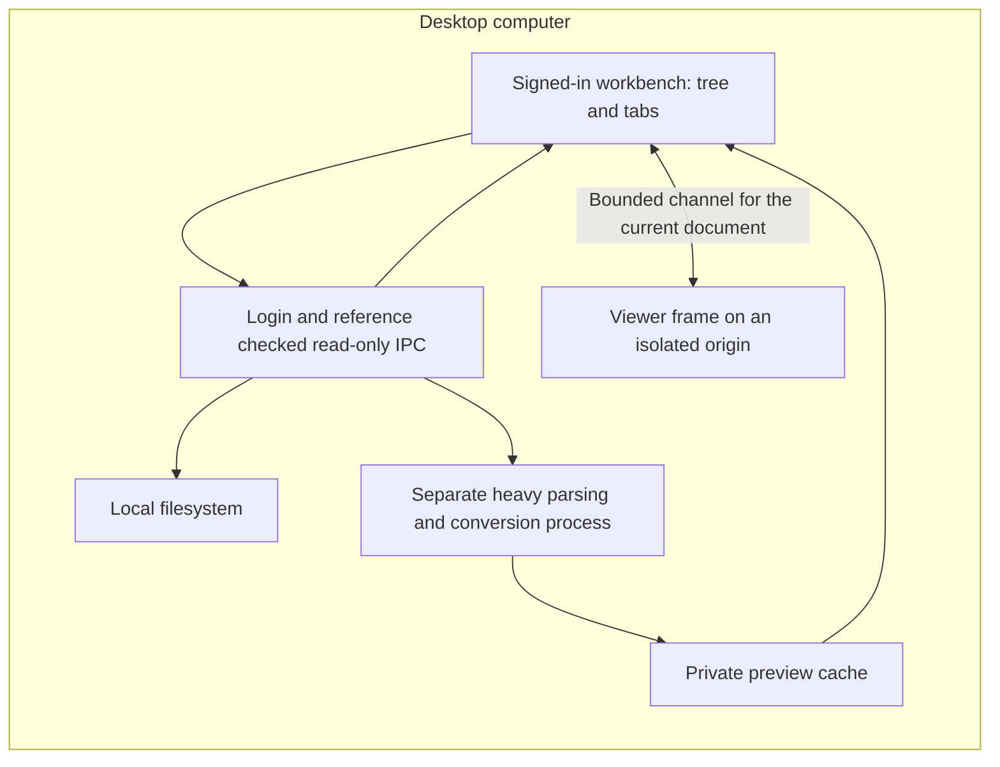

# SparkX Desktop Local File Browser Design

> Language: English | [简体中文](../zh-cn/docs/desktop-local-file-browser-design.md)
>
> Date: 2026-10-29. Status: final Mac arm64 installation and Linux arm64 artifacts use source `29623d86`, including the credential shutdown repair found during release CI. Sections 19–20 record acceptance and the two explicit owner exemptions; earlier sections retain historical evidence. Scope remains the read-only local client, Desktop/Documents/Downloads, the existing file tree, document tabs, and workbench UI.

SparkX will expose the computer's files through a read-only panel after desktop sign-in. Directory enumeration, file reads, document conversion, previews and caches stay on that computer. Opening a file does not attach it to a conversation or grant an Agent access. The Files entry and panel remain behind the existing desktop login gate; local processing does not make this an unauthenticated feature.

## 1 Scope and ownership

The [client/backend ownership boundary](client-backend-architecture-design.md) and [current workbench ownership](workbench-release.md) remain in force: non-mail documents belong to the originating client; the backend processes only explicitly supplied task inputs. The local browser adds a human-facing reader, not another Agent runtime or a shared backend workspace.

| Item | Decision |
|---|---|
| Directory names, absolute paths, file bytes, preview PDFs and reading state | Remain on the client; excluded from backend requests, model context and remote diagnostics |
| Existing disk files | Read in place; browsing does not import them into the conversation file store |
| Conversion intermediates | Private, bounded client-local temporary files; originals are never overwritten |
| Chat attachments and generated files | Keep existing ClientStore ownership and sending rules; may enter the same viewer through a separate read adapter |
| Agent access | No tool, prompt contribution, conversation event, attachment creation or task submission from browsing |
| Login and connection state | Require the existing desktop login gate; temporary outages after sign-in follow its existing identity-retention rules. Local processing does not use remote capabilities.files or add a remote authorization request for each read |

This scope replaces the earlier remote-Gotenberg/ISCP-preview suggestion. No new Gateway preview service, ISCP operation or remote conversion is part of this design. Existing backend document workflows remain unchanged.

The first implementation targets the existing Electron desktop distribution, qualifying macOS first and Linux separately. A normal WebChat page cannot enumerate its user's computer; it must not substitute a Gateway filesystem for this feature. Editing, annotations, Agent interaction, file deletion/rename/move, drag-to-chat, recursive content search and whole-disk indexing are outside this version.

## 2 Entry and panel interaction

Add a small folder icon immediately beside the existing Browser icon in the signed-in desktop title bar. Both the entry and panel remain inside the existing DesktopLoginGate protection; the login page exposes no Files entry. Reuse the existing icon button, typography, hover, focus and active-state styles. The accessible label and tooltip are Files; expanded state follows the visible panel. Preserve the original left sidebar, composer, browser controls and settings destinations.

The right-hand area presents one surface at a time: Browser or Files. A small coordinator manages visibility without replacing BrowserPanel or destroying its native pages. Switching to Files must hide the native browser surface as well as its DOM shell. Switching back restores its tabs, navigation and page state.

| Action | Result |
|---|---|
| First click on Files | Open the panel with a pinned Files tree tab |
| Click a regular file | Open a preview tab in the same panel |
| Open an already-open resource | Focus its existing tab; distinct same-name paths remain distinct |
| Return to Files | Restore expanded directories, selection and scroll position |
| Click Files while its panel is visible | Collapse the panel without closing its tabs |
| Reopen the panel | Restore the last active tab; do not reconvert every retained document |
| Close a document tab | Release that tab's reader and view resources; cancel shared work when its last reader leaves |
| Resize or expand reading | Follow the existing split/focus layout and native fullscreen behavior |

Illustrative layout, not a replacement stylesheet:

```text
Existing title bar                          [Browser] [Files]
Existing left sidebar | Conversation       | Files | report.pdf | data.xlsx
                      |                    | -----------------------------
                      |                    | Tree or active document preview
```

Use a single docked panel in this version. Do not import DSH's floating windows or multi-pane layout framework. Tree navigation supports standard arrow keys and Enter; document tabs support keyboard focus and closing. Escape first dismisses the topmost local popover, then collapses the panel and restores focus to its trigger. Do not take over existing global shortcuts.

## 3 Computer-wide tree

The synthetic root is This Computer, accessible after sign-in without an active conversation. Display only the local user's Desktop, Documents and Downloads, in that order. Do not add the home directory, filesystem root or mounted volumes as tree roots. Restore expanded directories only beneath those displayed roots. This is a navigation choice; the existing local file identity and read-only checks still apply to saved document tabs and explicitly followed links. Roots do not come from the backend workspace.

- Expand one directory at a time. Use incremental enumeration and continuation cursors; do not recursively scan the disk or read every child into an unbounded array before truncating the answer.
- Sort loaded entries with directories first and natural filename ordering. Keep the selected row and scroll anchor stable as batches arrive. Report a directory as complete only after enumeration ends; a large directory must remain reachable through continuation.
- Virtualize the list and bound cumulative entry/byte caches across expanded directories; virtualization does not replace a data budget. Use bounded local temporary page storage for revisiting and sorting the current enumeration, retaining only the visible window and adjacent pages in memory. Do not promise complete-directory ordering before enumeration finishes. Temporary pages count toward section 7's disk budget; at capacity, report an incomplete listing with narrow-scope/retry actions rather than claiming completeness.
- Bind cursors to login generation, directory identity, enumeration generation and hidden-entry/filter conditions. Refresh, condition changes, directory changes or volume replacement invalidate old cursors; old batches cannot enter a new listing. Adapt DSH DirectoryNode's coalesced invalidation with one enumeration per directory at a time. Under continuous changes, retain displayed entries and offer refresh instead of restarting automatically forever.
- Provide Refresh, Show hidden files and a clearly labelled current-directory name filter. The filter applies to the current listing and must not imply an indexed whole-computer search.
- Observe only expanded directories' direct entries and open files. Collapse/close releases watches; while the panel is hidden, coalesce invalidations without rereading, then revalidate when visible. A bounded watch budget falls back to manual refresh without hiding content.
- Permission failures belong to the affected node. Respect OS access controls; do not request administrator access or broad disk access automatically. Explicitly opening a protected location may invoke the normal OS permission flow.
- Display links as links. Following one is explicit, resolves its target locally and detects ancestor cycles; do not expand linked directories recursively by default. Revalidate the resolved file when opening it.
- Show special files, sockets and device nodes as unsupported. Do not read them as ordinary documents. Application bundles remain collapsed unless the user explicitly browses their contents.
- Represent cloud placeholders without implicitly hydrating them; tell the user when a file must first be downloaded through the OS. Show only locally available mount metadata for network locations, without enumerating remote directories or opening their contents. Unmounted devices do not trigger discovery or connection attempts. Resolved symlink and relative-image targets follow the same restrictions.

The tree represents the whole computer, but only OS-readable, locally available regular files qualify for content preview. Lack of permission never turns into an empty-success listing.

## 4 Local capability and process boundaries



Add an independent LocalFilesCapability and a narrow preload facade, provisionally named sparkclawLocalFiles. Do not broaden ClientStore's private attachment reader into an arbitrary-path reader: its identity scopes, owned-file checks and upload limits serve a different purpose.

| Proposed operation | Responsibility |
|---|---|
| roots | Return local root/shortcut metadata and opaque references |
| list | Enumerate one directory in batches with a local continuation token |
| stat | Return type, size, display path and a source version |
| readBytes / readText | Read bounded byte or text windows for a selected regular file |
| watch / unwatch | Observe a selected directory or open file, with bounded/coalesced invalidations |
| previewOffice | Produce a local preview from an authorized file reference and expected version |
| cancel / release | Stop work and release handles, watchers or temporary previews |

These are private application interfaces, not new public protocol operations. The UI adapter can accept AbortSignal; the preload maps cancellation to request IDs rather than trying to serialize AbortSignal through IPC.

Only the trusted workbench top frame may invoke the capability. Check sender WebContents, frame and application origin using the existing capability pattern. Embedded browser pages, document frames and Agent command channels receive no bridge. Preserve sandbox, contextIsolation, webSecurity and nodeIntegration=false. Never expose fs, a generic IPC sender or a shell command interface.

Every format viewer runs in a sandbox iframe on a separate `sparkclaw-preview://viewer` origin, outside the top-level React context that holds workbench bridges. This origin serves only bundled viewer assets and cannot map arbitrary disk paths. The frame has no business preload, native bridge, application credentials or workbench storage. Its sandbox permits only the viewer scripts and separate-origin facilities it needs, without top navigation, popups, forms or downloads; navigation back to the workbench origin is forbidden. Workbench CSP frame-src admits only this preview origin. Preview CSP and request interception reject remote connections, arbitrary file URLs and nested documents; PDF Workers and other assets load only from the package.

After validating frame source, message shape, login generation and document generation, the workbench establishes a dedicated MessagePort for the selected document. Allowed messages cover only bounded reads of that document, reading position and explicit user interaction, not arbitrary paths, directory enumeration, generic IPC or arbitrary network URLs. The viewer holds only a channel-local document identifier; the workbench/main process revalidates range and relative-resource requests. Navigation, refresh, close or loss of login revokes the port and rejects late responses. Relative-resource resolution, viewer crashes and cancellation cannot bypass this intermediary.

Main owns canonical path resolution and short-lived references. Distinguish local locators, actual file identity, source version, tab ID and request generation; bind references to the current login scope and generation. Tabs reuse locators, with distinct same-name paths remaining separate. Atomic file replacement or a changed symlink target invalidates the old version and marks the tab changed; reopening accepts the new version. A replacement volume cannot reuse an old reference solely because its mount path matches.

Validate reference ownership, type, permissions and file version for each read; compare descriptor metadata before/after a bounded read. A file changed during reading returns source_changed, and replacement responses cannot overwrite a newer tab state. Range reads stay on one verified source version; Office conversion uses a verified private input snapshot and content hash. Adapt DSH ResourceGroup to track document and local dependency versions and membership. Persistent tab state stores locators and reading positions, not reusable authority tokens.

The existing DesktopLoginGate and main-process verified local identity jointly enforce login; hiding the button is insufficient. Unconfigured, signed-out, conflicting-identity or verified-revoked states reject new calls and cached reads, close preview channels and cancel work. A later sign-in revalidates references. Previously signed-in users may continue local reading in reconnecting/service_unavailable states only where the existing gate permits it; there is no separate unauthenticated offline mode. The capability needs no active conversation and does not use remote capabilities.files. The application login gate does not alter OS file permissions.

## 5 Renderer choices

Use a small local registry mapping supported file types to lazy-loaded readers. The container owns resource identity, request cancellation and loading/error presentation; each renderer owns its format-specific controls. Check signatures/container type where applicable rather than trusting the suffix alone.

| Format | Selected approach | First-version behavior and limits |
|---|---|---|
| PDF | react-pdf with PDF.js | Continuous scrolling, initial fit width, selectable text and anchored two-finger pinch/pan on a white surface; retain completed frames and continuously rasterize visible detail while zooming. A transient bottom minus/percentage/plus control offers preset levels, with no page toolbar, slider or horizontal scrollbar. Bound rendered pages/pixels and cancel retired loads. Full-text search requires its own implementation and is not implied by installing the package |
| DOC/DOCX, PPT/PPTX | Bundled @deepseek-ai/libreoffice-kit to PDF, then the same PDF viewer | Static layout preview, missing-font feedback when available; no editing, slideshow animation or macro execution |
| XLSX | ExcelJS parser and FortuneSheet in read-only mode | Sheets, cell selection/copy, saved formula results and supported basic styles/merges; no recalculation, editing or source export |
| CSV/TSV | PapaParse and the same spreadsheet surface | Preserve literal strings, leading zeros and formula-looking text; quoted/multiline fields and encoding failures are explicit |
| Markdown | react-markdown and remark-gfm | Read-only formatted text; raw HTML disabled; local related images use a constrained resolver |
| Text/code | Bounded text view and lazy highlight.js languages | Wrapping, line navigation and copy; no editor commands or code execution |
| Raster images and SVG | Native image element with pinch/pan | Anchored gestures and a transient minus/percentage/plus preset control; no permanent zoom toolbar. SVG as an image, not inline executable markup; refuse automatic external resource loads |
| HTML and unknown files | Text/source view only when safely decodable; otherwise metadata and unsupported-preview state | No active HTML application preview in this version |

Legacy XLS is not included in the first table preview. If added, evaluate SheetJS CE through its official distribution as a separate adapter; do not silently convert it into a lossy table or claim ExcelJS supports it.

Keep original bytes separate from parser buffers. Before full ExcelJS parsing, check XLSX archive entry count and declared per-entry and total uncompressed sizes, then continuously count actual emitted bytes during bounded streaming decompression. Stop on exceeded limits, inconsistent sizes or unsupported container structures. Cover every entry, not only displayed worksheets; never decompress the whole archive before counting or trust ZIP metadata alone. Subsequent parsing uses the same verified input or bounded intermediate results and cannot reopen a changed source path to bypass checks.

Run XLSX and other heavy parsing, including Office, in a separate terminable worker process. Internal Workers are permitted, but their timeouts and cell counts do not cap decompression or process memory. Bound input bytes, cell-rectangle area and processing time, producing a bounded read-only model for the viewer; model storage and cross-process copies also count toward budgets. Show formulas literally and display saved values; explicitly mark a missing cached result unavailable. Do not recalculate. Detect and disclose unsupported charts, drawings, pivot features and conditional formatting instead of presenting a silently incomplete workbook as faithful.

FortuneSheet's read-only option is necessary but insufficient. Disable editing shortcuts, paste, deletion, drag fill, sheet mutations and write callbacks; independently verify formula-bar and clipboard escaping and worksheet switching. DSH maintains patches in these areas. Reproduce applicable failures against SparkX's React version before adopting narrowly scoped fixes; dependency peer ranges alone do not qualify the integration.

No renderer automatically fetches a remote image, stylesheet, font, hyperlink or file URL. Markdown relative assets resolve through the restricted channel, checking the actual resolved target against the document directory, file type, version, cloud and mount restrictions; a path-string prefix is not a boundary. Leaving that directory requires an explicit user action and a new document reference from the workbench. Keep rendered documents isolated from application credentials and native APIs.

## 6 Local Office conversion and packaging

Use the independently published LibreOffice kit, following DSH's local conversion pattern. The package provides native macOS engines and a Linux WASM engine. Qualify each shipped architecture; do not infer Linux behavior from a Mac test.

The desktop broker runs the kit in a separate terminable worker process. Linux WASM's Node Worker also lives inside that process, outside Electron main's failure scope. The broker creates a private temporary job directory, reads a verified input snapshot, passes only that snapshot and output location to the converter, validates the returned PDF, then removes intermediates. Original paths must not be reopened by an untrusted document or used as unrestricted conversion output paths.

Apply verifiable platform-specific filesystem and network isolation to the converter and its descendants: read-only access to the task snapshot, engine, authorized fonts and explicitly listed system runtime libraries needed for startup; writes only inside that task's temporary directory; no inherited workbench credentials or business channels. Disable macros, linked-resource fetching and automatic external refresh, and verify that network access and reads/writes outside the allowed scope are denied. Checkpoint 1 must establish the Mac and Linux isolation launch mechanisms separately. A private directory or a benign fixture making no network requests is insufficient evidence. If isolation cannot be established on a platform, retain the entry and disable its affected heavy previews rather than broadening workbench permissions.

Bundle the matched API, engine assets, PDF Worker and required viewer resources during packaging. Put executable/native assets outside ASAR as required, preserve permissions, and include the required license/notices/source-material obligations in the release preparation. No runtime download, system LibreOffice discovery or automatic remote fallback. Use installed local fonts; do not silently fetch missing fonts.

Package versions are candidates until exact installed-package tests pass. On 2026-10-29 npm reported kit 0.2.3 with Node >=22.19.0, and the darwin-arm64 engine declared 161,344,653 unpacked bytes, about 154 MiB. This is package metadata, not a measured SparkX installer increase or evidence of Electron compatibility. Harness source referenced an earlier kit range; match the tested API/engine set rather than mixing those versions.

Main costs are installation size, native signing/packaging, CPU/memory use and font-dependent fidelity. The renderer is not guaranteed to match Microsoft Office pagination or complex layout exactly. A missing engine leaves the file entry and other viewers usable, with an actionable preview-unavailable message.

## 7 State, caching and resource limits

Store browser state and preview caches in a distinct local profile area, scoped to the desktop login identity, not conversations, execution results or a remote-backed store. Browsing never adds a row to chat history or changes ClientStore attachment ownership. Adapt DSH's queue admission, input/output limits, shared conversions, eviction and cancellation cleanup, replacing its Host Remote/Session integration with local IPC and desktop lifetimes.

### 7.1 Admission, execution and cleanup

- Admit metadata and reserve input bytes before reading a complete source. Bound queued jobs, readers, aggregate input and per-task input/output. Readers in the same login scope may share work for one source version; content hash, engine generation, font environment and options determine conversion reuse. Each reader cancels independently; only the last departing reader stops shared work.
- The client broker owns concurrency and the total deadline from request admission, including queueing, input reads, parsing and output validation. Each reader keeps its deadline; later readers cannot extend an active task's deadline. DSH's original conversion timeoutMs excludes queue time, so the adapter must add this coverage. Timeout may be reported promptly, but the task retains execution capacity until exit and cleanup finish.
- One broker schedules Office, XLSX and other heavy tasks. Initially run one heavy task at a time, with no automatic heavy prefetch for hidden tabs. Determine final concurrency and other budgets through installed-package measurements rather than copying DSH defaults.
- Monitor aggregate memory across the worker and descendants, per-task temporary space and client-wide temporary space, retaining disk and application headroom. Sampling thresholds are protective measures with observation and termination delays, not strict hard caps. Include native descendants and WASM/buffer memory. Distinguish enforced input/output/decompression byte limits from process monitoring.
- On cancellation, timeout or exceeded limits, stop work and prevent new output, escalating to process-tree termination if necessary. Confirm worker and descendant exit, clean temporary files, then release execution capacity. Cleanup failure retains the corresponding capacity in a pending-cleanup state; do not claim release and accumulate more resources. Safe retries or restart recovery touch only task directories owned by this feature.
- Keep local-reading budgets separate from Agent upload limits. Prefer bounded PDF/text reads; spreadsheet and Office conversion may consume complete bounded input. Cross-process messages, output models and decoded images also have budgets; source-file size alone is insufficient.

### 7.2 Caches and retained tabs

- Cache Office previews by local profile/login scope, source content hash, engine version, font environment and render options. Revalidate login and source before reuse. A source-version lookup is only a shortcut, not proof of unchanged bytes. Different login identities never share readable cache references.
- Use private temporary files and atomic completion, with count and byte eviction. Do not persist failures or retain partial output after cancellation. Cleanup covers only this feature's data. Redirect kit font metadata caching into managed storage or disable it to avoid implicit caches outside the budget.
- Account for cache entries, document data and parsed models retained by open tabs, PDF page images, decoded pictures, Blob URLs and cross-process copies. Count shared allocations once and copies separately; deleting a cache entry does not release tab-held resources. Evict heavy models/pages from inactive tabs first, preserving only locators/reading state. The visible document must also fit visible-page/pixel budgets; report a limit instead of retaining unlimited data.
- Separate tab records from mounted views, adapting DSH tab-lifetime. Hidden panels keep lightweight tab state, pause refresh and release reclaimable pages. Closing a tab releases its reader, parsed model, watchers, port and Blob URLs. Restore only with still-authorized, current cached data, without reconverting every remembered tab.
- Persist expansion, locators and reading positions locally. On restart, clean task remnants proven to have no active owner; after login, revalidate and load only the visible content when opened. Provide a way to clear local preview caches and reading records: cancel affected work, release references, then delete managed data without deleting originals or chat attachments. Finalize retention and capacity policy from checkpoint 1 measurements.

At checkpoint 1, determine conservative budgets and monitoring intervals using representative and malformed fixtures in the target package. Cover directory continuation, forged ZIP sizes/decompression expansion, page pixels, multiple retained tabs, parser timeout, descendants, disk-full and exit cleanup. Record observed peaks and termination/reclamation delays after limits trip. Numeric limits are not release claims before measurement.

Expected states are loading, ready, changed, unavailable, unsupported and cancelled. Ordinary source updates may retain the current view clearly marked as an old version. Deletion, permission loss, volume replacement or loss of login clears visible contents and readable references and prevents redisplaying old caches. Failures and limits appear only on the affected node/tab; cleanup failures needing user action offer retry. Do not add permanent transport/engine status banners.

## 8 Integration map

| Existing area | Planned change |
|---|---|
| [Login gate](../apps/webchat/src/desktop/DesktopLoginGate.tsx), [LocalWorkbench](../apps/webchat/src/desktop/LocalWorkbench.tsx), [client window](../apps/webchat/src/components/clientWindow.tsx) | Preserve login protection and add Files inside it; revoke resources on logout and restore focus |
| [BrowserPanel](../apps/webchat/src/desktop/BrowserPanel.tsx), [browser layout](../apps/webchat/src/hooks/useBrowserLayout.ts) | Coordinate visibility and reuse size/focus behavior while preserving browser state and native view lifecycle |
| [Desktop main](../apps/desktop/src/main/main.mjs), [workbench preload](../apps/desktop/src/preload/workbench.cjs) | Register the login-protected capability, separate preview origin/channel and worker broker; no generic filesystem bridge |
| [ClientStore capability](../apps/desktop/src/main/client-store-capability.mjs), [owned-file boundary](../apps/desktop/src/main/local-file-boundary.mjs) | Preserve existing checks; add only a viewer adapter for owned attachments where needed |
| [Desktop packaging](../apps/desktop/package.json) | Prepare platform engine assets and offline viewer resources; verify actual installation paths and shutdown cleanup |
| Gateway, ISCP, ToolHub and Agent | No new browsing operation, grant, tool, remote conversion or document synchronization |

Proposed components are LocalFilesPanel, LocalFileTree, LocalDocumentTabs, LocalDocumentPreview and format adapters. These names describe responsibilities, not an instruction to create a new framework or replace existing components.

## 9 Delivery and acceptance

| Checkpoint | Deliverable |
|---|---|
| 1 | Signed-in Files entry, local IPC, computer roots, bounded tree and browser coexistence; first verify viewer isolation, heavy-process startup/termination/isolation and initial budgets in the package |
| 2 | Isolated PDF/image/text/Markdown viewers, document tabs, local state, cancellation and change handling |
| 3 | Bundled local Office engine, deterministic conversion, cache and installed-package checks |
| 4 | XLSX/CSV/TSV adapters, read-only spreadsheet behavior and format limitations |

Each checkpoint has usable browser behavior; no checkpoint enables Agent interaction. Full scope is complete only when every included renderer and boundary passes qualification.

| Acceptance area | Required evidence |
|---|---|
| Data boundary | Signed-in browsing/rendering creates no execution, attachment, model request or document-bearing Gateway/Relay traffic; distinguish unrelated existing connections. The viewer cannot invoke workbench bridges, read application storage or access the network; converter network and out-of-scope filesystem attempts are denied |
| Login and outages | Unconfigured, signed-out, logout and revoked states deny entry/panel access, direct IPC, old ports and cache references; temporary outages after sign-in follow only the existing gate's permitted states. Local fixtures render without downloads; signing in again does not revive old authority tokens |
| Whole-computer navigation | System roots, home, external disks, hidden files, cumulative large-directory caches/revisiting, cursor invalidation, permission denial, links/cycles, volume replacement and placeholders behave explicitly; network mounts trigger no directory reads |
| Original preservation | Source content hashes remain identical after preview, cancel, reload, failure and app restart; only private preview state/cache may change |
| Documents | Chinese fonts, long PDFs, malformed/encrypted inputs, missing fonts, DOCX/PPTX layout and unsupported-content messages; fixtures compared visually with expected results |
| Spreadsheets | Saved formula values including zero/false, missing cached results, leading-zero CSV values, merges, sheet switching, literal formula text and safe copying; typing/paste/delete/drag cannot mutate files or displayed workbook data |
| Resource lifetime | ZIP count/per-entry/total declared and actual decompression limits stop processing before full parsing. Independent shared-reader cancellation, queue timeout, descendant growth, full disk, rapid switching, late replies and Quit verify stop → confirmed exit → cleanup → capacity release. Cleanup failure retains capacity; record monitoring overshoot and reclamation delay |
| Caching and recovery | Reclamation actually releases inactive-tab models/page images; active-tab references remain accounted for, and deleting cache-map entries cannot masquerade as release. Hidden tabs do not retain unlimited data. Deletion/permission loss cannot redisplay old caches. Verify clearing reading records, crash-remnant cleanup, same-path file replacement and dependency changes |
| Native UI | Browser pages survive Files switching; native views do not cover Files; original sidebar/composer/settings/history, keyboard/IME, zoom, narrow windows, fullscreen and Quit/relaunch still work |
| Release | Test the exact packaged Mac/Linux artifacts, not only Vite or jsdom; preserve existing profile, credentials, conversations and file ownership |

This is a SparkClaw-only client feature. Other cluster projects need no implementation change because shared contracts, backend storage and transport semantics remain unchanged. Any later Agent access or remote preview proposal must be designed separately against the established boundary.

## 10 Reference choices

References were examined on 2026-10-29. The DSH references below are pinned to the reviewed Harness revision; the independently released kit must be pinned separately during implementation.

- [DSH file tree](https://github.com/deepseek-ai/deepseek-harness/blob/f3803c96974ad4a94195fb97e5c637e9c2a3afe3/packages/client/ui-sidebar-files/README.md): tree tab, per-directory loading and view-state restoration. SparkX substitutes local computer roots and IPC for its session-scoped Remote service.
- [DSH document preview](https://github.com/deepseek-ai/deepseek-harness/blob/f3803c96974ad4a94195fb97e5c637e9c2a3afe3/packages/client/ui-sidebar-documentpreview/README.md): shared loading/cancellation with format-specific viewers and no model-facing registration.
- [DSH Office provider](https://github.com/deepseek-ai/deepseek-harness/blob/f3803c96974ad4a94195fb97e5c637e9c2a3afe3/packages/document/office-to-pdf/README.md) and [LibreOffice kit](https://github.com/deepseek-ai/dsh-libreoffice-kit): local conversion and separately packaged engines.
- [DSH spreadsheet implementation notes](https://github.com/deepseek-ai/deepseek-harness/blob/f3803c96974ad4a94195fb97e5c637e9c2a3afe3/.agents/notes/implemented/feature/2026-09-16-browser-excel-preview.md): saved formula results, parser limits and read-only rendering defects to reproduce.
- [React-PDF](https://github.com/wojtekmaj/react-pdf), [FortuneSheet](https://github.com/ruilisi/fortune-sheet), [ExcelJS](https://github.com/exceljs/exceljs), [PapaParse](https://www.papaparse.com/docs), [react-markdown](https://github.com/remarkjs/react-markdown), [highlight.js](https://highlightjs.org/): component interfaces and limitations.

Prefer verified mechanisms while preserving SparkX login and local boundaries:

| DSH implementation | SparkX adaptation |
|---|---|
| [ConversionQueue](https://github.com/deepseek-ai/deepseek-harness/blob/f3803c96974ad4a94195fb97e5c637e9c2a3afe3/packages/document/office-to-pdf/src/queue.ts) | Metadata admission, input reservations, shared conversion, independent reader cancellation and release after cleanup; add queue-inclusive deadlines, separate process trees and temporary-space monitoring |
| [OfficePreviewCache](https://github.com/deepseek-ai/deepseek-harness/blob/f3803c96974ad4a94195fb97e5c637e9c2a3afe3/packages/client/ui-sidebar-documentpreview/src/client/office/cache.ts) | Source/engine-generation checks, shared reads and count/byte eviction; add tab models, images and cross-process copy accounting |
| [DirectoryNode](https://github.com/deepseek-ai/deepseek-harness/blob/f3803c96974ad4a94195fb97e5c637e9c2a3afe3/packages/client/ui-sidebar-files/src/client/directory-node.ts) and [ResourceGroup](https://github.com/deepseek-ai/deepseek-harness/blob/f3803c96974ad4a94195fb97e5c637e9c2a3afe3/packages/client/ui-sidebar-documentpreview/src/client/document/resource-group.ts) | Read/watch ownership, coalesced invalidation and document/dependency changes; add computer-wide pagination/cursors, file/volume identity and restricted resolution |
| [tab-lifetime](https://github.com/deepseek-ai/deepseek-harness/blob/f3803c96974ad4a94195fb97e5c637e9c2a3afe3/packages/client/ui-sidebar-documentpreview/src/client/document/tab-lifetime.ts) | Lightweight state follows tab-record lifetime and releases on close; add hidden-tab heavy-resource reclamation and logout revocation |
| [XlsxPreviewArchive](https://github.com/deepseek-ai/deepseek-harness/blob/f3803c96974ad4a94195fb97e5c637e9c2a3afe3/packages/client/ui-sidebar-documentpreview/src/client/excel/xlsx-archive.ts) | Reuse unsupported-content detection and original preservation. This revision uses whole-archive unzipSync, which is not a decompression budget; replace it with section 5's preflight and continuously counted bounded flow |

DSH supplies reference patterns and candidate dependencies. SparkX retains its existing React/Electron components, desktop login rules and data ownership; adopting those patterns does not import DSH's Agent filesystem authority, plugin architecture or default budgets. These adaptations define the requirements; section 11 distinguishes implemented code and observed checks from the remaining acceptance cases.


## 11 Implementation record — 2026-10-29

The initial implementation is committed locally. It preserves the existing workbench and BrowserPanel, adds the Files button inside the existing login gate, and implements the four checkpoints at source level. At this checkpoint it had not replaced the installed application, changed a production service, or been pushed. Subsequent authorized installation is recorded in section 12. Full release acceptance in section 9 is not yet complete.

| Area | Implemented source |
|---|---|
| Roots, references, directory pages and login scope | `local-files-capability.mjs`, `local-files-service.mjs`, `local-files-policy.mjs`, `local-files-pages.mjs`; narrow `sparkclawLocalFiles` preload, descriptor/version checks, local mount policy, SQLite temporary pages and bounded watches |
| Workbench | `LocalFilesPanel.tsx`, `LocalFileTree.tsx`, `LocalDocumentPreview.tsx`; pinned tree, distinct-path document tabs, local reading state, virtual rows, page navigation, name filtering, refresh, explicit links and source invalidation |
| Isolated viewers | `src/local-preview/` and `local-preview-protocol.mjs`; PDF, image, text/code, Markdown and read-only spreadsheets on `sparkclaw-preview://viewer`, with no business preload and a document-scoped MessagePort |
| Heavy work | `local-preview-broker.mjs`, `local-preview-process.mjs`, `local-preview-sandbox.mjs`, `local-preview-worker.mjs`; one active job, reader sharing/cancellation, queue-inclusive deadlines, snapshots, output validation and cleanup before capacity release |
| Spreadsheet parsing | `local-preview-zip.mjs`, `local-preview-spreadsheet.mjs`; all ZIP entries counted during decompression, bounded ExcelJS/PapaParse output, saved formula values including zero/false, no recalculation |
| Package | Matched kit/API 0.2.3, native engine outside ASAR on Mac, Linux WASM retained, offline PDF worker/fonts/CMaps, generated bundled-viewer notices and upstream engine licenses/source materials |

Browser and Files share the existing right-panel sizing/focus controls. Returning to Browser retains its existing native pages and tabs. Only the active document view remains mounted; hidden tabs retain lightweight reading records. Local file state, previews and cleanup are independent of ClientStore attachments, Agent execution and public ISCP operations.

Initial code limits are conservative admission settings, not universally qualified release limits:

| Resource | Initial limit |
|---|---|
| Directory enumeration | 128 entries/page, 1,024 scanned entries/batch, 32,768 entries/listing; 24 service listings, 16 expanded UI directories, 32 MiB temporary page storage |
| Local reads/state | 1 MiB/read, 8 concurrent reads, 64 watches, 4,096 references, 64 KiB persisted reading state, 12 document tabs |
| Heavy admission | 1 active job, 8 queued jobs, 12 readers; 32 MiB input/output per job, 64 MiB aggregate input, 8 MiB spreadsheet model; 90-second total deadline |
| Archive/table | 4,096 archive entries, 32 MiB per decompressed entry, 128 MiB total; 32 sheets, 50,000 populated cells, 100,000-cell rectangle |
| Cache/monitoring | 96 MiB / 12 cached previews; 256 MiB per-task disk, 512 MiB aggregate disk and 512 MiB free-space reserve; process-tree memory threshold 768 MiB sampled every 250 ms |

Source validation passed 579 desktop tests, 552 frontend tests and the production workbench/viewer build. Native Electron checks passed the existing 48 browser layout and 12 task-browser cases, Files/Browser switching with original page input and chat draft retained, original-byte preservation, and five isolated viewer formats. The viewer checks cover blocked network/file/application-storage access, no preload bridge, spreadsheet copy/sheet switching/edit suppression, PDF selectable text/pixel budget and Escape/navigation isolation. The same five viewer checks also passed against the exact candidate's 223 preview resource files, using the development Electron executable; that is resource qualification, not installed-app acceptance.

The isolated macOS arm64 directory candidate passed the package allowlist audit: 7,226 application entries, 24 workbench files and 223 viewer files. Its 78 desktop source files and all workbench/viewer resources matched the source build byte for byte. Resources total 236,557,867 bytes; this is not an installer-size delta. Two failed package attempts are retained in local evidence: a platform-specific files setting replaced the public allowlist, then PDF.js license files were rejected. The final config retains the allowlist and explicitly includes those license assets. The existing helper was reused because this task does not change Go code; this candidate is not an exact-revision release build.

The exact candidate's bundled executable, broker, parsers and native Office engine passed separate heavy-process checks: Chinese DOCX produced a one-page 26,595-byte PDF in 2,246 ms; observed peak process-tree memory was 350,273,536 bytes and temporary storage 783,228 bytes, with a 12 ms process join and 1 ms directory cleanup. CSV and XLSX completed in 127/137 ms with literal strings, cached zero/false, missing results, merges and two sheets preserved. All four fixture hashes remained unchanged. The engine reported missing PingFang SC; the fallback rendered Chinese correctly in the inspected PDF, which is not proof of exact font fidelity. The packaged isolation canary denied outside reads, metadata, writes and loopback networking. After observing a live native converter descendant, cancellation released the slot in 22 ms and broker shutdown completed in 41 ms, with zero retained input/cleanup reservations and no remaining task directories. These are sampled fixture measurements, not hard resource guarantees. A sanitized [validation receipt](evidence/desktop-local-files-2026-10-29.json) records the checks and open gates.

Go build/vet passed. The macOS full suite encountered three existing Linux `/dev/shm` cases, plus a `/private/tmp` string assumption and a receipt-sweep timing failure. The latter two passed a focused rerun with canonical home-directory temporary storage; the full suite is not reported green.

Remaining release work: exact installed-profile login/logout/revocation and Quit/relaunch acceptance; the full legacy DOC/PPT, encrypted/malformed and font/layout fidelity matrix; real external-volume/cloud/permission transitions; broader installed-budget measurements; and Linux isolation, engine/package and native-UI qualification. Linux uses a separate Bubblewrap launch path; missing isolation leaves affected heavy previews unavailable. No Mac result establishes Linux acceptance. These gates do not require changes in other cluster projects.

## 12 Owner-requested Mac installation — 2026-10-29

Clean commit `ca37d36c` rebuilt the UI, helper and arm64 DMG/ZIP. Package audit, 78 source/24 workbench/223 viewer resource matches, and DMG validation passed. The helper was rebuilt from clean source but has no embedded VCS revision; its provenance is recorded by commit and SHA-256.

After normal Quit, the original app and six profile locations were backed up. The three backup roots contain 75 SQLite databases and 342 tables. Chromium retained a WAL, so the audit used disposable DB/WAL copies rather than checkpointing originals. Original profile bytes/modes and backups remained identical before launch. All 6,946 installed file/symlink entries match the ZIP's contents and modes; the prior application is retained for rollback.

The installed app at `/Applications/SparkX.app` retained the original login profile and conversation list. Files opened and Desktop expanded actual directories. The app was left running on that panel for the owner. Complete document-format, new-app Quit/relaunch, logout/revocation and Linux checks were not rerun in this installation turn and remain open. No remote service change or push occurred. See the [installation receipt](evidence/desktop-local-files-install-2026-10-29.json).

## 13 Installed PDF range-read correction — 2026-10-29

An owner-reported DOCX preview failed after successful conversion to a 41-page PDF. The adapter delivered each 64 KiB IPC chunk as a separate PDF.js range response. PDF.js requires one complete response for each requested interval; later chunks had no matching range reader. Error cleanup then obscured that cause with a disposed document's `getPage` failure.

Source `db1ed7b9` assembles each requested interval before one callback, serializes intervals to retain one assembly buffer, caps queued requests, and stops stale/error page work. IPC reads remain bounded and original files stay read-only. A generated multi-window PDF reproduces the old failure without user content; fixed native checks cover range reads, page switching, zoom, reading-position restoration and the five existing viewer formats. This native fixture is added to the Electron CI job; a Linux CI run is not claimed here.

All 552 frontend tests and production build passed. A fresh arm64 package passed source/resource, DMG and 6,946-entry installation checks. Profiles were cold-backed up (76 databases / 343 tables), with bytes/modes unchanged before launch. The installed version reopened the same original DOCX and displayed pages 1 and 2 of 41; its source hash is unchanged. No push or remote service change. See the [sanitized correction receipt](evidence/desktop-local-pdf-range-fix-2026-10-29.json). The broader format, font and Linux gates remain open.

## 14 Continuous document reading — 2026-10-29

At the owner's request, document surfaces and toolbars use white with neutral gray separators. File tabs use the existing browser title-bar portal in both split and covering layouts. The pinned Files tab, filename tabs, close/resize/collapse controls and file tree remain available; the file strip uses two columns so the window actions no longer occupy the browser's unused new-tab column.

PDF and converted Office pages scroll continuously and fit the panel width without an inset frame. Page navigation, selectable text, zoom and fit-width controls remain. Resizing or reopening restores a page-relative reading position, including for mixed page sizes. Only the visible pages and adjacent pages render, with at most 16 canvases, 8 million aggregate canvas pixels, 4,096 pixels per canvas dimension and DPR at most 2; retired pages release canvas and PDF.js resources. Source admission remains 64 MiB; page geometry is capped at 10,000 pages. These are conservative code limits, not full malformed-document or platform qualification.

The production build and 553 frontend tests passed. The native Electron fixture covers continuous scrolling, mixed page sizes, white surfaces, fit width, panel resize, reading-position restoration and canvas retirement/budgets, alongside the previous range-read and five-format isolation checks. The private 41-page regression PDF also renders successfully. The original browser's 48 layout and 12 task-page checks pass. No shared contract or counterpart work is required.

Clean source `912df1ff` was packaged and installed locally after cold backups of the app and profiles (76 databases / 343 tables). All 6,946 installed entries match the ZIP, and profile bytes/modes remained unchanged before launch. In the installed app, the original 41-page DOCX restored page 4; native wheel scrolling advanced continuously to page 5. White surfaces, top-frame filenames, reachable actions, split/wide fitting, conversation/document position restoration, Files tree and Browser switching were visually checked. The original file hash, login and conversation list are preserved. See the [validation receipt](evidence/desktop-local-continuous-reader-2026-10-29.json). No push or remote service change occurred; broader format/font and Linux gates remain open.

## 15 Three folder roots and gesture reading — 2026-10-29

The owner further narrowed the file tree to Desktop, Documents and Downloads. Default roots now expose only those three folders, in that order, with unavailable folders retaining their disabled entries. Old expanded locations outside these roots are ignored. Saved document tabs and existing read-only, login and mount checks remain intact.

PDF/Office and image previews no longer show page navigation or zoom controls. A non-passive listener handles Chromium's native trackpad pinch events inside the isolated viewer, anchored to the document point beneath the gesture. Ordinary two-finger movement retains native horizontal/vertical scrolling and momentum; the workbench itself does not zoom. Initial fitting, selectable PDF text, bounded rendering, and local reading position remain. Horizontal reading offset is saved alongside the existing vertical position. PDF zoom remains bounded to 25–300%, images to 10–400%; no permanent gesture/status banner is added.

Source `3855de5d` passed 554 frontend tests, 19 local file service tests and the final 9 panel tests. The exact package's native viewer checks use Chromium pinch/wheel input to verify PDF/image zoom, PDF two-axis pan, fixed gesture anchor, zoom bounds, canvas budget, reading-position restoration and absence of the toolbar. All five format/isolation checks and the private 41-page PDF pass. The first image-fixture attempt produced an empty native image from the old tiny PNG; a generated valid bitmap replaced that test input.

The fresh arm64 package is installed locally: 78 desktop source files, 24 workbench and 224 viewer files match the build; 6,947 installed entries match the ZIP. Original app/profiles were cold-backed up (76 databases / 343 tables), with unchanged profile bytes/modes before launch. The installed UI visibly shows only the three roots; Desktop expands/collapses, the original DOCX opens without the toolbar and scrolls continuously. The original hash, login and conversation list remain intact. See the [gesture-reader receipt](evidence/desktop-local-gesture-reader-2026-10-29.json). No push or remote service changes; broader format/font and Linux gates remain open.


## 16 Smooth gestures and transient percentage — 2026-10-29

Source `c281f033` keeps each completed PDF canvas and selectable text layer visible at the live CSS scale while a pinch is active. After the gesture settles, an offscreen replacement is promoted only when both its canvas and text are ready. Visible and replacement rasters share the same 8-million-pixel budget; at most 16 page slots and 32 canvases exist, including hidden replacements. The normal target reserves half the budget for each generation. Retirement releases the canvas and PDF.js resources.

The zoom accumulator and document anchor persist for the whole gesture, independently of React render timing. Minimal edge space prevents native scroll clamping from moving the anchor when shrinking below fit width or crossing an edge. Ordinary two-axis scrolling retains native momentum. PDF and images share a bottom percentage pill: it appears during zoom or when the pointer reaches the bottom, hides after three idle seconds, and remains while hovered or focused. Clicking offers numeric entry and percentage presets. There is no slider, horizontal scrollbar or persistent toolbar.

The production build and 554 frontend tests pass. Native Chromium pinch/wheel checks sample every animation frame during zoom-in and a long zoom-out across the fit boundary, asserting no missing visible canvas, at most 1.1 pixels of anchor drift and the shared raster budget at every sample. They also cover percentage auto-hide, focus hold, manual entry and presets, plus the existing five-format isolation, range reads, two-axis pan, position/resize restoration and private 41-page PDF. The first control check exposed a preset being overwritten by input blur; a blur guard fixes it and the same regression passes. These are automated native input measurements, not a claim of a physical trackpad recording.

The fresh arm64 package is installed at `/Applications/SparkX.app`. Its 78 desktop sources, 24 workbench files and 224 viewer files match the build; all 6,947 installed entries match the ZIP. App/profile cold backups contain 76 databases and 343 tables; profile bytes/modes were unchanged before launch. In the exact-package test, zoom-in/out sampled 42/1,504 frames with zero missing canvas frames and maximum anchor drift of 0.233/0.257 pixels. The installed original DOCX displays with its white surface and title-bar filename; its percentage changes are visible in accessibility state. Automatic control clicks stopped once the owner began interacting; manual percentage input and auto-hide are covered by the isolated package test. Login, conversations and original file hash are preserved. See the [smooth-reader receipt](evidence/desktop-local-smooth-reader-2026-10-29.json). No push or remote service change; broader format/font and Linux gates remain open.


## 17 Sharp text and compact zoom controls — 2026-10-29

Source `04882164` adds a high-resolution rendering of each visible PDF region above the retained fallback pages. PDF.js redraws that cropped region during the gesture, with screen-density oversampling and a margin for movement; a completed region stays visible until its replacement is ready. This avoids enlarging a low-resolution full-page raster for the whole gesture. Selectable text uses its own transparent layer above both canvases. The shared raster allocation now allows 16 million pixels (about 64 MB for RGBA), 64 canvases including in-flight replacements, and 16 page slots. Per-generation targets are 1.9 million pixels for fallback pages and 5.9 million for detail. The cap remains enforced at allocation; large windows or higher display densities can reduce oversampling rather than allocate unbounded memory.

The bottom pill is now minus / percentage / plus. Plus and minus move to the next fixed step; clicking the percentage offers 50%, 75%, 100%, 125%, 150% and 200%. Numeric entry is removed. Two idle seconds hide the pill and menu, including after a click leaves keyboard focus on the control; movement, focus, keys or a new gesture reveal it again. PDF and image zoom bounds remain unchanged.

The build and 554 frontend tests pass. Native tests measure actual detail-canvas density on every sampled pinch frame, require at least 1.9 pixels per CSS pixel on a 2x display, verify glyph pixels at 300%, preserve the zero-blank-frame and 1.1-pixel anchor gates, and cover plus/minus, six presets, no input field and two-second idle hiding. Five-format isolation, range reads, two-axis scrolling, reading/resize restoration and the private 41-page PDF also pass. Raster-density evidence and inspected screenshots establish the tested cases; they are not a universal font-fidelity or physical-trackpad guarantee.

The fresh arm64 package is installed locally, with 78 desktop sources, 24 workbench resources and 224 viewer resources matching the build; 6,947 installed entries match the ZIP. The app and profiles were cold-backed up (76 databases / 343 tables), and profile bytes/modes remained unchanged before launch. Exact-package zoom-in/out checks sampled 42/1,504 frames: zero blank frames, maximum anchor drift 0.233/0.255 pixels and minimum detail densities 2.237/2.466 pixels per CSS pixel on the 2x screen. The installed original document was inspected at 193%; its six-level menu selected 200%, plus advanced to 300%, minus returned to 200%, and idle dismissal was observed. Login, conversations and the original file hash remain intact. See the [sharp-reader receipt](evidence/desktop-local-sharp-reader-2026-10-29.json). No push or remote service change; broader format/font and Linux gates remain open.


## 18 Escape ordering and isolated revocation checks — 2026-10-29

Source `5b2da662` fixes Escape while the PDF/image zoom preset menu is open. The menu consumes the first Escape, closes and returns focus to the percentage button; the next Escape is forwarded to collapse the Files panel. The viewer handles unconsumed events during bubbling, after inner controls. Existing layout, gestures, six presets and two-second idle dismissal are preserved.

The native Chromium keyboard regression fails the old assets because the first Escape reaches the parent panel, and passes both PDF and image after the fix. The final isolated viewer run also verifies that revocation unmounts PDF/image content, releases document raster pixels, silences the old channel and permits a fresh preview. PDF.js can retain a hidden zero-sized text measurement canvas outside the React root; the first cleanup assertion incorrectly counted that empty node as document content. The corrected assertion checks both content removal and zero remaining raster dimensions, without changing product cleanup.

The real sandboxed Office conversion test now reads a cached synthetic DOCX-to-PDF result, injects signed-out identity, rejects old reads and new conversions, and waits for readers, jobs, retained/cache bytes and input reservations to reach zero. Only the owner marker remains in the session directory. Signing in with the same test identity creates a different preview ID, and the old preview stays invalid even when its reader ID is reused. The synthetic source hash remains unchanged. This uses source modules and an isolated test identity; it does not qualify logout or OS permission revocation in the installed app.

554 frontend tests, 580 desktop tests (including the extended broker test), the 9-test broker rerun, desktop/viewer builds, 48 native browser layout cases and 12 task-browser cases pass. Native five-format isolation, zoom clarity, no blank frames, canvas budgets, pan and reading-position restore remain green. Gateway build/vet pass; the full Mac Go run is not green. Temporary-path failures pass with a canonical short temporary directory; three existing Linux memory-workspace tests remain unsupported on this Mac. No Gateway code changed.

This is a local source checkpoint, with no repackaging, installation, push or remote service change. The installed source remains `04882164` from section 17; this new Escape fix is not installed. Complete format/font/encrypted/corrupt-file coverage, installed-profile logout and permissions, real cloud/external-volume/stress cases, and Linux qualification remain open. There is no shared-contract change or counterpart implementation requirement. See the [sanitized acceptance record](evidence/desktop-local-preview-escape-2026-10-29.json).


## 19 Release closeout — 2026-10-29

The owner requested completion of the remaining work and explicitly exempted real not-downloaded cloud-provider files and encrypted legacy binary DOC/PPT on 2026-10-29. These two cases are waived, not counted as passes. The completed matrix, inputs and reproducible commands are in [document compatibility acceptance](desktop-local-document-compatibility.md).

Besides Escape ordering, acceptance found and fixed missing font warnings that never reached the viewer, encrypted PDFs that waited on an unavailable password prompt, detached preview descendants surviving app crashes, reused removable-volume identities, and full-disk directory-cache initialization. The guardian now uses an owner-specific pipe and independent deadline, sends the worker result over a private IPC channel, and kills its whole process group before exiting. Darwin removable-volume references bind to the actual VolumeUUID. Owned disk images reproduce mount replacement and ENOSPC without modifying user volumes. A 33,024-file directory stops with an explicit storage limit at 25,344 entries; 960 switch/cancel reads leave no readers or watchers. See the [filesystem/resource evidence](evidence/desktop-local-files-environment-2026-10-29.json).

Mac arm64 source `00a0ebc3` is installed. Its 79 desktop source files, 24 workbench resources and 224 viewer resources match the clean build; 6,948 installed entries match ZIP bytes and modes, and the DMG validates. Final validation passes 556 frontend tests, 584 desktop tests with one Linux-only skip, and the original 48 browser-layout plus 12 task-page cases. The exact package modules pass 19 format cases, and package viewer assets pass 25 format cases plus the complete gesture/isolation regression. The latter records 42/1,488 zoom frames with no blanks and at most 0.370 CSS pixels of anchor drift.

The actual final installed app converts a synthetic DOCX, closes only an open zoom menu on the first Escape, and collapses Files on the second. Real sign-out and a synthetic pinned-loopback HTTPS authorization revocation remove the workbench preview and clear both encrypted test credentials and all preview payload files. Locking persists after restart. Earlier installed read-permission denial on an owned test file clears its body and refuses reopening until permissions return; this is a filesystem-mode check, not a reset of macOS privacy settings. Original credentials and launch selections match the cold backup, all 75 persistent SQLite databases remain, and only one temporary directory-index database is retired. No business rows were removed. The original login, conversations, document bytes/mode, tabs, page, zoom and two-axis reading offsets are retained. The page fraction is recomputed slightly after layout; the stored pixel offsets remain unchanged. Test tabs and Desktop samples have been cleaned up. The original app and profiles remain backed up. See the [Mac release receipt](evidence/desktop-local-preview-release-mac-2026-10-29.json).

Package acceptance also rejected an incomplete build produced from linked dependencies; the final Mac checkout uses a complete locked `npm ci`, and afterPack now requires parser, guardian and platform-engine files in addition to its existing allowlist. Linux packaging corrects the AppImage runtime, removes its implicit `--no-sandbox`, rejects any unsafe launch before profile creation, and declares the actual Bubblewrap/process-monitoring/graphics/audio dependencies. Linux source `64a23b63` differs from the Mac source only in Linux package metadata and artifact-qualification checks; normal runtime and viewer sources are the same. See the [Linux release receipt](evidence/desktop-local-preview-linux-2026-10-29.json) and [ordinary installed UI evidence](evidence/desktop-linux-installed-local-files-ui-2026-10-29.json).

This delivery publishes desktop source and acceptance records to the existing repository. It does not change Gateway/remote service binaries or shared protocols. The macOS archives retain the existing local unsigned packaging configuration. Linux artifacts target arm64; AppImage qualification in the isolated container uses extraction because that environment has no FUSE device. Office layout remains a preview: font fallback and the documented legacy DOC text-copy ordering limit are not a claim of pixel identity with Microsoft Office.

Linux arm64 acceptance runs on Debian 12 under Xvfb. Extracted AppImage and actual DEB installation pass; the final package retains all 6,003 application payload files byte-for-byte from the runtime candidate. Actual renderer processes use Seccomp mode 2 and NoNewPrivs, and ordinary installed login uses a real GNOME Secret Service with encrypted credentials. The 19 format cases, 40-page DOCX, 20-slide PPTX, native gestures/Escape, and installed logout/401 invalidation pass. Real WASM cancellation releases processes, caches and reservations in 1.131 seconds; owner crash, blocked event loop and completed-worker cases also pass. Linux desktop tests pass 582 of 585 with three Mac-only cases skipped and independently reproduced on Linux; WebChat passes 556, and all 77 Go packages plus build/vet pass. This validates X11/arm64, not every display server or distribution. Hosts unable to create the required namespaces refuse heavy previews without disabling isolation.

## 20 CI follow-up and final packages — 2026-10-29

Hosted CI exposed stale Compose checks for the retired shared proxy token and older model defaults, plus a gateway test that removed its temporary directory before its detached worker finished persistence. The checks now assert the existing product configuration, and the test joins the real worker. These changes do not alter deployment settings. Ubuntu 24 CI also grants user namespaces to the exact disposable Electron and Bubblewrap executable paths through AppArmor profiles, preserving global policy and sandbox checks. Electron's first-load download output is kept separate from the executable path.

A separate helper teardown failure was a real lifecycle issue: credential recovery or cached installation could still write after owner shutdown. Source `29623d86` cancels before acquiring the mutex, then joins the recovery flight and all admitted access calls outside the lock. This also lets a checkpoint-file-lock waiter observe cancellation. Four shutdown scenarios passed 100 iterations each, the original helper integration case passed 100 race-enabled iterations, and both affected packages passed race checks on Linux. Protocol fields and UI remain unchanged. See the [lifecycle receipt](evidence/ci-credential-lifecycle-2026-10-29.json) and [Compose evidence](evidence/compose-ci-local-profile-2026-10-29.json).

Mac and Linux packages were rebuilt from the same clean `29623d86` source. Mac's 6,948 installed entries match the verified ZIP; only the helper and its audit digest changed from the previously qualified package. Actual document rendering, both Escape steps, Quit/relaunch, original login and conversations pass. The complete saved reading state is unchanged; all 75 original persistent databases and business rows remain, with one normal event cursor update. Original document bytes and permissions, plus 17 authentication/launch files, are unchanged. See the [final Mac receipt](evidence/desktop-mac-helper-closeout-2026-10-29.json).

Linux's 6,003 installed entries match the final DEB; 6,001 are identical to the previous qualified payload. AppImage execution, dependency closure, Chromium sandbox, real keyring, document rendering, logout and authorization revocation pass again on the installed package. See the [final Linux receipt](evidence/desktop-linux-helper-closeout-2026-10-29.json). The renderer, preview and conversion assets are byte-identical, so the earlier format and stress evidence remains applicable. Source and sanitized receipts are published to the existing repository; production services are unchanged. The associated commit's Actions checks are the authoritative remote CI result.
