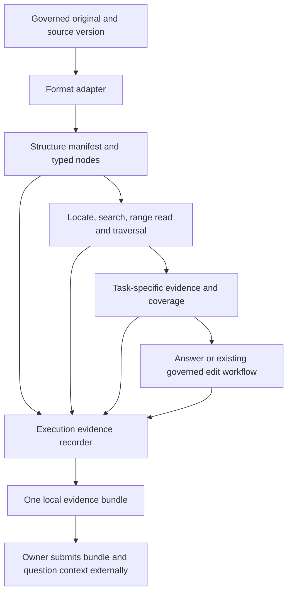

# Unified Document Structure And Evaluation Evidence Design

> Language: English | [简体中文](../zh-cn/docs/document-structure-and-evaluation-design.md)

Status: P0–P3 implemented in local source, 2026-11-05; owner acceptance is pending.
Documents of every supported size use programmatic structure extraction and
on-demand reads. Internal evidence capture is opt-in, defaults off, and exports
on demand for manual external review. This is not an installed/deployed release
or a claim of model answer quality. Section 12 records implementation boundaries.

The contracts and phases below define the implemented direction.
The application does not invoke a reviewing model, assign semantic quality
scores, choose a reviewer, or automatically submit evidence externally.

Owner scope confirmation, 2026-11-05: the initial implementation excludes local
editing of large documents. Tasks admitted to internal evaluation record their execution chain;
a ready-to-deliver report/archive is generated only on demand, not at every
task completion. Existing supported editing remains available.

## 1. Scope And Relationship To Existing Contracts

Unify document access for PDF, DOCX, PPTX, XLSX, plain text and Markdown. Preserve
format-specific capabilities and explicit unsupported features. The first
implementation keeps the existing one-governed-document workflow boundary;
multi-turn source selection remains supported, while cross-document reasoning
is not added by this design. The initial exporter emits one run per archive; related runs can be supplied as
separate files for the same review.

[Large document context](large-document-context-design.md) records the previous
size-triggered retrieval path, retained for persisted revision 4/5 plans. New
revision 6 reads use this unified architecture. Model capacity calculation,
tokenizer admission, OCR resource bounds and upload limits remain independent
constraints; [Document workflows](document-workflows.md) describes the active profiles.

[Evidence ownership](workflow-evidence-ownership.md),
[minimum evidence projection](workflow-minimum-evidence-projection-design.md)
and [workflow execution](workflow-execution.md) retain authority over source
identity, runtime bindings, model decisions, approvals and durable execution.
This design adds document access and factual export contracts within those
boundaries. InfiniCenter coordination is out of scope.

Existing pages, menus, preview components, layouts and interactions are retained.
No permanent indexing indicator, assessment dashboard or reviewing-model setting
is introduced. Initial export is a controlled local management/CLI operation;
a new end-user export control requires a separate UI design.

## 2. Verified Source Baseline

The design baseline is local revision `cddda7d1`; it is not a claim about an
installed or deployed binary.

| Current component | Existing behavior | Required evolution |
|---|---|---|
| `internal/document` | Small reads already normalize paragraphs, tables, sheets, slides, pages and enrichment | Provide shared versioned structural access without requiring a complete model-sized extraction |
| `internal/docindex` | Outline, anchored text chunks and keyword search; small prebuilds can discard the index | Make lookup available to every supported document; keep it derived from the canonical structure |
| `internal/toolhub/document_retrieval.go` | Supported deferred reads enter retrieval after source/text limits | Expose structure and range reads independently of those limits |
| `internal/agent/document_read_retrieval.go` | Complete read first, then bounded retrieval when required | Choose a task scope first; continue reads according to coverage |
| `internal/trace/writer.go` | Writes a per-run JSON containing run, messages, calls, approvals and audit | Add document evidence export with frozen context and resolvable payloads |
| `app.ModelCall` and projection audit | Model identity, tokens, latency and projection lineage/counts | Capture the actual dispatched input and returned output of each relevant call |

The baseline text index was not a lossless document representation. For example,
search chunk normalization and overlapping text cannot serve as verbatim
source text or as an editing locator. Existing trace files also do not by
themselves prove that every model input and referenced source is available.

## 3. Architecture And Ownership



The original bytes and their version are the source of authority. Structure is
a rebuildable interpretation; a search index accelerates access; a projection
is the bounded evidence delivered to one consumer. They share lineage but do
not become independent copies of source truth.

Runtime owns authorization, document/version binding, locators, allowed ranges,
coverage accounting, continuation and checks. Existing task models resolve
semantic target choices, formulate searches, summarize and generate answers or
edits. The evidence recorder observes those operations and makes no additional
model calls. External review remains entirely with the owner.

Changing the selected model must not change the document's node identity or
remove its range-read capability. Model capacity changes batch sizes and
projections. File size may change parsing schedules, storage and resource
admission; it does not select a different document capability family.

## 4. Shared Structural Contract

### 4.1 Source And Node Identity

Keep `DocumentRecord` as the durable document identity. Introduce a derived
structure manifest keyed by owner/workspace scope, document ID, source SHA-256,
parser version and structure schema version. Different owners do not gain
access through equal hashes. Repeated acquisitions retain their event identity
even if immutable payload bytes are physically deduplicated.

Each node carries:

| Field group | Required meaning |
|---|---|
| Identity | Opaque node ID, source version, parent, ordered position and node kind |
| Location | Format-native locator: package part/paragraph, sheet/cell range, slide/shape, PDF page/region, or text byte range |
| Structure | Child references, title where known, structural relationships and completeness |
| Content | References to original text/typed values, display text, formula, assets and formatting supported by the adapter |
| Provenance | Native parser, OCR or inferred structure; acquisition ID and implementation/model version where applicable |
| Availability | `available`, `unread`, `unrecognized`, `unsupported` or `failed`, with a reason |

Node IDs are stable within one source/parser/schema version. A changed file or
parser invalidates old locators and continuations; mapping to a new version is
explicit, never an assumed identical ordinal. Build from a verified immutable
snapshot and verify the snapshot and original source after extraction; discard
a changed result. Before/after hashes alone cannot exclude a temporary source
change while a parser runs. Do not publish an index mixing two source versions.

Lazy OCR or structural enrichment also carries a `structure_generation` and an
enrichment version. It must not silently renumber existing native nodes. Reads
pin one generation; a cursor whose ordered scope changed is rejected or migrated
by an explicit rule, never resumed against a different node list. OCR cache
keys include source/page and provider/model/prompt/preprocessing versions.

Keep native text separate from search-normalized text and generated summaries.
Preserve cell value/formula/display distinctions, table headers, units, merge
anchors, notes and supported cross-references. A range read adds these required
dependencies and records which nodes were added. Search overlap does not cause
double counting in enumeration, calculation or coverage.

### 4.2 Format Fidelity And Lazy Work

DOCX headings, PPTX slides and XLSX sheets supply native structure where it
exists. A PDF bookmark is useful navigation but is not proof of complete logical
structure or correct reading order. Without reliable headings, expose physical
pages/blocks with provenance instead of inventing chapters. Mark OCR and inferred
relationships separately from native parsing.

Every document can obtain a lightweight structure manifest. This does not
require full OCR, image understanding, embeddings or chapter summaries at import.
Expensive content is materialized on demand. Some parsers must scan a whole
package to discover structure; measure that I/O rather than claiming physical
random access. Model-visible content can still be selected by node.

Cache structure and lookup under versioned keys. Optional import prebuild and
analysis fallback share one build, retain current bounded worker/queue behavior,
and do not duplicate parsing just to attach a second index. Active reads pin
required entries; cache eviction cannot delete authoritative originals or saved
evaluation evidence. OCR availability and each failed page remain explicit.

## 5. Uniform Access And Task Execution

### 5.1 Access Operations

Extend existing tools/adapters instead of adding a parallel document runtime.
The following logical contracts use versioned schemas registered in the existing
ToolHub directory. Native cell/shape coordinates are node locators; the initial
range API selects their node IDs, chunks, pages, sections or the whole source,
not arbitrary cell-expression syntax.

| Operation | Scope and result |
|---|---|
| Structure/outline | Paginated node hierarchy, format capabilities, source version and unknown ranges |
| Locate | Resolve runtime-provable page/cell/ordinal locators; return bounded candidates for semantic ambiguity |
| Search | Keyword matches mapped to canonical node ranges, scored snippets and the searched/indexed scope |
| Read range | Node IDs or typed ranges, original content plus required dependencies, coverage and continuation |
| Traverse | Enumerate the declared subtree/range in source order with a version-bound cursor |
| Summarize | Traverse required units, summarize bounded parts, then combine with source references and coverage |

Use `document.outline`, `document.search`, `document.read_range` and
`document.summarize` as the starting surface. Traversal may be a cursor mode of
range reading rather than another model-visible tool. Existing format readers
adapt to the same underlying source and preserve their format qualifiers.

A cursor binds source/parser version, selection and ordering. Runtime validates
the structure generation as well and rejects stale or foreign cursors. Requested nodes and mandatory context
take priority over optional neighbors; an oversized node is split at a supported
boundary with an explicit continuation. If its mandatory semantics cannot be
preserved, return a limitation instead of silently substituting another passage.

### 5.2 Task Scope And Completion

Freeze the original request and selected document through existing preflight.
Record `task_mode`, required source scope and how that scope was selected.
Proposed modes are `targeted`, `exhaustive`, `whole_summary`, `comparison`,
`calculation` and `edit`. They describe coverage requirements, not a new semantic
router or a list of hard-coded request keywords. Existing semantic admission
selects the task; Runtime binds provable selectors and clarifies ambiguity.

| Task | Required execution condition |
|---|---|
| Targeted question | Read selected evidence with relevant headers, notes and qualifications; preserve citation locations |
| Exhaustive extraction | Traverse the entire declared scope; a search top-k is not an exhaustive result |
| Whole-document summary | Cover each required section/physical range, retaining unrecognized and omitted units through all summary levels |
| Comparison | Read each selected side and its required context; record missing sides |
| Calculation | Read the declared typed dataset and units; record program/calculation inputs and results; deduplicate overlap |
| Edit | Complete the target and impact-scope checks in section 6 |

Track structure discovery, content acquisition, model exposure and task coverage
separately. Each uses explicit required/covered/missing ranges with a known or
unknown denominator. `complete`, `partial` and `unknown` are scope-relative;
reading a cited paragraph does not make the document complete. Complete coverage
does not prove semantic correctness, which is left for external review.

A short document may read all required nodes in one operation when this fits
the task and budget. A deterministic page/cell selection needs no model search.
The same interfaces remain available even when a full read would fit. Full-read
optimization records its reason and coverage, and does not create a separate
small-document workflow.

Search misses may broaden a query or traverse a declared scope. Repeated calls
must add coverage or follow an explicit recovery path. Bound per-call work,
total attempts, OCR pages, wall time and cancellation using workflow budgets.
Do not require every document to finish in the current six-attempt retrieval
shape; the new profile needs versioned continuation and explicit remaining-work
state. Exhausted budgets yield a partial/blocked result with missing ranges,
never a false exhaustive answer or silent autonomous continuation.

Keep tokenizer admission and evidence projection budgets. When one call cannot
hold the required content, schedule bounded reads/parts and preserve the source
references of intermediates. Sampling is permitted only for an explicitly
partial result; it cannot satisfy an exhaustive or whole-scope completion claim.

## 6. Editing Boundary

Record all existing document edit runs, including unsupported and blocked cases.
The owner explicitly excluded local editing of large documents from the initial
implementation. Keep existing edit admission and unsupported-result behavior;
making a source structurally readable must not make it eligible for editing.
Keep existing policy, approvals, original-hash checks, output-copy naming,
preservation checks and format-specific limitations.

A separately scoped future effort may qualify local edits independent of total
file size only when it proves: a stable target; complete target/dependency evidence;
known impact scope; safe format-preserving write; output reopen/readback; intended
change verification; and preservation outside the allowed change scope. Some
formats still require package-wide parsing or writing. That cost must fit its
resource budget even if the edited text is short.

Search chunks and generated summaries never authorize a mutation. An unsupported
target or incomplete mandatory evidence blocks before mutation. Approved edits
continue through the current workflow; this design introduces no new approval
step for read-only structural access or evidence recording.

## 7. Per-Execution Evidence Recording

Owner clarification, 2026-11-05: evaluation is an internal tool and must not add
client transfer, UI, or ordinary interaction overhead. Recording is opt-in via
`storage.execution_evidence.enabled` (default `false`). When enabled in an
internal host evaluation environment, the trace root's private `document-evidence/`
directory holds bounded run evidence. Normal desktop/ISCP executions do not
inherit this recorder, return evaluation attachments, or retain content on the
server. Evaluate those document operations through the same runtime in an
explicitly configured internal environment; do not weaken their content cleanup
contract to collect samples. Disabled runs have no evaluation evidence and
cannot later be reconstructed as complete captures.

### 7.1 Coverage Of The Recorder

Capture all admitted document read/edit runs, including clarification, binding
failure, rejection, timeout, cancellation, partial result and recovery. The
general run recorder must retain routing decisions before document selection;
the exporter also accepts explicit authorized run IDs so a misrouted document
request can be examined rather than disappearing from the sample population.
Do not identify document cases by a second keyword classifier.

Freeze the request and relevant context as seen at each decision. Include the
attachment candidates, selected target and versions actually used; label absent
files. Do not export the whole later session as though it existed at execution
time. User-supplied review context remains a separately labeled supplement and
never rewrites the original request or trace.

### 7.2 Events And Model Calls

Each event has `event_id`, `run_id`, per-run `seq`, timestamp, parent/cause IDs,
node/stage, attempt, status, source versions, input/output payload references,
duration and typed error. Parallel branches use cause IDs; sequence alone is
not proof of causality. Retried and cached operations keep distinct events and
reference the originating acquisition/cache entry.

Record source binding, parse/index/OCR, scope choice, search, range reads,
coverage changes, evidence projections, model dispatch/response, tool execution,
approval, verification and final output. Record failed attempts as well as the
final successful attempt. Large payloads are stored once and referenced by hash.

Capture the actual application request after final context assembly, projection,
token fitting and runtime bindings at the dispatch boundary. Include message
roles/order, tool definitions, response schema, images/attachments, resolved
model identity when available, generation parameters and actual returned output.
Separate a prepared-but-not-sent request from a dispatched request. Do not
reconstruct prompts later from changed templates or just record template names.
Cover routing, step, decision, OCR/vision, section summary and finalization calls
when they participate in the run. No hidden model reasoning is required.

Record requested, returned and model-visible node ranges independently, including
trimming, sampling, dropped neighbors, OCR gaps and cache use. Missing token or
cost telemetry is `unknown`, not zero. Resource measurements include parsing
and index time, OCR pages, input/output tokens, calls, retries and total latency;
distinguish cold and warm cache runs.

### 7.3 Durability And Capture Failure

Reuse run/call/audit identities, artifact storage and the existing trace writer.
Persist incremental bounded events at operation boundaries and atomically seal
the run manifest at terminal state. On crash/restart, retain the last durable
events and identify interrupted spans. Do not infer that a started tool either
succeeded or never ran. Business recovery remains governed by existing rules;
export never re-executes a tool or model call to fill a historical gap.

Capture and business status are independent. A recorder failure cannot convert
a completed user action to failure or trigger a repeated edit. Mark
`capture_complete=false` with missing spans/reasons and emit the existing bounded
diagnostic. If even that write is unavailable, recovery/export must report the
missing record; it cannot claim every run was captured. Approval-wait snapshots
are labeled nonterminal and are not fabricated final results.

At acquisition, retain a reference to the exact immutable source bytes for the
evidence lifetime. Stream a versioned snapshot for mutable workspace files;
reuse an already verified owned artifact when possible. Capture derived outputs
before later edits can replace their paths. Merely saving a path and hash cannot
recover an overwritten source. Failure to retain bytes is an explicit capture
gap, and the exporter must not silently use the current file at the old path.

## 8. One Portable Evaluation File

### 8.1 Delivery Format

Each run admitted to internal evaluation receives a local manifest. Task completion seals
the execution record but does not generate a delivery report or ZIP. When the
owner requests an export, the controlled exporter generates `report.md` and
materializes one file, `document-evaluation-<run_id>.zip`, from that frozen run.
The archive is a transport container, not an assumption that a reviewing model
can open ZIP files. The owner can extract it and submit `report.md`, selected
payloads and originals with their question context. No upload happens in SparkClaw.

```text
document-evaluation-<run_id>.zip
  report.md                   human-readable factual timeline and limitations
  evaluation.json             versioned manifest and event/payload inventory
  events.jsonl                ordered execution events with causal links
  calls/<payload_id>.json         actual dispatched model input and returned output
  evidence/<payload_id>        parse results, reads and projections
  sources/<source_id>/<name>   original bytes for the bound source version
  outputs/<output_id>/<name>   answer or derived document and verification data
  assets/<asset_id>            images/render evidence actually available
```

Batch archives remain a future extension; the initial CLI exports one run per
archive. Related-run links alone do not authorize exporting other owners or sessions.

`report.md` is generated deterministically from recorded facts. It contains the
request, source inventory, scope/coverage, timeline, model-visible evidence
references, final result, failures, resource use and missing evidence. It adds
no quality verdict, inferred reasoning or generated explanation of success.

### 8.2 Manifest Contract

The implemented `schema_version` is `document_evaluation_v1`. The table below
defines logical evidence content, not a list of JSON root keys. `evaluation.json`
stores scope/status, times, `request_payload_id`, event counts, payload inventory
and `capture`/`export`/`review`. Full run states, requests, canonical structure,
task scope, coverage and model calls live in hash-verified payloads referenced
by `events.jsonl`. The factual report links these records without generating a
semantic analysis. Missing provider token/cost telemetry remains unknown.

| Field | Contract |
|---|---|
| `run` | IDs, start/end, business status, workflow/catalog revision, code revision and dirty-tree indication |
| `request_context` | Original request, frozen relevant messages/attachments and their provenance |
| `sources` | Document/version/hash, format, bytes, parser/index/enrichment versions, structure generation and bundle entry |
| `task_scope` | Declared mode, selectors, required ranges and scope-selection event |
| `coverage` | Structure, acquisition, model exposure and task scope with explicit missing/unknown ranges |
| `events` / `model_calls` | Event/call inventories and bundle entries, including failed attempts |
| `outputs` / `checks` | Actual outputs and deterministic check name/version/input/result; no semantic grade |
| `metrics` | Raw measured values, units, availability and cache conditions |
| `payloads` | Stable payload ID, kind, relative bundle entry, byte length, SHA-256, provenance and redactions |
| `capture` | `capture_complete`, required/missing spans, reasons and capture boundary |
| `export` | `package_complete`, missing entries, redactions, source transformation and export version |
| `review` | `mode: owner_external`, `status: not_performed`; no model selection or review execution |

Bundle entries in the payload inventory are authoritative; the layout above
illustrates their roles.

An entirely recorded failed task may have `capture_complete=true`. A successful
task may have incomplete capture. A package containing all captured payloads can
be complete while capture is incomplete; neither flag says the answer is right.
The report presents both flags and task coverage independently.

### 8.3 Source Evidence, Privacy And Bounds

Include exact version-bound originals by default for authorized export, plus
available original render evidence when layout matters. Derived parser text
alone cannot independently establish parser correctness. Missing originals or
visual evidence are explicit review limitations. Never substitute a regenerated
file for the historical source. Post-run rendering, if requested separately,
is labeled with its time/version and is not claimed as model-visible evidence.

Resolve internal artifact references into bundle entries; a local path or
expiring URL is not portable evidence. The exporter must work offline once the
authorized stored sources are present. Verify hashes and reject traversal paths,
symlinks and entries outside the selected ownership scope. Use opaque IDs in
entry paths; retain display names separately and disambiguate collisions.

Reuse existing redaction rules and explicitly exclude credentials, transport
tokens and unrelated session data. Record every redaction's location and reason;
hash exported bytes separately from their original-version identity. Raw binary
originals are not claimed to be redacted by text rules. A user-requested sanitized
copy is a labeled derivative with its own hash; an omitted original is a gap.

Stream export under finite configured byte/time/storage limits. Do not truncate
payloads to fit a reviewing model's context window. If the complete export
exceeds the budget, return an explicit failure/size inventory; an explicitly
requested diagnostic-only export declares every omission. Extraction rejects
archive traversal and decompression-budget violations. Defaults and retention
must be qualified in phase P0 before implementation is enabled; no unbounded
new retention or silent deletion of existing history is authorized here.

### 8.4 Internal Capture And Offline Export

Set `storage.execution_evidence.enabled: true` only in the internal host
evaluation configuration. Captures live under
`<storage.trace_dir>/document-evidence/`, with owner/session/run scope checks,
private directory/file permissions and no product UI entry. The default file
state backend is supported. A normal desktop/ISCP task still clears server
content and does not upload an evaluation sidecar to its client.

Default limits are 128 MiB per payload, 512 MiB per run, 2 GiB total capture,
1 MiB per event and 20,000 events per run. Capture operations have a 30-second
bound; exports have a 120-second bound and a 1 GiB raw/archive budget. These
are resource ceilings, not promises that every admitted source can be retained.
Model transport observation has a separate 32 MiB boundary; exceeding it records
a gap without truncating the business response. Quotas stop new capture; there
is no automatic expiry or deletion of earlier evidence.

The P0 microbenchmark (`BenchmarkExecutionEvidenceManualRead`, Apple M5,
Darwin/arm64, five iterations of a 128-line text read) measured about 4.34 ms
with capture disabled and 625.65 ms with durable capture enabled. This is an
internal recording-cost sample, not a model latency or product performance
claim. The default remains disabled; capture costs must be reported when
comparing evaluation runs.

From `services/gateway`, export an existing run without starting a gateway:

```sh
go run ./cmd/document-evaluation \
  --evidence-dir /absolute/trace-dir/document-evidence \
  --owner OWNER_ID --session SESSION_ID --run RUN_ID \
  --output /absolute/new-evaluation.zip
```

The destination must not exist. Add `--diagnostic` to explicitly export an
unfinished or incomplete capture; missing entries and open operations remain
visible. `--max-export-bytes` changes the export ceiling. The current CLI exports
one run per file; a selected collection can be reviewed as several such files.
It never reads the present source path to replace missing historical bytes,
replays a task, calls a model, or uploads the package. No evidence can be
retroactively recovered for a run that occurred while capture was disabled.

## 9. External Review And Capability Coverage

The owner selects the reviewing model, supplies the evaluation file and question
context, and interprets the judgment outside SparkClaw. The application has no
review queue, scoring function, judge prompt, reviewer-model API, automatic
improvement loop or automatic incorporation of a reviewer response. Ordinary
models required to perform the user's document task remain unchanged.

The file should support the following questions without answering them itself:

| Capability | Evidence needed by the external reviewer |
|---|---|
| Intent and binding | Original request/context, route candidates/decision, selected source |
| Parsing and structure | Original bytes, nodes, order, native/inferred provenance, OCR gaps |
| Location and reading | Search scope/results, selected ranges, dependencies and omitted ranges |
| Answer and summary | Actual model inputs, output, citations, complete/partial scope evidence |
| Calculation | Typed values, units, calculation procedure, inputs and actual result |
| Editing and preservation | Before/after originals, target/impact scope, approval and verification |
| Efficiency and recovery | Timeline, cache state, tokens, duplicate reads, failures and retries |

Maintain a fixed manually curated case inventory spanning the modes and formats,
plus ordinary successful and failed usage. Keep development cases separate from
held-out comparisons. Freeze source bytes and case wording for before/after
comparisons; record changing model/provider versions rather than promising
identical nondeterministic replay. Human reference answers or review notes, if
supplied, are separate labeled material and never visible to the executing model.
Size and context capacity remain useful test dimensions even though they no
longer define product capability branches.

## 10. Implementation Sequence And Compatibility

| Phase | Work | Exit evidence |
|---|---|---|
| P0: recording baseline | Extend existing run capture, exact model-input payloads and portable export before changing read policy; freeze export budgets/retention and a case inventory | Old-path successful, failed and interrupted cases export with no fabricated completeness; bounded capture overhead measured |
| P1: shared structure | Versioned manifest/nodes; format adapters; source verification; small-document structure reuse | Supported formats expose stable nodes and honest unsupported ranges without a model-context dependency |
| P2: unified reads | Same access operations for all sizes; task scope, traversal, dependencies and continuation; retain one-call full-read optimization | Fixed cases exercise local and whole-scope tasks, partial budgets and cold/warm caches |
| P3: workflow cutover | Version the read profile/tool schemas, preserve persisted plan decoding and finalize coverage/result handling | Existing interaction behavior plus recovery, source binding and all three store backends verified |

The initial implementation comprises P0–P3. Large-document local editing is
deferred outside these phases; section 6 records prerequisites for a separately
requested future effort, not an automatic next implementation stage.

The recorder is added around existing `internal/agent`, `internal/modelrouter`,
document/OCR adapters, `internal/trace` and artifact boundaries. `internal/document`
owns structural semantics; `internal/docindex` owns rebuildable lookup;
`internal/toolhub` exposes registered operations. Avoid a second workflow engine
or store. Store interface/schema changes, if needed, cover memory, file snapshot
and PostgreSQL with paired versions and migrations.

Old persisted workflow plans retain their declared revision; do not reinterpret
an in-flight read as the new traversal workflow. Old trace exports explicitly
declare unavailable request payloads. Old derived indexes can rebuild lazily;
originals, document records, approvals and historical observations are retained.
Deployment and any shared transport change require their own qualification.

## 11. Acceptance Matrix

These are acceptance cases and evidence requirements, not automated model
quality judgments or a claim that every real-model case has passed. Captured
cases use the same evaluation bundle format; owner acceptance remains separate.

| ID | Case | Required observation |
|---|---|---|
| A01 | Short DOCX, question about one paragraph | Structure and direct target read available; unrelated body need not enter the model |
| A02 | Short whole-document task | One bounded full read is allowed; declared scope and coverage remain explicit |
| A03 | Same source with short/long context profiles | Same source/node identity and operations; only batching/projection changes |
| A04 | Source above 8 MiB or text above old extraction ceiling | Uniform access remains available within parser/resource admission |
| A05 | Compressed Office file with large extracted content | Bounded parsing and explicit continuation or resource rejection |
| A06 | Scanned PDF with/without bookmarks and OCR disabled/failing | Physical structure and unknown/unrecognized pages remain visible; no invented complete text |
| A07 | Table value with header, unit, merged cell and note | Required dependencies accompany the selected value |
| A08 | XLSX formula, displayed value and hidden data | Typed distinctions and requested scope preserved; no invented recalculation |
| A09 | PPTX notes/shape or unsupported object | Supported text and structure retained; unsupported content explicitly identified |
| A10 | Exhaustive extraction and negative claim | Full declared search/traversal coverage required; top-k miss cannot prove absence |
| A11 | Whole summary with a late exception and unread page | Late ranges scheduled; missing pages survive aggregation and final disclosure |
| A12 | Calculation across overlapping chunks | Each source value counted once with a reproducible input range |
| A13 | Source changed during build/between reads, or lazy OCR changes structure | Mixed-version output rejected; stale source/generation cursor cannot continue |
| A14 | Duplicate/concurrent requests and cache eviction | Shared build, separate events, correct cache provenance and active-read protection |
| A15 | Existing supported edit and a large-document local edit request | Existing approval/output-copy/preservation behavior retained; the large-document edit stays blocked despite structural read access; both traces retained |
| A16 | Timeout, cancellation, repeated search and budget exhaustion | Bounded stop, remaining ranges, partial/blocked outcome and no silent continuation |
| A17 | Crash or recorder disk/write failure | Interrupted/missing spans explicit; no repeated business operation to repair trace |
| A18 | Input fitting, schema repair and model retry | Each actual sent payload/output recorded separately, including omissions |
| A19 | Clarification, source failure and misrouted request | Export by authorized run ID; pre-document decisions available where captured |
| A20 | Offline transfer to a fresh directory | Required payloads resolve within bundle; hashes match; no internal-path dependency |
| A21 | Missing artifact, over-budget export and redaction | Honest gap/inventory; no silent truncation or false original-byte claim |
| A22 | Cross-owner IDs, path traversal and archive expansion | Scope and resource rejection; no unrelated payload exported |
| A23 | Existing WebChat/desktop interactions | Pages, menus, previews, approvals, results and recovery behavior retained |
| A24 | Task completion followed by owner-requested export, with network-call accounting | Completion seals local records without a delivery report/ZIP; export creates the bundle on demand; zero reviewing-model calls or automatic external submission |

## 12. Implementation And Acceptance Record

P0 records admitted internal runs, frozen request context, run/tool/approval
states, actual model dispatches and returns, source/output snapshots and full
canonical structures. Terminal state seals the record; only an explicit CLI
export creates a ZIP and factual report. Capture failures never repeat a
business operation. Normal desktop/ISCP execution does not inherit the recorder.

P1/P2 provide versioned canonical nodes for PDF, DOCX, PPTX, XLSX, UTF-8 text and
Markdown. Parsing uses bounded private immutable snapshots; source changes
invalidate results. Native text, formula/cached-value distinctions, dependencies,
unsupported structures and OCR gaps remain explicit. A derived search index
never replaces original node text. Cache acquisition is recorded as built,
rebuilt, memory/disk cache or shared build; enrichment changes the generation.

Revision 6 first discovers structure, then declares targeted, exhaustive,
whole-summary, comparison or calculation scope. Runtime binds the source hash,
generation and continuation cursor, persists scope in ordinary workflow facts,
and stops incomplete when coverage or execution budgets prevent completion.
The final projection separately records whether all acquired evidence reached
the model. Images retain their existing visual adapter. Persisted revision 4/5
plans retain their original behavior, and the routing catalog version is unchanged.

Tool policy remains keyed by registered tool names. Revision 6 uses
`document.outline`, `document.search`, `document.read_range` and
`document.summarize`; custom named-tool restrictions must cover these operations.
A `files.read` rule still applies to that direct/legacy tool, not every tool
with a read effect. The existing policy editor and approval flow are retained.

Legacy direct callers may omit version pins for chunk/section selectors for
compatibility; such bare selectors cannot promise continuity across source
changes. New revision 6 workflows always bind the versions. Summary contract 2
visits every section, includes late parts, and reads at most eight parts per
section; omitted parts remain partial. Typed values and dependency context are
projected atomically or reported missing when they exceed the budget. There is
no spreadsheet recalculation or new large-document local editing.

Source implementation checks cover recorder recovery/export, exact model
payloads, lossless traversal, format adapters, stale cursors, source changes,
partial summaries, old-plan cold resume and scope persistence across memory,
file and PostgreSQL. UI components, transport contracts and store schemas are
unchanged. Automated checks support the implementation; the A01–A24 real-task
matrix and semantic quality remain for owner acceptance. No deployment, app
installation, push or reviewing-model invocation was performed.

### 12.1 Source Validation

Implementation revision `8bebe17c` passed the full isolated Linux Go suite
(82 tested packages; 12 packages without tests), `go build ./...`, and
`go vet ./...`. Race checks passed for evidence/model/OCR/index packages and
focused workflow/ToolHub/gateway integration. The isolated PostgreSQL store
suite passed, including the new scope persistence contract; file cold-resume
checks cover both legacy revision 4/5 and revision 6 scope facts.

Unchanged UI/client checks passed: WebChat 595 tests across 93 files plus build;
desktop client-store/execution-client 52 tests. On Node 26, WebChat tests use
`NODE_OPTIONS=--no-experimental-webstorage` so jsdom owns localStorage; the
ordinary invocation's native-storage conflict also reproduces on baseline.
The full Go baseline and final qualification ran on Linux because macOS has
existing `/dev/shm` fixture failures. All 141 project Markdown mirror/link
checks passed. No new native UI or real-model semantic acceptance is claimed.

The first full integration run retained failures from obsolete small-document
prebuild/single-reader assertions and missing upload-test worker cleanup. The
final checks verify both upload sizes, actual untrusted range content, named-tool
approval, structure/scope model telemetry and bounded worker shutdown. The first
failed run remains distinct from the passing qualification.
