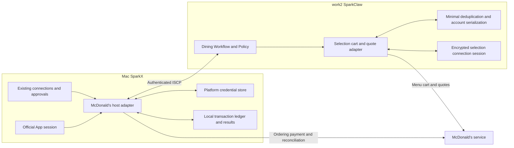
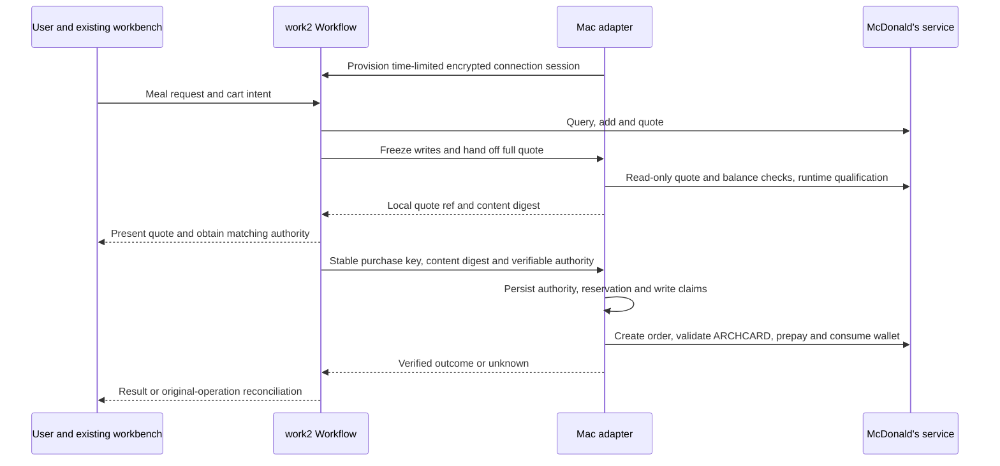

# EzMcDonalds split integration design

> Language: English | [简体中文](../zh-cn/docs/ezmcd-split-integration-design.md)

> **2026-11-20** — The workbench operation registry, peer-session checks and seven-day domain journal below describe the retired transport. The current Gateway authorizes the link principal and uses desktop reverse calls for host operations. The Vault, ordering workflow and payment approval retain their own rules. [Link contract](link-contract.md).

Date: 2026-11-16. Revision: R3, with section 8 aligned to the confirmed ordering R4. Status: split-integration and the single ordering Workflow are implemented in this worktree's source; G1 current-build v4/v5 reads and the historical selected-pickup G2 have evidence. [The implementation and rollout gates](ezmcd-adapter-implementation.md) distinguish fixtures, upstream payment and live product acceptance. All rollout flags default to false; the November 16 source has not been repackaged or deployed, and this is not a shipped capability.

**Mac SparkX obtains and refreshes McDonald's credentials and executes ordering, payment and payment reconciliation. work2 SparkClaw handles stores, meal selection, carts and quotes.** SparkClaw retains workflow orchestration, model calls and Policy/approval decisions. Mac provides a deterministic host adapter that validates authority and executes approved operations. This document defines the target design; the linked implementation checkpoint records actual code and qualification separately. The upstream handoff completed one separately authorized purchase; this implementation made no new order or payment and did not deploy the product.

Payment is fixed to upstream's current McDonald's wallet channel, `ARCHCARD`. This integration adds no payment channels. Quote presentation, authorization digests, cashier validation and consumption all bind that channel.

## 1. Baseline and evidence

The baseline is SparkClaw `32143be1fa81519413c1b6271ac21a0e781c1787` and [pinned EzMcDonalds](https://github.com/Chiiz0/EzMcDonalds/tree/2497334e4ff1b2331773a36890db74136b288537), version `0.1.0a50`, MIT licensed. Adapters reuse its protocol, product parsing and transaction protections. Pin revisions and retain attribution; do not automatically track a moving upstream branch.

A real Mac → work2 → Mac test completed at 16:19 Asia/Shanghai on 2026-11-12: [redacted evidence](evidence/ezmcd-credential-portability-2026-11-12.json).

| Area | Observed evidence | Integration implication |
|---|---|---|
| Account source | Read the already authenticated official Mac App after the user allowed OS data access; the account matched the user's specified account | Existing login was reused; no SMS was sent. This baseline did not qualify initial login or automatic upstream refresh |
| Signing | Reconstructed v4 Authorization and body signatures matched an official cached request; each executing host generated fresh timestamps and nonces | Linux can directly use transferred session and v4 signing material |
| A–B–A | Mac balance; work2 balance, rights and favorite stores; Mac balance again. All five GETs returned HTTP 200 and business success | The session was portable at that time and remained valid on Mac afterwards |
| Transfer | Authenticated SSH stdin, remote memory only | No remote credential files; production uses the authenticated product channel |
| Environments | Mac arm64 / Python 3.11.15; work2 Linux x86_64 / Python 3.14.4, standalone probes | This does not qualify the complete upstream MCP runtime and dependencies on Linux |
| Compatibility | Official App 7.0.451, temporary v4 material-location adaptation | Upstream's original 7.0.440 support is not full support for the installed version |

This November 12 16:19 baseline did not test real cart mutation, cross-host quote handoff, order creation, payment, long-duration validity or cross-day renewal. Later G1/G2 and handoff evidence is recorded in the implementation document. App 7.0.451 v5 ordering and payment runtime qualification remain separate gates. The evidence's `passed` field covers only those reads.

Production support is an explicit table of App version, binary SHA-256 and adapter revision. The tested 7.0.451 binary SHA-256 is `c7684499ea491e20004a8b748be4fc1472ef3e2047b5f9656c7150daeb6b28e4`. Reject unknown builds instead of bypassing upstream version checks. Account sessions, decoded signing constants and official App binaries must not enter the repository, logs or release artifacts.

## 2. Architecture

Preserve the business/host-resource boundary in the [current architecture](architecture.md) and [workbench convergence design](workbench-runtime-convergence-design.md). Session transfer is this specifically authorized integration, not general synchronization of App data or browser profiles.

The first release serves the originating Mac installation and its work2 backend. A McDonald's member has one payment-authority installation at a time; aliases cannot bypass member-level concurrency. Other workbenches do not automatically inherit that Mac's credentials, order history or spending authority. Cross-workbench delegation and payment-host migration require separate designs. Existing household configuration semantics for Info/LocalMind remain unchanged.

Qualify ISCP first. A LAN adapter must invoke the same typed services and qualify independently before activation. Unsupported transports retain the entry with dependent actions disabled; choosing ISCP never permits silent LAN fallback.

## 3. Placement of all 38 upstream MCP tools

This is the complete pinned upstream inventory and target mapping, not an instruction to expose all tools directly to the model. Maintenance, authorization and payment use dedicated entry points.

| Business area | Tools | Execution and constraints |
|---|---|---|
| Capabilities and connection instructions (2) | `capabilities`, `account_connection_instructions` | SparkClaw aggregates both hosts' qualification; Mac supplies local login guidance |
| Accounts and runtime (6) | `accounts_list`, `account_diagnose`, `account_check`, `account_refresh`, `account_runtime_check`, `account_runtime_restore` | Mac; work2 receives redacted status and may perform read-only health checks on its imported session. Refresh and repair remain on Mac |
| Preferences (2) | `preferences_get`, `preferences_save` | Originating workbench persistence through typed adapters |
| Meal planning (1) | `meal_plan` | work2, with the preferences explicitly supplied for this execution |
| Stores and pickup (6) | `cities_list`, `stores_search`, `stores_favorites`, `store_get`, `pickup_slots`, `pickup_methods` | work2 |
| Menu and benefits (5) | `menu_list`, `product_detail`, `membership_assets`, `coupons_list`, `coupon_products` | work2 |
| Cart reads and writes (4) | `cart_get`, `cart_clear`, `cart_add_simple`, `cart_add_configured` | work2; serialized writes with original intent and stable keys. Clear requires a fresh `cart_ref` and removal intent |
| Cart recovery (3) | `cart_add_status`, `cart_operations_list`, `cart_operation_retire` | work2 coordinates active operations; Mac retains complete historical receipts. Retirement only abandons an eligible expired local intent, without asserting upstream failure |
| Ordinary quote (1) | `checkout_quote` | work2, producing the complete handoff object |
| Pickup selection and status (2) | `checkout_quote_pickup`, `checkout_quote_pickup_status` | work2; selection changes official state and is a cart-class mutation, not a pure read |
| Ordering and payment (2) | `checkout_submit`, `order_pay` | Mac only. `checkout_submit` can create an order and pay in one call, so authorize the complete purchase |
| Orders and reconciliation (4) | `order_status`, `orders_list`, `official_orders_list`, `official_order_detail` | Mac, correlating its ledger with official evidence; work2 receives only the redacted result needed by the active task |

### 3.1 Adapter strategy

Upstream provides stdio, while SparkClaw's generic MCP integration currently requires HTTP(S). Run managed Python helpers on both hosts with private stdio access to the pinned core. Gateway calls the Linux helper through a typed selection adapter; Mac main calls the local helper. There is no public MCP listener or unrestricted remote server in `mcp_servers`.

The helpers share the pinned core and protocol tests but use separate entry points, operation allowlists, storage adapters and credential providers. Linux receives validated v4 material instead of reading a Mac App path. Mac retains the v5/payment runtime. Package a supported Python and fixed dependencies; do not run pip during first use. The Python 3.14 probe does not qualify helper packaging.

Most upstream read tools declare `open_world_hint=true`. Current generic MCP classification treats those as dangerous mutations, leaving only `cart_operations_list` and `orders_list` when mutations are disabled. Use reviewed, fixed capability definitions for external reads, cart mutations, host maintenance and purchases. Keep upstream annotations for audit without weakening generic MCP rules. Product detail remains semantically read-only even though its endpoint uses HTTP POST.

Business failures can arrive with MCP `isError=false` and `{ok:false,error:...}`. Validate business success, structure and mandatory fields before constructing `ToolOutcome`. Missing cart, amount or pickup evidence stops handoff. Use filtered/paginated bounded menu projections; truncated output is not a complete menu.

## 4. Session acquisition and transfer

### 4.1 Mac is the sole session writer

1. Locate the verified, supported official App and current account, accessing only its relevant container. Do not hardcode the experiment's container UUID.
2. Reuse valid login first. When login is necessary, Mac guides the official login flow; phone and OTP remain within that flow. The user handles OS App-data access prompts when required.
3. Validate format, App compatibility and a real read-only session request on Mac. Store secrets in the platform credential store; databases retain only opaque references and revisions.
4. Once the user enables the connection, provision a time-limited selection connection session over the authenticated product channel, permitting encrypted work2 storage and reuse across tasks. Each execution still admits identity, authority, context and resources independently; possessing a session does not create new business intent. work2 requests renewal from Mac and never refreshes independently.

Credentials never traverse renderer state, model context, ordinary tool arguments, URLs, process arguments, environment variables or generic traces. Helpers receive private stdin input. Do not transfer raw headers or cache databases. Allow only verified request headers and reject CR/LF; the experiment found an internal cached header that could not be sent directly.

### 4.2 `SelectionSessionEnvelope v1`

This is an internal secret message, not model tool input. Public status includes only account label, availability and necessary recovery actions.

| Group | Contents and constraints |
|---|---|
| Identity | `deployment_id`, `owner_id`, `client_id`, `installation_id`, opaque `account_ref`, verified member-binding digest |
| Revision and lifetime | `schema_version`, stable `connection_id`, monotonically increasing `credential_revision` and `grant_revision`, `adapter_revision`, `issued_at` and `session_not_after`; upstream expiry recorded only when verifiable |
| Minimal secrets | Current session, required device identity, allowed client headers and versioned v4 signing material; exact fields established by per-endpoint contract tests |
| Scope | Fixed selection operation set, signing-profile revision and request budgets; callers cannot expand host/path/method. Each execution separately binds `execution_id`, originating workbench identity and business authority |
| Idempotency | `provision_request_id` and canonical envelope digest; same ID/digest returns original state, drift rejects |

Do not transfer refresh tokens, v5 runtime, payment-specific material or local spending grants. **The v4 session is not an upstream-issued read-only or selection-scoped token.** Restrictions are enforced by SparkClaw adapters and deployment boundaries; they do not cryptographically eliminate other official authority from a backend holding that session.

Allow only fixed official hosts and reviewed method/path templates in the work2 helper. Reject arbitrary URLs, redirects, order creation, cashier and wallet-consumption routes. The bounded pickup-method mutation required by quoting is allowed. New endpoints require classification and qualification evidence.

### 4.3 Persistence, leases, rotation and revocation

Persist the selection session as necessary integration service configuration in the existing encrypted backend Vault. Bind ciphertext to deployment, Owner, Client, installation, account and connection ID. Only the trusted adapter can decrypt it; public settings APIs cannot read secrets back. Use atomic replacement and revision checks, with opaque database references and transient helper memory for decrypted material. This does not change workbench ownership of menus, cart bodies or order history.

The initial connection lease defaults to 24 hours, may be configured shorter, and has a 24-hour maximum. Mac issues `session_not_after` after a successful real read-only validation. Use an earlier verifiable upstream expiry when available; do not infer unknown upstream lifetime. This integration usage limit is separate from execution deadlines, the 120-second quote lifetime and 24-hour result delivery. An online Mac may revalidate and renew while the connection remains enabled. work2, task activity, retries, ciphertext reads and restarts cannot renew it.

After restart, work2 checks durable identity, revision/revocation high-water marks and absolute expiry before decrypting and performing a read-only health check. Successful validation enables normally admitted selection executions without requiring another Mac import. Health failure, untrusted clocks or corrupt ciphertext disable the session without falling back to an older revision. Restoring credentials never restores or replays business writes.

`credential_revision` represents changes to actual session/signing material; `grant_revision` represents lease or scope changes. Equal revisions require equal digests; rollback rejects. Renewing unchanged credentials increases only `grant_revision`, without changing purchase content or invalidating a valid quote. Credential changes, narrowed authority or revocation cancel affected executions and invalidate old quotes and unused purchase authority. Started writes retain original keys and reconcile.

Account disconnect, logout, device revocation or identity change stops new operations on reachable peers, deletes the associated Vault ciphertext and clears memory. Expiry or confirmed upstream invalidity also stops use and removes secrets. Revision/revocation high-water marks and deduplication records survive independently so old provision messages cannot restore access. A partitioned peer that has not received revocation may operate until `session_not_after`; reconnect synchronizes revocation first. Local Mac logout immediately prevents local purchases.

Explicit revocation also durably closes that `connection_id`; even a late provision with a higher revision cannot automatically reenable it. Explicit user reenablement creates and binds a new connection ID while the old closed record remains effective. Ordinary expiry only requires Mac revalidation/renewal and is not user revocation.

While Mac is temporarily offline, work2 may finish selection and admit new selection executions that carry the original workbench's identity, authority and necessary context, within the valid connection lease. Other workbenches do not inherit connection access. Each execution retains its original deadline; results await their originating workbench within existing delivery limits. Mac absence does not invalidate qualified `mcd.selection`, but makes `mcd.checkout` unavailable. It cannot initiate a new purchase, renew or move payment to Linux. Reconnect reconciles unknown operations before updating sessions or quotes as needed.

## 5. Cart and quote handoff

### 5.1 One cart writer

An official member cart can be affected by different store contexts, conversations, aliases and the official App. Serialize all SparkClaw cart and pickup-method writes on work2 by verified member-binding digest. Check store, time, product configuration and predecessor digest before each write. Never clear an existing cart automatically for a new task.

Upstream file locks are host-local. Add durable, payload-free account control containing operation key, digest, phase, epoch and deadline. Before Mac purchases, work2 verifies that no cart mutation remains unresolved, freezes member writes and issues a handoff epoch bound to that purchase. Mac persists its acceptance receipt on import.

Handoff timeout does not release the freeze automatically: first establish whether Mac accepted and whether an official write began. Any started or unknown write requires reconciliation. Mac detects official-App changes by live pre-submit checks; SparkClaw's freeze cannot lock the official App itself.

### 5.1.1 Aborting preparation and releasing the cart

Add `mcd.checkout.abort` for local purchase preparation only; it neither cancels an official order nor refunds. Bind the request to `purchase_id`, handoff epoch, stable operation key and reason: user abandonment, quote refresh or execution termination.

1. work2 persists `abort_requested` and stops sending new commits for that epoch. The account remains frozen.
2. Mac serializes prepare, commit and abort by member and purchase. In one local transaction it verifies that no official write claim exists, invalidates that epoch and its undispatched reservation, persists an `aborted_before_write` tombstone, then returns a receipt. Even if prepare has not arrived, record the epoch tombstone and reject subsequent late prepare/commit messages.
3. Existing write claims, an executing transaction or insufficient proof of non-dispatch return the original attempt/`reconciliation_required`, never successful abortion. User cancellation cannot clear an unknown transaction.
4. work2 advances the account epoch and releases the freeze only after persisting Mac's `aborted_before_write` receipt. A lost response queries the original operation or retransmits abort with the same key. Offline Mac leaves `abort_requested` pending; timeout or a single `not_found` is not non-dispatch evidence.

User abandonment ends the purchase and revokes its unused authority. Aborting preparation for an expired quote may preserve valid, unused authority for the same `purchase_id`, with a new quote revision and handoff epoch under section 5.4. The old epoch can never submit. Release after a verified normal terminal outcome also requires its transaction receipt to be persisted first.

### 5.2 `CheckoutQuoteEnvelope v1`

Upstream `quote_id` refers to a host-local database row, and `quote_summary` is not a complete submittable object. Export the complete quote from the trusted service and normalize it for handoff. Passing only `quote_id` or copying the entire SQLite database is insufficient.

| Group | Required content |
|---|---|
| Binding | Schema, deployment/Owner/Client/installation, account and member digest, credential revision, execution ID, source quote ref, stable `purchase_id`, increasing `quote_revision` and handoff epoch |
| Context | Original normalized CheckoutInput, store, pickup time and timezone, pickup method, items/quantities/modifiers/combo choices and selected benefits |
| Price and evidence | Currency and integer minor-unit amounts, complete items and discounts, exact order `body`, cart digest, `checkout_digest`, upstream `intent`, fixed `payment_method=ARCHCARD`, provenance and adapter revision |
| Lifetime | Original generation/expiry timestamps, preserving upstream's 120-second quote limit; transfer, import and reconnect do not restart the clock |
| Pickup selection | When applicable, complete `pickup_selection` and one-shot switch receipt with context/digest/provenance binding |
| Integrity | Versioned canonicalization, whole-transport `envelope_digest` and purchase-content `purchase_digest`, field allowlist, encoded-size bound and rejection of unknown critical fields |

This is private transport data. Models and UI receive only the necessary item, price, store, time and pickup projections. Define field ordering, integer money, timestamps, null handling and array ordering with shared test vectors. Production envelopes reject `simulation=true`.

### 5.3 Mac import and revalidation

1. Verify channel identity, envelope digest, account/credential revision, expiry, epoch and the local payment-authority binding.
2. Revalidate the official cart, checkout content, member, wallet balance and host runtime qualification using Mac's current session. Prepare never creates an order. Cashier/channel and `payment_ready` checks requiring a real `orderId`/`payId` occur only after authorized order creation. For `pickup_selection`, use upstream's corresponding revalidation path. A fresh ordinary quote may report the default pickup method and must not overwrite the selected-method receipt.
3. Compare amount, items, discounts, store, time, method and semantic digests. Missing or inconsistent evidence returns to work2 for a new quote; never infer a missing receipt.
4. Persist a Mac-local `quote_id` mapped to the backend reference with the original expiry. Import does not authorize purchase.
5. SparkClaw presents that same quote through existing approvals. Reuse explicit matching authority under section 5.4; otherwise obtain single-purchase authority bound to `purchase_digest`. Mac rechecks expiry, content and local spending policy immediately before a write.

Keep upstream duplicate-order, balance, spending-limit and per-stage write-claim checks. Backend quotation is not a reason to skip them. Checkout is disabled by default upstream. The local adapter establishes scoped local policy only from verifiable business authorization; the model cannot expand standing spending limits.

### 5.4 Quote refresh and authorization reuse

`envelope_digest` covers the entire transport object except itself, including quote ID, revision, timestamps, epoch and receipts; refresh may change it. `purchase_digest` binds member identity, canonicalization version, `ARCHCARD` and upstream `quote_authorization_fingerprint`, covering every item/modifier, benefit, price, store, pickup time/method, exact order body, intent and checkout digest. Do not remove business fields to force equality. Both hosts must calculate the same digest.

Refresh metadata explicitly excluded upstream, such as quote ID, expiry and wallet balance, is outside the purchase-content digest. Wallet sufficiency is still rechecked before payment. Channel identity, credential revision, execution authority and epoch are separate conditions; digest equality alone is insufficient.

| Condition | Handling |
|---|---|
| Quote remains fresh, authority valid and content identical | Submit the currently imported Mac quote |
| Quote expired or has insufficient remaining time for validation, with no official write claim | Abort the old preparation, obtain a new official quote on work2 and reimport on Mac; keep `purchase_id`, increment `quote_revision` and use a new epoch |
| New `purchase_digest` exactly matches, original authority remains valid and unused, identity/credential revision unchanged | Reuse the original approval without another confirmation; establish local scoped policy for the new quote ref |
| Items, benefits, amount, store, pickup time/method, channel or any other bound business field changes | Invalidate old authority, present the new quote and obtain a new Policy decision. A lower price is still changed content |
| Original authority expired, revoked or consumed; identity changed; or a write is unknown | No reuse. Expiry/change needs new authority; unknown writes reconcile first |

The approval record includes `approval_id`, `purchase_id`, `purchase_digest`, original execution/identity scope, fixed `approval_not_after` and single-use state. Authority expires no later than the original execution deadline. Quote refresh cannot extend it or authorize a second purchase intent. Each newly obtained official quote retains its own original 120-second lifetime.

Mac transactionally reserves unused authority and marks it consumed when the first official write claim is durably recorded. Only the abort transaction may release an undispatched preparation reservation. Once a claim exists, a lost response cannot restore unused authority. Consumed authority covers only the same attempt's intended transaction; later stages remain subject to their own write claims and upstream continuation conditions, and cannot create a second attempt.

A new quote uses a new submission key and input digest; original keys keep their original outcomes rather than overwriting idempotency conflicts. Each `purchase_id` permits at most two automatic refreshes, with a durable count and no extension beyond execution/authorization deadlines. If no submittable quote is obtained, return a recoverable state. A subsequent explicit user continuation may request another quote, but cannot restore revoked/expired authority or clear unknown writes.

## 6. Purchase, authorization and unknown outcomes

Bind authorization to account, installation, original purchase intent, `purchase_digest`, currency/amount, store, pickup time/method, fixed `ARCHCARD`, credential revision and expiry. Renderer presents and submits the user's decision. Backend Policy decides business authority; Mac main independently verifies its source, scope and host protections. Model prose, connection permission, cart authority and static capabilities cannot authorize payment.

Credential acquisition, cart mutation and purchase are distinct operations. Authorized selection should not prompt for every read or implementation step. Obtain an additional decision through existing Policy when clearing a nonempty cart, changing approved content or exceeding granted scope.

The only payment method is McDonald's wallet `ARCHCARD`. Preserve upstream sequencing: create order, verify wallet channel and amount, prepay, obtain wallet token, consume, then reconcile officially. Do not fetch the token early or pass it to work2. Insufficient balance, unavailable wallet channel or required official verification stops automatic payment with an actionable result. Existing orders retain their original attempt and recover by querying. There is no automatic top-up, alternative-channel fallback, verification bypass, refund or official-order cancellation capability.

| Integration state | Permitted continuation |
|---|---|
| `selecting` | work2 continues the original selection intent, reconciling unknown writes first |
| `quoted` / `prepared` | Mac validation and user authorization; expiry/content change requires a new quote |
| `authorized` | Mac reserves the purchase while all conditions remain valid; repeated clicks do not create another purchase key |
| `abort_requested` / `aborted_before_write` | The former keeps the freeze while reconciling preparation; the latter permits release after Mac's durable receipt invalidates the old epoch. Refresh may reuse unused authority only under section 5.4 |
| `submitting` / `paying` | Persist write claims before dispatch; interruptions query the original transaction |
| `unknown` | Query/reconcile the original key or attempt only; no automatic reorder or repeat charge |
| `paid` / `failed_before_write` / `unpaid_verified` | Display proven results. Verified unpaid does not mean canceled; further payment must satisfy original-attempt continuation rules and authorization |

These are proposed projections with deterministic mappings from upstream states such as `RESERVED`, `CREATED` and `UNKNOWN`. Network success or order creation is not payment success. Display paid only after the official evidence meets upstream verification requirements.

Each purchase intent has a stable `purchase_id`; stages have stable operation keys, input digests and a local attempt. Same key/digest returns original state; drift rejects. If any write may have happened, resolve that purchase before replacing its quote. Only proven non-dispatch allows a new submission with a fresh quote and authority reused or newly obtained under section 5.4. `order_pay` must not replay an unknown charge.

## 7. Storage, recovery and transport

| Data | Authority and lifetime |
|---|---|
| Full credentials, refresh capability, payment material | Mac platform credential store; briefly available to its helper as needed |
| Backend selection session | Time-limited work2 Vault configuration, reusable across executions/restarts; revocation/expiry/confirmed invalidity deletes ciphertext and clears memory. Task completion clears only that execution's secret copy |
| Preferences, displayed history, complete cart receipts | Originating workbench; initially Mac ClientStore/managed local storage |
| Selection context, menu, active cart and quote | Bounded work2 execution resources; removed on completion/cancellation/expiry, never a permanent history store |
| Undelivered results | Existing bounded encrypted delivery; removed after Mac's durable ACK, at most 24 hours from generation without reconnect renewal |
| Purchase authority, imported quotes, budgets, attempts, orders and payment claims | The sole payment Mac's local ledger, sharing member-level budgets across aliases and restarts |
| Deduplication and concurrency | Each host persists necessary scoped IDs, digests, epochs, enumerated states and deadlines, including revocation high-water marks, preparation tombstones and authority-consumption state; excludes meal bodies, credentials and complete orders |

Preserve applicable limits and the 24-hour rule from the [workbench implementation](workbench-convergence-implementation.md) and [original R3 resource boundary](client-r3-implementation.md#frozen-storage-identity-and-capacity). The desktop baseline includes 32 MiB/task and 256 MiB/Owner temporary content, and 8 MiB results. Session and quote schemas must impose narrower encoded-size limits without expanding common capacity policy. Execution disk resources continue to use isolated tmpfs; undelivered content uses encrypted spool storage.

Upstream SQLite combines accounts, cart preparations, quotes and payments. Do not deploy that database as a permanent work2 history store. Use a temporary backend Store adapter plus independent durable minimal fences, delivering full receipts to Mac. Commit a fence before any network write. After a crash, lost temporary Store state becomes unresolved instead of executable again. Insufficient evidence remains unknown. Eligible expired local selection intents may be explicitly retired under upstream rules while retaining original keys; payment claims cannot be retired to unlock retries.

Secrets and full quote bodies must not enter generic seven-day ISCP receipt archives. Preserve the existing [ISCP receipt contract](iscp-receipt-retention.md). New operations journal only payload-free acceptance states, refs and digests. Provision secrets directly into the controlled encrypted Vault; transport records retain no secret bodies. Complete results use the bounded delivery path above. Content cleanup is independent of fences; full storage rejects new admission rather than deleting deduplication evidence.

### 7.1 Typed operations and capability negotiation

These proposed names must be registered in the operation registry and generated contracts during implementation:

| Direction | Operation | Semantics |
|---|---|---|
| Mac → work2 | `mcd.session.provision`, `mcd.session.revoke` | Dedicated secret payload path, both revisions and absolute expiry checks, atomic Vault replacement/deletion and secret-free receipts |
| work2 → Mac | `mcd.account.ensure` | Check local session or request necessary login; secrets return through provision, never the ordinary response |
| work2 → Mac | `mcd.checkout.prepare` | Full quote handoff, revalidation and local persistence; no official order |
| work2 → Mac | `mcd.checkout.commit` | One authorized purchase with stable purchase/operation keys |
| work2 → Mac | `mcd.checkout.abort` | Abort local preparation only without official write claims; persist an epoch tombstone before receipt-based release |
| work2 → Mac | `mcd.operation.status`, `mcd.orders.query` | Query original operations and local/official orders; unknown does not trigger a write |
| Bidirectional delivery | Existing result delivery and durable ACK | Bounded receipt/quote/result projections and local persistence, without generic history archival |

Reuse deployment/Owner/Client/installation, exact PeerSession and authorization-revision checks. Add independent `mcd.selection` and `mcd.checkout` capabilities with supported/permitted/dependenciesReady/qualified/enabled semantics. Existing browser-only reverse-operation negotiation and main dispatch require extension; changing an operation string alone is insufficient. Dining commands are not browser commands.

Unknown capabilities, incompatible revisions, unsupported App and unavailable corresponding helper yield typed unavailability. Offline Mac disables host purchase/maintenance; valid backend connection sessions still support selection. Refresh/reconnect may restore capability but never replay a purchase. Enforce encoded admission against transport frame/object limits. When chunking is needed, reuse authenticated bounded objects and verify the complete digest before import. Secret objects must not enter general file/artifact storage.

## 8. Workflow and UI integration

The [ordering Workflow R4](mcd-ordering-workflow-refactor-design.md) replaces the former read, cart, quote, purchase and status leaves with a single `dining.mcd_order` (`draft`, `RequireQuery: true`). Its nine nodes—`guard → intent → context → menu → offer → cart → quote → pay → settle`—continue in the same execution across question forms and payment approval. The model parses intent and ranks official candidates; deterministic stages own tool calls and final replies. Menu browsing and previous-order questions do not enter ordering. Do not route dining through Happy's coding Workflow or an unrestricted generic MCP branch.

Store and configuration questions reuse the existing approval form with the optional, digest-bound `submit_label`. Cart writes follow the frozen plan without individual approvals; clearing a different non-empty cart still needs confirmation. Coupon selection includes the chosen extras and permits at most one requote without coupons. Payment still requires the complete immutable review and `ARCHCARD` authority. `settle` confirms this order; `guard` reconciles an earlier unresolved original operation before starting another. Status access is independent of the cart/payment flags, and provably undispatched preparations can be durably retired through the existing status path. All existing adapter capabilities and ISCP operations remain; no new operation or spending authority is introduced, and all three rollout flags remain false by default.

Extend the existing `Connections` directory/detail components with McDonald's account connection, necessary login recovery and disconnect actions. Use existing conversation, tool-result and approval components for menus, carts, quotes and orders. Preserve pages, menus, layout, styling, Back navigation and interactions. Do not add permanent technical displays for credential revisions, backend addresses or probe status.

`External MCP access` is inbound access to SparkClaw and cannot configure this outbound business integration. Keep the McDonald's entry visible when unavailable, disabling dependent actions. Show recovery prompts when the user needs to log in, update the App, review a new quote or resolve an unknown outcome.

## 9. Implementation phases and acceptance

### 9.1 The first two technical validations

Before broad Workflow/UI integration, use minimal helper prototypes for these checks. Record real-provider, fixture and uncovered portions separately. This documentation revision does not execute them.

| Gate | Method | Passing evidence and limits |
|---|---|---|
| G1 Installed-version wallet compatibility | Establish 7.0.451 build identification and v4 support; validate v5 signing/order request construction against available official samples/fixtures, inspect local payment-runtime dependencies and wallet paths; live calls remain allowed reads | Reproducible support table, signature/request vectors and dependency results. Missing trusted v5 samples or dependencies explicitly block purchasing. Preflight must not create a test order, prepay or consume. Real-order channel checks and actual charging remain in P3; G1 does not qualify live payment |
| G2 Minimal work2 → Mac quote handoff | work2 generates a complete quote for an authorized existing cart, transfers it through the prototype to a fresh isolated Mac Store, and Mac imports, revalidates and then aborts preparation | Equal purchase digests, unchanged original 120-second expiry, no copied whole database or dependency on the old backend process, and no order creation/prepay/consumption. Record ordinary and `pickup_selection` paths separately. The latter uses an existing valid receipt or a separately authorized non-purchase pickup-switch test; fixtures cannot qualify the corresponding live path |

G2's Mac Store has no preexisting quote row. Include rejection of missing fields, wrong member, expired quote and tampered receipts. Repeated import with the same key/content returns the original local quote ref; changed content under that key rejects. An unportable pickup method remains unavailable rather than falling back to an ordinary quote. Resolve material G1/G2 adapter and contract failures before broad integration, instead of discovering them only in the complete purchase phase.

### 9.2 Delivery phases

| Phase | Intended changes; new modules explicitly identified | Exit criteria |
|---|---|---|
| P0 Early validation and helpers | New `tools/ezmcd-adapter/`; upstream pin, license, dependencies, support table, canonicalization and G1/G2 prototypes | Explicit G1/G2 passing scope and minimal target-path quote handoff; no real orders/payments; unqualified paths remain disabled |
| P1 Sessions and reads | New desktop `src/main/mcd/`, Gateway `internal/mcdintegration/`; Vault, ISCP registry/capabilities/main dispatch | Product-channel provisioning and encrypted recovery; selection within lease while Mac is offline or after work2 restart; rotation, renewal, expiry, revocation, tampering, scope and leakage checks |
| P2 Cart and quotes | New `internal/mcddining/`, Workflow/capability registration, temporary Store, account controls, Mac receipts and prepare/abort | Simple/configured products, benefits, explicit clearing, pickup selection and full handoff; fresh quotes with identical-content authority reuse, cancellation/release and late-commit rejection; unknown writes never replay; payment still disabled |
| P3 Mac wallet purchase | Mac ledger, commit and existing Policy/approval adapters; fixed `ARCHCARD` | G1 compatibility plus real cashier-channel checks; authority consumption, deduplication and recovery; a user-selected, approved real order with wallet consumption and official reconciliation |
| P4 UI and matched release | Adapters under existing connection/result/approval components; packaging, manifests and operator guide | Matched Mac/work2 qualification, existing UI regression and real fault matrix; per-capability rollout, rollback retaining unresolved ledgers |

Integration references: Gateway [`workflow_registry.go`](../services/gateway/internal/agent/workflow_registry.go), [`mcpintegration/manager.go`](../services/gateway/internal/mcpintegration/manager.go), [`mcptools/tools.go`](../services/gateway/internal/mcptools/tools.go), `reverse_session.go` (`reverse_session.go`, since removed); desktop `iscp-transport.mjs` (`iscp-transport.mjs`, since removed), `iscp-capabilities.mjs` (`iscp-capabilities.mjs`, since removed); [settings and connections](settings-integration-configuration-design.md). The implementation checkpoint records the code now connected at these extension points and the separate release gates.

Required coverage:

- Identity/session: Vault recovery across restarts, new selection admission while Mac is offline, 24-hour connection maximum, same-credential renewal preserving valid quotes, credential rotation invalidating old authority; same-key retransmission and rollback/member/Owner/installation rejection; revocation high-water marks preventing old ciphertext/messages from restoring sessions.
- Cart: task/alias serialization, official-App concurrent edits, clear preconditions, crashes before/after dispatch and lost responses. Retirement never rewrites outcomes or unlocks charge retries. Cover abort before prepare, abort/commit races, lost abort receipts, offline Mac, late commit after restart and refusal to abort existing write claims.
- Quote: both G2 paths, 120-second boundary, clock skew, identical-content refresh without repeated approval, renewed approval for any changed bound field, refusal to reuse expired/consumed authority and refresh-attempt limits. Missing fields, forged pickup receipts and oversized/incomplete chunks never submit. Untrusted clocks stop handoff rather than extending expiry.
- Wallet payment: only `ARCHCARD` passes; insufficient balance, channel changes and required official verification never trigger automatic consumption or channel fallback. Duplicate clicks, disconnect/suspend, either host restarting and lost prepay/consumption responses reconcile the original attempt without automatic second orders/charges.
- Storage/security: corrupt Vault ciphertext, expiry/revocation and memory cleanup, full-disk refusal, lost ACK, 24-hour result expiry with surviving fences/epoch tombstones, and no secrets in model context, logs, traces, generic receipts or crash output.
- UI: original directory/Back navigation, existing providers, conversation/approval paths and offline/recovery behavior. Functional checks do not replace original UI interaction acceptance. Native Mac qualification uses this worktree's isolated `SPARKCLAW_DESKTOP_USER_DATA_DIR`.

Run affected Go/desktop/webchat checks per phase, `npm run check:workbench-contract` for ISCP changes, and browser regression when changing existing reverse routing. A real purchase test requires its concrete order and authority; this documentation task does not authorize payment.

## 10. Implementation evidence and release gates

The [implementation checkpoint](ezmcd-adapter-implementation.md) records the code, tests, manifests and operational limits. Encrypted session persistence, temporary cart adapters, full quote import, native approval-bound wallet execution and existing UI adapters are implemented. Original spending budgets and unknown-write fences remain authoritative; missing established ledgers never initialize a replacement.

1. G1 now has current-build v4/v5 read-only evidence; the upstream handoff also verified one authorized wallet purchase. This does not qualify the new product purchase Workflow.
2. Selected-pickup G2 has real work2 → fresh Mac Store evidence. Complete native chunk transfer, authority consumption and original-attempt recovery also have offline cross-language coverage. Ordinary quote portability remains unqualified.
3. Matched installed Mac/work2 product ISCP, physical disconnect/restart/lost-response faults and a separately approved Workflow purchase still require live acceptance. Defaults remain disabled until the corresponding capability is qualified.
4. Broader real menu/configured-combo/benefit/pickup behavior, new account acquisition and cross-day upstream refresh remain outside the observed evidence. Importing an already verified account and renewing its product lease does not prove these paths.

Upstream references: [MCP tools](https://github.com/Chiiz0/EzMcDonalds/blob/2497334e4ff1b2331773a36890db74136b288537/src/ezmcd/mcp_server.py), [business and transaction protections](https://github.com/Chiiz0/EzMcDonalds/blob/2497334e4ff1b2331773a36890db74136b288537/src/ezmcd/service.py), [storage](https://github.com/Chiiz0/EzMcDonalds/blob/2497334e4ff1b2331773a36890db74136b288537/src/ezmcd/storage.py), [official API adapter](https://github.com/Chiiz0/EzMcDonalds/blob/2497334e4ff1b2331773a36890db74136b288537/src/ezmcd/provider.py).
