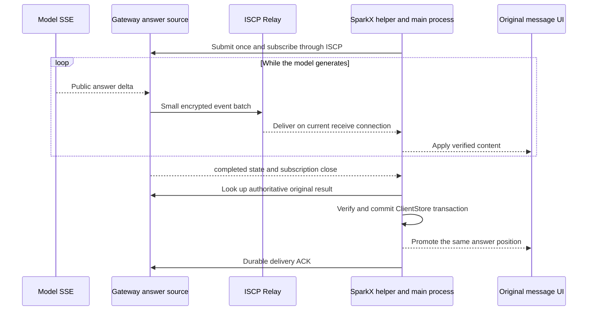

# ISCP and SparkClaw Streaming Output Design

> Language: English | [简体中文](../zh-cn/docs/iscp-application-stream-design.md)

- Status: design proposal for discussion, associated with InfiniCenter ProjectGroup-2 decision **0036 proposed**. This change produces documentation only; no implementation, release or deployment.
- Initial draft: 2026-10-16; revised: 2026-10-18 (internal-use proposal v3).
- Current scope: reuse valid authorization locally with background refresh, without per-batch remote waits; remove artificial quotas on the self-managed transport. Resource scheduling and backward compatibility are deferred. This supersedes the corresponding earlier requirements; documentation only, with no code, configuration or deployment changes.
- Parameter status: authorization cache, recovery deadlines and latency numbers below are design defaults, not implemented or measured guarantees.
- Historical source baseline from the initial draft (not a new qualification): SparkClaw `b8952d8cf6ec2395d55b1b4ad049090932f82690`; local ISCP fork `47f1f6c231c56c92eff6b6c5d398e037ebcf9602`. SparkClaw pins `v0.2.0-rc.1`, resolving to `2707cce6922768882f77c5bdaddaef74db759a73`. These ISCP revisions differ only in `AGENTS.md`; their protocol and implementation are identical.

## 1 Conclusion and Goals

**ISCP can carry real incremental push without a new encryption protocol. SparkClaw needs persistent subscriptions, incremental events, recovery and continuous rendering. The self-managed Relay uses continuous receive without artificial quotas; resource scheduling is deferred. Switching to the latest ISCP fork alone adds no streaming capability.**

SSE specifically means HTTP `text/event-stream`. This design retains model-side SSE, converts permitted answer deltas into encrypted ISCP events, and delivers them continuously to SparkX. It provides equivalent server-push behavior without tunneling a complete HTTP response or bypassing ISCP with direct desktop-to-Gateway business HTTP. Existing browser HTTP SSE remains another transport binding.

Real streaming means several batches of produced answer content reach the original UI while the model is still generating, without a new client progress request for every batch. Rendering must not wait for a completed answer and then play its characters. A provider that returns all content at once, a task without public text, or opening an already completed conversation may legitimately display one result; those cases cannot prove streaming performance.

The reported first-character-then-full-answer behavior has several plausible paths: merged progress snapshots, Agent buffering, final-message replacement and arrival-paced animation. The original stream trace from the other computer is unavailable, so source analysis does not establish a unique cause for that incident.

## 2 Current and Target Paths

| Stage | Current behavior | Target |
| --- | --- | --- |
| Model | Requests `stream:true`, parses SSE and emits `text_delta` | Preserve the actual incremental source |
| Agent | Streams ordinary text; answers starting with `{` or a backtick may wait for `done` | Extract public answer increments using an explicit output format; do not classify ordinary code fences as wrappers |
| Execution progress | Cumulative 8 KiB preview; stops appending after truncation | Separate answer projection and event source with bounded recovery |
| ISCP application adapter | One Response completes and deletes a pending call | One subscription receives events until a terminal response |
| Desktop helper and IPC | One `call`, one response | Explicit stream open, events, completion and cancellation |
| UI | Polls snapshots, animates previews, renders final messages separately | Update original components with received content and preserve final handoff |
| Upstream reference Relay | Drains at most 100 existing messages, sends `drained`, closes | Receive continuously while healthy and authorized; close for faults, rekeying or revocation |

Submission, subscription, lookup and ACK all use the original ISCP channel. Model completion and durable local storage are separate events. Existing recovery may discover the final result first; it does not depend on receiving stream completion.

## 3 ISCP and SparkClaw Responsibilities

| Owner | Proposed change | Preserved boundary |
| --- | --- | --- |
| ISCP Core | Streaming does not require changing SecureEnvelope, session handshake or cryptography | Existing identity, Trust Grant, PoP, opaque routing and replay protection |
| Optional ISCP application extension | Propose generic frames/schema, codec, sequence validation and conformance fixtures in the local fork; candidate package `pkg/iscp/appstream` | No execution tasks, LLM semantics, SparkClaw operations or UI; not yet an upstream standard |
| ISCP reference Relay | Consolidate continuous receive, remove artificial quotas and forced healthy-connection rotation, retain takeover/revocation/recovery; resource scheduling is deferred | Relay handles opaque envelopes, not tokens, plaintext, task IDs or application stream state |
| SparkClaw ISCP Endpoint | Stream call lifecycle, event dispatch, subscription cancellation, ordering recovery and matched-release confirmation | Ordinary RPC remains one response; events are not repeated ordinary Responses |
| SparkClaw Gateway | `execution.progress.stream` connects permitted answer production to subscriptions | Subscriptions never create or rerun tasks; existing JingSi Runtime, App-CLI and IMMS contracts remain unchanged |
| SparkClaw Agent | Initially stream only explicitly selected plain-text and Markdown final answers | No planning, reasoning, tool arguments or unapproved intermediate data |
| SparkClaw desktop | Helper, transport/auth and ExecutionProgressClient consume and recover streams | Account, device, installation, session and authorization generation remain bound |
| SparkClaw UI | Adapt original components, coalesce paint notifications and hand off to final messages | Preserve pages, menus, layout, style, attachments, approvals, cancellation and conversation navigation |

The generic stream SDK is a recommended ownership boundary, not a missing prerequisite in ISCP Core. With an already qualified continuous Relay, SparkClaw can implement its application binding over existing envelopes. The fork's optional extension and Relay consolidation still need separate review; two permanent copies of the same stream protocol should not be the end state.

### 3.1 Relay Prerequisites

Upstream `47f1f6c` drains once and shares a default 120 requests/minute clientKey allowance across HTTP routes. Read-only inspection on 2026-10-16 found TEST1 configured for 3600 requests/minute and a 55-second receive window; source issuer forwarding separately has 600 requests/minute and 32 concurrent slots. These numbers describe existing gates to remove, not constraints for the target deployment.

SparkClaw already has continuous receive in `internal/iscprelayreference/receive.go`: one receive owner, replacement, notifications with a one-second fallback, Ping/Pong, a maximum 55-second window, shutdown and revocation handling. Existing deployment records describe TEST1 using this patch. The design relies on inspected source and those records, not on an assertion that upstream has the feature or that production was requalified in this turn.

Reuse and review this patch: keep healthy authorized connections open, remove forced 55-second rotation and fixed one-second reconnect waits. Run liveness checks independently rather than waiting for a Pong per message. Preserve receive-owner fences, known revocation, failure detection and transaction rollback. Core envelopes and existing Relay frame definitions remain unchanged; old Relay adaptation and mixed-version qualification are outside this phase.

The target deployment uses PostgreSQL, including delivery and failed-write rollback validation. A successful Relay socket write does not establish desktop display or durable storage. Multi-tenant fairness, dynamic worker pools, resource reservations and large-scale load scheduling are deferred.

## 4 Application Contract and State Machine

### 4.1 Opening and Identity

The matched internal release declares execution_stream and execution.progress.stream, enabled after explicit matching-version capability confirmation. Subscribe only after acceptance of the original execution; an authoritative result goes directly through final delivery. Each subscription uses a new random subscription_id equal to its stream RPC ID and different from the business request_id.

Opening contains the original request_id, input_digest, latest-open time and optional cursor. The server derives deployment, owner, client and installation from authenticated context; the subscription also binds execution, ISCP session, authorization revision and local auth generation. Self-declared identity never overrides that context. Opening reuses a valid authorization snapshot; without one it waits for one authority check, as defined in section 6. The 10-second opening window starts only when authority is ready and the open is actually sent.

### 4.2 Data, Control and Completion

| Layer | Fields or behavior | Rule |
| --- | --- | --- |
| ISCP envelope | message_id, session_id, sequence | Session and replay protection, not answer ordering |
| Generic frame | schema_version, subscription_id, stream_seq, body | Payload type is iscp.application.stream.v1; body is opaque to the SDK |
| Business binding | kind, request_id, input_digest, epoch, generation, revision | Fixed epoch/generation per subscription; revision is the source version |
| delta | from_offset, to_offset, text, content_digest | UTF-8 byte offsets, append only; SHA-256 of the complete resulting text |
| snapshot_begin | snapshot_id, baseline revision, total bytes, full digest | Create a candidate without replacing the visible preview |
| snapshot_chunk | snapshot_id, offset, text | Write only to the candidate; never split a UTF-8 character |
| snapshot_end | snapshot_id, total bytes, full digest | Publish the candidate atomically after full validation |
| state | Binding and existing business state | Neither text nor delivery evidence |
| Separate control | cancel, invalidate, original subscription, source version, reason | Outside text sequencing; can end observation or invalidate an old projection, never publish text |
| Sole terminal response | Original RPC ID, last_stream_seq, reason | terminal, renew, canceled, reset, auth_expired, gap, preview_unavailable; not proof of business success |

Digests use lowercase hexadecimal SHA-256 over raw UTF-8, without Unicode normalization. Offsets start at 0, stream_seq at 1; integers fit JavaScript's safe integer range. One strict schema and positive/negative fixtures freeze mandatory fields before implementation. Unauthenticated input, unknown versions, invalid UTF-8/integers, binding drift and digest errors cannot advance application receive state.

Opening may yield zero or more frames and at most one normal terminal RPC response; disconnection does not guarantee completion delivery. If terminal/renew arrives early, wait at most 2 seconds to reach last_stream_seq before settling; otherwise recover. cancel, invalidate, known revocation and a stored authoritative result do not wait for text gaps. Controls still validate identity, direction, subscription and source version, using valid local authority. Local expiry/revocation cleanup needs no remote query.

### 4.3 Ordering and Cancellation

Each subscription has one sending owner and contiguous frame numbers; subscriptions may interleave. After envelope authentication and local authorization, apply text only in contiguous order. Application retransmission uses fresh encryption and outer message_id/sequence, preserving stream_seq and content. Ignore proven-equivalent duplicates, reject conflicts and never apply old frames whose equivalence cannot be established. Wait at most 2 seconds for a gap, then recover the original task without skipping text.

Within an epoch/generation, revision identifies a fixed text offset and digest; state events need not change text. A snapshot fixes a baseline followed only by later deltas. Process restart changes epoch; answer replacement/retry changes generation. Either change sends invalidate and closes the old subscription with reset, then subscribes to a new baseline. Do not splice generations inside one subscription. Business failure/cancellation may invalidate temporary text, while the original result path delivers the failed/canceled result; normal completed keeps its preview until final handoff.

The receive loop does not wait for remote authorization, UI callbacks or a whole snapshot; each subscription advances state and sending serially. Canceling observation releases only that subscription, never resets the shared session or invokes execution.cancel. One desktop process shares one subscription per original execution and cancels when its last observer leaves; independent subscriptions do not cancel one another.

The latest-open time defaults to 10 seconds after sending and uses existing clock-tolerance rules on the server. A cancel carries the original latest-open time and, if it arrives first, fences the same identity/session/subscription through that time plus existing clock tolerance. The server rejects claimed times beyond the allowed opening window; repeated controls cannot extend it. Expired opens are rejected. Late frames cannot reopen a closed subscription.

### 4.4 Unified Transitions

These are observation states, distinct from business task states. One state owner arbitrates identity, authorization and durable-storage events.

| Current state | Event | Next state and action |
| --- | --- | --- |
| opening | Confirmation or first valid event | receiving; establish a baseline or consume deltas |
| opening | Opening deadline exceeded | recovering; look up the original task, never resubmit |
| receiving | delta/state | receiving; validate/apply, then notify original components |
| receiving | Complete valid snapshot | receiving; atomically replace, then apply later deltas |
| receiving | Disconnect, gap or source-version change | recovering; discard old candidate and follow section 5 |
| receiving/recovering | Refresh fails but authority snapshot is valid | No transition; continue streaming and retry in background |
| Any nonclosed state | Authority expires without renewal | auth_paused; close old subscription, hide preview, retain task identity |
| auth_paused | Authority restored within recovery deadline | recovering; new subscription and complete snapshot |
| receiving | Normal completion with all tail frames | awaiting_result; retain valid preview and look up final result |
| recovering/auth_paused | Recovery deadline exhausted | awaiting_result; stop automatic preview recovery, retain result recovery |
| Any nonclosed state | Verified final result committed locally | closed; show final result in place, ACK independently |
| Any nonclosed state | Cancel observation or last observer leaves | closed; release observation, not the business task |
| Any nonclosed state | Known revocation or account/installation switch | closed; clear temporary identity data and reject old frames |
| closed | Old frame, completion or refresh result | closed; ignore, never revive |

Recheck identity, authorization expiry and generation before every text publication and final transaction. Known revocation/identity change fences uncommitted text or storage actions; it does not retroactively delete previously legitimate history. Once the authoritative result is committed, reset, tail frames, animation and candidates cannot overwrite it. Canceling observation does not stop existing durable task recovery. Source invalidation discards the candidate before establishing a baseline; normal completion settles after gaps are filled or the final result is stored.

## 5 Answer Formats and Recovery

### 5.1 Initial Formats

Initially guarantee real streaming for plain text and Markdown, including code fences, Chinese and other multibyte text. A trusted workflow selects the output mode before calling the model; do not infer it from the first character. Plain text beginning with a brace or backtick still streams. Forward only public final-answer text_delta, never planning, reasoning, tool arguments or unapproved intermediate content.

Structured final wrappers initially use complete parsing/validation followed by direct final display, without incremental extraction or character playback. They are excluded from successful real-streaming samples. Allowed fields, duplicate keys, escapes, fragmentation and final validation failure are a later separate design; that parser is not a prerequisite for this phase.

### 5.2 Projection, Cursor and Warm Reconnect

Maintain a temporary projection and short replay history, not permanent token history. Text and candidates respect the existing business result format: the current total result limit is 8 MiB including other result content. New streams do not inherit the old progress 8 KiB limit. Retain the most recent 30 seconds of replay within existing text-size bounds; subscriptions do not delay ACK, revocation or result cleanup.

A cursor contains epoch, generation, revision, offset and full-text digest. Submit it only while the corresponding verified text also exists in client memory; it is not a delivery ACK. Recovery uses a new subscription and stream_seq starting at 1, preserving business request_id/input_digest.

1. Cursor remains in replay: validate it, capture the replay upper bound and register the live observer in one short critical section; replay precedes subsequent events.
2. Cursor is too old but projection is complete: atomically capture a snapshot baseline and register subsequent deltas; replace only after complete candidate validation.
3. Same identity, valid authority snapshot and unchanged source version: retain verified text across a short outage; never continue a partial candidate across connections.
4. Epoch/generation change, expired authority or identity change: discard candidate and invalid preview. If the server has no current projection, return preview_unavailable and recover only the final result.
5. Once the authoritative result is stored: stop preview recovery; candidates and late frames cannot overwrite it.

### 5.3 Cold Start and Large Snapshots

Initially do not persist preview text, cursors or partial snapshots. After desktop/helper restart, recover the original request_id/input_digest from durable task records and look it up: store a completed result; fetch a full snapshot for a running, previewable task; otherwise await the final result. Never restore an isolated cursor without text, resubmit or rerun the task.

A snapshot binds its own snapshot_id, fixed baseline and full digest. Pack chunks within the encoded 64 KiB message budget rather than the live delta 4 KiB trigger. Include JSON escaping and metadata, and split only at UTF-8 character boundaries. Deltas generated meanwhile follow the baseline and are applied after full validation.

Renewal with the same identity, scope, revision and session updates deadlines without discarding the candidate, reopening or restarting transmission. Permission reduction/version change closes the old subscription and obtains a new baseline under new authority; real session replacement also creates a new subscription. After transport loss, fetch the candidate from scratch; partial-snapshot resumption is not promised.

Each incident shares a 30-second recovery deadline starting at the first disconnect/gap or authority expiry. A cold-start snapshot starts timing when observation begins. Failed opens, replaced connections, candidate restarts and waiting for authority do not reset it. If a complete baseline cannot catch up within 30 seconds, return preview_unavailable, stop automatic preview recovery and retain original-task result lookup; that lookup still obeys its own authority rules. Reopening the conversation may start one new observation.

Retry transient failures after 250 ms, 500 ms, 1 second, 2 seconds, then at most 5 seconds, always within the total deadline; never retry known revocation. This is an incident recovery deadline, not a cumulative request quota. cancel, invalidate, known revocation or final-result commit immediately discards a candidate without waiting for snapshot_end.

## 6 Authorization and Internal-Use Scope

### 6.1 Local Authority Snapshot and Background Refresh

Reuse a valid authority snapshot at opening, validate locally per batch and refresh periodically in the background. Do not add an issuer-signed lease wire format or cross-subject Gateway delegation. Reuse existing verifiable authority-query results within a bounded lifetime in trusted Endpoint memory.

| Item | Design default or rule |
| --- | --- |
| Binding | deployment, owner, client, installation, peer identity, Grant, session, scope, authorization revision, local auth generation |
| Establishment | Query once when no valid snapshot exists; only active results with verified provenance and signatures/trust establish a snapshot |
| Lifetime | At most 5 minutes and no later than Grant/capability expiry; measured from check initiation, not delayed response arrival |
| Refresh | Every 60 seconds in the background, earlier for nearer known expiry; share refresh work within the same binding |
| Query and retry | Each query lasts at most 10 seconds; retry failures every 5 seconds in background; stream while the snapshot remains valid |
| Per-batch validation | Local identity, session, scope, expiry, revision, cancellation/revocation and integrity checks, without remote waiting |
| Expiry or known revocation | Stop sending/displaying text, hide temporary preview and close the old subscription; expired authority may be rechecked, known revocation cannot revive |
| Restart or session/identity replacement | Do not reuse the old memory snapshot; bind and verify again |

This is explicit bounded caching, not per-batch fresh authority. Normally remote revocation is discovered at the next successful refresh or verified notification; query latency contributes to discovery delay. With no connectivity or notification, reuse may last at most 5 minutes from that check's initiation, or an earlier Grant/capability expiry. Once revocation is known locally, clear immediately without waiting for cache expiry.

Use a process-monotonic TTL. Convert absolute Grant/capability deadlines with existing clock-error rules; clock rollback cannot extend authority. A response arriving after its deadline cannot establish a snapshot. Before publishing a refresh, recheck its original identity, session and auth generation; an old success cannot overwrite later revocation or identity change. Same-version renewal extends validity without reopening or discarding a candidate; changed revision or scope closes the old subscription and recovers under new authority.

Authority queries do not themselves renew Grants or capabilities. Existing renewal flows refresh those independently in background; unchanged rights continue after verified renewal, otherwise their original deadlines still apply.

Both sender and receiver enforce these rules. The policy covers only this proposal's stream opening, events and subscription controls. Business submit, approvals, tool execution, execution.cancel and authoritative lookup/ACK retain their existing authorization contracts. PoP, Trust Grant, ciphertext validation, business visibility and revocation fences remain effective. Pure local cleanup needs neither valid authority nor a network call.

### 6.2 Remove Artificial Quotas; Defer Resource Scheduling

Plan for internal low-concurrency use. Remove fixed request-rate, concurrency-count and cumulative-use quotas from the self-managed Relay, issuer forwarding and stream-call path. Increasing old numbers is not the objective; healthy connections are not forcibly rotated.

Multi-tenant fairness, priority reservations, dynamic worker pools, capacity modeling, slow-consumer scheduling and large-scale stress qualification are all out of scope. Use ordinary send queues, cancellable operations and explicit errors, without a separate resource scheduler. Message sizes, authority expiry, integrity, existing result-format sizes and recovery deadlines retain their meanings, not cumulative request/task allowances.

### 6.3 Live Sending Cadence

Send the first nonempty answer increment immediately. Thereafter flush at 50 ms or 4 KiB of raw UTF-8, whichever comes first; flush the remainder immediately on completion. The 50 ms window is batching delay, not typing speed. Each encoded frame must fit 64 KiB including JSON escaping and metadata; split an oversized model delta into valid frames.

Sending waits for neither the next authorization refresh nor the complete answer. Relay does not wait for a Pong per message. Desktop coalesces received content only by paint frame, without artificial typing delay. These remove avoidable pauses under low concurrency; they are not a resource scheduling design.

## 7 Desktop Integration and Final Handoff

Ship helper and Electron together with stream_call, stream_event and stream_cancel; ordinary call/response keeps its meaning. Subscriptions inherit neither ordinary RPC total timeouts nor the 55-second receive window. Same-permission authority/capability renewal maintains the subscription; actual expiry or session replacement triggers state transitions. Closing the page cancels observation; only the existing stop-task action invokes execution.cancel.

Preserve TaskProgressMessage, MessageBubble and every existing page, menu, layout, style, attachment, approval, setting and conversation interaction. Received text enters original components by the next paint frame. Coalesce notifications and fence old asynchronous reads using conversation read versions. Add no permanent transport-status UI.

Final delivery remains: look up the original task, verify the complete payload digest, recheck identity/authority/generation, commit message and receipt in ClientStore, replace the preview in place, then ACK in background. Storage and ACK do not wait for animation, tail frames or a complete preview; failures use existing durable delivery recovery.

Identical text changes only durability status; a prefix extension displays its remainder immediately; normalization or correction atomically adopts the authoritative result. Replacement and preview removal share one view update, with no blank interval or duplicate bubble. History does not replay. A short outage with valid authority retains verified text; expiry, revocation or identity change hides temporary previews according to the state machine, using existing error UI only when user action is needed.

## 8 Matched Internal Releases and Publication Boundary

The user confirms there is no public deployment. Backward compatibility, automatic fallback, mixed-version matrices and old Relay adaptation are outside this phase and are not implementation or acceptance prerequisites.

Gateway, helper, Electron, ISCP extension and Relay share an internal release manifest recording each revision and stream schema version. Before opening, confirm local IPC and remote schema match. Otherwise explicitly reject the new stream operation and require a matched update; do not guess fields or silently fall back to progress. This is version correctness, not backward compatibility design.

Temporary Go workspaces may support local integration; delivered builds pin obtainable commits/versions without machine-specific absolute replace paths. Design compatibility separately if public or mixed deployments become necessary. Rollback uses a qualified complete release combination, preserving business databases, identities and original task records without resubmission; independent component downgrade interoperability is not promised.

This turn changes documentation only: no build, installation, push, deployment or existing public contract change. The generic extension remains proposed; internal-use decisions do not imply ISCP upstream acceptance.

## 9 Stages and Acceptance Criteria

### 9.1 Stages

1. Freeze stream schema, authority snapshots, state transitions and recovery rules with positive/negative fixtures; resource scheduling and backward compatibility are not prerequisites.
2. Connect a controlled incremental producer through encrypted Endpoint, continuous Relay, helper, IPC and original UI; prove batches never wait for remote authority.
3. Integrate real-model plain text/Markdown, warm reconnect, cold start, final handoff and original UI regression.
4. Qualify the matched internal release against the latency targets below, then discuss packaging, single-node verification and deployment.

### 9.2 Functional and Failure Acceptance

| Scenario | Passing behavior |
| --- | --- |
| Controlled 600 characters | Produce 6 Chinese characters every 100 ms for 100 batches; at least 90% visible before done; one subscription, no per-chunk progress RPC or later typing playback |
| Real-model plain text/Markdown | Grow during generation; only samples producing multiple visible deltas qualify as real streaming |
| Code fences, leading brace, over 8 KiB, multibyte text | No first-character buffering or old-preview truncation; no loss/duplication/corruption; final result verifies |
| Structured final wrapper | Display after full validation without leaking internal fields or claiming real streaming |
| Slow/failed background authority | Valid snapshots keep sending/displaying; no per-batch remote-query dependency |
| Expiry, known revocation, identity switch, late refresh | No text publication after invalidation; old success cannot revive authority; cleanup does not wait for network |
| Same-version renewal and permission changes | Renewal keeps candidate/subscription; changes close old streams and recover with new authority |
| Duplicates, reordering, early completion, bad digest | Contiguous verified text, 2-second gap rule, no swallowed tail frames |
| Cancel before open, late old invalidate/completion | Cancellation fence works; mismatched controls have no effect; closure cannot revive |
| Warm reconnect and cold start | Warm text matches cursor; cold start looks up the task and requests a full snapshot, without isolated cursors or resubmission |
| Renewal, disconnect, source change or final commit during snapshot | Renewal continues; invalidation discards candidate; restarting does not reset 30 seconds; final result wins |
| Exhausted recovery deadline | Stop automatic preview recovery, keep the original task, no reopening spin |
| More than 55 seconds | No old-window forced disconnect or fixed one-second cooldown |
| Final result concurrent with preview | One logical delivery in place; transaction and idempotent ACK do not wait for animation/tail frames |
| Current release and original UI | Matched release opens correctly; mismatch explicitly rejects; menus, conversations, attachments, approvals, cancellation and settings remain |

### 9.3 Smoothness Targets

These are design acceptance targets, not measurements. The baseline is one active plain-text/Markdown answer stream, transport-path RTT at most 150 ms, no injected packet loss, and endpoints/Relay without known faults. Record machines, network, model and release; large-scale stress tests are not required. Record user submission to first model delta separately as inference/tool latency.

| Metric | Target |
| --- | --- |
| First visible delta to original UI paint after opening | At most 500 ms |
| Per-batch production-to-paint delay during generation | P95 at most 300 ms; P99 at most 500 ms |
| Extra stalls while visible deltas keep arriving | No stall over 1 second unrelated to the model or real disconnection |
| Healthy-path send batching | At most 50 ms; first/last batches flush immediately |
| Recovery of a projection up to 64 KiB after network/authentication restoration | P95 at most 3 seconds to current valid text |
| Total incident recovery deadline | 30 seconds, never extended by reopening; explicitly stop automatic preview recovery on expiry |
| ClientStore commit to final handoff | Within normal paint scheduling, without additional animation wait |

Use a shared monotonic observation clock for the controlled producer and UI, or quantify cross-host timing error. Without an error bound, report process-local stages only; do not subtract absolute clocks to claim end-to-end P95. Run at least 20 controlled 600-character samples for percentiles, plus long-text and real-model cases; retain batch correlation IDs and sample counts.

Record request/subscription/seq, bytes, digests, production, send, receive, verification, paint, background refresh and final-commit timing, never text or credentials. On failure, locate the stage and review design changes; do not slow the producer afterward or silently relax thresholds. Report other network conditions separately rather than borrowing this baseline's conclusion.

## 10 Decisions and Deferred Work

| Topic | Decision |
| --- | --- |
| Authorization | Local valid snapshot, at most 5 minutes, refresh every 60 seconds, no per-batch remote waiting |
| Artificial quotas | Remove fixed rate, concurrency-count and cumulative quotas from self-managed transport and authority forwarding |
| Resource scheduling | Internal low concurrency; no design or acceptance prerequisite in this phase |
| Compatibility | Matched internal release only; no backward compatibility or automatic fallback |
| Formats | Real plain-text/Markdown streaming; structured wrappers display after full validation |
| Recovery | Verify warm text/cursor, full cold-start snapshot, 30-second deadline, no task rerun |
| Lifecycle | Fixed epoch/generation per subscription; unified state machine; no revival by old frames; authoritative result wins |
| Ownership | Optional ISCP extension owns generic frames/validation; SparkClaw owns business streams, authority snapshots and IPC/UI |
| Current authorization | Update bilingual design and InfiniCenter records only; no product code or live changes |

The 5-minute cache, 60-second refresh, 10-second query, 50 ms batching, 2-second gap wait and 30-second recovery are explicit design defaults. Future changes must update both languages, state transitions and acceptance fixtures. No further resource-scheduling or backward-compatibility design is required this turn.

SDK receive-authentication order still needs review: the original inspection found envelope.Decrypt calls MarkReceived before AEAD verification. Implementation must prevent failed input from advancing security receive state and add negative fixtures. Authorization caching does not remove this requirement, nor establish it as the cause of the historical first-character-then-full-answer incident. No encryption wire change is required.

## 11 Source and Existing Evidence

Line numbers refer to the historical initial-draft baselines. Repository links point to source files; ISCP links pin the exact revision.

| Fact | Evidence |
| --- | --- |
| Model SSE and Agent buffering | [router.go](../services/gateway/internal/modelrouter/router.go) 612, 642, 672; [agent.go](../services/gateway/internal/agent/agent.go) 960–994 |
| Execution source and old preview | [execution_workflow.go](../services/gateway/internal/gateway/execution_workflow.go) 120; [progress.go](../services/gateway/internal/execution/progress.go) 11, 86, 128, 154; [execution_progress.go](../services/gateway/internal/gateway/execution_progress.go) 43 |
| One-shot response and dispatch | [endpoint_rpc.go](../services/gateway/internal/iscpworkbench/endpoint_rpc.go) 27, 67, 156, 273; [endpoint.go](../services/gateway/internal/iscpworkbench/endpoint.go) 557, 635 |
| Negotiation and fresh authority | [negotiation.go](../services/gateway/internal/iscpworkbench/negotiation.go) 201, 224; [authorization.go](../services/gateway/internal/iscpnodeclient/authorization.go) |
| Helper, client and UI | [helper](../services/gateway/cmd/iscp-workbench/main.go) 153, 246, 291; [execution-progress.mjs](../apps/desktop/src/main/execution-progress.mjs) 77; [execution-client.mjs](../apps/desktop/src/main/execution-client.mjs) 243, 261; [LocalWorkbench.tsx](../apps/webchat/src/desktop/LocalWorkbench.tsx) 225, 476; [messages.tsx](../apps/webchat/src/components/messages.tsx) 94 |
| SparkClaw Relay patch | [receive.go](../services/gateway/internal/iscprelayreference/receive.go); [deployment record](public-iscp-node-deployment.md); [prior latency measurements](iscp-latency-optimization.md) |
| ISCP envelopes and sequence state | [envelope.go](https://github.com/Infinimesh-ai/ISCP/blob/47f1f6c231c56c92eff6b6c5d398e037ebcf9602/pkg/iscp/envelope/envelope.go#L34); [session.go](https://github.com/Infinimesh-ai/ISCP/blob/47f1f6c231c56c92eff6b6c5d398e037ebcf9602/pkg/iscp/session/session.go#L243) |
| Upstream drain, allowance and queue | [server.go](https://github.com/Infinimesh-ai/ISCP/blob/47f1f6c231c56c92eff6b6c5d398e037ebcf9602/services/relay-reference/internal/relay/server.go#L546); [PostgreSQL claim](https://github.com/Infinimesh-ai/ISCP/blob/47f1f6c231c56c92eff6b6c5d398e037ebcf9602/pkg/server/repository/relay.go#L254) |
