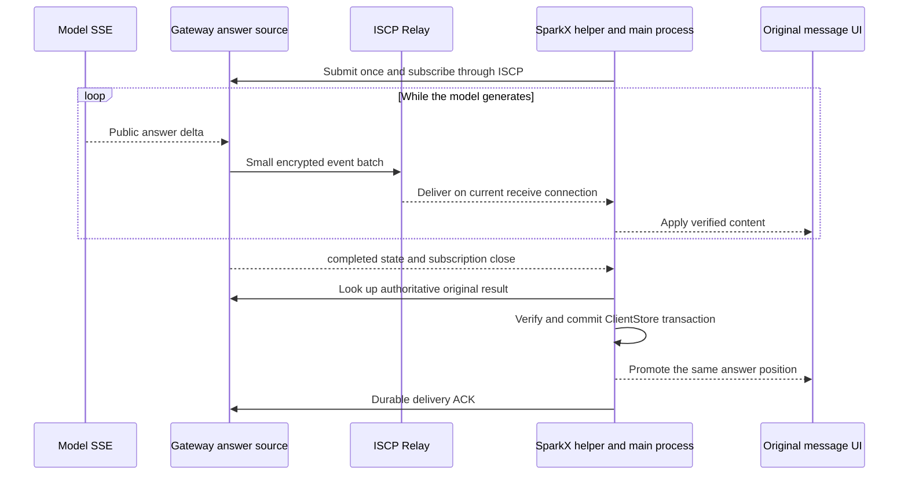

# ISCP and SparkClaw Streaming Output Design

> Language: English | [简体中文](../zh-cn/docs/iscp-application-stream-design.md)

- Status: design proposal for discussion, associated with InfiniCenter ProjectGroup-2 decision **0036 proposed**. This change produces documentation only; no implementation, release or deployment.
- Date: 2026-10-16.
- User-selected capacity policy: remove artificial request-rate, concurrency and cumulative quotas from the self-managed ISCP transport deployment. Backpressure and overload follow actual server resources. This supersedes earlier advice to tune around upstream quotas; implementation remains pending and this turn changes neither code nor live configuration.
- Inspected baseline: SparkClaw `b8952d8cf6ec2395d55b1b4ad049090932f82690`; local ISCP fork `47f1f6c231c56c92eff6b6c5d398e037ebcf9602`. SparkClaw pins `v0.2.0-rc.1`, resolving to `2707cce6922768882f77c5bdaddaef74db759a73`. These ISCP revisions differ only in `AGENTS.md`; their protocol and implementation are identical.

## 1 Conclusion and Goals

**ISCP can carry real incremental push without a new encryption protocol. SparkClaw needs persistent subscriptions, incremental events, recovery and continuous rendering. Deployments using the original upstream reference Relay also need continuous receive and adequate capacity. Switching to the latest ISCP fork alone adds no streaming capability.**

SSE specifically means HTTP `text/event-stream`. This design retains model-side SSE, converts permitted answer deltas into encrypted ISCP events, and delivers them continuously to SparkX. It provides equivalent server-push behavior without tunneling a complete HTTP response or bypassing ISCP with direct desktop-to-Gateway business HTTP. Existing browser HTTP SSE remains another transport binding.

Real streaming means several batches of produced answer content reach the original UI while the model is still generating, without a new client progress request for every batch. Rendering must not wait for a completed answer and then play its characters. A provider that returns all content at once, a task without public text, or opening an already completed conversation may legitimately display one result; those cases cannot prove streaming performance.

The reported first-character-then-full-answer behavior has several plausible paths: merged progress snapshots, Agent buffering, final-message replacement and arrival-paced animation. The original stream trace from the other computer is unavailable, so source analysis does not establish a unique cause for that incident.

## 2 Current and Target Paths

| Stage | Current behavior | Target |
| --- | --- | --- |
| Model | Requests `stream:true`, parses SSE and emits `text_delta` | Preserve the actual incremental source |
| Agent | Streams ordinary text; answers starting with `{` or a backtick may wait for `done` | Extract public answer increments using an explicit output format; do not classify ordinary code fences as wrappers |
| Execution progress | Cumulative 8 KiB preview; stops appending after truncation | Separate answer projection and event source with bounded recovery |
| ISCP application adapter | One Response completes and deletes a pending call | One subscription receives events until a terminal response |
| Desktop helper and IPC | One `call`, one response | Explicit stream open, events, completion and cancellation |
| UI | Polls snapshots, animates previews, renders final messages separately | Update original components with received content and preserve final handoff |
| Upstream reference Relay | Drains at most 100 existing messages, sends `drained`, closes | Wait for new messages within a bounded connection window, with replacement and revocation |

Submission, subscription, lookup and ACK all use the original ISCP channel. Model completion and durable local storage are separate events. Existing recovery may discover the final result first; it does not depend on receiving stream completion.

## 3 ISCP and SparkClaw Responsibilities

| Owner | Proposed change | Preserved boundary |
| --- | --- | --- |
| ISCP Core | Streaming does not require changing SecureEnvelope, session handshake or cryptography | Existing identity, Trust Grant, PoP, opaque routing and replay protection |
| Optional ISCP application extension | Propose generic frames/schema, codec, sequence validation and conformance fixtures in the local fork; candidate package `pkg/iscp/appstream` | No execution tasks, LLM semantics, SparkClaw operations or UI; not yet an upstream standard |
| ISCP reference Relay | Consolidate continuous receive, remove artificial quotas and forced healthy-connection rotation, handle resource overload, and retain takeover/revocation/recovery | Relay handles opaque envelopes, not tokens, plaintext, task IDs or application stream state |
| SparkClaw ISCP Endpoint | Stream call lifecycle, event dispatch, subscription cancellation, ordering recovery and explicit negotiation | Ordinary RPC remains one response; events are not repeated ordinary Responses |
| SparkClaw Gateway | `execution.progress.stream` connects permitted answer production to subscriptions | Subscriptions never create or rerun tasks; existing JingSi Runtime, App-CLI and IMMS contracts remain unchanged |
| SparkClaw Agent | Explicit plain-text versus structured final-wrapper modes and incremental final-answer extraction | No planning, reasoning, tool arguments or unapproved intermediate data |
| SparkClaw desktop | Helper, transport/auth and ExecutionProgressClient consume and recover streams | Account, device, installation, session and authorization generation remain bound |
| SparkClaw UI | Adapt original components, coalesce paint notifications and hand off to final messages | Preserve pages, menus, layout, style, attachments, approvals, cancellation and conversation navigation |

The generic stream SDK is a recommended ownership boundary, not a missing prerequisite in ISCP Core. With an already qualified continuous Relay, SparkClaw can implement its application binding over existing envelopes. The fork's optional extension and Relay consolidation still need separate review; two permanent copies of the same stream protocol should not be the end state.

### 3.1 Relay Prerequisites

Upstream `47f1f6c` drains once and shares a default 120 requests/minute clientKey allowance across HTTP routes. Read-only inspection on 2026-10-16 found TEST1 configured for 3600 requests/minute and a 55-second receive window; source issuer forwarding separately has 600 requests/minute and 32 concurrent slots. These numbers describe existing gates to remove, not constraints for the target deployment.

SparkClaw already has continuous receive in `internal/iscprelayreference/receive.go`: one receive owner, replacement, notifications with a one-second fallback, Ping/Pong, a maximum 55-second window, shutdown and revocation handling. Existing deployment records describe TEST1 using this patch. The design relies on inspected source and those records, not on an assertion that upstream has the feature or that production was requalified in this turn.

Reuse and review the patch while allowing authorized, healthy connections to remain open. Remove forced 55-second rotation and the fixed one-second wait after a normal reconnect. Run liveness checks independently rather than requiring a Pong before every delivered message; preserve receive-owner fences, live revocation, failure detection and transaction rollback. Continue supporting old Relay `drained` behavior without replacing the logical receive process. Actual disconnection, authority failure or session replacement enters application recovery. Preserve existing ready/envelope/drained wire compatibility.

Also verify per-device and global queued bytes, database backlog, claim/release on failed writes and expired ciphertext cleanup. Memory and PostgreSQL branches currently differ in capacity and delivery behavior. A successful socket write is neither SparkX display nor durable storage acknowledgment.

## 4 Application Stream Contract

The following interfaces are proposed, not implemented or frozen.

### 4.1 Opening and Identity

Add explicit `execution_stream` negotiation and `execution.progress.stream`. Subscribe only after the original execution is accepted; if its result is already complete, use authoritative lookup. Every subscription has a new random `subscription_id`, which may equal its streaming RPC ID but must differ from the execution's `request_id`.

Opening supplies the original `request_id`, `input_digest` and an optional recovery cursor. The server derives owner/client/installation from authenticated context rather than trusting self-declared identity. Bind deployment, owner, client, installation, execution, input digest, ISCP session, authorization revision and local auth generation. Late events cannot enter a replacement context after any binding becomes invalid.

### 4.2 Generic Frames and Business Events

| Layer | Fields or behavior | Meaning |
| --- | --- | --- |
| ISCP envelope | `message_id`, `session_id`, `sequence` | Encrypted message and session security, not contiguous answer order |
| Generic data frame | `schema_version`, `subscription_id`, `stream_seq`, `body` | Candidate payload type `iscp.application.stream.v1`; body remains opaque to the generic SDK |
| SparkClaw event | `kind`, `request_id`, `input_digest`, `epoch`, `generation`, `revision` | Execution and answer version; source revision differs from subscription sequence |
| Content range | `from_offset`, `to_offset`, `text`, `content_digest` | UTF-8 byte offsets, append-only delta, digest of the full current answer projection |
| Subscription completion | Single terminal RPC response with `last_stream_seq`, `reason` | Distinguishes terminal, renew, canceled, gap, resource_limit and other outcomes; authoritative results determine business success |
| Cancellation and invalidation | Explicit control bound to the original subscription; invalidation also binds snapshot ID and source version | Idempotently detach observation or invalidate an old candidate, not `execution.cancel` or permission to display new content |

Generic data frames are separate from ordinary Responses. A subscription receives zero or more data frames; the server sends at most one normal terminal response, and the local state machine settles once. Disconnect, revocation and timeout may end locally without a delivered remote response. Only normal terminal/renew completion waits through `last_stream_seq`; an early response waits for missing data and then recovers on a bounded gap timeout. User cancellation releases local preview resources immediately without waiting for tail frames. A durably stored authoritative result also allows immediate preview closure.

Business events are `snapshot_begin`, `snapshot_chunk`, `snapshot_end`, `delta`, `state` and `reset`. Snapshots establish baselines, deltas append, state reports existing execution states, and reset explicitly replaces or clears a projection. completed only triggers final lookup. Clearing on failure, cancellation, delivery expiry or authorization failure is not an empty delta.

Before implementation, freeze terminal error codes, cancellation/invalidation wire shapes, required event fields and numeric bounds in strict schemas and fixtures. Controls also require envelope, direction, original subscription, fresh authority and source-version validation. A peer cannot cancel unrelated subscriptions or use old controls to clear a new snapshot. Count text and nested metadata toward size budgets. Unknown fields, invalid UTF-8 or integers, identity drift and mismatched digests must not advance receiver state.

### 4.3 Ordering and Concurrency

One sender owns each subscription, assigning contiguous `stream_seq` values from 1. Different subscriptions may interleave. Envelope sequence cannot substitute for this: the SDK primarily detects duplicates, and Relay priority and database claiming do not establish universal application delivery order.

After envelope authentication, business binding and authorization, a receiver holds events in a byte- and time-bounded reorder buffer and applies only the next sequence. Application retransmissions use newly encrypted envelopes with new outer message_id and sequence, retaining original stream_seq and content. Duplicate ciphertext remains subject to existing replay protection; never bypass decryption checks for deduplication. Compare already-applied events using a bounded digest window: ignore equivalent retransmissions and reject conflicts. Explicitly reject or recover on older frames outside that window rather than claiming their contents were compared. Missing frames, budget exhaustion or timeout recover the preview without skipping bytes. Verify cumulative digests continuously.

The encrypted receive owner performs necessary decryption and short dispatch only, without waiting for network authorization or UI callbacks. Sending, authorization batches and notifications have bounded work state; do not create a goroutine for every token. Subscription cancellation releases only that subscription and must not reuse ordinary Call's session-reset-on-cancel behavior.

Cancellation can arrive before opening. Bind opening to a bounded latest-valid time and retain a cancellation fence for the same identity, session and subscription ID through that time. Reject late opening. Charge fence bytes and never evict them early in a way that reopens an old subscription; reject new openings under pressure. Old-session cancellation cannot affect a new subscription. One state machine arbitrates cancellation and normal completion.

## 5 Gateway Answer Production and Recovery

### 5.1 Actual Answer Source

Reuse the `text_delta` entry in `execution_workflow.go`, adding an answer projection and subscription source while preserving the legacy 8 KiB `ReadProgress` contract. Looping over the old snapshot still stops at 8 KiB and cannot represent missed events precisely.

The Agent must choose an output format explicitly. Plain final answers emit received text directly. Structured final wrappers incrementally expose only the permitted answer field, handling JSON escapes, fragments and Unicode boundaries. A backtick alone must not buffer an entire Markdown code block. Formats requiring complete validation may temporarily remain nonstreaming, with explicit capability/test scope; wrapper planning or tool fields must never leak, and splitting a completed result does not qualify as streaming.

Answer replacement or retry increments `generation` and emits reset; process restart changes `epoch`. Deltas append within one generation. A verified authoritative final answer may differ due to normalization.

### 5.2 Projection and Replay

Keep a current answer projection and a short event replay ring as temporary display data, not a second permanent conversation history. Projection cannot exceed the existing result budget, currently 8 MiB for the combined result including other content. Bound replay by bytes; do not carry over the old 8 KiB preview cap. Retain the active projection within reserved resources. After completion, retain it only for the shorter of a bounded recovery window and existing delivery retention. Preview subscriptions cannot delay ACK cleanup, revocation or deletion.

A recovery cursor contains `epoch`, `generation`, `revision`, offset and digest. It claims what the client received; the server checks it against its own data and never treats it as delivery ACK.

1. Cursor retained: validate the cursor, fix the replay upper bound and register the live observer in one short critical section. Send replay through that bound, followed by queued subsequent events, with no handoff gap.
2. Cursor too old but full projection available: explicitly start a snapshot. Capture its baseline and register subsequent events in one short critical section, avoiding a snapshot-to-subscribe gap.
3. Snapshot larger than one frame: send chunks with a fixed baseline revision, total bytes and digest. The client verifies a candidate buffer before atomically replacing the current projection, then applies post-baseline deltas.
4. Generation continues during snapshot transfer: queue subsequent events within a byte budget. Overflow produces an explicit gap/resource_limit and closes preview instead of unbounded catch-up or blocking the model.
5. Projection lost or unavailable after restart: return reset/preview_unavailable and continue original-task status and final-result recovery. Never rerun work to reconstruct token history.

A brief network interruption may retain verified text only under the same identity and valid authority, until the candidate snapshot is complete. Do not shrink a long preview to its first recovery chunk. Identity changes, revocation or unverifiable authority stop delivery and hide temporary content. A replacement subscription gets a fresh ID and starts its frame sequence at 1; execution identity remains unchanged.

Each snapshot has an independent ID bound to its baseline epoch/generation. Terminal clearing or a generation/epoch change immediately invalidates the sender's old candidate. On receiving the corresponding reset/lifecycle notification or storing an authoritative result, the client immediately invalidates its candidate; late chunk/snapshot_end cannot republish old content. Invalidation controls cannot queue behind a large snapshot: use an authenticated priority control path bound to the original subscription to invalidate candidates early, never to skip sequence and apply text. If control cannot be delivered, detach and recover instead of continuing the old snapshot. Client guarantees start when invalidation is known; it cannot anticipate an undelivered remote state change.

Schedule recovery by reason: normal renew may reconnect directly; transient disconnect/gap uses bounded backoff with jitter; persistent resource_limit waits for budget changes or subsequent ordinary reconciliation rather than immediately reopening; unrecoverable preview_unavailable stops preview retries and retains authoritative-result recovery only. Servers may supply retryable/retry_after, but clients must still prevent retry loops and respect original execution and authorization deadlines.

## 6 Authorization and Resource Control

### 6.1 Preserve Authorization Freshness

The current send path performs fresh authority checks only for Request/Response. New stream payloads must explicitly enter that boundary; merely adding a dispatch case would bypass it.

Phase one retains fresh authorization at opening and for each delivered batch. Freeze outbound batch contents and deadline before checking. Authenticate and bind inbound ciphertext, then check fresh authority before releasing its batch to the application. Content arriving during a check belongs to the next batch, not an indefinitely growing approved batch. Use only existing permitted coordination of overlapping checks, with no unapproved successful cross-batch cache. Recheck session, Grant expiry, revision, cancellation and revocation before release.

Authority round trips remain a real latency floor: removing Relay and issuer request quotas does not remove desktop-to-issuer network time. Before implementation, establish whether authorization scheduling meets the display target. If a stream lease or Gateway delegation is needed, first review expiry, revocation latency and outage behavior as a trust-contract change. Removing quotas does not authorize skipped checks or implicit multi-second caching.

Revocation or identity replacement stops sends and clears queued events and temporary display. Unverifiable authority stops release and enters authentication recovery without falsely declaring permanent revocation. Relay Access/PoP, ISCP Trust Grant and execution visibility are different boundaries; a connected socket does not replace business authority.

### 6.2 Remove Artificial Quotas

The user explicitly directs the self-managed Relay not to inherit upstream rate and quota policies. Actual hardware and runtime resources determine throughput. Do not replace an old small limit with another larger arbitrary allowance.

| Existing artificial gate | Target rule |
| --- | --- |
| Relay per-IP/clientKey requests per minute and configuration ceiling | Remove fixed-rate and cumulative-count rejection; continue accepting while healthy resources are available |
| Issuer forwarding 600/min, 32 concurrent calls and fixed routing slots | Remove these as product quotas too, preventing the bottleneck from moving to authorization; size work scheduling from actual capacity |
| Endpoint/helper/subscription counts such as four or sixteen | Preserve negotiated concurrent=0; no renamed fixed task or subscription quota |
| Transport rejection after cumulative requests, tasks, bytes or messages | No usage-history allowance; handle cryptographic counter boundaries through safe rekey/recovery, not task limits |
| Forced 55-second healthy-connection rotation and one-second cooldown | Keep connections open; reconnect only for real failure, revocation, credential/session renewal or equivalent lifecycle needs |

Scope covers this ISCP transport and authorization-forwarding path. Frame encoding, protocol value ranges, integrity checks and authority expiry retain explicit semantics. Chunk large content rather than interpreting chunk size as a total request or stream allowance. Existing business-result formats and other projects' durable-delivery contracts are reviewed separately; removing Relay quotas does not delete those contracts.

### 6.3 Small Batches and Resource Backpressure

Do not send one network request per token. Candidate policy: send the first nonempty increment promptly, then batch for 50–100 ms or 4 KiB of raw text, whichever comes first. These are unmeasured parameters. The text budget counts UTF-8 bytes; the complete encoded frame, including JSON escaping and metadata, must also fit the existing 64 KiB message budget.

| Resource | Control | On exhaustion |
| --- | --- | --- |
| Events and outbound backlog | Frame, stream, device and global byte budgets | Coalesce consecutive deltas before assigning sequence; otherwise close preview with a recovery reason |
| Recovery data | Projection budget plus bounded replay ring | Evicted history triggers explicit snapshot, never a silent continuity claim |
| Reordering and IPC | Byte budgets, gap deadline and write backpressure | Release/recover subscription without blocking encrypted reception |
| Actual Relay and issuer capacity | CPU, available memory, bandwidth, connections/file descriptors, database pool, IO and queue delay | No count-based rejection with headroom; use fair backpressure and explicit recoverable resource reasons under real overload |
| Renderer | One notification per paint and ordered same-conversation reads | Apply the newest valid projection; reject stale read results |

Preserve negotiated `concurrent=0`. Account for actual state, timers, waiters, authority work, reorder/deduplication digests, cancellation fences and content even for empty subscriptions. Size shared work queues and memory reservations from measured server capacity, not upstream counts imposed as user quotas; additional server resources should increase capacity. Apply backpressure or explicitly close preview on exhaustion instead of waiting until OOM. Trusted scheduling protects control, final results, ACK, cancellation and handshake; streams share receive connections. Preserve typed overload, retry_after where available and resource-domain backoff instead of repeatedly resetting all sessions.

Measure actual requests/second, encrypted bytes/second, per-request CPU/database cost, active-connection memory and queue delay to identify server bottlenecks. Do not derive permitted stream frequency from old 120/600/1200/3600 allowances. Memory/connection-pool budgets must correspond to real instance, container or OS capacity and necessary reserves, not hidden user quotas. Phase one retains envelope POSTs; review batching if HTTP/database cost becomes limiting. Removing counters alone does not establish latency performance.

## 7 Desktop Integration and Final Handoff

Extend the helper's existing JSON-line protocol with negotiated `stream_call`, `stream_event` and `stream_cancel`; preserve ordinary call/response. Electron owns a separate stream API, cancellation, session bindings and terminal response. ExecutionProgressClient consumes subscriptions rather than repeated queries. Detect old-helper/new-Electron incompatibility during local IPC capability exchange.

Subscriptions have deadlines and renewal semantics bounded by business, Grant and capability expiry. Do not inherit ordinary RPC timeouts or equate subscription lifetime with the Relay's 55-second window. Renewal replaces the subscription only. Closing a page may detach observation; only the existing stop-task action invokes `execution.cancel`.

Keep `TaskProgressMessage`, `MessageBubble` and their existing containers. Show received text directly, coalescing at most by paint frame; remove arrival-interval character playback for the new stream. LocalWorkbench must coalesce refresh notifications and discard stale same-conversation read results instead of issuing unordered full-conversation reads per chunk.

Final delivery retains the original sequence: lookup → verify full payload digest → commit local message and receipt transaction → switch display and discard preview → background ACK. Neither storage nor ACK waits for animation or a complete preview.

Associate both views with the original request ID and the same answer position. Identical content changes persistence state only. A prefix extension immediately displays already-received final suffix. Normalization or correction atomically adopts the authoritative result without invented appends or duplicate bubbles. One view transition must cover preview removal and final-message visibility. Historical messages display immediately.

## 8 Compatibility and Dependency Releases

| Combination | Behavior |
| --- | --- |
| New desktop and Gateway with qualified stream capability | One subscription and pushed events |
| New desktop and old Gateway | Legacy long-poll progress only when execution_stream is explicitly unnegotiated |
| Old desktop and new Gateway | Exact old-compatible operations and response shapes |
| Electron/helper mismatch | Select a declared supported local path or fail explicitly; do not guess remote support |
| Negotiated stream encounters authority, digest, ordering or network error | Recover the stream or original execution; no downgrade that bypasses the error |
| Original draining Relay | Compatibility may remain, but it does not establish continuous-push latency qualification |

Require explicit opt-in. Negotiation currently validates exact operation lists, so even one extra advertised operation can break old peers. Remove execution_stream first when falling back, then retain existing progress/unbounded compatibility steps. Retry only read-only negotiation on explicit unsupported responses; never replay business submission or discard supported unbounded semantics merely because streaming is absent.

A temporary Go workspace may reference the local fork during development. Reproducible delivery must pin an obtainable fork commit/version and record provenance and licensing, without a developer-specific absolute replace path. Track SDK, Relay binary, Gateway/helper and Electron revisions separately. Rollback stops new subscriptions and uses negotiated legacy paths without database resets or task resubmission.

## 9 Implementation Stages and Acceptance

### 9.1 Stages

1. **Freeze the application contract and capability matrix.** Review generic frames, SparkClaw events, completion/cancellation, authority, recovery and resource boundaries under 0036. Implement cross-project interfaces only after acceptance; preserve other contracts.
2. **Qualify transport and SDK.** Pin Relay provenance, test absence of artificial quotas, continuous reception, actual server-resource boundaries, ordering and disconnects, and establish frame/receiver fixtures.
3. **Connect server to desktop.** First drive a controlled incremental source through encrypted Endpoint, helper, IPC and original UI; then integrate actual model SSE, structured-answer extraction and reliable final delivery.
4. **Qualify compatibility and faults.** Cover old peers, long streams spanning receive windows, pressure, authority changes and recovery before discussing packaging, single-node qualification or deployment.

### 9.2 Required Evidence

| Scenario | Passing behavior |
| --- | --- |
| Controlled 600-character production | Explicitly produced in batches; at least three real UI content increases before completion; one subscription and no per-chunk progress RPC |
| Actual model long reply | Correlate model delta, Gateway emission, desktop validation and paint; multiple batches arrive before model done, without completed-output mock splitting |
| More than 8 KiB, code fences and multibyte text | No legacy truncation, broken UTF-8, duplication or omission; final validation succeeds |
| Running past the old 55-second window, old-window compatibility and actual disconnection | New deployments retain healthy connections; old-peer reconnect and new-session recovery do not repeat submit/tools |
| Duplicates, reordering, loss, cancel-before-open, early completion and bad digest | No corrupt append; bounded recovery; terminal response does not swallow tail frames; cancellation fence rejects late opening |
| Snapshot or valid-cursor replay overlaps live production | Both recovery paths capture baselines without gaps or shrinking to partial snapshots |
| Cancellation, ACK or reset during chunked snapshot, followed by a late old end frame | Invalidated chunk/snapshot_end cannot republish content or replace stored final results |
| Failure, cancellation, ACK, expiry and restart | Explicit reset/completion; no improperly retained temporary text or execution-based reconstruction |
| Revocation, renewal and identity/node switches | Old queued events cannot cross boundaries; authorization failure cannot be bypassed by downgrade |
| Exceeding old frequency/concurrency gates and long cumulative use | No old counter-based rejection with available resources; Relay, issuer, Endpoint and helper retain no equivalent hidden gate |
| Slow consumers, empty subscriptions, server saturation and concurrent streams | Resource-sized memory/queues, no control/result/ACK starvation, backoff under real pressure and recovery afterward, without reopen loops |
| Final result precedes stream completion | One stored result and one logical delivery with existing idempotent ACK recovery; no animation/tail wait |
| Original UI | Preserve menus, conversations, attachments, approvals, cancellation and settings; functional streaming tests do not replace UI regression |

Measure within each process using monotonic clocks and correlate request/subscription/sequence across hosts. Do not subtract host wall clocks without a clock-error bound. Record first visible model delta, first send/receive/paint, batch gaps, fresh authorization, Relay POST, queue delay, local commit and ACK. Log IDs, sizes, digests and durations rather than plaintext or credentials.

The 50–100 ms window, 4 KiB text batch, replay bytes, aggregate memory and subscription lease are candidate settings. First prove arrival during generation and bounded recovery, then set latency targets from actual issuer/network/Relay capacity. No unmeasured P95 guarantee is asserted.

## 10 Decisions for Discussion

1. **Ownership:** recommend generic frame/validator support in an optional ISCP extension, business streaming and IPC in SparkClaw, and consolidation of the existing Relay patch.
2. **Authority:** removing request quotas does not change permission. Establish per-batch fresh-check latency before implementation; freeze revocation and outage semantics before introducing leases or delegation.
3. **Answer format:** qualify plain text and Markdown first; expose structured final wrappers only when incremental extraction is verified. Other formats wait for complete validation.
4. **Recovery:** use temporary projections and short replay, not permanent token history. Recover current text and authoritative results without promising historical animation timing.
5. **Capacity and release:** the user has selected no artificial quotas. Measure server resources and workloads, select corresponding budgets and verify overload recovery. Implement after interface acceptance; the local decision does not imply upstream or other hosted-platform acceptance.

An independent SDK review item also exists: `envelope.Decrypt` calls `MarkReceived` before AEAD validation, so failed input can consume sequence state. Future work needs a negative fixture proving failed authentication does not advance state and ISCP maintainer review. This is not repaired by this document or proven to cause the reported display behavior; it does not require a new encryption wire format.

## 11 Source and Existing Evidence

Line numbers refer to the inspected baselines. Repository links point to source files; ISCP links pin the exact revision.

| Fact | Evidence |
| --- | --- |
| Model SSE and Agent buffering | [router.go](../services/gateway/internal/modelrouter/router.go) 612, 642, 672; [agent.go](../services/gateway/internal/agent/agent.go) 960–994 |
| Execution source and old preview | [execution_workflow.go](../services/gateway/internal/gateway/execution_workflow.go) 120; [progress.go](../services/gateway/internal/execution/progress.go) 11, 86, 128, 154; [execution_progress.go](../services/gateway/internal/gateway/execution_progress.go) 43 |
| One-shot response and dispatch | [endpoint_rpc.go](../services/gateway/internal/iscpworkbench/endpoint_rpc.go) 27, 67, 156, 273; [endpoint.go](../services/gateway/internal/iscpworkbench/endpoint.go) 557, 635 |
| Negotiation and fresh authority | [negotiation.go](../services/gateway/internal/iscpworkbench/negotiation.go) 201, 224; [authorization.go](../services/gateway/internal/iscpnodeclient/authorization.go) |
| Helper, client and UI | [helper](../services/gateway/cmd/iscp-workbench/main.go) 153, 246, 291; [execution-progress.mjs](../apps/desktop/src/main/execution-progress.mjs) 77; [execution-client.mjs](../apps/desktop/src/main/execution-client.mjs) 243, 261; [LocalWorkbench.tsx](../apps/webchat/src/desktop/LocalWorkbench.tsx) 225, 476; [messages.tsx](../apps/webchat/src/components/messages.tsx) 94 |
| SparkClaw Relay patch | [receive.go](../services/gateway/internal/iscprelayreference/receive.go); [deployment record](public-iscp-node-deployment.md); [prior latency measurements](iscp-latency-optimization.md) |
| ISCP envelopes and sequence state | [envelope.go](https://github.com/Infinimesh-ai/ISCP/blob/47f1f6c231c56c92eff6b6c5d398e037ebcf9602/pkg/iscp/envelope/envelope.go#L34); [session.go](https://github.com/Infinimesh-ai/ISCP/blob/47f1f6c231c56c92eff6b6c5d398e037ebcf9602/pkg/iscp/session/session.go#L243) |
| Upstream drain, allowance and queue | [server.go](https://github.com/Infinimesh-ai/ISCP/blob/47f1f6c231c56c92eff6b6c5d398e037ebcf9602/services/relay-reference/internal/relay/server.go#L546); [PostgreSQL claim](https://github.com/Infinimesh-ai/ISCP/blob/47f1f6c231c56c92eff6b6c5d398e037ebcf9602/pkg/server/repository/relay.go#L254) |
