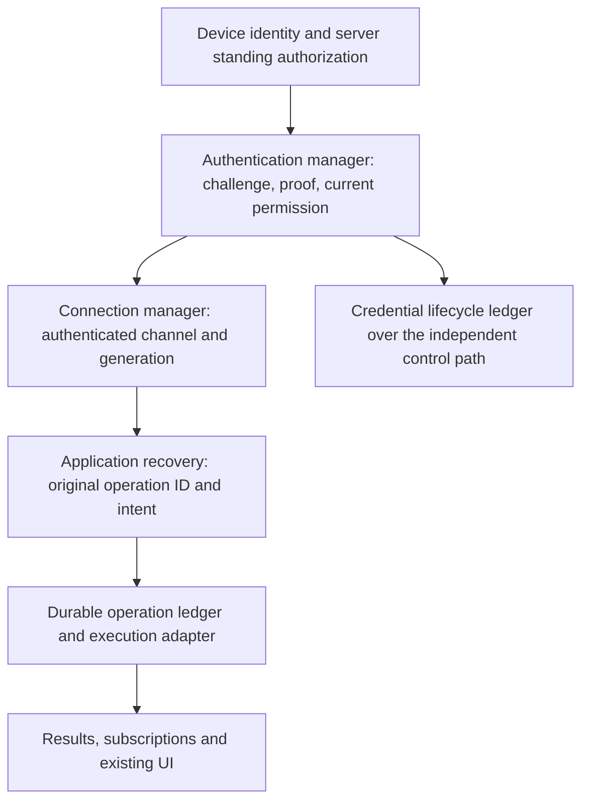

# ISCP connection authentication and operation recovery design

Language: English | [简体中文](../zh-cn/docs/iscp-authentication-operation-recovery-design.md)

Date: 2026-10-19. Status: proposed design, with cross-project review recorded in InfiniCenter 0041. Source baselines: SparkClaw `cf9b81dec39b8872efc43650080bb8facaa58511` and the ISCP fork `10fe37b3bd02a56b4f9d6cb8dc0333d7eec5356a`. This proposal defines responsibilities and acceptance criteria; it does not change deployed behavior or accepted contracts.

## 1 Decision and intended behavior

Separate connection authentication from durable operation identity. The connection layer obtains fresh proof from the enrolled device identity, refreshes credentials and restores an authenticated channel. The application layer uses the original operation ID and immutable intent to reconcile admission, execution and results over that channel.

After initial enrollment, network interruption or expiry of a connection credential must not require another invitation or user authorization while the original standing authorization remains active. Recovery must still enforce identity, revocation, task permission, approval, deadline and resource-version constraints. A valid signature proves possession; the server must independently establish current permission.

The target device-enrollment policy persists until explicit revocation/deletion or an authorized binding change. A connection-token TTL or time spent offline must not end that relationship. Store that authority independently from short Grants; do not reinterpret a genuinely time-bounded task authorization as permanent.

The target behavior is: **network recovers → authenticate the existing identity again → restore a usable channel → reconcile original operations → resume subscriptions and deliver existing results**. Connection recovery is automatic. Operation recovery depends on the operation's declared semantics and durable evidence; it does not automatically repeat arbitrary side effects.

This design covers operations created under the new protocol, including lifecycle control and application operations. Legacy-request migration, import adapters and preservation of legacy digest/sealing formats are outside its scope. It can be implemented with the current transport or the proposed [duplex WSS binding](iscp-duplex-websocket-design.md); duplex transport alone does not resolve the coupling.

## 2 Current failure and its architectural cause

The client persists a complete `LifecycleRequest`, including time-limited `Proof` and optional `RelayProof`, in encrypted `lifecycle.pending`. Retry reuses that request. The issuer binds deduplication and sealed results to `Digest(request)`, which includes these proofs. It accepts an expired proof only when an exactly matching operation was already admitted. A request created during an outage can remain unreceived until the five-minute issuer proof window has expired. Replaying it then fails forever; changing its proof also changes the digest used to identify and decrypt the result. Relay recovery has the same structural coupling and a separate one-minute proof window.

These are two different facts: **what operation the caller intends** and **whether this connection/request is currently authenticated**. Their lifetimes cannot share one immutable record. Increasing the proof lifetime, retaining one signature forever, clearing pending records, or generating a new operation ID on every reconnect does not solve that distinction.

Evidence in the current source: [client persistence](../services/gateway/internal/iscpnodeclient/lifecycle.go), [issuer digest, freshness and sealing](../services/gateway/internal/iscpnodeissuer/lifecycle.go), [Relay recovery](../services/gateway/internal/iscprelayadapter/lifecycle.go), [workbench lifecycle](../services/gateway/internal/iscpworkbench/node_lifecycle.go). The fork carries the corresponding code under `extensions/sparkclaw/`.

## 3 Independent lifetimes and invariants

| Object | Lifetime and purpose | Effect of expiry or loss |
| --- | --- | --- |
| Device identity and private key | Stable enrolled principal and possession | Key loss requires explicit identity recovery; reconnect cannot invent a replacement identity |
| Standing authorization | Server-owned enrollment, resource binding, scopes and revocation revision | Revocation or actual authorization expiry stops recovery; possession alone cannot restore permission |
| Authentication proof and connection lease | Fresh challenge response, access credential and authenticated channel | Renew or authenticate again without changing operation intent |
| Task authorization and operation deadline | Durable permission for a particular action, purpose, approval and time interval | Continue, read or cancel only as that operation's contract allows; reconnect cannot extend it |
| Operation identity and result | Durable admission, execution and deduplication history | Survives connection replacement; result retention and execution lifetime are separate |
| Subscription and projection | Live delivery of a task's current state | Rebuild from cursor/snapshot without creating a task |

Required invariants:

1. Authentication timestamps, challenges, proof signatures, bearer tokens, connection IDs and session IDs never enter the v2 operation semantic digest.
2. Original task authorization, approvals, effects, target, input, business deadline and preconditions do enter that digest. Excluding a short connection Grant must not exclude a task Grant with a similar name.
3. The same principal, operation namespace and operation ID identify one immutable intent. Different intent under that key is a conflict. A new authentication context does not create another execution.
4. Transport acceptance, application admission, completion and client application of a result are separate acknowledgements.
5. Timeout, HTTP 403, a missing row or expired retention never proves that a side effect did not occur.
6. Authentication renewal cannot revive revoked authority, extend a task deadline, replay an obsolete encrypted session or transfer an operation to another identity.

## 4 Responsibilities and dependency direction



| Owner | Responsibilities | Boundary |
| --- | --- | --- |
| Identity store | Retain enrolled private key, trusted issuer/Relay identities and endpoint pins | Does not cache a handshake proof as durable authority |
| Authentication manager | Fresh challenges and proof; lease renewal; current authorization and revocation checks | Does not decide whether to repeat a business action |
| Connection manager | Connect, reauthenticate, back off, fence obsolete generations and publish readiness | Does not delete pending operations or recreate their IDs |
| Application recovery coordinator | Load operation journal; query/reconcile each operation; recover result or subscription | Receives an authenticated channel, never requests raw private keys or constructs PoP |
| Operation handler and ledger | Permission checks, atomic immutable admission, durable state, effect reconciliation | Does not make deduplication depend on transient authentication fields |
| Existing UI adapters | Reflect current capability and original task state; preserve drafts/history | Do not create a second operation when connection recovery succeeds |

Credential renewal is itself a durable control operation. Its ledger belongs to the connection subsystem, with the same intent/authentication separation, and runs over a control path that does not require business-channel READY. A stuck application operation must never block authentication. The issuer and forwarder also need independently recoverable service identities; routing control traffic through a service peer does not remove this prerequisite.

## 5 Operation intent and authentication context

The following are proposed logical types, not additions to an accepted v1 schema:

```text
OperationIntentV2 {
  version, namespace, operation_id, kind,
  subject_binding, target,
  task_authorization, payload,
  business_deadline, preconditions
}

semantic_digest = SHA256(domain_separator || Canonical(OperationIntentV2))

AuthenticatedContext {                       // created by the verifier
  principal, audience, verified_scopes,
  authorization_revision, authentication_epoch,
  connection_generation, expires_at
}

RequestEnvelope {
  protocol_version, attempt_id,
  action, operation_id, semantic_digest, intent_or_query,
  authentication_binding, optional_result_delivery_binding
}
```

Use ISCP's strict parsing and canonical encoding with a versioned domain separator. Freeze field presence, integer/time formats, unknown-field rejection and test vectors before implementation. `subject_binding` is checked against the verified principal; it cannot establish identity by self-declaration. The deduplication key is `(authenticated principal, namespace, operation_id)`, including the domain/tenant boundary.

On an authenticated E2E channel, the receiver derives `AuthenticatedContext` from the verified session and authenticates requests with the existing session protection. Application code adds no possession proof to its intent. Across a process boundary, the context must come from a protected trusted adapter or verifiable binding, never an untrusted header claiming a principal. Relay transport authentication alone cannot authorize a Gateway operation or disclose its encrypted content.

For stateless HTTPS control requests, the connection adapter supplies fresh request authentication outside the intent. It binds the selected protocol, receiver/audience, server challenge, method/path, canonical request digest excluding `authentication_binding`, any result-delivery key, and the credential hash when a credential is used. The proof does not recursively sign itself. A challenge is short-lived and consumed atomically; a lost authentication reply is handled with a new challenge. It does not require replaying the same authentication attempt. Fresh proof may cover an old intent digest without becoming part of that digest.

`attempt_id` correlates one exchange and can change. `operation_id` and `semantic_digest` remain fixed. Envelope message IDs, E2E sequence numbers and subscription IDs have their own lifetimes and must not be substituted for an operation ID.

An immutable result contains the operation key, semantic digest, result version and result digest. Its canonical contents and issuer signature do not depend on the connection. Delivery encryption binds those values plus the authenticated recipient and delivery context, permitting resealing of the **same result** to a new authorized channel. Changing a delivery wrap key requires current authenticated possession and integrity protection; it cannot change the stored result or recipient identity. Credential secrets remain encrypted at rest and in transit.

## 6 Connection authentication and recovery

Connection lifecycle: `DISCONNECTED → CONNECTING → AUTHENTICATING → READY`. Transport failures return to reconnect/backoff. Credential renewal may occur while READY remains valid; once its authority expires, application admission and delivery stop until authentication succeeds again. A verified revocation transitions to `AUTHORIZATION_REVOKED`; missing identity material transitions to `IDENTITY_RECOVERY_REQUIRED`. They are not generic network retry states.

1. Resolve the original pinned authority and obtain a fresh server challenge over its protected control entry. Issuing a challenge reveals no account details and grants no business access.
2. Sign the fresh binding with the original device key. The server verifies possession, audience, challenge freshness and consumption, enrollment, current standing authorization and revision. The old short lease is not required as valid authority for this recovery path.
3. Reconcile credential lifecycle operations over this authenticated control context and obtain usable short leases. Normal refresh-token rotation may be the fast path; expired access **and** refresh credentials still permit standing-identity recovery.
4. Authenticate the Relay connection and the appropriate Gateway/E2E session at their distinct permission boundaries. Validate actual capabilities before publishing business-channel READY.
5. Publish the current connection generation to the application recovery coordinator. Resume operation reconciliation only for this generation and the original identity/resource binding.

Successful initial enrollment establishes the standing identity relationship. Its consumed invitation is historical linkage, not a reusable credential. If current policy intentionally grants only time-bounded standing authorization, its genuine expiry still requires authorization; changing that product policy is a separate decision. A server cannot treat a client-side “previously connected” flag as authority.

One authentication/recovery flight runs per identity, domain and target binding; automatic and manual reconnect join it. Use exponential backoff with jitter and existing responsiveness bounds. Single flight must not serialize independent application operations. A new generation fences old callbacks, credential writes and UI projections. Server admission and revocation/owner transitions need a shared serialization boundary; a client counter alone provides no protection. Check current authority at admission and again where the business contract requires it before effects or disclosure.

An operation timeout ends its waiter, not the shared connection. A retryable proof-expired response requests a new authentication attempt; it cannot mark the device revoked. A generic denial or unreachable authorization service remains an unresolved authentication failure. Only verified authoritative state supports a terminal revocation decision. Server time controls freshness; repeated clock errors must be diagnosable without weakening verification.

The duplex proposal's bounded auth-only state and independent HTTPS recovery remain applicable. There is no circular dependency on an authenticated data socket to obtain credentials for that socket.

## 7 Application recovery after READY

Before the first send, persist the immutable intent and operation key in the local journal. Record an attempt before sending, so a crash cannot make an uncertain send look unsent. Connection loss preserves journal entries, terminal results, stream cursors and user drafts.

| Authoritative operation state | Recovery action |
| --- | --- |
| Locally never attempted | Submit the original intent after current permission/precondition checks |
| Admitted or running | Attach to the same operation; query status or resume its subscription |
| Succeeded, failed or cancelled | Retrieve the original terminal result and acknowledge local application durably |
| No admission in a ledger with complete deduplication coverage | A v2 handler may atomically find-or-admit the original intent under the same key |
| Admission or external effect unresolved | Keep the original key, reconcile further and report only actionable uncertainty; do not invent another operation |
| Result payload expired but durable completion tombstone retained | Return the retained terminal disposition; never execute again to reconstruct a result |
| Same key with another semantic digest | Return conflict; do not overwrite the original |
| Permission revoked or task deadline exhausted | Apply the operation's existing stop/read/cancel rules; do not renew its business authority implicitly |

For proposed v2 handlers, `Recover(intent)` is a server-side atomic **find-or-admit** operation, not a client sequence of “GET missing, then POST new”. It returns an existing operation or admits the original intent only if the server can prove complete admission coverage and current authorization permits admission. A delayed original request races on the same durable uniqueness key. Query alone does not reserve permission to execute. Handlers that lack these guarantees support lookup/attach only and must not advertise find-or-admit.

Declare recovery behavior per operation family: recomputable reads, durable idempotent mutations, resumable executions, and effects requiring reconciliation. The connection layer cannot infer these classes from HTTP verbs or RPC names. Re-reading current state does not claim to reproduce an old snapshot.

Existing contracts override this generic proposal. In the accepted SparkClaw–JingSi Runtime v1 contract, uncertain submit is followed by lookup; `not_started` is a **durable negative fence that permanently forbids admission under that key**. It is not the v2 eligible-absence case. Keep its complete task-authorization digest and original grant/key requirements. This design adds no fields, automatic resubmission or changed meanings to that contract or to IMMS bindings.

Resume application streams using the original request/execution identity and a fresh session-bound subscription, with a snapshot when the cursor cannot be replayed. Preserve [application stream semantics](iscp-application-stream-design.md). Reauthentication of an unchanged session need not reset its projection. A replaced E2E session must allocate new sequence numbers and envelopes; it cannot resend stale ciphertext. Neither reconnect nor a stream preview timeout extends the original execution deadline.

## 8 Ledger, concurrency and side effects

Persist at least: principal and namespace, operation ID, semantic digest and immutable intent, admitted authorization snapshot, state/version, execution reference, result or disposition digest, effect-reconciliation reference, client result disposition, and timestamps. Authentication attempts belong in a separate audit trail and do not replace the admitted authorization snapshot.

Admission must atomically validate current authority/preconditions, establish the unique intent record and reserve execution. Dispatch and worker recovery use that durable reservation. Commit business state and its receipt in one transaction where they share storage; otherwise use a durable outbox and the downstream operation key. Every worker or owner takeover needs fencing against the stored execution version.

For effects outside that transaction, persist dispatch intent and propagate an idempotency key where supported. If an email/provider accepts an effect but its reply is lost and no reliable reconciliation exists, keep `effect_unknown`; do not resend merely because the connection is healthy. The guarantee is one logical admission with deduplicated recovery where the handler supports it, not universal exactly-once external execution.

Cancellation is a durable desired-state request bound to the original operation and authorized caller. Reconcile cancellation versus completion in the ledger; a reconnect cannot turn a cancelled operation into a new submission. Expiry of a connection lease alone does not cancel an admitted task. Continued execution still follows its original authorization, revocation and deadline rules.

Result content can have a shorter retention period than deduplication metadata. Retain an immutable tombstone for every operation whose namespace remains eligible for requests. Garbage collection must not turn an old completed ID into admissible absence. A namespace can be retired durably before removing its deduplication history; all later requests to it are rejected. Incomplete history or uncertain database restore must return unknown or a closed-namespace result, never assume coverage from an empty query. Retention and retirement rules are protocol acceptance gates.

## 9 Renewal and Relay recovery are control operations too

Use the same separation for issuer renew/recover, Relay credential issuance and refresh rotation. Their stable intent includes the original principal/binding, control-operation kind, requested scope and durable expected resource/authorization version. Short proofs, bearer tokens, connection generation and delivery wrap keys stay outside. Current authorization must permit the requested scope; renewal cannot widen it.

Serialize conflicting credential mutations by durable credential generation and expected version. Reconciliation returns one immutable issued result for an operation, even across new authenticated sessions. A second concurrent renewal cannot silently overwrite newer credentials locally. Installation is conditional on identity, generation and credential validity, and is persisted before acknowledgement.

If a recorded operation's issued credentials have expired before installation, recover its terminal outcome, record an explicit `acknowledged_expired` or equivalent signed disposition, and close that operation. Only then create a successor control operation linked to the predecessor and current credential generation. Do not label expired credentials “installed”, alter the old result, or create successors while the original outcome remains unknown.

Issuer-to-Relay recovery is a multi-service transaction. Persist a stable child operation key derived from the parent operation and step, reuse it with fresh Relay authentication, and reconcile its receipt before completing the parent. A child that committed before an outage must not rotate credentials again on replay. Relay proof freshness must be decoupled too; fixing only the issuer proof leaves the same failure one hop later. Parent/child transitions and expired child results require durable reconciliation before any successor.

## 10 Interfaces and repository ownership

Illustrative internal interfaces are `EnsureAuthenticated(binding) → ChannelLease`, `ConnectionChanged(generation)`, `Submit(intent)`, `Lookup(key, digest)`, `Recover(intent)` for declared supporting handlers, `Subscribe(execution, cursor)`, and `AcknowledgeResult(key, resultDigest, disposition)`. A lease is validated by the receiver at use; holding a client object is not authority. These names require schema/API review and are not public v1 method additions.

| Change area | Owning repository and responsibility |
| --- | --- |
| Protocol/schema, Relay transport and service-side authentication/session rules | ISCP fork; define the versioned service contract and align with proposed 0038 |
| Issuer, control forwarding and Relay credential lifecycle | ISCP fork; maintain standing-authority checks, credential issuance/recovery and the control-operation ledger |
| Client connection, fresh device proof, credential installation and local generation fencing | SparkClaw connection adapters consume ISCP services through the published protocol; possession proof is generated where the device key resides |
| Operation journals, handler-specific recovery, subscriptions and task/result projection | SparkClaw application runtime and Gateway adapters |
| Desktop reconnect entry points and capability presentation | SparkClaw helper/main-process adapters and original UI components invoke the connection layer |
| JingSi/IMMS external contract changes, if later needed | Separate InfiniCenter accepted decision and coordinated contract revision |

The user has clarified ownership: SparkClaw consumes ISCP services, and each repository maintains its own responsibilities. ISCP service changes and SparkClaw client/application changes are coordinated through the published wire protocol. They build and release independently; compatibility does not require shared source, a shared workspace, the same commit or adoption of a fork Go module. Repository ownership is settled. Freeze protocol versions and compatibility tests before implementation. Withdrawn decision 0040's source-removal and dependency-migration plan remains withdrawn.

## 11 Errors and user experience

| Error category | Owner and response |
| --- | --- |
| Network unavailable, challenge expired, lease expired | Connection manager retries or reauthenticates with fresh proof |
| Verified identity revoked, standing authorization ended, key unavailable | Stop automatic privilege recovery; show the existing actionable authorization/recovery flow |
| Operation running or result available | Application recovery attaches or fetches under the original identity |
| Operation conflict, business permission/deadline failure | Original operation reports its own outcome; no global reconnect loop |
| Outcome unknown or result content expired | Preserve disposition and identifiers; offer existing appropriate reconciliation/read behavior |
| Protocol incompatible or clock misconfiguration | Explain the corrective action without deleting identity or pending state |

Retain existing pages, menus, component hierarchy, styles and interactions. Existing controls reflect verified capability; drafts, conversations and task views remain intact. Successful reconnect restores capability without adding a permanent technical-status panel. Business recovery proceeds independently for each operation; one unresolved effect does not disable unrelated read capabilities. Never show a running task as newly submitted simply because its subscription was rebuilt.

Logs may record phase, error class, generation and redacted operation identifiers for diagnosis. Do not log private keys, bearer/refresh tokens, raw possession proofs, task secrets or decrypted credential results. Record connection readiness and operation reconciliation separately so an “online” indicator cannot be mistaken for completed delivery.

## 12 Delivery sequence and acceptance gates

1. **Freeze the contract.** Accept InfiniCenter 0041 after reviewing authentication/intent separation, canonical vectors, recovery states and retention under the repository responsibilities above. Coordinate with 0038 without requiring its WSS cutover for this separation. Freeze protocol names, versions and scope before implementation.
2. **Implement ISCP services.** In the ISCP fork, establish service-side authentication, credential lifecycle ledgers and immutable control results/dispositions. Qualify issuer/Relay atomicity, parent/child reconciliation and crash behavior.
3. **Integrate SparkClaw.** Its connection adapters generate fresh proof, consume ISCP credential/connection services and fence local generations. Its application runtime owns business-operation journals, permission checks, recovery, subscriptions and result application. Use the declared wire protocol; a shared source dependency is not a prerequisite.
4. **Qualify interoperability and coordinate rollout.** Independently build the ISCP services and SparkClaw client, then exercise the supported protocol-version matrix, new-protocol operations, version mismatch and durable execution fences. Verify native UI and original data before deployment. Compatible releases may have different commits and release dates. This document itself authorizes no rollout.

| Acceptance scenario | Required observation |
| --- | --- |
| Disconnect beyond proof TTL, then beyond access and refresh TTL | Original identity obtains fresh proof/leases; no new invitation; business operations keep their IDs |
| Original request never reaches the server | Fresh authentication plus eligible atomic recovery admits the same operation once |
| Server admits/commits, response is lost | New session retrieves the existing operation/result; no duplicate effect or credential rotation |
| Issuer admits, Relay has not; or Relay commits and issuer loses reply | Stable child key and fresh child authentication reconcile one parent outcome |
| Token renewal succeeds but reply/connection is lost | Reconcile the credential operation before installing or rotating again |
| Issued result expires before installation | Explicit expired-result closure and linked successor; no false installed ACK |
| Automatic reconnect and repeated manual reconnect overlap | One authentication flight; stale generations cannot overwrite state |
| Revocation or permission reduction races with admission | Shared server fence prevents unauthorized new admission/disclosure; no invitation reuse |
| Original task permission/deadline has expired | Connection may recover; the task does not receive renewed permission |
| Same ID with modified payload or another principal | Conflict or access denial; original record is unchanged |
| Crash around journal write, dispatch, commit, result save or ACK | Deterministic reconciliation at each boundary; no “missing means unsent” inference |
| Receipt pruned or database restored without complete history | Tombstone/closed namespace or unknown; no fresh admission of an old operation |
| External side effect accepted but confirmation is unavailable | Keep effect unknown; no automatic duplicate send |
| New E2E session, stale events and cancellation/completion race | New envelopes/subscription; fenced projections and original terminal state |
| Protocol-version mismatch, lost private key, invalid audience, nonce replay or clock skew | Typed failure, no identity reset or verification bypass |
| Original UI, saved conversations, nonempty draft and capability restoration | All preserved; no extra model/message side effect caused by reconnect |

Documentation validation checks bilingual mirrors and local links. Implementation qualification must add fault injection and real persistent-store tests for the boundaries above, plus native UI acceptance. Passing documentation checks does not establish runtime recovery guarantees.

## 13 Relationship to existing designs

- [Public Relay and node issuer](public-iscp-relay-node-issuer-design.md): retain initial enrollment, trust pins and revocation; define separate operation intent and authentication for the new protocol.
- [Desktop connection](desktop-iscp-connection-design.md): keep identity/resource binding and the original UI adapters.
- [Application streams](iscp-application-stream-design.md): recover subscription/projection without restarting business execution.
- [Duplex WSS transport](iscp-duplex-websocket-design.md): share connection authentication and independent credential recovery; transport receipts remain distinct from application results.
- InfiniCenter 0039: fork import is accepted; it does not accept 0038 or this proposal. Migration decision 0040 is withdrawn; 0041 records this proposal and its cross-project review gates. The accepted SparkClaw–JingSi contract remains authoritative for its existing API.
