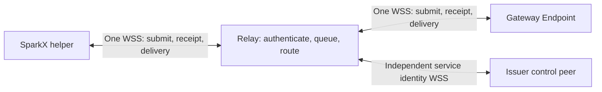

# ISCP full duplex WebSocket transport design

Language: English | [简体中文](../zh-cn/docs/iscp-duplex-websocket-design.md)

Date: 2026-10-19. Status: proposed design. Source baseline: SparkClaw `cf9b81de`, ISCP fork `10fe37b3` (imported onto upstream `47f1f6c`); SparkClaw dependency remains `v0.2.0-rc.1`. This document proposes a new Relay transport binding, not a change to the cryptographic envelope or an implemented release. InfiniCenter proposal 0038 records the cross-project review boundary.

## 1 Decision and scope

Use one authenticated, persistent WSS connection per device identity and Relay for both sending and receiving ISCP envelopes. Requests, responses, application stream events, cancellation, encrypted session handshakes and business delivery ACKs use that connection. Multiple tasks and E2E sessions share it; a new task does not open a new socket. Each endpoint has its own connection to the Relay: this is not a direct desktop-to-Gateway socket.

Remove `POST /v2/relay/envelopes` from the new deployment's data path and retire the old receive-only connection binding after a coordinated cutover. Do not silently fall back to HTTP submission. Keep HTTPS discovery, device enrollment, access/Grant renewal, credential recovery, administration and the WebSocket opening handshake. Their independence allows recovery when no authenticated WSS connection exists. The issuer forwarder's ISCP envelopes also move to duplex WSS; its private Unix-socket transaction API remains a local control interface. The model provider's SSE and the accepted JingSi Runtime HTTP binding remain separate interfaces.

The scope preserves the existing application stream, original UI components, ordinary RPC behavior and durable business result lookup/ACK. It does not add a generic byte-stream API, replace the cipher suite, or make a connection ACK mean a completed task.

The ISCP fork owns Relay, protocol and ISCP authentication/authorization service development. SparkClaw continues to consume ISCP services as an independent client. Duplex transport requires compatible client connection handling; it does not require repository migration, shared source code or a shared release revision. The canceled consumer-source/dependency migration in InfiniCenter 0040 remains withdrawn.

### 1.1 Confirmed release and delivery scope

On 2026-10-19 the user confirmed and then expanded the scope to the complete current ISCP service chain: the shared Relay, Gateway/node issuer on work1–work5, every related control forwarder/peer, and their connecting clients. A short maintenance window is allowed. Old clients are unsupported, with no automatic HTTP envelope fallback. Reconcile the actual service, route, identity and client inventory before deployment. This defines the release scope; the present task remains documentation.

Retain business result acknowledgement, lookup/recovery and stream snapshot recovery. Do not add a persistent receiver inbox, per-envelope receiver acknowledgements or a redelivery guarantee. Existing Relay offline queues and handling of failed writes remain; same-ID lookup/deduplication resolves intake uncertainty rather than guaranteeing every frame reaches durable receiver storage. Service changes belong to the ISCP fork and client adaptation to SparkClaw; independently built releases undergo joint protocol qualification.

## 2 Findings in the current implementation

| Current behavior | Required design response |
| --- | --- |
| `RelayClient.submit` posts an envelope with an access credential and HTTP PoP; `RunOnceReady` owns a receive-only WebSocket | Replace both network paths with one connection manager and reusable envelope admission service |
| Relay's reader expects only control frames after authentication | Add an authenticated input dispatcher for submit, query and reauthentication |
| The receive callback may itself call `Submit` | Do not execute that callback on the only socket reader or await its reply there |
| `iscpnodecontrol.Peer.Run` calls `begin` before opening its receive socket | Establish duplex READY before the E2E Hello; migrate the responder/control peer as well as desktop |
| PostgreSQL `StoreMessage` overwrites content on a message-ID conflict; message and receipt writes are separate | Add immutable duplicate detection and transactional acceptance before enabling retry |
| Relay marks delivery after a successful socket write | Preserve that limited meaning; final business delivery continues to require the existing application ACK |

Sources: [client](../services/gateway/internal/iscpbridge/relay.go), [Relay](../services/gateway/internal/iscprelayreference/server.go), [receive transaction](../services/gateway/internal/iscprelayreference/receive.go), [control peer](../services/gateway/internal/iscpnodecontrol/peer.go). These paths document the inspected baseline; future service implementation belongs to the ISCP fork under section 9. The repository operation is in the pinned ISCP module's `pkg/server/repository/relay.go`.

## 3 Connection topology and lifecycle



This design selects `GET /v2/relay/duplex` and WebSocket subprotocol `iscp.relay.duplex.v1`; these are not yet released public capabilities. Signed discovery advertises the endpoint, binding version and encoded message-size limit. Clients require an exact subprotocol match; a bare HTTP 101 or old `ready` message is insufficient.

Lifecycle: `DISCONNECTED → CONNECTING → AUTHENTICATING → READY → CLOSING → DISCONNECTED`. Reauthentication runs inside READY while the previous authority remains valid. Ordinary credential rotation/expiry may enter an auth-only `REAUTH_REQUIRED` state for at most 10 seconds: no data admission or delivery, only fresh authentication. Successful renewal returns to READY; timeout closes the socket. Verified device revocation or identity replacement closes immediately. A healthy connection has no fixed maximum age or periodic drain. A transient operation timeout ends only that operation's waiter.

The Relay assigns a random connection ID and an owner generation. One active owner is allowed for each authenticated domain/device pair; the rule prevents competing receivers and is not a request quota. Replacement fences old admission, delivery and callbacks. Admission commit and ownership/revocation transitions need a shared serialization point, so a transaction admitted before the transition may finish, while stale work cannot begin a new admission. The initial reference implementation targets one active Relay process. Multiple replicas must implement the same ownership boundary across processes before claiming this guarantee.

## 4 Wire messages

Use one strict UTF-8 JSON object per WebSocket text message. Preserve SecureEnvelope fields and ciphertext byte-for-byte. Application stream frames remain encrypted inside their existing envelope. Transport control is protected by WSS and connection authentication; it is not an E2E task receipt.

| Kind | Direction | Meaning |
| --- | --- | --- |
| `challenge` | Relay → endpoint | Connection ID, fresh challenge and selected binding |
| `authenticate` | Endpoint → Relay | Access credential plus device PoP over the connection context |
| `ready` | Relay → endpoint | Authenticated owner generation, authority deadline and negotiated limits |
| `submit` | Endpoint → Relay | Transport request ID, original message ID, envelope digest and envelope |
| `accepted` | Relay → endpoint | Correlated durable acceptance receipt after commit |
| `rejected` | Relay → endpoint | Correlated rejection known to have made no new acceptance |
| `delivery` | Relay → endpoint | Original message ID and opaque envelope for the authenticated recipient |
| `submit.query` / `submit.status` | Endpoint ↔ Relay | Resolve an uncertain submission by original ID and digest |
| `reauth.request` / `reauth.challenge` / `reauthenticate` / `reauthenticated` | Both | Request a challenge and bind a refreshed credential to the same socket with fresh PoP |
| `closing` | Relay → endpoint | Reason for replacement, expiry, revocation, restart or protocol failure |

Authenticated frames carry the binding version and connection ID. Request IDs correlate transport exchanges within a connection; `message_id` identifies an immutable envelope across reconnects; the encrypted business request ID and stream subscription ID retain their existing meanings. The Relay does not inspect the latter two. Unknown fields/kinds, duplicate JSON keys, invalid UTF-8 and unsafe integer values are rejected according to a versioned schema.

Use native WebSocket Ping/Pong for liveness. Do not create application JSON ping messages or wait for Pong before sending data. The transport does not require receiver `delivery.ack` in this revision: a socket write remains a transport attempt, not durable receiver acceptance. Introducing a persistent receiver inbox and at-least-once envelope delivery would require a separate change to delivery semantics.

### 4.1 v1 fields and version rules

The following selects this proposal's v1 contract; it is not an already released capability. Fix the path to `/v2/relay/duplex` and subprotocol to `iscp.relay.duplex.v1`. Retain the existing discovery signature wrapper and declare `duplex_protocol`, `duplex_path` and `duplex_limits_sha256` in its existing string-valued `metadata`; do not add fields to the strict core descriptor. Verify the pinned Relay signer, validity and HTTPS/WSS origin before matching the subprotocol exactly. Version 1 does not guess compatible versions.

Every frame requires `v:1`, `kind` and `connection_id`. All except initial challenge/authenticate also carry `owner_generation`, first learned through ready. Connection, challenge and history IDs are unpadded base64url encodings of 32 random bytes. Generation is a persistent increasing uint64 decimal string. Client request IDs are strictly increasing uint64 decimal strings starting at 1; responses echo them. Only the steps of one reauthentication exchange reuse its ID; other reuse is a protocol error. A new connection may restart its counter at 1, and old receipts cannot match across connections.

All fields below are required; `?` means conditional presence as specified, never null. Every object rejects unknown fields, duplicate keys and missing required fields.

| kind | Fields beyond the common header |
| --- | --- |
| `challenge` | `relay_id, domain_id, challenge_id, challenge, expires_at, history_id, limits`; no owner generation yet |
| `authenticate` | `request_id, challenge_id, access_token, proof`; no owner generation yet |
| `ready` | `request_id, domain_id, device_id, authority_expires_at, history_id, limits` |
| `submit` | `request_id, history_id, message_id, envelope_digest, not_after, envelope` |
| `accepted` | `request_id, message_id, envelope_digest, receipt` |
| `rejected` | `request_id, message_id, envelope_digest, code`; no new acceptance by this attempt, not proof of no earlier acceptance |
| `delivery` | `message_id, envelope_digest, envelope`; no transport request ID or receiver ACK |
| `submit.query` | `request_id, history_id, message_id, envelope_digest, not_after` |
| `submit.status` | `request_id, message_id, envelope_digest, state, reason?, receipt?`; state is `accepted/expired/absent/unknown`; the first two require the original receipt, unknown requires reason, other conditional fields are forbidden |
| `reauth.request` | `request_id`; initiated by the client |
| `reauth.challenge` | `request_id, challenge_id, challenge, expires_at`; server response |
| `reauthenticate` | `request_id, challenge_id, access_token, proof`; reuses this reauth.request ID |
| `reauthenticated` | `request_id, authority_expires_at` |
| `closing` | `code`; generation is the string `"0"` on initial authentication failure |

The `envelope` strictly follows the existing SecureEnvelope v2 schema; Hello/Ready retain their current carrier rather than creating another plaintext task channel. Outer and inner message IDs must match, as must domain/sender/Relay routing and authenticated context. Let `C` denote the fork's ISCP v2 canonical profile and `B64` unpadded base64url: `envelope_digest = B64(SHA256(C(envelope)))`. Do not use signature canonicalization that removes signature fields to calculate an envelope digest. Preserve envelope field values and ciphertext bytes; JSON whitespace/member order does not affect the digest.

The client fixes `not_after`, an absolute sending deadline, at first enqueue and retains it with the envelope. It and history ID are immutable admission metadata outside the encrypted envelope. First admission requires server time before not_after and not_after no later than now plus envelope TTL; `expires_at=min(not_after, accepted_at+ttl_seconds)`. Duplicates cannot change not_after or restart TTL. Matching queries/duplicate receipts remain available after expiry without requeuing.

Use a new `iscp.relay.acceptance.v1` receipt with exactly `type, receipt_id, relay_id, domain_id, history_id, message_id, sender_device_id, recipient_device_id, envelope_digest, not_after, accepted_at, expires_at, signature`. Receipt ID is B64 of 16 random bytes; signature uses the Ed25519 `alg/kid/value` object and ISCP signature profile. Sign with the existing persistent Relay signer and store the exact signed object. The old mutable delivery receipt is not a substitute. Acceptance and repeated lookup return the same signed object.

A `submit.status` normally answers query; uncertain submit commit may also return state=unknown and reason=`commit_unknown` under the submit's request ID. This is not rejection. Other unknown reasons are exactly `history_unavailable, legacy_record, barrier_timeout`; they describe transport history without revealing another principal's record. A different sender or conflicting digest/deadline under the key produces rejected/code=`message_conflict`, including for query.

### 4.2 Encoding, sizes and errors

C follows the fork's `spec/canonical-jcs-v2.md`: strict UTF-8, Unicode-code-point key ordering, Go-compatible JSON escaping and no Unicode normalization. Reject duplicate keys, unpaired surrogates, fractions, exponent notation and trailing JSON/garbage. Numeric frame fields are integers from 0 through 9007199254740991; uint64 generations/counters are decimal strings with no sign or leading zero, at most 18446744073709551615. Zero is allowed only for explicitly identified initial-authentication generations. Timestamps are UTC `YYYY-MM-DDTHH:MM:SSZ`. Ordinary identifier strings are nonempty and at most 256 UTF-8 bytes; access tokens at most 8192 bytes. Digests decode to exactly 32 bytes and Ed25519 signatures to 64. Stricter core-schema limits still apply.

The limits object contains exactly these integer properties, identical in challenge and ready and matching the discovery canonical-object digest: `max_frame_bytes=1114112`, `max_envelope_bytes=1048576`, `max_control_bytes=65536`, `max_ttl_seconds=86400`, `query_recovery_seconds=604800`. Count actual reassembled UTF-8 JSON bytes. Application control messages contain no envelope; native Ping/Pong are separate. Maximum nesting depth is 16. Submit/delivery must satisfy both envelope and whole-message limits. Queues remain constrained by available resources. These are initial release settings requiring renewed advertisement and qualification if changed, not cumulative-call or business-concurrency quotas.

| Condition | Response and client handling |
| --- | --- |
| Invalid envelope, digest or deadline before admission | `rejected: envelope_invalid / digest_mismatch / deadline_expired`; no new admission |
| Conflicting content, sender or deadline under the same key in current continuous history | `rejected: message_conflict`; no other principal's receipt and no new business ID |
| Expired authority, sender mismatch or resource exhaustion before admission | `rejected: auth_required / sender_mismatch / resource_exhausted`; these do not negate earlier acceptance |
| Lost COMMIT response or disconnected connection | unknown; query original ID after reconnect; `rejected: storage_unavailable` is allowed only after a definite rollback |
| Invalid JSON/fields/kind/version, reused request ID or mismatched connection/generation | Best-effort `closing: protocol_error`, then 1002; invalid UTF-8 uses 1007, oversized messages 1009 |
| Expired challenge, invalid proof, verified revocation/replacement | `closing: challenge_expired / authentication_failed / revoked / replaced`, then 1008; revocation is not ordinary reconnect recovery |
| Maintenance or internal fault | `closing: maintenance / internal_error`, then 1001/1011 respectively; outstanding uncertain sends remain unknown |

Missing/wrong subprotocol on the new endpoint returns HTTP 426 with `transport_upgrade_required`, without upgrading to 101. Retired envelope POST and old connect return HTTP 410 under section 10. Close malformed input without inventing a correlated rejection when no trustworthy request ID exists. Neither close frames nor Ping/Pong are business outcomes.

History mismatch/incompleteness takes precedence under section 7: query returns unknown/history_unavailable and a new submit receives pre-admission rejected/code=history_unavailable, not an ordinary content conflict. Invalid correlation-field types/encodings close with protocol_error rather than echoing schema-invalid fields. The 10-second auth-only timeout closes with auth_required/1008; queue exhaustion that prevents safe admission closes with resource_exhausted/1011, preserving uncertain outstanding sends.

## 5 Authentication and credential rotation

The old receive proof alone must not grant the new send capability. Initial authentication validates both the access credential and device possession, binds their domain/device, checks current device status and verifies Relay audience. PoP signs a domain-separated canonical context containing the binding version, endpoint path, Relay ID, server connection ID, fresh challenge and access-token hash. DeviceProof's existing nonce and issuance time remain replay/freshness inputs. Sections 5.1–5.2 define exact bytes and a vector to turn into executable fixtures during implementation. Credentials never go in URLs, subprotocol names or logs.

Each submit verifies sender identity against authenticated connection ownership and validates the existing envelope metadata. Admission and delivery enforce current local authority, expiry and known revocation; neither requires a remote issuer round trip per frame. Database-backed access/device changes must invalidate local state or be checked at the transaction boundary. Failure to establish current authority cannot admit new work. E2E Trust Grant verification and the application stream's separately bounded authorization snapshots retain their own rules.

Refresh access credentials through the existing control path, then request a fresh reauthentication challenge on the live socket. Success for the same device and rights extends the local deadline without resetting E2E sessions, pending calls or subscriptions. Identity/scope/revision changes fence old work. A delayed reauthentication success cannot override revocation or a successor connection. At the original authority deadline, stop data admission/delivery if renewal has not succeeded. If refresh invalidates the old token before the new one is attached, use the bounded auth-only state; this grants no data grace period and cannot resurrect a revoked device. Old queued work must revalidate under current authority before proceeding. Reauthentication itself does not extend a Grant. Recovery must not depend exclusively on an expired control-peer WSS channel.

### 5.1 Exact PoP bytes and authentication commit

Reuse DeviceProof v2 and the Ed25519 device key without adding transport fields to its strict schema. Put the complete connection-context digest in proof.challenge using this single encoding. All context fields are required. Context contains neither proof nor signature, avoiding recursive signing:

```text
context = {
  purpose, protocol, method, path, relay_id, domain_id, device_id,
  connection_id, owner_generation, history_id,
  challenge_id, challenge, request_id, access_token_sha256, limits_sha256
}
access_token_sha256 = B64(SHA256(UTF8(access_token)))
limits_sha256 = B64(SHA256(C(limits)))
proof.challenge = B64(SHA256(
  UTF8("ISCP-RELAY-DUPLEX-AUTH-V1") || 0x00 || C(context)
))
signature_input = UTF8("ISCP-V2-SIGNATURE") || 0x00 ||
                  UTF8("iscp.device.proof.v2") || 0x00 ||
                  C(proof with the entire signature member removed)
proof.signature.value = B64(Ed25519.Sign(device_private_key, signature_input))
```

Purpose is exactly `authenticate` or `reauthenticate`; protocol, method and path are the selected subprotocol, `GET` and exact endpoint path. Initial owner_generation is `"0"`; reauthentication uses the current generation. Other values come from this socket's challenge, verified identity, corresponding request ID and submitted token. Hash the token's original UTF-8 bytes without a Bearer prefix or trimming. Proof domain/device match context, audience equals relay_id, and kid matches the registered device public key. Receipt signing uses the same signature-input rule with object type `iscp.relay.acceptance.v1` and the Relay signer.

Challenge and challenge ID each use 32 fresh random bytes for initial authentication and every renewal. A challenge is valid only for its original connection and purpose, expires after 10 seconds, and at most one authentication exchange is outstanding per connection. Each proof nonce uses at least 16 fresh random bytes. Issued_at may be at most 60 seconds behind or 30 seconds ahead of server time, without bypassing challenge expiry. After validation, atomically consume challenge/proof nonce and recheck current authority while installing ownership/lease at the authentication commit boundary. Failure cannot displace a healthy owner. Obtain a new challenge or connection after a lost response rather than reusing proof.

Initial authentication increments persistent generation under lock, fences the prior owner, then emits ready. Same-identity/same-rights renewal only changes the lease, preserving E2E sessions; identity/rights changes close and rebuild authorization context. After expiry allow only reauthentication, native liveness and close; queued data and unwritten receipts pause too, and close after at most 10 seconds. Relay ready means transport readiness only; enable business capabilities only after E2E session and business authorization also succeed.

### 5.2 Fixed vector and recovery alignment

The following is the canonical UTF-8 context for testing, excluding the code block's trailing newline. Token is `test-token` and limits are the values in section 4.2. Expected proof.challenge is `ztgbgIFC8M-jWkH-qAaODa7VVTNpPL73ut8RRKH7WxU`:

```json
{"access_token_sha256":"TF3Jt3CJBfd_Xl0WMWtd-0JeaMsybc1VqGDpCncHAx4","challenge":"AwMDAwMDAwMDAwMDAwMDAwMDAwMDAwMDAwMDAwMDAwM","challenge_id":"AgICAgICAgICAgICAgICAgICAgICAgICAgICAgICAgI","connection_id":"AAAAAAAAAAAAAAAAAAAAAAAAAAAAAAAAAAAAAAAAAAA","device_id":"device-test","domain_id":"domain-test","history_id":"AQEBAQEBAQEBAQEBAQEBAQEBAQEBAQEBAQEBAQEBAQE","limits_sha256":"JbOt-VgyDcLNvVMLYsuq6Af0zIB4X_Puotqmi0_mRY8","method":"GET","owner_generation":"0","path":"/v2/relay/duplex","protocol":"iscp.relay.duplex.v1","purpose":"authenticate","relay_id":"relay-test","request_id":"1"}
```

Implementation must turn these definitions into executable schemas/signature vectors and cover wrong purpose/path/token/connection/generation/limits, cross-connection replay, double challenge consumption, wrong kid, duplicate keys, invalid Unicode, expired/future time and maximum-frame boundaries. The digest vector has been checked; this is not server implementation qualification.

Align with the [authentication and operation recovery design](iscp-authentication-operation-recovery-design.md): reconnect generates fresh proof; if both access and refresh expire, use independent HTTPS control recovery under the original identity and current long-term authorization. Preserve credential-operation IDs and reconcile issuer/Relay parent/child operations first. WSS proof never enters a business-intent digest or changes task authority, deadline or approval. This document defines WSS authentication bytes; independent HTTPS control requests bind their own method, path and intent digest under the recovery design, and cannot reuse WSS proof. This does not add legacy business-request migration or claim that changing WSS implements complete business recovery.

## 6 Concurrent send and receive

Use one socket reader, one ordinary-data writer and separate bounded dispatch queues. The reader routes `accepted/rejected/status` directly to pending transport calls and queues deliveries for endpoint processing. A worker may send an E2E reply and wait for its acceptance while the reader continues receiving. Do not hold a connection lock or run business/authorization handlers on the reader. The [Gorilla concurrency contract](https://pkg.go.dev/github.com/gorilla/websocket#hdr-Concurrency) permits one concurrent reader and one concurrent writer; `WriteControl` and `Close` have separate concurrency allowances.

All ordinary JSON output, including acceptance receipts and deliveries, goes through the same writer. A claim transaction must await actual writer completion, not merely enqueue success, before marking a delivery. Include writer queue time in the existing bounded transaction/write deadline; rollback on timeout, failure or owner replacement.

Provide an asynchronous enqueue operation returning a receipt future, and a synchronous compatibility wrapper that awaits it. Stream producers can enqueue several frames without waiting one network round trip per delta. Bound unacknowledged bytes using real memory capacity. A stream completion barrier checks outstanding send outcomes; an unknown/rejected batch leads to stream recovery, while authoritative result lookup remains independent. Do not make business ACK or saving a final answer wait for preview completion.

For a given E2E session, serialize sequence allocation, encryption and queue insertion in one short ordered pipeline. Do not hold its lock while awaiting a Relay receipt. The queue preserves session order; cross-session scheduling and transport control priority must not reorder an already encrypted session. Relay priority/queue selection and reconnects can still reorder delivery, so keep existing E2E replay and application stream sequence/gap checks. WebSocket order is not a substitute for them.

On queue saturation, do not block the only reader waiting for a queue whose worker needs that reader's confirmation. Reject a submit before admission when possible; otherwise close with an explicit resource error and classify outstanding submissions as uncertain. No silent loss is reported as success. Existing result lookup and preview snapshot recovery handle the resulting connection failure within their original authority rules.

## 7 Acceptance, idempotency and uncertain outcomes

Keep the existing database uniqueness domain `(domain_id, message_id)`, and bind the record immutably to authenticated sender, recipient, canonical envelope digest, original expiry and original acceptance receipt. Digest calculation uses the existing canonical JSON rules for the complete envelope, excluding the transport correlation fields. Validate strict encoding before canonicalization.

- First valid submit atomically stores the message and immutable acceptance receipt, then emits `accepted` and wakes the receiver.
- Same key, same sender and same canonical envelope returns the original acceptance receipt. It does not extend expiry, alter priority, requeue an already delivered record or create a second receipt.
- Same key with different sender/content/routing is rejected as a conflict without exposing another sender's receipt.
- Receipt loss after commit is an unknown outcome, not rejection. Reconnect with current authority and query the original message ID and digest.
- `submit.status` distinguishes accepted, expired, absent-within-retained-history and unknown. Retention gaps cannot be reported as proof of nonacceptance. Keep a deduplication tombstone for at least the maximum allowed envelope lifetime plus the supported retry/recovery interval; migrations must preserve existing identities and receipts.

The client retains the original encoded envelope and its first-attempt deadline while resolving an uncertain send. Reuse those exact bytes only while the original E2E session, authority and deadline remain valid. Never assign a new message ID or extend TTL simply because an acceptance receipt was lost. Once the session is replaced or the process loses its old in-memory encryption state, recover through the application's durable original request ID and lookup/idempotency contract. A transport `absent` response alone never authorizes creating a second business operation.

An application timeout after write starts may still have committed at the Relay. Return an explicit unknown-outcome error; canceling the local waiter does not retract a sent message. Only a known pre-write cancellation or explicit pre-admission rejection proves this attempt was not accepted. Distinguish: `accepted` = Relay durable intake, successful socket write = transport delivery attempt, business ACK = application-specific durable receipt. This design makes no exactly-once network-delivery claim.

### 7.1 Durable model and the admission transaction

Add an immutable admission table separate from mutable delivery receipts. The unique key remains `(domain_id,message_id)`; fields include history ID, sender/recipient, canonical envelope digest, not_after, accepted_at/expires_at, original signed receipt and implementation format version. Queue entries reference the key and maintain delivery state separately. Delivery, GC, lookup and duplicate submit cannot rewrite admission content/signatures. Production requires PostgreSQL persistence; the in-memory test backend cannot advertise durable acceptance.

History ID identifies continuous durable intake history, generated and persisted in the scope state at controlled cutover. Preserve it across normal restarts, reconnects and compatible rollbacks. It is neither a device identity/E2E session nor a client-selectable tenant. Retain old records under their original keys. Insufficient legacy evidence yields unknown/legacy_record rather than fabricating new acceptance or overwriting/reaccepting the record.

First acceptance uses one database transaction and emits accepted only after successful commit:

1. Verify the service owns the current database writer epoch and this scope has continuous history with writes enabled.
2. Lock relevant domain/device authority and ownership rows in a stable order, then the message-key transaction lock. Submit/query/revocation/owner replacement/claim follow the same lock order. Different keys may proceed concurrently; the admission critical section performs bounded database work without awaiting network receipts.
3. Recheck current token/device status, sender, generation, scope and deadline-field encoding under lock rather than relying only on the read-time cache. A future not_after is required only for new admission in step 5; it must not prevent existing-receipt lookup in step 4.
4. For an existing key, first verify caller authority, then compare history, digest and not_after: return the original receipt on an exact match, reject conflicts, or return unknown for legacy/incomplete history. A duplicate changes no TTL, delivery state or business operation. Expiry prevents new admission, not authorized reconciliation of existing records.
5. For a new key, strictly validate the envelope and atomically insert immutable admission, signed receipt and queue row. Unique conflicts use the same comparison branch, never overwrite through upsert. Store first acceptance time and fixed deadline, then wake the recipient only after successful commit.

A pre-commit crash rolls back the transaction; a lost post-commit receipt is recovered from the same admission. Losing the database connection during COMMIT does not establish rollback: report unknown, never infer rejected or allocate a new ID. Signing/queue failures cannot leave partial acceptance. Bound lock/transaction time to 5 seconds; reject only after confirmed rollback, otherwise report unknown.

Revocation and owner replacement lock the same authority rows, ordering commit against the effective authority transition. Revocation does not erase committed history; subsequent delivery/receipt disclosure still checks current authority. Process takeover increments the database writer epoch and fences the old process's database role/write sessions. Startup validation cannot replace per-write epoch checks.

### 7.2 Query ordering and the limited meaning of absent

The socket reader places submit/query for each message key into the same bounded work queue in receive order. Receipt reading and other keys do not wait on that key's network responses. Query crosses the commit/rollback barrier of every preceding submit for that key, then reads under the same database lock order. It cannot report an empty row while an earlier queued submit can still commit afterward.

When a new connection obtains a higher owner generation, old transactions holding the lock must first commit/roll back; old queued tasks fail generation revalidation. Query also checks the original history ID retained by the client. Return absent only with continuous history, a completed barrier, current query authority and no admission or conflicting legacy record. Barrier timeout yields unknown/barrier_timeout; restored/incompatible history yields unknown/history_unavailable. Another sender's key returns a uniform conflict without disclosing its receipt.

| Query state | Exact meaning | Allowed next action |
| --- | --- | --- |
| accepted | Matching immutable admission exists and server time is before expires_at; no claim of delivery/task completion | Return original receipt; wait for or look up the original business result |
| expired | The same record exists but expires_at has passed; delivery might already have succeeded | Return original receipt; recover the business result without requeuing |
| absent | No admission existed at this query's linearization point in complete history after the submission barrier | Resubmit original envelope/metadata only while the original E2E session, authority and not_after remain valid |
| unknown | History, transaction outcome or barrier cannot establish those states | Preserve original IDs for reconciliation/business recovery; never automatically create a replacement operation |

Absent is not a permanent no-execution promise. A later submit may still be admitted, so clients must not query while creating different attempts for that key. Retries retain the exact envelope and metadata. If reconnect replaced the E2E session, even absent leads to original-business-ID recovery rather than old ciphertext replay into the new session. Transport does not issue a business `not_started` denial fence.

### 7.3 Retention, cleanup and history gaps

Maximum envelope TTL is 86400 seconds. Persist not_after at first enqueue without extending it for disconnects, queueing or retries. Version 1 supports uncertain-admission queries for 604800 seconds after original not_after. This does not extend business deadlines or the existing 30-second automatic preview-recovery window. Afterward use business-result recovery; the server may still answer from retained complete records without authorizing re-admission.

Clean queue ciphertext under existing delivery/expiry rules. Keep admission ID, principal, history, digest, original times and signed receipt for at least eight days after first acceptance, and **do not delete this deduplication evidence while the principal's admission namespace remains open**. Version 1 has no date-based tombstone GC. Existing envelopes lack a signed absolute creation time: once all evidence is erased, an old-ID replay cannot reliably be distinguished from a new submission. Apply storage backpressure by refusing new admissions rather than clearing tombstones and continuing to claim deduplication.

Because uniqueness is domain/message ID, cleanup requires permanently closing the entire domain admission namespace, fencing all of its producers and rejecting its requests under a future maintenance policy. Revoking one device is insufficient to remove domain-wide uniqueness evidence. Retain the closure marker and forbid reusing that domain to re-admit old IDs. An older restored database snapshot, missing logs, skipped migration records or other incomplete history marks the scope incomplete and disables new admission; query returns unknown. Restore/reconcile actual history before reopening. A fresh history ID or an empty table is insufficient. This does not migrate legacy business requests or authorize business repetition after a history gap.

## 8 Recovery, resources and timing

Reconnect with jittered exponential backoff, proposed 250 ms initial delay and 5 s maximum. Backoff applies to faults, not healthy traffic. Reset it after a stable READY interval. Keep transport reconnection independent of the existing 30 s automatic preview-recovery window; exhausting that window does not terminate the original execution or reset its deadline.

Initial implementation should preserve the current conservative behavior of rebuilding E2E sessions after real socket loss. Separate Relay reconnection from E2E session creation in the API so future session resumption is explicit. Query uncertain acceptance records, restore tasks by original IDs and recover active preview snapshots under current authorization. Late receipts from an old connection cannot complete a new waiter. A successful in-place access refresh does not trigger this recovery path.

Proposed liveness values: Ping every 20 s, fail after 60 s without a valid Pong, 10 s initial authentication deadline and 5 s individual write deadline. These are design defaults to validate, not measurements. Configure reverse-proxy idle timeouts above the liveness interval. Enforce the same limits on the fully reassembled message, counting metadata, escaping and ciphertext expansion; the old server's 64 KiB receive-only read limit cannot simply be reused for submissions. Advertise the supported encoded-frame maximum and preserve existing envelope limits and application-level chunking. Disable WebSocket compression initially because payloads are already encrypted.

Memory buffers, pending bytes, database capacity, file descriptors and write deadlines provide resource backpressure. No fixed requests/minute, cumulative-message allowance, healthy-connection rotation or business concurrency quota is added. Large objects continue to use existing chunked operations so one large frame does not hold the only writer for an entire upload. Single TCP connection head-of-line blocking remains possible; duplex WSS alone does not guarantee lower latency.

## 9 Implementation ownership

| Owner | Change |
| --- | --- |
| ISCP fork | Maintain Relay, protocol specification/schema/codecs and ISCP authentication/authorization services, including issuer/control-peer recovery; implement duplex admission, atomic persistence and duplicate/query fixtures here |
| SparkClaw connection adapter | Consume the fork's services through the agreed wire protocol; adapt the client connection lifecycle, READY-before-Hello, asynchronous sends and uncertain outcomes |
| SparkClaw application | Preserve Agent/business logic, task permission checks, business result lookup/ACK and storage while integrating client transport outcomes |
| SparkX | Adapt the helper's client connection as needed; preserve IPC stream events and the original UI, history, drafts, approvals, attachments and result delivery |
| Relay operator / hosted consumers | Qualify independently built service/client releases for protocol compatibility; confirm discovery, reverse proxy behavior, upgrade scope and legacy endpoint retirement |

The two repositories communicate through versioned service interfaces and build and release independently. Using the fork's services does not require SparkClaw to import its Go module, use the same commit, share a workspace or copy service source. An optional SDK dependency is a separate implementation choice, not a prerequisite for this design. SparkClaw's application permission checks consume ISCP authorization results and remain part of its business behavior; ISCP authorization service implementation is maintained in the fork.

This ownership clarification does not reinstate the canceled SparkClaw source deletion or dependency/build migration. Implement service changes in the fork and only the necessary client connection adaptation in SparkClaw. No accepted JingSi/IMMS contract is amended by this proposal.

## 10 Cutover and rollback

### 10.1 Complete service inventory and maintenance window

The final user scope is all current ISCP services, no longer work2 alone. Inventory the shared Relay/database writers/proxy ingress, Gateway and issuer on work1–work5, every forwarder/control peer, and each node's desktop/helper consumers. Record component/protocol versions, service routes, identities, public-key pins, readable/writable data formats and binary digests; repository revisions may differ. Do not upgrade only work2 and then globally disable the old protocol on the shared Relay. Offline clients must also upgrade when they return.

1. Produce executable schemas and positive/negative fixtures, complete InfiniCenter interface acceptance, and independently implement/pin service and client releases. Self-managed fork deployment does not require official upstream adoption or modify official hosted-platform contracts.
2. Qualify the complete combination against isolated PostgreSQL and independently built services/clients, actively blocking every envelope POST, including Hello/Ready, control peers, reconnect and rotation. Verify original UI, configuration, identity and business-data preservation.
3. Enter short maintenance: stop new business submissions and old envelope intake, pause producers and handle in-flight tasks under their original contracts. Do not clear pending or repeat side effects. Drain bounded database transactions and record original IDs for uncertain outcomes; timeout is not proof of drainage.
4. Close old sockets, stop all old Relay writers and related control senders, advance writer epoch, revoke old software's database write privileges and terminate remaining write sessions. Exclude old background writers before additive data preparation, history-continuity establishment and database write guards. Preserve old queues, receipts, identities, credentials, tasks and IDs without importing/reissuing legacy business requests.
5. Install all compatible services and clients, then open independent control recovery, duplex authentication and existing business-result lookup. Verify both directions for every node and reconcile/recover original tasks before enabling new business submissions. Every service producer must be upgraded before maintenance ends; old clients receive only an upgrade requirement.
6. Publish signed discovery and the new endpoint together. Old `POST /v2/relay/envelopes` and `GET /v2/relay/connect` return HTTP 410 with exactly `{"code":"transport_upgrade_required","protocol":"iscp.relay.duplex.v1","path":"/v2/relay/duplex"}`. They neither process envelopes, issue send authority nor upgrade old sockets. Retain HTTPS identity controls, administration and the WebSocket handshake.

Old queues retain original TTL/delivery rules. Do not requeue delivered envelopes or rewrite legacy receipts into new acceptance records. When an old E2E payload is no longer consumable, recover results/subscriptions by original business ID instead of re-encrypting it as a new execution. Maintenance permits temporary disconnection, not discarded tasks, database rollback or identity replacement.

### 10.2 Database write guards and compatibility evidence

Persist required writer format, writer epoch, history continuity and activation state. Beyond startup validation, enforce protection through database roles and controlled write functions/triggers: old roles cannot write the duplex scope; admission is immutable; old `StoreMessage` upserts cannot overwrite protected message keys; GC/delivery-state changes use dedicated paths. Do not assume old software understands new version fields. Fence former writers during pause/rollback too.

A rollback candidate must read the current schema/receipt/history and preserve atomic admission, conflicting-key rejection, uncertain-commit lookup, current identity/revocation/credential generation and current-format task/recovery records. Starting successfully is insufficient. Create accepted, expired, delivered, unknown and rotating-credential states in the new format, switch to the candidate, and verify original bytes, uniqueness and authority. An actual old binary attempting to write the protected test database must be rejected by the database.

### 10.3 Rollback matrix and stop conditions

| Point | Allowed recovery | Forbidden action |
| --- | --- | --- |
| Before opening the new protocol and before any new-format business/control writes | After checking format compatibility and original data, abort cutover and restore the old complete combination; this is a pre-release abort | Inferring no commit merely because no accepted response arrived |
| After duplex admission or new authentication/recovery-format records exist | Only use a duplex-compatible combination qualified above, preserving old-client retirement and the current database | Running old HTTP/upsert code, downgrading credentials or re-enabling old clients |
| No qualified compatible package exists | Remain in maintenance, reconcile with compatible tools and repair the current implementation | Clearing ledgers, bypassing write guards or restoring an old database snapshot to regain availability |
| History is missing, uncertain submissions unreconciled, or identity/receipt checks fail | Stop new admission for the affected scope, preserve evidence and recover history under section 7 | Hiding old operations behind new history/message/device IDs |

Rollback replaces qualified software/configuration only. Preserve the latest durable database, private keys, devices, public-key pins, credential-rotation results, tasks and original operation IDs. New connections generate fresh proof and check current authority without restoring revoked rights. After new-format writes, rollback to baseline `10fe37b3`/`cf9b81de` is not promised; no compatible rollback package is claimed before implementation qualification. These are future release operations; this task performs no deployment.

## 11 Acceptance gates

| Scenario | Required evidence |
| --- | --- |
| True duplex | The same authenticated socket sends and receives before either side's operation completes; concurrent request, answer delta, reverse call and cancel work |
| HTTP removal | Zero calls to envelope POST, including Hello/Ready, control peer, reconnect and credential-rotation paths; permitted control HTTP recorded separately |
| Independent repositories | Independently built fork services and SparkClaw clients interoperate using the declared protocol version, without cross-repository source paths or a shared commit requirement |
| Encoding/authentication vector | Section 5.2 produces identical digest bytes; reject wrong purpose/token/path/generation/limits, cross-connection proof and double challenges; strictly parse every frame under section 4 |
| Size/deadline boundaries | Independently verify 1 MiB envelope and 1088 KiB whole-message boundaries; reject oversize and never extend fixed not_after during retries |
| Query/commit races | Same-connection submit then query, old-connection unfinished commit then new-owner query, lost COMMIT response and lock timeout never produce false absent |
| Cleanup/history continuity | Open-namespace tombstones remain queryable after eight days; old snapshots/missing logs yield unknown and disable new admission; identity reuse cannot bypass namespace closure |
| Complete cutover | Inventory Relay, five nodes, all control peers and companion clients; old POST/connect return 410 after maintenance and new endpoint without subprotocol returns 426 |
| Rollback write guards | Actual old software cannot upsert duplex records; compatible candidates preserve receipts, identities, credential generation and tasks; no compatible package means continued maintenance |
| Unchanged delivery guarantees | No receiver per-envelope ACK/persistent inbox; faults use original business-result acknowledgement/recovery without claiming lossless frame delivery |
| Reader/writer behavior | Callback sends while awaiting acceptance without deadlock; ordinary writes never race; streams do not incur one receipt round trip per batch |
| Failure points | Cut before write, during write, after DB commit and before acceptance receipt; no false rejection, changed-envelope replay or duplicate business execution |
| Idempotency and persistence | Exact replay returns original receipt; conflict leaves data unchanged; message/receipt transaction survives PostgreSQL restart; retention gaps return unknown |
| Authority | Sender mismatch, forged/replayed proof, expiry, revoke, owner replacement and late reauthentication are fenced in both directions |
| Replacement and flow control | Old owner cannot admit or deliver after its boundary; a blocked writer rolls back its delivery claim; queue exhaustion cannot deadlock receipt handling |
| Long-running use | More than 55 s, empty queue, actual credential rotation and network interruption; no healthy forced reconnect, leaked goroutines or unbounded pending bytes |
| Existing experience | Original menus, message bubble, scrolling/selection, mail, attachments, approvals and cancellation; one authoritative saved result and idempotent final ACK |
| Performance | Same source/RTT baseline as previous stream acceptance: 20 × 600-character samples, 6,000-character answer, P95 ≤ 300 ms/P99 ≤ 500 ms source-to-render; separately report send-to-accept and DB time |

## 12 Protocol references

[RFC 6455](https://www.rfc-editor.org/rfc/rfc6455) defines the opening handshake, bidirectional WebSocket messages, subprotocol negotiation and control frames. Application multiplexing, durable receipts and reconnect recovery above are ISCP design choices. [Gorilla WebSocket](https://pkg.go.dev/github.com/gorilla/websocket#hdr-Concurrency) supplies the implementation concurrency constraints. Existing [application stream design](iscp-application-stream-design.md) and [implementation](iscp-application-stream-implementation.md) remain the business streaming baseline.
