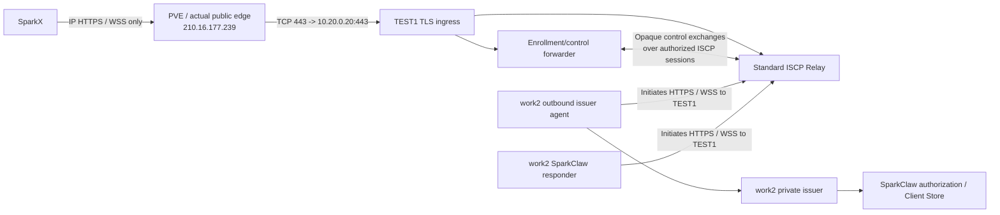
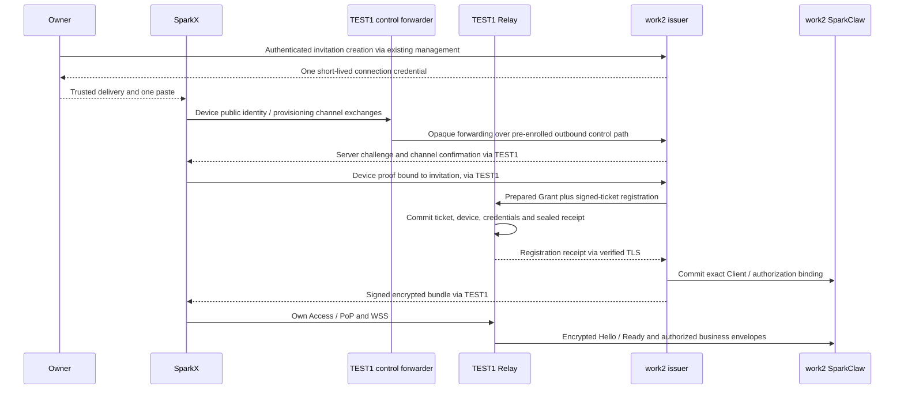

# Public ISCP Relay and SparkClaw Node Issuer Design

> Language: English | [简体中文](../zh-cn/docs/public-iscp-relay-node-issuer-design.md)
>
> Date: 2026-10-12. Status: implementation and rollout in progress. TEST1
> public IP HTTPS/WSS, the work2 private issuer and registered responder/control
> peers are deployed. Real external registration, refresh, recovery and revocation
> have evidence; the repaired isolated native relaunch also passes. Current-installation
> migration and remaining two-device business/UI gates are still in progress.
> TEST1 is the sole new public application ingress. No domain and no new work2
> port exposure. Execution owner: Codex in this chat.
> Current server source: `3a9c2535`; subsequent desktop retry fixes are recorded
> separately in the [execution record](public-iscp-node-deployment.md).

## 1. Objective and scope

Expose the ISCP Relay on TEST1 through PVE, deploy the credential issuer beside
SparkClaw on work2, and let a new SparkX installation connect by pasting one
credential issued by that SparkClaw deployment. A test deployment uses the same
Relay protocol and authorization requirements as the online service. It does
not enable anonymous registration, bearer-only delivery or a private test
protocol.

SparkX owns presentation and desktop-local data; work2 owns business execution,
Owner/Client authorization and its issuer. TEST1 routes encrypted envelopes and
holds its own Relay authority. A separate TEST1 control-forwarding
component routes sealed enrollment/lifecycle exchanges to work2; it holds no
work2 Grant signing key or SparkX-to-SparkClaw business-session key. PVE handles
ingress routing and VM isolation.
The [architecture](architecture.md), [existing ISCP integration](desktop-iscp-connection-design.md)
and [capability/authorization design](desktop-iscp-capability-expansion-design.md)
continue to govern data ownership, permissions and business recovery.

**LAN client connectivity is outside this work's design, implementation and
acceptance scope. Keep the existing LAN connection feature, entry points,
listeners and behavior enabled as before.** Server-to-server connectivity from
work2 to TEST1 is a separate infrastructure dependency, not LAN client acceptance.
Do not remove the HTTPS adapter, change its defaults or silently use it as a
business fallback for ISCP.

### 1.1 Self-hosted authority and device management

An independent work2 service provides the issuer and device-authorization
management needed by this deployment, replacing this connection flow's dependency
on InfiniMesh Cloud. It reuses the existing SparkClaw deployment/Owner/Client
authority; it does not create another account system or a second business backend.
Its separate process, signing keys and private state give issuance an explicit
lifecycle alongside the Gateway. The outbound control agent belongs to that
service; it need not be a third work2 daemon.

| Responsibility | Authority and durable state |
|---|---|
| Owner-approved enrollment and device management | work2 issuer: pending invitations, public device keys, exact Owner/Client/installation bindings, scopes, authorization revision, expiry/revocation and redacted audit |
| Business execution and Client ownership | Existing work2 SparkClaw Gateway/Client Store; remains the source of business authorization |
| Business Grant and provisioning bundle | work2 issuer; independently pinned Grant/bundle signing identity |
| Invitation validation authority | work2 enrollment signer public identity configured on TEST1; its private key stays on work2 and its purpose is separate from descriptor signing |
| Relay transport registration | TEST1 Relay: device records, ticket consumption, Access/Refresh lineage, PoP replay records and ciphertext queues |
| Relay Access/Refresh | Issued and rotated by TEST1 Relay, independently for SparkClaw, each SparkX and each control peer |
| Opaque control forwarding | TEST1 sidecar: approved node routes and bounded forwarding receipts; no Grant signing authority |

Registering SparkClaw does not register SparkX or give it SparkClaw's tokens.
Both devices need their own enrollment, key possession and Relay credentials;
SparkX additionally needs a Grant authorizing the selected SparkClaw responder.
The actual work2 responder and both service control peers are now enrolled on
TEST1 with separate credentials. Independent qualification devices A and B reached
the real work2 backend over the public origin. A was deliberately revoked; B
remained available. This does not by itself complete native relaunch or migration
acceptance; see the execution record.

## 2. Hosts and management boundary

The inventory below was supplied by the user. VM IDs, actual PVE node name,
interfaces, routing and existing forwarding rules must be checked before a
network change. Passwords and API tickets belong in the operator's secure
channel, never this document, Git, scripts, command arguments or evidence.

| Host | Identity | Address/access | Responsibility |
|---|---|---|---|
| PVE | Administrator `root@pam`; realm `pam` / Linux PAM standard authentication | [Management console](https://210.16.177.239:8006) | VM management, actual edge forwarding and applicable firewall rules |
| TEST1 | VMID `100`; guest account `ubuntu` | `10.20.0.20`; `ssh -p 22020 ubuntu@210.16.177.239` | Public Relay/TLS, Relay PostgreSQL/signer and independent control-forwarding sidecar |
| work2 | VMID `104`; guest account `ubuntu` | `10.20.0.23`; `ssh -p 22023 ubuntu@210.16.177.239` | Existing SparkClaw backend plus its issuer and enrollment authority |
| SparkX | Independent desktop device and installation | TEST1 IP HTTPS/WSS origin plus the issuer identity carried by its credential | Device-generated private key, enrollment, transport, local persistence and original workbench UI |

`root@pam` is a PVE management identity, not an application user or issuer
credential. Preserve PVE `8006`, both SSH mappings and all existing work2 business
routes. This inventory does not imply that PVE SSH uses either guest SSH port.
See the official [PVE authentication reference](https://github.com/proxmox/pve-docs/blob/master/pveum.adoc).

## 3. Topology and ports

The only new public application mapping targets TEST1. Both work2 agents initiate
outbound connections to that same public origin. The issuer is reachable through
sealed control forwarding, not a client-facing work2 listener.

| Public/VM port | Deployed destination | Exposure and purpose |
|---|---|---|
| Public TCP `443` | TEST1 `10.20.0.20:443` | Relay HTTPS/WSS; first check for an existing mapping or listener |
| Public TCP `8006` | Existing PVE management service | Preserve existing management access; not an application route |
| Public TCP `22020` | Existing TEST1 SSH mapping to guest `22` | Preserve |
| Public TCP `22023` | Existing work2 SSH mapping to guest `22` | Preserve |
| TEST1 loopback `55117`, `5432` | Relay process and Relay database | No public forwarding |
| work2 local issuer IPC | Existing/local-only service adapter, subject to inventory | Used by the outbound agent; no new VM inbound or public port rule |
| Existing work2 business and LAN ports | Existing configuration | Preserve; this design does not reassign or qualify them |

If public `443` is already allocated, preserve that mapping and explicitly select
another available Relay ingress port; regenerate all advertised URLs and new
connection credentials accordingly. Do not allocate another work2 application
mapping. Existing work2 management/business/LAN routes are preserved, but are not
part of SparkX's new connection path.

The sole application origin is [TEST1 HTTPS](https://210.16.177.239); its WSS
endpoint is `wss://210.16.177.239/v2/relay/connect`. No domain is used. Enrollment
credentials carry that origin, its public TLS trust material and the logical
work2 issuer/control identity, with no direct work2 URL.

## 4. PVE forwarding plan

Allowing a port in a firewall does not create a destination NAT mapping. For a
single public IP and private guests, identify the actual edge owning that IP,
its forwarding rules and the return path. PVE may own this path or sit behind
another router; a PVE GUI firewall rule alone cannot substitute for that router's
configuration. See the [PVE networking reference](https://github.com/proxmox/pve-docs/blob/master/pve-network.adoc).

Before editing, record the PVE node, guest NIC/bridge/VLAN assignments, gateway,
WAN interface, IP forwarding state, NAT owner, active nftables/iptables and PVE
firewall implementation, rule persistence mechanism, occupied ports and current
VM/PVE filters. Capture the existing rules and relevant configuration privately.
Use the existing network mechanism; do not guess `vmbr0`, mix firewall engines,
flush rule sets or disable a firewall. Keep console recovery and the management
sessions usable.

The intended rule semantics are:

1. Add only public TCP `443` forwarding to TEST1 `443`; add no work2 application mapping.
2. Allow the corresponding new forwarded connections and established replies
   at the actual host/bridge/VM filtering layers; guest ingress must also allow
   its TLS listener. Host `INPUT` permission is not enough for guest forwarding.
3. Preserve existing outbound NAT and return routing. Add source NAT only where
   required by the observed path, with narrow source/destination/port matching.
4. Persist named, idempotent rules using the observed host configuration and
   provide exact removal/restore steps. Apply a reviewed change with console
   recovery available; verify both management routes immediately afterwards.

work2 initiates connections to the canonical TEST1 IP HTTPS/WSS origin. Inspect
whether the actual edge supplies the necessary return path/reflection; any narrowly
scoped reflection is PVE transport infrastructure, not a work2 inbound listener or
LAN client feature. Do not replace the canonical endpoint with HTTP or a private-IP
HTTPS URL whose certificate does not match. Respect the actual
[PVE firewall configuration](https://github.com/proxmox/pve-docs/blob/master/pve-firewall.adoc).

## 5. TLS, trust and public interfaces

TEST1 currently uses an IP self-signed certificate, recorded as expiring
2027-01-10 at 11:49:21 China time. Keep verification enabled. For initial tests,
distribute its public certificate/fingerprint in the trusted connection credential
and work2 operator configuration. No domain, extra certificate-validation public
port or separate work2 public certificate is part of this rollout. Renew the IP
certificate before expiry; distribute replacement trust over an already verified
channel or a new Owner-issued credential, with explicit identity continuity.
Never disable TLS verification or silently trust an unknown replacement.

Retain WSS upgrade headers, finite proxy/connect timeouts, suitable read timeout,
disabled response buffering and bounded envelope sizes. Overwrite forwarding
headers at the trusted ingress rather than accepting a client-supplied source IP.
See [Nginx WebSocket proxying](https://nginx.org/en/docs/http/websocket.html).

| Surface | Published behavior |
|---|---|
| TEST1 discovery | `GET /.well-known/iscp/relay`; signed identity and correct external URLs |
| TEST1 transport | Standard envelope submission, WSS connect, credential refresh and revocation with their required authentication |
| TEST1 registration | Standard actor-authorized bootstrap or correctly configured signed-ticket enrollment; no test bypass |
| TEST1 administration | `/v2/relay/admin/*` and metrics remain private |
| TEST1 enrollment/control ingress | Versioned SparkClaw application-side forwarding interface; routes a proven, bounded operation to the selected work2 issuer, not a direct issuer URL |
| work2 Grant lifecycle | Private signing/authorization logic reached through its authenticated outbound agent; results retain the pinned work2 issuer signature |
| work2 administration | Existing Owner/admin interface or local management; no new public entry for credential creation, scopes, signing keys or audit |

A Relay advertises only implemented optional lifecycle capabilities. Its access
credential is not a workbench Grant. The separated issuer remains the Grant
authority. Standard transport behavior is defined by the [Relay specification](https://github.com/Infinimesh-ai/ISCP/blob/47f1f6c231c56c92eff6b6c5d398e037ebcf9602/spec/relay.md).
The user-designated [ISCP project](https://github.com/Infinimesh-ai/ISCP) is the
protocol/service reference. Its README defines reference services and conformance
tools, not a fixed vendor endpoint. Use those documented interfaces as the baseline;
do not invent a hosted address or reinterpret application forwarding as an ISCP
standard endpoint.

| Secret/key | Location and boundary |
|---|---|
| PVE/guest login credentials | Operator secure channel only |
| Relay descriptor signer | TEST1 private durable storage; stable across service restart |
| Relay actor/admin authority | Trusted server-side registration adapter only; never SparkX or a pasted credential |
| work2 Grant signing key | work2 issuer private storage; never TEST1 |
| Registration authority public identity | Pinned by the relevant enrollment verifier; key purpose distinct from Relay descriptor and business Grant signing |
| SparkX device private key | Generated by SparkX, stored in native secure storage; never issued by work2 |
| Each peer's Relay access/refresh | That peer's controlled storage; never copied from SparkClaw to SparkX |

Changing a TLS certificate does not rotate the Relay or issuer signer. A copied
public key cannot establish first-contact trust by itself; bootstrap must combine
verified TLS with the trusted credential's expected identities. Dynamic descriptor
hashes include validity timestamps; do not mistake them for an unchanging signer
anchor.

## 6. work2 issuer and registration authority

### 6.1 Reach the private issuer through TEST1

work2's issuer agent is enrolled with operator-approved identity and connects
outbound using the existing Relay HTTPS submission and WSS receive surfaces.
TEST1's separate control forwarder has its own registered device identity and a
work2-approved session limited to forwarding enrollment/lifecycle operations,
with a distinct application permission such as `sparkclaw.issuer.control.v1`.
Neither peer receives access to ordinary workbench business operations from this
control permission. Keep their keys/session state separate from the Relay process
and from SparkX-to-SparkClaw sessions.

The initial bootstrap must be provisioned by the operator: register both control
peers, pin their identities and establish the restricted control authorization
before accepting desktop redemption. Their setup cannot depend on the unredeemed
SparkX credential or on direct access from SparkX to work2.

The sidecar accepts only versioned, allowlisted application-control requests on
TEST1 HTTPS. The implemented application path is `POST /api/sparkclaw/iscp-control/v1/exchange`;
its versioned envelope carries the issuer/deployment route, stable operation ID,
step, device public identity/proof and opaque provisioning/lifecycle frame. Freeze
the field types, error codes, replay rules and cryptographic transcript binding
in the implemented application contract/tests before changing them. This is a
versioned SparkClaw interface, not an ISCP-standard path. Do not overload `/v2/relay/connect` with arbitrary WebSocket
RPC or change the standard envelope/proof flow. The selected issuer identity must
resolve to an operator-approved node route. Bind each operation to issuer,
deployment, input digest, device and expiry; bound outstanding requests and enforce
rate limits. No caller-selected upstream URL or general TCP/HTTP tunnel is allowed.

It relays the client's provisioning-channel messages to work2 through the scoped
control session and returns sealed, work2-signed results. TEST1 does not learn the
bootstrap secret or final provisioning plaintext; public routing/proof metadata is
not business data. The work2 agent calls only its private local issuer adapter.
Disconnected agents produce a typed temporary-unavailable result; retain the same
durable operation for replay after reconnect. No direct work2 fallback, alternate
signer or transfer of signing authority to TEST1 is permitted.

Issuer capability discovery and renewal use the same authenticated forwarding
path, retain work2's signature/proof/idempotency checks and declare only qualified
capabilities. Existing optional ISCP lifecycle endpoints may be exposed only after
their documented request/error/metadata semantics pass conformance; absent support
must stay absent. Application-control forwarding is not advertised as a new Relay
wire capability.

The deployed bridge is a separate application/platform adapter beside the Relay.
The upstream reference Relay alone does not supply remote issuer forwarding.
Ordinary ISCP clients retain their standard wire surfaces and authentication.

### 6.2 Issuance and actor authorization

Deploy the issuer with work2's existing SparkClaw lifecycle, private writable
state, backups and an independently pinned signing identity. Keep execution,
Owner/Client state, model/TLS configuration and existing credentials intact.
The issuer admits only authenticated Owner credential creation and proven,
authorized device redemption. It is not an unrestricted public Grant factory.

For this deployment, bootstrap the stable SparkClaw responder as the
operator-authorized inviting device. Later SparkX installations join using a
signed `iscp.pairing_ticket.v3`, with `purpose=invite`, application consumer role
`sparkx_workbench_client`, audience equal to that SparkClaw device and permission
`sparkclaw.workbench.v1`. The role name is application policy; an ISCP session
initiator is not automatically an enrollment controller. The issuer must authorize
the invitation against the actual Owner and registered inviting device before
signing it. Do not bootstrap every joining SparkX or reverse the Grant audience.
The joining SparkX generates its own proof with the ticket ID as challenge;
the service forwards that proof without impersonating the device.

For the current reference service, the operator token represents actor authority.
Keep the Relay admin token on TEST1. Initial responder bootstrap uses an
operator-run adapter with a server-issued, stored, expiring challenge and the
independently generated peer proof plus actor authority. Later control peers use
role-appropriate, operator-approved service invitations; ticketless bootstrap
does not become a shortcut for joining devices. Work2's normal issuer process
and SparkX receive no global Relay admin token. Routine client enrollment uses the
configured invitation signer and the signed-ticket path. This requires configuring
`TicketIssuer`, transactional durable consumption and cross-restart negative tests
before enrollment opens. Keep unavailable modes closed. These role boundaries
follow [ISCP provisioning](https://github.com/Infinimesh-ai/ISCP/blob/47f1f6c231c56c92eff6b6c5d398e037ebcf9602/spec/provisioning.md).

The workbench Grant retains the current direction:

| Grant binding | Required value |
|---|---|
| Subject | The enrolling SparkX device |
| Confirmation | That SparkX device's public-key thumbprint |
| Audience | The selected work2 SparkClaw responder |
| Permission carrier | Existing `sparkclaw.workbench.v1`, with application operation scopes separately enforced |
| Relay constraint | Selected, verified Relay ID |
| Authorization | Exact deployment/Owner/Client/installation binding and current revocation revision |

Do not reverse this direction by borrowing an agent-invitation template, widen
permissions on renewal or treat transport registration as authority over business
data. The existing [workbench verifier](../services/gateway/internal/iscpworkbench/config.go)
is the application-role reference.

### 6.3 Private issuer implementation and authoritative records

Add a node issuer entry point under `services/gateway/cmd/iscp-node-issuer` and
node-owned packages for issuance, control forwarding and durable operations.
Reuse ISCP identity/trust/provisioning primitives and the existing business
authorization service; do not turn the fixed-pair `iscplocalissuer` into an
unrestricted signing endpoint. The source belongs to this SparkClaw repository.
TEST1 control/registration persistence adapters and any required reference-service
patches are versioned and separately packaged from it; record the pinned upstream
revision, patch hashes and reproducible build manifest. Upstream ISCP wire schemas
remain pinned.

The deployed work2 unit is `iscp-node-issuer.service`, with binary
`/opt/sparkclaw-iscp/bin/iscp-node-issuer` and private state rooted at
`/home/ubuntu/.local/share/sparkclaw/public-iscp-node`. It uses the existing
Gateway's restricted Unix management adapter and exposes its own private
`issuer-socket/issuer.sock`; it has no guest-network listener. Exact configuration,
registry and matched rollback paths are in the execution record.

Use PostgreSQL-backed issuer operation/receipt storage on work2 with a narrowly
owned role/schema. Store business Client and authorization records through the
existing Gateway store interface, implementing any extensions in memory, file
and PostgreSQL together. A Client's Owner/scopes/revocation are not duplicated
in an independent issuer account database. Issuer records reference the
authoritative revision and use transactional reservations/reconciliation.

The issuer needs durable records for invitations, device bindings, staged grants,
redemption operations, renewal/recovery attempts, encrypted result receipts,
revocation jobs and audit. Enforce unique invitation consumption and device/key
binding with database constraints. Store bootstrap-secret verification material
and, only where cryptographic channel establishment needs it, an encrypted secret
under a separate protected storage key. Never log the secret or keep pasted
credentials in plaintext. Operation receipts, pending channel/wrap private keys
and temporary Relay credential escrow are encrypted at rest and access-controlled.
Define bounded retention, garbage collection and paired backups before rollout;
unresolved operations and revocation tombstones cannot be purged by TTL alone.

Use separate stable invitation and Grant/bundle signing keys, with explicit
public purpose and verifier configuration; neither is a Relay descriptor signer
or a client key. The implemented private application runtime uses schema 2 with
`mode=node-managed`, an explicit issuer/control route, TLS trust and multi-peer
registry reference. Keep legacy local-test schemas readable through their existing
validation path. This is an application configuration version, not a renamed ISCP
wire object or an automatic trust migration.

The first rollout targets at least two independently enrolled SparkX devices
under the existing Owner. Owner isolation remains enforced in storage and calls;
inviting a device never creates or selects a new Owner from client input.

### 6.4 Relay registration transaction and lost-response recovery

Before ticket consumption, work2 verifies the ready provisioning channel and
device proof, reserves the exact Client/authorization binding and prepares the
device-bound Grant. It sends an authenticated preparation record to the TEST1
registration adapter: ticket ID, stored device/key binding, public signed Grant
and digest, operation ID and a work2-generated receipt-wrap public key. This
internal record is not a new public ISCP request field. Only the approved issuer
route can prepare it; verify the Grant signature and every ticket/Grant binding.

The standard ticket registration handler then commits ticket use, device record,
Access/Refresh hashes, the prepared signed Grant reference and a sealed issuance
receipt in one Relay database transaction. Do not rely on the reference handler's
current sequence of independent writes or in-memory ticket map. Return credentials
only over the authorized, verified provisioning path. A prepared Grant is public
authorization material; storing its signed copy on TEST1 gives TEST1 no signing
key or permission to alter it.

Work2 finalizes its Client/authorization state idempotently against that receipt
and publishes one signed, encrypted bundle only after all required records agree.
A newly staged ISCP peer has no business admission until its verified durable
registry/Grant is activated. Existing Client and LAN authorization remain under
the original Gateway authority; the private data-preserving migration reuses
that exact Client only for its approved operation. If work2 crashes
after Relay commits, resume the same operation instead of consuming the invitation
again. A narrowly authenticated private status/receipt operation returns only the
original sealed receipt to its bound work2 wrap key. Standard unauthenticated or
replayed registration proofs remain rejected; do not make proof replay an
unprotected plaintext-token lookup.

The deployed cooperating preparation/commit adapter implements this transaction;
it does not imply that an unmodified upstream reference Relay has the same
atomicity. Isolated concurrency/restart/negative tests and actual public enrollment
are recorded separately from the remaining native client-visible completion gates.
Failure cleanup touches only this operation's staged allocations. An unknown
commit is reconciled before revocation or retry, preserving previous valid peers.

### 6.5 Multiple SparkX peers and Relay receive behavior

The node-managed responder surrounds the existing one-peer Endpoint with a
registry and dispatcher on work2. It uses one stable responder identity and one
coordinated Relay credential/receive owner. Route verified envelopes to isolated
peer/session state keyed by device, key thumbprint, authorization revision and
session ID. Resolve Owner/Client from the server registry, never message body
assertions. Reuse the existing operation handlers and permission checks after
Grant, Hello, Ready and capability verification. Bound peer/session counts,
queues and per-device work; one peer's expiry/revocation cannot reset others.

Do not start multiple WSS drain workers competing for the same responder queue
or duplicate its Refresh state per Client. Share transport ownership while
keeping peer session keys, drafts, pending results and ACK fences isolated.
The public-mode runtime is a new explicit application configuration version,
not an old `local-test` file with a changed URL. Model the self-hosted enrollment
authority and workbench Grant signer by purpose; the old rule separating the
test issuer from a cloud root must not be blindly copied or simply removed.

The pinned reference Relay sends `ready`, drains the current queue, sends
`drained`, then closes WSS. The node-managed production adapter also accepts normal drained completion
without discarding a healthy higher-level encrypted session on every poll.
This is qualified separately from the unchanged local-lab profile. Unexpected
loss, identity change and failed handshake retain their protocol recovery rules.
Preserve standard WSS frames and production PoP. Inventory shared IP limits,
account for responder/control/client traffic and qualify bounded polling/backoff
and deployment capacity with two active clients; do not switch to local-lab or
use separate source-IP tricks to conceal a rate-limit failure.

### 6.6 Administration through the existing product boundary

Use existing Owner device/credential administration components to create an
invitation, copy its credential, list enrolled devices and revoke a selected
device. Extend their adapters and server-side operations; preserve layout,
menus, labels and confirmation behavior. Before any remote credential exists,
operator setup and first invitation creation can use local management over the
existing SSH route. No extra work2 application port is required. Once enrolled,
Owner-authorized management uses the existing ISCP workbench control path.

The management view distinguishes an unredeemed invitation from an active device.
Revocation commits the business authorization revision immediately, stops renewal
and new business admissions, invalidates peer sessions and enqueues Relay
credential revocation. Track and retry that second step durably if TEST1 is
unavailable; show completion only when the required stages have receipts. Do not
let a successful local row deletion imply completed Relay revocation.

## 7. One pasted credential and device-bound redemption

An Owner issues one opaque, short-lived connection credential for a specific
work2 deployment and Client. Before SparkX has generated a key, this credential
is a limited enrollment authority, not a final device-bound Grant. It supplies
the single TEST1 origin and trust information, logical work2 issuer/control and
responder identities, intended Owner/Client scope, redemption ID/challenge,
expiry and a one-use bootstrap secret.
It contains no device private key, operator token or pre-shared backend access.
Its application envelope must be explicitly versioned and distinguished from the
existing HTTPS-only `sparkclaw-connect-v1` encoding; it is not a new ISCP object.

The user pastes once in the original connection screen. Main/helper then:

1. Validate the envelope and TEST1 trust binding, create the local device key and
   persist a durable redemption operation with an immutable input digest.
2. Prove device possession with the appropriate server-issued challenge and
   establish the provisioning secure channel with the pinned work2 issuer using
   the bootstrap secret, with all network exchanges routed through TEST1. The
   secret itself stays inside the client/work2 cryptographic channel.
3. Let work2 verify Owner-issued enrollment authority, device binding and expiry;
   prepare the scoped v3 invitation/Grant and perform the correctly authorized,
   transactional Relay registration for that device.
4. Complete the service's durable Client/authorization and device-bound Grant
   issuance, and return the verified, device-bound provisioning result over the
   ready secure channel. Do not release credentials before that channel is ready.
5. Save verified credentials in native secure storage, finish enrollment recovery,
   establish ISCP Hello/Ready and verify workbench identity/capabilities before
   showing the original workbench as connected.

The pinned SDK's [`EstablishLocalChannel` demonstration](https://github.com/Infinimesh-ai/ISCP/blob/47f1f6c231c56c92eff6b6c5d398e037ebcf9602/pkg/iscp/provisioning/provisioning.go)
constructs both sides in one process. It is not an already implemented two-process
network handshake.
Implement and qualify the distributed transcript/key confirmation using the
existing cryptographic primitives and normative provisioning bindings; a local
`Ready=true` assignment or two-party fixture cannot establish remote readiness.

Registration on TEST1 and issuance on work2 cannot share one database transaction.
Use a durable coordinator and stable operation IDs, staged records and reconciliation
to provide atomic completion to the client. Before completion, staged registrations
grant no business access. A lost response replays/reconciles the same issuance;
failure cleanup revokes only this operation's unused allocations. Do not repeat an
unknown side effect or recreate a device key. A different key/input under the same
operation conflicts; a second device cannot reuse a completed one-use authority.
Commit the idempotent response with issuance state and preserve enough encrypted
receipt material to recover the same result after restart.

No user-visible JSON/key/Grant assembly is required. The old HTTPS credential
format remains supported, but adding that compatibility is not new LAN development.
Keep every existing page, menu and component. Unsupported actions retain their
entry and are gated individually; do not add persistent technical status panels.
Normal credential renewal/recovery is silent, with feedback when user action is
needed.

### 7.1 Implemented credential and control contract

The implemented separate application prefix is `sparkclaw-iscp-connect-v1.`,
with canonical base64url encoding, a strict versioned schema and a 48 KiB decoded
limit. Its fields are: schema version, TEST1 HTTPS origin, public TLS trust,
domain/Relay IDs and signer pin, issuer identity, logical issuer route, responder
public identity, deployment/Owner/Client or reservation binding, invitation ID,
creation/expiry times, expected scopes and a random bootstrap secret of at least
32 bytes. Sign the public constraints; the Owner-issued out-of-band delivery is
the first-contact trust boundary. The secret is a one-use enrollment authority,
not a Relay token or a device private key. Preserve the old HTTPS prefix and
strictly dispatch formats before constructing the helper's transport.

The TEST1 exchange contract admits only channel setup/finished, redeem,
operation status, issuer lifecycle and sealed receipt steps. Use stable
operation IDs, immutable payload digests, monotonically checked channel sequence
numbers and versioned errors. Suggested errors: malformed/unsupported input
400, invalid proof 401, denied/revoked 403, conflicting operation 409,
expired/consumed authority 410, rate limited 429 with `Retry-After`, and issuer
temporarily unavailable 503. An unknown node/device cannot be used as an
existence oracle. These are application errors, not invented ISCP reason tokens.

Do not claim that a public route or opaque payload authenticates itself. Work2
validates the enrollment secret, device proof, expected route and transcript;
the sidecar enforces admission limits and authenticated control-peer routing.
Block redirects, caller-selected URLs, oversized frames and secret-bearing logs.
Freeze canonical signing/MAC inputs and the full handshake transcript before
coding. Bind the protocol/version, both identities and ephemeral keys, operation,
invitation, deployment and expiry; verify role-specific finished proofs in both
directions before marking ready. Fresh sessions use fresh keys; resumed
operations are re-authenticated and use their durable bound device/input.

### 7.2 Operation states and storage activation

The coordinator durably records invitation/device/channel binding, prepared
Grant and receipt, then bundle readiness. Renewal/recovery results reach `applied`
only after a signed acknowledgement following the client's durable local save.
These are semantic stages; executable state names and fields are defined in
`internal/iscpnodeissuer`, not a second schema in this document.
Expired/revoked/failed states are terminal for new side effects; an unknown commit
is a reconciliation state. Persist each transition, its exact input and receipt
before publishing the next state. Reserve one invitation against one device key
with compare-and-swap; concurrent other-device attempts conflict.

Only after the signed bundle and device/key/issuer/Relay/Grant bindings pass does
SparkX activate a new connection profile. Persist the device key in native secure
storage and the operation before network mutation. If secure storage fails, keep
the original active profile and local workbench, retain recoverable state and
report the actionable failure. Device private keys, Relay tokens and decrypted
bundles stay out of the renderer. The pasted credential is transient input:
handoff to main/helper and clear it after use; do not retain it in UI storage,
diagnostics or crash logs. Clipboard access is limited to the requested copy/paste.
Deleting a pending connection reconciles remote stages before cleanup; it does
not silently abandon a consumed invitation.

## 8. Renewal, revocation and failure recovery

Maintain separate lifetimes for the bootstrap credential, Relay access/refresh,
short-lived Grant, capability manifest and application standing authorization.
The standing authorization remains until manual deletion under the existing
product decision; it is not an infinite bearer or an expiry edit. Node-issuer
extensions must be versioned, declared and tested; do not label them as standard
online Relay capabilities. The ISCP project's published lifecycle semantics
and declared deployment policies govern compatibility; test mode is not an
exception to them.

Use the TEST1 control-forwarding path, possession proof, original-scope continuity
and durable idempotency for issuer renewal. Retry an unknown outcome with the
exact original request; retain bounded backoff and server pacing. Refresh rotates
a peer's own Relay credentials.
Deletion commits an authoritative revocation revision and blocks business effects
and future renewal; old cached Grants or delayed responses cannot revive it.
See [existing authorization semantics](desktop-iscp-capability-expansion-design.md#22-permissions-and-authorization-renewal)
and the [ISCP lifecycle reference](https://github.com/Infinimesh-ai/ISCP/blob/47f1f6c231c56c92eff6b6c5d398e037ebcf9602/spec/device-lifecycle.md).

Transport recovery creates fresh session keys and revalidates the application
manifest. It retains installation identity, the original business request, stored
result and ACK fences. Neither ingress changes nor a server restart authorize
automatic resubmission of an uncertain task/email. Normal business remains inside
ISCP; HTTPS issuance/control traffic does not become an HTTP business bypass.
See the [session specification](https://github.com/Infinimesh-ai/ISCP/blob/47f1f6c231c56c92eff6b6c5d398e037ebcf9602/spec/session.md).

### 8.1 Expiry policy and cold-start recovery

Deployed first-rollout defaults: invitation TTL 15 minutes and one use; workbench
Grant TTL 900 seconds, renewed within the issuer-qualified renewal window;
standing authorization `until_revoked`. The observed Relay issues Access for 15 minutes and Refresh for
24 hours. Keep those as independent transport expiries and read actual issued
metadata; do not turn standing authorization into a permanent token.

Existing-device recovery must work after both the Grant and Refresh have expired,
using the original device key and server-held authorization. SparkX can still
reach TEST1 HTTPS without valid Relay access: authenticate a fresh issuer control
channel to work2, renew the unchanged Grant, then recover Relay credentials for
the existing device with the lifecycle specification's stored-key proof, wrap-key
binding, sealed result, revocation gates and atomic idempotent receipt. It must
not consume a new invitation or require the expired bootstrap secret. Advertise
standard optional Relay recovery only after every specified gate, schema/error
and negative vector passes; otherwise the feature remains explicitly unavailable.

Renewal must update the Relay's verified Grant/revocation reference before
credential recovery uses it. The copied original Grant cannot authorize recovery
after its own expiry. Keep work2 authoritative for device permission and revocation;
the cooperating recovery gate requires current authenticated issuer confirmation,
including the bound key, scope and authorization revision. If that authority is
unreachable or revisions disagree, return temporary unavailability rather than
recovering from a stale cached authorization. Delayed preparation/renewal results
cannot overwrite a newer revoke. Service-peer recovery uses its separately stored
operator authorization and cannot renew ordinary client business permissions.

Control peers and the bootstrapped responder need their own recovery plan too.
Use separately scoped `relay.recovery` anchors where the standard requires them;
those anchors grant no workbench access. Operator-enrolled service-peer recovery
must remain possible without the expired control session: a narrow TEST1 adapter
checks the stored operator-approved peer key and fresh proof, with protected local
actor authority and a sealed device-bound result. It accepts only pre-provisioned
service peers and performs no new enrollment. This platform recovery path is
qualified separately from standard device lifecycle endpoints. Losing a device
key or revoking its authorization always requires explicit re-authorization.

Routine refresh rotation is serialized per device and persists its successor and
sealed receipt in one Relay transaction. The implemented adapter closes the old
reference service's sequential-write gap. Real external A refresh rotated both
credentials and rejected its old Refresh with 401; isolated tests cover concurrent
rotation, lost response and restart. Unknown operations keep their original proof,
wrap key and input. Native relaunch and paired service-restart acceptance are tracked
separately from those tests.

## 9. Deployed state and remaining acceptance

| Area | Implemented/deployed evidence | Remaining gate or boundary |
|---|---|---|
| Public ingress | PVE `pve-iscp-443.service` forwards only new application TCP 443 to TEST1; outside-PVE TLS/health/discovery pass; public admin and metrics return 403 | Keep existing management/SSH and work2 ports; no domain or new work2 ingress |
| Relay/device enrollment | Persistent signer, PostgreSQL ticket consumption, approved invitation verifier and registered work2 responder/control peers | Preserve standard ISCP authentication, actor roles and replay rejection; paired real Relay/issuer/forwarder restart passes with stable signer/TLS |
| Node authority | Independent work2 issuer, existing Gateway Unix management, encrypted PostgreSQL state, fixed Owner/Client scope and actual device-held keys | No duplicate account authority or Relay admin token on work2/SparkX |
| Single-origin control | TEST1 sidecar and work2 outbound agent carry allowlisted RPC over ordinary authenticated ISCP sessions | Forwarder cannot issue Grants, decrypt provisioning results or become a business HTTP proxy |
| Provisioning | Independent X25519 keys, OOB-secret/transcript binding, two finished MACs, signed sealed result and restart-safe operation replay | Unknown outcomes reconcile the same operation; no new device key or second invitation consumption |
| Registration/refresh/recovery | Atomic ticket/device/credential receipt, durable refresh lineage and key-bound recovery adapters; real A refresh and both-expired recovery pass | Application service-peer recovery is distinct from standard optional lifecycle capabilities |
| Multi-peer workbench | One responder receive owner, private peer registry, scoped isolated sessions and live Gateway Client validation | Device A revocation must keep B usable; business result/ACK and all remaining native lifecycle gates stay explicit |
| SparkX integration | Separate ISCP credential parser, original connection/main/helper adapter, schema 2 `node-managed`, native device key storage; helper A/B and an isolated native B initial connection/automatic renewal have evidence | Isolated native relaunch passes after the 30-second/single-flight retry fix; current Mac installation/migration and B/C business/UI gates are not yet accepted |
| Existing data binding | Private operator-approved one-operation migration reuses the exact existing deployment/Owner/Client and installation identity | Never retag rows or create another Client merely to make existing UI data visible; final native data/selection parity is pending |
| Validation | Linux supported-platform Gateway suite: 70 packages pass, 10 have no tests; official SDK/conformance packages pass; official local P0 report has 31 pass/0 fail/6 skip | The six service/CLI cases have no endpoint evidence; do not claim hosted-service interoperability or native acceptance from local conformance |
| LAN | Original adapter, listeners and UI entry points are retained | No additional work2 LAN rollout or physical LAN acceptance in scope |

The [execution record](public-iscp-node-deployment.md) owns current host paths,
matched backups, rollout manifests and evidence distinctions. Server source is
SparkClaw `3a9c2535`, based on pinned ISCP `v0.2.0-rc.1`; reference inspection uses
upstream `47f1f6c231c56c92eff6b6c5d398e037ebcf9602`. Internal persistence and
application adapters do not change the frozen ISCP wire objects. The official
local conformance runner does not target a remote endpoint. Actual public SDK
registration, encrypted connection, refresh, recovery and revoke evidence is
therefore reported independently. Current-installation migration and any unexecuted
business acceptance cannot be inferred from a healthy endpoint or those tests.

## 10. Implementation phases and acceptance

| Phase | Work | Exit evidence |
|---|---|---|
| P0 Inventory/freeze | Inspect existing hosts/routing/registration; take paired checkpoints; freeze roles, credential/control schemas, storage migrations and transaction/recovery design | No guessed registrations or ports; current-state receipt, source hashes and concrete rollback |
| P1 Isolated implementation | Implement issuer/store, TEST1 sidecar/registration transaction, distributed channel, public receive lifecycle and multi-peer responder in an isolated test deployment | Two independent devices; bad proofs/roles/keys; concurrent redemption, crash/lost-response, refresh/recovery and owner isolation pass |
| P2 TEST1 preparation | Install qualified sidecar/persistence adapters, configure trusted invitation signer, bootstrap/pin actual responder/control peers, then open only IP HTTPS/WSS through PVE | External TLS/WSS; durable distinct registrations/credentials; stable signer and preserved management/old routes |
| P3 work2 rollout | Install independent issuer/outbound agent and registered multi-peer responder against existing Gateway/Client state | Private-only issuer IPC; Owner creates an invitation; no existing Client/execution/config loss |
| P4 SparkX rollout | Build/audit the credential/main/helper adapter; qualify a separate native profile before switching the existing installation | Fresh paste-to-connect, two concurrent devices, secure storage and original UI/data/HTTPS-format preservation |
| P5 Complete lifecycle/business | Real model request/result/ACK, offline expiry, restart, revoke and actual external path | One original admission, matching digests/ACK, expired Grant+Refresh recovery and immediate business denial after revoke; zero direct business HTTP fallback |
| P6 Project compatibility/close | Run pinned ISCP conformance against reference and TEST1, archive source/config/binary/registration/acceptance receipts and rollback instructions | Standard wire interoperability; declared application extensions; distinguish implemented/deployed/verified states |

Public acceptance must originate outside PVE; SSH tunnels and host-local curl are
preflight evidence only. Include WSS challenge/ready and actual encrypted delivery,
an offline queued message across Relay restart, refresh rotation rejecting the old
token, proof replay rejection across restart and stable signer identity. Include
one-use redemption with a different device, crash after each issuance stage,
expired/revoked credentials, wrong issuer/Relay/peer and role reversal. Mark
unsupported ticket or recovery capabilities as unavailable rather than bypassing
checks.

Also verify fresh enrollment and expired-Grant renewal with all direct work2
client paths unreachable, and capture that SparkX uses only TEST1 HTTPS/WSS.
Interrupt/restart the outbound issuer agent and sidecar independently; original
operations must reconcile with unchanged inputs and exactly one issuance. Test
tampered issuer routes, provisioning MAC/transcript failure and broker denial.
The sidecar must neither recover provisioning plaintext nor admit business calls.
Use two separate native SparkX profiles/devices concurrently; prove their keys,
Client bindings, Refresh lineage, results and ACKs cannot cross. Revoking one must
leave the other operational. Include offline time beyond both protocol expiries,
control-peer cold start, direct ticket consumption without a prepared Grant,
transaction fault injection and lost refresh responses. Source/package/helper/UI
parity and paired installation rollback are required before switching the current
Mac profile. A synthetic device or successful health check is not that evidence.

UI acceptance covers original pages, menus, styles, schedules, rename/delete,
mail/attachments and preserved drafts as applicable. A transport unit test is not
UI preservation evidence. Preserve the LAN adapter and entry points with targeted
regression checks; a work2 LAN rollout or physical connectivity test is not a gate.
No real external email/send action is authorized by this connectivity design.

## 11. Rollback, coordination and execution in this chat

For PVE, snapshot the original rules/configuration and remove only this rollout's
owned mappings/filters on rollback; retain management and old guest routes. For
TEST1, restore the matched signer, database, TLS/config and exact binary. For work2,
checkpoint its database schema, execution/authorization state, issuer state and
runtime config together; do not roll an older binary over an incompatible ledger.
For SparkX, pair the application backup with profiles, native credential state,
launch selection and owned SQLite/files; do not delete an existing workbench to
change its transport. Keep the original Mac Relay/issuer until the new path is
accepted, then retire dependencies only under the approved rollout.

InfiniCenter is absent at the prescribed ancestor anchors. This is a repository
implementation record, not a centrally accepted contract. Changes remain within SparkClaw-owned
adapters and deployed reference-service configuration/internal persistence fixes,
reusing frozen ISCP wire objects. If implementation requires a changed external
contract or changes across projects, restore the required cluster decision/contract
workflow before that change; do not invent central acceptance. No upstream ISCP
wire-contract change is planned.

Codex in this chat owns P0–P6 implementation, host deployment, validation and
documentation. The user has selected direct execution; no other AI handoff is
required. Implementation and rollout are underway, following these dependencies and
preserving resumable evidence at each milestone. Server deployment is recorded;
current-installation migration and final native business/UI gates are still under validation.
Use the existing server authorization for inspection and scoped deployment;
resolve network-owner/trust facts by inspection. Do not ask again for a domain,
work2 public issuer URL or an already supplied host credential. Report an actual
new blocker with its evidence if one appears.

Deliver the sole TEST1 IP origin, public trust material, actual device-registration
receipts, issuer creation/renewal/revocation instructions, source/binary manifests,
native acceptance records and exact rollback steps. Preserve original UI/LAN,
existing business state and unrelated pending/unknown operations. Keep current
local services and profiles until the new path passes acceptance. Closing the
work requires an independently enrolled SparkX to use the real work2 backend via
TEST1, recover after expiry/restart and lose access after deliberate test revocation;
document completion cannot substitute for that running result.
