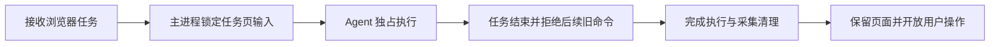
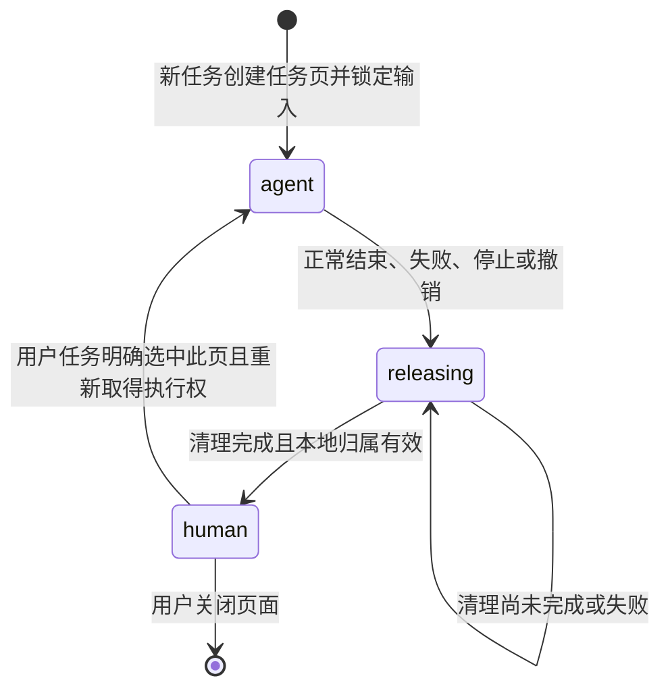

# SparkX 内置浏览器执行期间只读与结束后交还设计

> 语言：简体中文 | [English](../../docs/desktop-browser-interaction-control-design.md)
>
> 日期：2026-11-13。状态：已完成源码实现与隔离 macOS 原生验证，尚未安装或部署。
> 源码基线：`codex/sparkx-website-url-lookup` 的 `194da714`。
> 范围：SparkX 通用内置浏览器、本地 Controller 与 Gateway 工作流。

## 1. 决策与设计链路

**Agent 操作期间，用户只能查看该任务的页面；本次浏览器任务结束且执行清理完成后，保留页面并允许用户操作。** 本期不支持 agent 与用户同时操作同一任务页，也不新增暂停／接管／继续控制。



执行期间继续使用现有输入遮罩、焦点保护和只读提示；结束后在原页面上解除限制，不重新创建个人页，不丢失仍存活页面的表单和历史。页面的任务来源与会话归属保持不变，用户操作能力由主进程明确授予。

锁定只作用于当前任务页及属于同次执行的弹窗。会话切换、查看其他标签、收起／加宽面板及现有“停止任务”仍可用；无关个人页保持原有行为。本期不新增共享输入归因、字段冲突修订、焦点／视口让步或通用暂停恢复检查点。

[Controller 设计](desktop-embedded-browser-controller-iscp-design.md)的 ISCP、授权、journal 和未知写入保护继续有效。本提案只收敛输入权与页面寿命的关系，替代此前共享交互方案。保留现有页面、菜单、布局、样式和地址草稿，不增加常驻技术状态面板。不涉及 InfiniCenter、邮件业务、provider 脚本、AI 对话导出或新的远端 CDP／LAN 通路。

## 2. 参照研究与证据边界

以下保留前期参照研究。Codex 的共享交互行为不作为本期 SparkX 的产品要求；本期采用第 1 节的独占操作决定。归属与寿命分离、结束后的资源释放仍可借鉴，结构／共享输入补测不计作本期验收。

研究对象为本机 Codex 客户端：bundle 为 `com.openai.codex`，版本 `26.1106.51428`、build `26605`，以及 2026-11-13 的真人配合 IAB 实测。

| 依据 | 已确认行为 | 设计含义 |
|---|---|---|
| 静态分析 | 页面关联、`isBrowserUsePage`、`isBrowserUseActive`、`browserUseTabLifetime` 分开管理 | 分开建模页面归属、活动状态与寿命 |
| 静态分析 | 未发现以 agent 活跃状态全局禁用键盘或设置 webview `inert` 的策略；agent 光标层为 `pointer-events:none` | 仅描述 Codex；SparkX 本期明确保留执行期间输入锁，静态审计也未覆盖全部原生读取方 |
| 真人实测 | 两次鼠标点击、粘贴、逐字输入到达页面，后续 agent 操作继续 | 说明 Codex 允许并行输入；SparkX 本期不采用该行为 |
| 真人实测 | 同一字段依次为 `AGENT-A → HUMAN—B → AGENT-C` | 本次测试中 Codex 没有阻止后续覆盖 |
| 真人实测 | Agent 心跳点击把视图带向其目标，干扰用户定位共享输入框 | 说明共享交互需要额外协调，本期将其移出范围 |
| 真人实测 | 计划追加 30 次点击，只执行 2 次；显式停止约一分钟后计数仍为 32，turn 为 interrupted | 停止能阻止后续动作；不能据此保证已派发底层命令可原子取消 |
| 随包 API | `markHandoff` 保留临时标签供后续轮次使用，`markDeliverable` 保留成果页 | 页面保留不等于控制权转移 |
| 随包 API | `requestUserTakeover` 属于 Cloud Browser；它与 `requestManualHandoff` 均将 IAB 列为默认不支持 | 不能据此声称 IAB 支持接管；SparkX 本期不新增暂停／继续协议 |

独立 IAB 接管入口和同一瞬间的键盘冲突尚未验证。部分批注／编辑辅助能力会在 agent 活跃时受限，这不等于普通网页输入被禁用。最初 IAB 不可用，后续已成功完成实测，恢复原因未知。第一次停止试验在点击停止前已经完成，不能作为取消证据。事件归因结合真人确认、专用控件、工具调用与时序，不单独依赖 `isTrusted`。

静态来源为本机客户端 `Contents/Resources` 下的 `app.asar`，主要包括 `.vite/build/early-bootstrap-615-24f1d3fc72897a7a.js`、`webview/assets/async/514766.2d2f1ddc86.js` 和 `.vite/build/browser-page-preload.js`。随包文档位于 `plugins/openai-bundled/plugins/browser/docs/` 的 `api.json`、`tab-cleanup-iab.md`。以上结论限定于该版本。

私有实测证据保留在 `~/Documents/Codex/2026-11-13/mac-codex-iab-agent-agent-iab/outputs/`，不复制进仓库。初次输入／停止实测的临时页面与服务已清理，原有标签页保留。后续结构／导航补测的最终结果与独立清理记录见第 2.1 节。

| 文件 | SHA-256 |
|---|---|
| `iab-test-summary.json` | `a0d1f8099a41b65cc5dbafb9949d72e3d4941a40e21f5f8b57475000f0a3c758` |
| `iab-events.json` | `39da74013f58df8a48ab4d8b3937663cc3e0bc9d3329980fdb8a56688aee5f30` |
| `iab-stop-audit-2.json` | `913cc46a821d392b4a5f5d8f11fdc48cbf2e417ed9f37139c96dfe7cb017aa59` |
| `iab-stop-observation.json` | `79634c2dd3dc149745417a07f4a2dbe2d29a8c2ed1e617f7d0ba982c7d45cd54` |

DeepSeek Harness 仅补充参照[会话资源归属与串行执行](https://github.com/deepseek-ai/deepseek-harness/blob/e8f7b93a344964de3dca1ace9e72b6e4d6de87cb/packages/experimental/browser-use-runtime/src/index.ts)。其资源独占预约机制不作为 SparkX 默认用户输入策略。

### 2.1 页面结构与导航补测的最终结果

补测使用同一 Codex 版本。A1／A2 中，真人控件触发 12 秒后的 DOM 变化，原点击命令在实际变化前约 1.4 秒开始；未预写自动错误恢复脚本。下表时间均为 2026-11-13 的 Asia/Shanghai 时间（UTC+08:00），JSONL 原始日志使用 UTC。

| 场景 | 命令与页面事件顺序 | 可以支持的结论 |
|---|---|---|
| A1 在其他区域重建等价目标 | 原同名 `getByRole` 点击于 17:04:35.780 开始；17:04:37.181 删除旧节点并新建节点；17:04:37.288 新节点收到点击；17:04:37.505 原命令成功；模型 `domSnapshot` 直到 17:05:00.640 才开始 | 定位器在同一次调用内重新解析并命中新节点，成功不依赖模型先整页重读；任务继续 |
| A2 原名称目标消失 | 原点击于 17:07:12.202 开始；17:07:13.602 旧目标移除；17:07:15.228 命令失败；模型于 17:07:21.762 主动 `ax.get`，17:07:32.491 对新索引 23 调用 `ax.click`；17:07:32.518 替代目标收到点击 | 失败的是单次操作，模型主动选择重读与恢复，任务未停止；这不是客户端自动重规划的保证 |
| B 同标签页同源导航 | 真人触发 `/nav-start → /nav-dest`，17:13:02.586 导航提交，17:13:02.624 新文档加载；模型于 17:13:57.489 主动 `ax.get`，17:14:12.897 点击新索引 14，17:14:12.931 页面记录成功 | 模型读取新 URL／文档／目标后任务继续，未观察到客户端自动中断任务；导航发生在两次调用之间，不在旧页面点击执行期间 |

A2 的完整错误为：

```text
Error: Error: Playwright selector deadline exceeded
waiting on click for selector internal:role=button[name="确认目标 A2"s]
Locator diagnostics: {"kind":"no_matches","action":"click","locator":"internal:role=button[name=\"确认目标 A2\"s]","matchCount":0,"matches":[],"visibleCount":0,"truncated":false}
```

更早一轮禁用控件约 3 秒提前超时，发生在真人变更之前，不能算作 DOM 变化导致报错。A1 的新目标是测试定义的等价目标，任意按钮同名不代表业务语义等价。IAB 语义定位器的这些表现也不能证明 SparkX 的不透明快照引用具有同样行为。

B 的导航发生在只读命令 30 于 17:12:55.382 结束之后、调度命令 31 于 17:13:03.773 开始之前，旧页面点击根本没有发出。新文档不含旧文档的触发日志，导致调度器 31 返回 `waitingForHuman`；这是测试调度局限，不代表真人未跳转。命令 32 和页面事件确认了新文档，命令 33–34 完成操作与验证。目的地仍在本次测试授权范围内，因此继续不需要新的用户授权。

A1／A2／B 补测已完成；导航与在途旧页面操作相撞、旧 AX 索引复用、跨域导航及一般业务页仍未验证。部分点击请求设置 45 秒超时却约 3 秒报错，原因未确认，不能推导通用超时或自动恢复保证。

同一私有目录中的最终证据为 `iab-structure-report.txt`、`iab-structure-summary.json`、`iab-structure-commands.jsonl`（A1 命令 ID 14–15，A2 为 20–23，B 为 30–34）、`iab-structure-page-events.jsonl`，三张结果截图 `iab-structure-a1-result.png`、`iab-structure-a2-result.png`、`iab-structure-b-result.png`，以及保留的夹具 `iab-structure-fixture.py`。测试标签 3 已关闭，原标签 1 保留，服务已退出，60715／60741 端口确认关闭，临时工作源码已移除。`outputs` 中保留证据；未修改客户端配置、权限、安装包或业务页。

| 最终补测文件 | SHA-256 |
|---|---|
| `iab-structure-report.txt` | `586deb9db1769c6aa0ab51648ebc80023cbacfea2db998ac6a65f278128aae90` |
| `iab-structure-summary.json` | `3a12774f5c4b943ed8858970b9ac94097055843ba95e9e6dc95f5cf985e1b512` |
| `iab-structure-commands.jsonl` | `41ca3a932845d221ddf2a561342cc0359e442dc7de78686e525574f34c5036d0` |
| `iab-structure-page-events.jsonl` | `01763735d9b5859e19d2eace73e57e0d444890fcb70f4b78fad28289845af7db` |

## 3. 当前实现与所需改动

| 当前边界 | 基线行为 | 本期适配 |
|---|---|---|
| `BrowserPanel.tsx` | 任务角色显示只读提示，导航和关闭依赖个人页角色 | 执行期间保持只读；结束后依据主进程能力启用原入口 |
| `presentation.mjs` | `showTask` 持续显示原生输入遮罩并重定向焦点 | 由执行状态控制遮罩和焦点保护，不能因页面仍是 task 就永久只读 |
| `page-registry.mjs` | 任务角色拦截键盘／右键；新连接可自动接纳会话保留页 | 区分来源和当前操作权；结束后允许用户操作，阻止新任务自动接纳用户保留页 |
| Controller／forwarder | 单 lease、串行命令、journal 和未知写入拦截 | 保持现有执行机制，补齐任务终态与本地清理完成的交还判定 |
| Registry／adapter 清理 | 正常 release 只保留选中页，`closeConnection` 销毁仍绑定的页面 | 统一保留／销毁策略；先撤销执行绑定，再保留应交还的页和弹窗 |
| Owner 浏览器服务 | 部分导航、下载和权限操作只允许个人角色 | 为已交还任务页接入相同的本地能力检查，保持任务来源与权限边界 |

现有文档／frame 校验和未知写入保护继续使用。无需为本期交付引入共享输入的逐字段修订机制，也不能顺手放宽 Controller 现有失败或重试规则。

## 4. 状态与交还条件

以下是拟实现的本地契约。主进程是页面输入与寿命的权威，Gateway 提供已认证的浏览器任务生命周期，renderer 只显示状态和能力。

| 状态 | 用户操作该页 | Agent 访问该页 | 进入条件 |
|---|---|---|---|
| `agent` | 禁用页面输入及导航／关闭等修改操作 | 仅持有效授权时允许 | 为本次任务锁定页面后；包括授权准备、执行和工具间隙 |
| `releasing` | 继续禁用 | 拒绝新命令，只结算旧回执和执行清理 | 任务终止或本地决定撤销本次执行 |
| `human` | 当前身份与页面策略允许的操作可用 | 不允许读取、写入或持续采集 | 结束条件成立且清理已完成，页面仍可保留 |



页面已销毁或身份策略要求隐藏／清除时，不进入可交互的 `human` 状态，优先遵守现有保护规则。

交还需同时满足：

1. **本次浏览器任务已结束。** 由已认证工作流终态或本地停止／撤销确认，不能从 assistant 文本、单次工具返回或计时器推断。
2. **旧执行已失效。** 排队命令已拒绝，旧 lease／绑定不能再次派发，旧进程或 adapter 不能继续访问该页。
3. **清理已完成。** 自有在途执行已结束或完成隔离，debugger／采集关联已撤销，尚未发布的旧采集结果已丢弃。
4. **页面仍归当前身份且可使用。** 页面存活、归属和 URL 等本地策略允许用户操作。

模型思考、工具调用间隙、审批等待、单次工具失败后的恢复，以及 Controller 的暂时释放，均不单独构成交还。工作流仍可能访问该页时，页面保持只读。本期以本次浏览器任务结束为交还边界，不新增步骤间短暂解锁。

清理完成只证明旧 agent 不能继续操作，不保证已提交的网站请求、网页脚本或服务端效果被撤回。未知写入记录保留；它不阻止清理完成后的人工浏览，也不允许后续 agent 自动重试。

## 5. 从执行到用户操作

### 5.1 开始执行

主进程先确认页面归属并设置 `agent` 状态，再授予 Controller 页面访问能力。遮罩、原生键盘／右键拦截以及 IPC 操作检查必须一起生效，不能仅靠 renderer 灰化按钮。对已获准复用的用户页，执行权切换与输入门禁在同一本地状态转换内完成；关闭已有页面菜单／待处理权限请求，结束活动编辑手势后重新观察，再派发第一个 agent 动作。

新任务默认创建新的任务页。只有用户的任务指令明确选中保留页时，才允许重新锁定并使用该页；不能因为会话相同、页面可见或旧书签存在就自动接管。新的执行使用新授权和新观察，不继承旧引用、旧动作队列或旧审批目标。

### 5.2 执行期间

保留现有任务页只读体验。点击、输入、粘贴、IME、滚动、拖放、页面快捷键、右键菜单、后退／前进、刷新、地址导航、关闭任务页等改变该页的操作均被阻止。通过旧 UI、快捷键或直接 IPC 请求也不能绕过主进程检查。

用户仍能选择查看该页、切换会话／其他标签、操作面板及停止任务。后台任务不能为了执行而抢前台会话。属于同次执行的弹窗继承输入锁；不允许通过弹窗取得并行人工操作入口。

### 5.3 结束执行并交还

1. 将终止原因绑定到准确的会话、任务、页组和当前执行代次。拒绝新的旧任务命令，进入 `releasing`。
2. 取消排队工作，结算在途操作或保留未知回执；撤销 Controller／adapter 访问与采集能力。不能把输出传输结束等同于浏览器清理完成。
3. 保留已向用户呈现的任务页、成果页及仍需使用的关联弹窗；清理未呈现且可丢弃的临时页。先从将被销毁的连接集合中分离保留页，避免后续退出回调再次销毁它们。
4. 确认真实清理完成后释放安装实例级 Controller 执行槽，并按第 4 节条件将保留页切换到 `human`。清理失败时保持只读，不提前释放执行槽，不报告交还成功。
5. 主进程发布新的输入能力；原 BrowserPanel 解除只读提示、遮罩、焦点重定向和对应入口禁用。保留原生页面和历史，不刷新页面来完成交还。

旧响应可更新原命令回执，但不能重新附着 Controller、覆盖新任务状态或再次锁定已交还页面。结束事件和清理回调必须幂等；过期任务／代次的事件不能修改新执行。

## 6. 结束原因与边界

| 场景 | 行为 |
|---|---|
| 正常完成 | 清理后交还成果页；任务结果证据不再随用户操作变化 |
| 可恢复的单步错误 | 任务继续时保持只读，不在重试间隙交还 |
| 任务失败或用户停止 | 结束本次执行，清理后保留可用页面供用户处理；“停止”仍是终止操作 |
| 需要人工登录／验证码 | 先终止当前自动化执行并完成清理，再让用户操作；不能在活跃 agent 旁边开放登录输入 |
| 登录后继续 | 仅复用已有且受支持的显式确认流程，重新上锁、申请新执行权限并重新观察；本期不新建通用暂停／继续协议，不因登录成功自动续跑 |
| 传输中断或 Controller 退出 | 本地撤销执行并清理；同一身份仍获准保留的页面可交还，重连不自动接管 |
| 锁定、撤权或身份改变 | 遵守现有隐藏／清除／销毁策略，不能借“交还”或改角色绕过身份检查 |
| 清理卡住 | 页面保持只读，执行槽不释放；仅在需要用户处理时使用原提示区域说明 |
| Renderer 重启 | 从主进程重新取得状态；默认不授予交互，不能从旧 UI 缓存推断任务已结束 |
| 主进程重启 | 仅按现有规则恢复安全书签，确认旧执行不可访问后才能交还；不恢复旧授权，不承诺保留未保存 DOM／表单或历史栈 |

既有登录流程若尚不能满足安全交还条件，则保留明确阻塞结果，不能开放并发输入或声称已经支持恢复。上述处理不要求新增持久暂停状态机。

## 7. 交还后的浏览器能力

| 能力 | 本期要求 |
|---|---|
| 点击、输入、滚动与选择 | 在原生保留页直接可用，不依赖页面是否标记为 `personal` |
| 后退／前进、刷新、地址导航 | 使用原入口及 URL 策略；仍操作当前保留页，不能意外新建个人页 |
| 关闭与未保存表单 | 尊重 `beforeunload`；用户取消关闭时页面继续存在，不强制丢弃内容 |
| 右键和页面快捷键 | 按现有个人浏览能力开放，原应用快捷键保持原优先级 |
| 用户打开的弹窗 | 无活跃 Controller 时也能正常打开；保持来源／会话关联，不自动授予 agent 访问 |
| 下载与站点权限 | 按当前本地能力、页面及 origin 检查；同一下载只走一条归属处理路径，不自动把用户文件上报为 agent 产物 |
| 页面对话框 | 用户阶段按正常浏览流程处理，不被遗留自动化监听器自动关闭 |
| 历史和成果 | 用户导航更新浏览历史与安全书签，原任务验证证据保持不可变 |

任务来源、会话关联和用户输入能力分开保存，不能简单把 task 改成 personal 来绕开保护。保留页不会因此出现在后续 agent 的可操作列表中；查看、读取和截图同样需要新的执行授权。已经启动的下载按原归属和资源限制完成，不因交还被重新归类。

## 8. 实现边界与契约

| 层 | 本期职责 | 主要文件 |
|---|---|---|
| Workbench | 在原组件中消费可操作能力，保留提示、导航、菜单和面板交互 | `apps/webchat/src/desktop/BrowserPanel.tsx`、相关类型与 preload |
| 主进程 | 权威状态、输入锁与能力检查、可信任务终态关联 | `apps/desktop/src/main/desktop-capability.mjs`、`presentation.mjs` |
| 页面与服务 | 保留页 detach、原生事件限制、弹窗／对话框／下载／权限 | `apps/desktop/src/browser/page-registry.mjs`、`adapter-server.mjs`、`electron-chrome-api.mjs`、`main/owner-browser-services.mjs` |
| 执行 | 撤权、在途结算、清理完成、执行槽释放与未知结果保护 | `controller-forwarder.mjs`、`controller-runtime.mjs`、`controller-admission.mjs` |
| Gateway | 发出绑定本次浏览器任务的可信结束事实，保持原任务、登录与审批流程 | `internal/browserhost/client_controller_host.go`、现有 workflow 与 browser login 模块 |

实施前先固定以下三个小契约：

1. **能力投影：** 稳定页组／页面关联、当前操作状态、控制修订及允许的用户操作。主进程派生权限，renderer 不能提交可信身份或自行解锁；沿用原接口注册点和严格 schema。
2. **任务结束关联：** 结束原因必须绑定当前 Owner／Client／安装实例／会话／任务及执行代次；与本地清理完成分别记录。优先复用现有任务生命周期事件，缺字段时在原契约单点补齐，不新增通用 pause／resume 操作。
3. **清理策略表：** 正常完成、失败、停止、断线、退出、撤权分别明确保留页集合和销毁条件，统一进入同一终止与 detach 路径。

继续使用现有 lease、generation、操作 journal 和会话级未知写入拦截。源于任务生命周期的锁定不因 lease 暂时不存在而丢失；解除用户输入锁不清空 journal。持久化只保存必要页面来源、保留关联与安全书签，不保存活跃授权；若改动 Gateway Store，须同步覆盖 memory、file／Snapshot 和 PostgreSQL。

能力需端到端匹配。缺少可信结束事实或本地清理保证时保持原只读行为，入口保留并禁用；不能由新 renderer 单独开放。方案不授权安装、部署或修改当前用户 profile。

## 9. 交付顺序与验收

| 阶段 | 范围 | 交付门槛 |
|---|---|---|
| P1 生命周期与清理 | 固定终态／清理／能力契约，区分来源与输入权，统一保留路径，阻止保留页自动接管 | 仍维持现有只读行为；旧命令失效、任务间隔不解锁、保留页不被退出回调销毁 |
| P2 结束后开放操作 | 原组件和主进程一起启用交还能力，接通导航、关闭、菜单、弹窗、下载和权限 | 仅清理完成后开放；原生页面与 UI 保留；执行期间所有入口仍只读 |
| P3 边界验证 | 停止、失败、断线、重启、登录阻塞、旧对端和迟到消息 | 不复活旧授权、不重放未知写入、不锁死合法成果页 |

| 编号 | 场景 | 必须成立 |
|---|---|---|
| A01 | 执行期间鼠标、滚轮、键盘、粘贴、IME、拖放 | 页面不接受用户输入，原遮罩与焦点保护有效 |
| A02 | 工具间隙、审批等待、lease 暂时释放、单步重试 | 不误判任务结束，不短暂解锁 |
| A03 | 正常完成后点击、编辑、滚动、导航与历史 | 同一原生页可操作，任务来源与会话仍保留 |
| A04 | 结束事实先到而清理延迟／失败 | 保持只读和执行槽；只在清理成功后交还 |
| A05 | 停止时有排队／在途命令、迟到响应 | 旧执行不可继续；保留未知回执；交还页不被重新附着或销毁 |
| A06 | 多任务、弹窗和已有用户保留页 | 运行页及任务弹窗只读；无关用户页可用；新任务不自动接管保留页 |
| A07 | 地址栏、快捷键、菜单、关闭和直接 IPC | 执行期无旁路，用户期原入口可用，取消 `beforeunload` 不丢页 |
| A08 | 下载、权限与页面对话框 | 单次归属处理，无遗留自动化处理器干扰用户阶段 |
| A09 | 登录／验证码人工处理 | 清理先于输入开放，无旧 agent 读取／截图／持续采集，不自动续跑 |
| A10 | 断线、重连、重启、锁定与撤权 | 不复活授权，不绕过身份约束，安全书签按现有规则恢复 |
| A11 | 用户操作成果页后发起新任务 | 原证据不变；默认新页；明确复用须重新锁定、授权与观察 |
| A12 | 原界面与旧对端 | 会话切换、面板收起／加宽、标签和地址草稿保留；不支持能力时维持只读 |

执行针对 registry／presentation／IPC／forwarder／清理与 Gateway 任务终态的测试，并覆盖真实 main／preload／原生 Electron。在受支持的 Mac／Linux 目标上验证任务中输入无效、结束后输入有效以及原 UI 保留。文档修订不是产品验收，第 2 节 Codex 研究也不是 SparkX 实现通过的证明。

## 10. 真实网站场景的目标链路

以“打开苹果官网，查看公司介绍并总结”为例。苹果官网打开与呈现已有前期验证；下面的交还流程尚未完成真实网站验收或安装交付，第 11 节记录了隔离原生 fixture 的验证结果。

1. Gateway 接收任务，经 ISCP 调用本地 Controller；主进程创建或绑定任务页，先锁定输入，再允许执行。
2. Agent 打开并读取网站，必要时导航；用户能观看当前页面，不能点击、滚动、输入或刷新，可以使用原“停止任务”。
3. 工作流确认本次浏览器任务已结束，本地进入 `releasing`；即使结果文字已经出现，清理期间仍保持只读。
4. 旧命令与采集关联全部清理后，保留同一个页面并切到 `human`。用户可以滚动查看、点击其他链接或操作表单，agent 不再访问该页。
5. 用户后来要求 agent 继续操作当前页时，明确绑定该页并重新上锁、授权、观察；普通点击和导航不会自动唤醒 agent。


## 11. 源码实现与验证（2026-11-13）

实现复用 `ExecutionClient` 的已鉴权执行查询：检查身份、请求摘要、授权会话／版本和单调执行投影后，才向浏览器发布任务终态。结果交付／ACK 与浏览器清理分开处理。本次没有新增 Gateway 操作、Store schema 或远程暂停恢复协议。

- `page-interaction.mjs` 管理任务范围的 `agent → releasing → human` 页面组。原 role 保留任务来源；原生呈现、键盘／菜单准入、IPC 导航和 BrowserPanel 控件统一使用主进程能力。旧端缺少能力时，任务页继续只读。
- 临时释放 Controller 会解绑调试器，但工作流页面组继续锁定。只有同一仍在执行的任务和授权 epoch 可以重新关联。新任务创建新页；没有新增显式选择保留页或登录后继续的入口，不能凭会话、可见性、标签列表或书签接管 human 页面。
- 终态、停止及传输／Controller 丢失路径拒绝旧命令并丢弃缓存观察。调试器解绑后，原生读取、CDP 操作和隐藏截图请求还须结束。清理失败保持只读并占用调度槽位；迟到响应可结算原回执，但不能发布页面数据或改变新执行。单页清理失败只锁定该页，其他连接和 Controller 照常工作；超过排空时限的原生操作结束后，该页再交还。终态隔离跨重连保留，在终态 15 分钟后（长于最长租约）失效；只有该时间窗内超过 4096 个终态任务才失败关闭。
- 已呈现／选中的结果页和执行弹窗在清理后保留。用户导航、历史、菜单、权限和下载复用原页面；关闭尊重 `beforeunload`，由用户选择离开或留下；没有确认入口时直接关闭。任务下载按原有边界结束，用户下载不会登记成 Controller 制品，已退役适配器会移除下载监听。
- `browser_view:` 单独保存用户浏览的安全书签，不覆盖 `browser_page:` 验证证据；另存 `browser_ended:` 终止标记，在重启后拒绝旧任务再次执行，未选中的页面也保留该标记。恢复的是没有 lease、CDP target、旧表单和旧历史栈的新页面。显式关闭抑制恢复；锁定／撤销仍清除任务活页。

验证使用 Node 26；WebChat 测试设置 `NODE_OPTIONS=--no-experimental-webstorage`，避免 Node 的全局 Web Storage 遮蔽 jsdom。最终桌面串行测试 659 项通过、1 项跳过；WebChat 93 个文件的 600 项测试全部通过。WebChat 构建、workbench／Controller 契约检查以及 148 份文档的双语／链接检查通过。原生回归命令：

```sh
npm run build:client-controller
npm run build:local-preview
SPARKCLAW_LAYOUT_HANDBACK=1 npm --workspace @sparkclaw/desktop run test:browser-layout
```

macOS ARM64 隔离验证运行了原组件／CSS、真实 preload／IPC、沙箱原生页面和实际 Controller／适配器进程，目标是本地 HTTPS fixture。已验证执行期键盘及直接 IPC 拒绝、临时释放不解锁、原页面 ID 和表单值保留、交还后输入／导航／历史、取消 `beforeunload` 关闭、新任务隔离，以及停止后的进程清理和页面保留。原有 48 组布局、12 组任务页布局、会话草稿、面板收起／加宽、弹窗遮挡与 renderer 恢复检查通过。

这里使用合成授权，不代表生产 ISCP、已安装客户端发布、Linux 原生验证或完整系统鼠标／滚轮／IME／拖放覆盖；没有修改已安装用户资料或生产服务。

Gateway browserhost／ISCP-workbench／execution 定向测试和 Go build／vet 通过。此 Mac 全量 Go 测试仍有三个 Linux 内存工作区用例（`/dev/shm`）和 `TestReadyzProjectsFiveResidentServicesAndLatestCallStatus` 失败（该断言匹配到 `/private/tmp` 路径中的 `private`），Go 源码未改。早期原生验证暴露了 fixture 前置条件缺失（未构建 local-preview）、fixture 端点文件名错误及不可克隆的 JavaScript 返回值，修正后才取得通过记录。并发负载下桌面全量测试中的邮件时序用例曾失败，与本次浏览器回归结果分开记录。
