# 客户端内嵌 Browser Controller 经 ISCP 设计

> 语言：简体中文 | [English](../../docs/desktop-embedded-browser-controller-iscp-design.md)
>
> 日期：2026-11-10。状态：实施推进中。干净源码 `c6948132` 候选修复视觉快照绑定和隐藏页面截图，
> 记录范围内的 Mac／work2 原生检查通过。work2 共享磁盘耗尽曾中断 PostgreSQL，原服务已恢复；
> §14 保留失败的环境保持检查及发生变化的运行基线。TEST1、其余验收矩阵和成对切换仍未完成，
> 未替换生产安装包。§12 保留所有者决定 D1–D3。
> 已核对源码：`main` 的 `e031a453`（初版提案）；浏览器／ISCP／桌面实现起点为 `b5c21e14`。
> 本次仅涉及 SparkClaw，不执行项目簇协调流程。
> 范围：SparkX 经 ISCP 的通用浏览器自动化。邮件、provider 脚本和 AI 对话导出保持现有路径。

## 1. 决策

将通用 Browser Controller 和 Playwright MCP 放入每个 SparkX 安装包，使用现有已认证的
ISCP 设备会话承载 Gateway–Controller 边界：

```mermaid
flowchart LR
  G[Gateway 浏览器工具] --> S[ScopedAdapter：可信任务作用域]
  S --> H[ClientControllerHost + PlaywrightExtensionAdapter]
  H --> C[ISCPControllerClient]
  C <-->|browser.controller.*| F[SparkX 主进程：转发器与 journal]
  F -->|私有 Unix socket| B[随包 Controller]
  B --> M[本地 Playwright MCP]
  M --> A[本地 Electron adapter]
  A --> V[任务 WebContentsView debugger]
```

复用 Controller 执行契约、Playwright 操作和 Electron 隔离核心；作用域／呈现边界、进程装配和
生命周期需要明确适配。“复用”不代表相关文件原样不动。后端采集 Controller 及其 Unix socket
保持独立。

每次 **Controller 请求**跨 ISCP 一次，分块读取另计。一个公开浏览器工具可能发起多次 Controller
请求，现有打开、读取、snapshot 和稳定状态等待已经如此。验收测完整工具延迟，不能假设每次模型工具
只需一次往返。CDP 保持本地：跨网传输会增加大量串行往返，也会暴露更宽的远端执行接口。
不新增远端 JavaScript、CDP、selector 或 Playwright 代码 API。

## 2. 源码基线与缺口

下表记录提案时的源码基线，不代表当前实施状态；实施状态见 §10／§14。

| 边界 | 提案基线事实 | 必需改动 |
|---|---|---|
| 后端采集 | `AcquisitionAdapter` → `BackendHost` → `PlaywrightExtensionAdapter` → `browsercontrol.Service` → Unix socket 上的 `HTTPControllerClient` | 保留角色和路径 |
| 客户端内嵌 | `Broker.ForScope` → `ScopedAdapter` → 反向 `browser.command` → `BrowserHostAgent` → `native-page-commands.mjs` | 更换执行器和传输 |
| 原生执行器 | 八个页面操作；最多 120 个控件；DOM click；缺少等价 frame／弹窗支持；截图上限 39 KiB | 验证共享 MCP 语义，不能假设所有点击行为都会自动改善 |
| Scoped adapter | 裁剪参数、合成单页列表、本地处理 focus，并保留冻结目标的 settle 规则 | 保留公开契约，转发完整且已验证的工具参数（§4.3） |
| Controller | 通用通道只有一个活动会话；允许 `scriptFactory=null`，但 `controller.mjs` 仍导入并构造 `MailObserverFeed` | 分离可选装配，保持后端邮件行为 |
| MCP 模块 | `mcp-client.mjs` 静态导入 AI 登录／导出模块 | 提取／注入可选处理器，使客户端包不依赖这些模块 |
| HTTP 装配 | `http-server.mjs` 静态导入 App-CLI 协议并开放 application／mail 路由 | 共享有界 Unix server 基础能力，仅装配四个客户端路由，不带该导入 |
| Electron adapter | `main.mjs` 仅在 Linux 验收模式启动；任务连接没有工作台会话归属 | 两个平台生产启动，增加可信本地绑定映射 |
| 页面释放 | Host 路径保留会话视图；MCP 清理会关闭持有的标签页 | 正常释放时保留原视图（§5.4） |
| 恢复 | `HostJournal` 和 Gateway fence 只持久化 ID／摘要／状态，不保存结果；`browser.receipt` 读取 Gateway fence | 复用存储并扩展准入／状态处理，不能假设已有结果重放 |
| 传输／安装包 | 操作消息预算 63,488 字节；RPC 30 s；桌面截止 25 s；Electron 固定 44.4.3；Controller 包声明 Node `>=26 <27` | 验证随包 Electron runtime（提案基线 Node 24.21）、有界传输及冷启动 |

角色分工以[客户端／后端 R3 设计](client-backend-architecture-design.md)为准。
[桌面浏览器设计](desktop-client-embedded-browser-design.md)保留历史设计依据；新客户端控制一跳以本文为准。
§13 列出源码位置。

## 3. 范围

包含：macOS ARM64／x64 和 Linux ARM64／x64 打包、生产 Electron adapter 启动、ISCP 转发器／客户端／
service，以及现有 `browser.status`、`open`、`navigate`、`read`、`snapshot`、`click`、`type`、
`select`、`screenshot`、`wait`、`list_tabs`、`focus`、`close` 工具、客户端任务页呈现与恢复。
work2 同机桌面也属于客户端（D3）。

不包含：`RunScript`、App-CLI、provider 脚本、邮件观察器、QQ／Gmail／Outlook 操作、
`OpenProviderLogin`、`ai_chat.export`、`ai_platform.check`、远端 `tabs.handoff`。
现有个人页脚本／导出功能和后端邮件采集保持原路径。不纳入该包不等于删除已有产品入口。

P3 后删除反向 `browser.command`、原生执行器和 LAN 直连浏览器 host（D2）。仅 LAN 连接时
浏览器自动化不可用；其他 LAN 能力和个人浏览保持原有授权行为。不回退到 work2 的采集浏览器。

## 4. Gateway 集成

### 4.1 `ISCPControllerClient`

为一个确定的 ISCP 会话实现 `browsercontrol.ControllerClient`。`Acquire`、`Execute`、`Release`
映射到同名反向操作，session service 通过 `browser.controller.status` 获取就绪信息。
`Status` 当前不是 `ControllerClient` 方法：探测放在新 service／transport，不给后端接口增加无用方法。
`RunScript`、`OpenProviderLogin`、`ValidateToken` 在本地返回类型化 `browser_operation_unavailable`。
Vault token 不跨网。

扩展 `browserhost.ReverseSession`，使其接受操作名；下层 `iscpworkbench.PeerSession.Command`
已经支持。每次调用固定到原 ISCP 会话，重连不能将进行中的命令改投新会话。
校验外层信封与分块后，按原 Controller 结果 schema 解码，执行响应仍不超过已有 10 MiB 上限。

### 4.2 Session service 与代次

每个 ISCP 会话的 manager 持有传输、就绪状态、租约和串行化控制；每个任务单独持有 Playwright
adapter／snapshot 状态。实现不依赖 Vault `Service` 的 `PlaywrightController.Status/AcquireSession`
及 `browsercontrol.Session`。不能让多个排队任务共享一个可变 Playwright adapter，该 adapter
当前会拒绝与活动任务不同的 scope。

凭据代次取正数且 JavaScript 可安全表示的 `authorization_revision`，超出范围则协商失败。
Controller／session／page 代次来自真实 Controller 返回值，校验后才能更新缓存。
它们与外层 host 的 `runtime_generation=iscp_<会话 ID>`、桌面进程／adapter 启动代次分别管理。
即便 ISCP 仍连接，Controller 重启也必须使旧租约失效。

保留现有已认证 host ID 和授权摘要派生。外层 `Binding` 是不可变归属句柄；Controller 页面代次和
真实 page ID 存在其私有租约映射中。不能用 host 代次覆盖 Controller page generation，重新 acquire
后不能恢复旧 snapshot。Controller TTL 为 10 分钟，与现有 adapter 一致，不延长设备授权。
到期使租约和 ref 失效；后续调用只有在清理完成、检查未知写入后才能重新 acquire，不能重放旧操作。

### 4.3 作用域与工具语义

`Broker.ForScope` 为已认证 installation 解析 `ScopedAdapter(ClientControllerHost)`。
Scoped 边界继续从任务派生身份、拒绝外部页面并检查 fence。扩展内部强类型转发路径，参考后端已有的
`incumbentCall`，让客户端 Playwright adapter 收到原始且已验证的参数。
不能把当前有损的 `ref/value` 原生命令投影直接送入 Playwright，也不能信任模型填写的 scope。

| 公开行为 | 客户端实现要求 |
|---|---|
| status | 本地协商就绪状态加无副作用 status 探测；读取状态不能创建页面、子进程或 acquire |
| open／navigate | 共享 Playwright URL／标签页规则；只映射租约持有页面，包括已接纳任务弹窗 |
| read／snapshot | 保留读取窗口、snapshot 身份、ref 校验、认证证据和代次检查 |
| click／type／select | 保留共享参数语义，包括 fill 与 type／submit 的差异；每个写类 Controller 子调用单独记 journal |
| screenshot | 保留图片 MIME 与内容，使用有界传输，解除原生 39 KiB 上限 |
| wait | 保留冻结目标和有界同源重绑定规则；共享 settle 逻辑，完整保留强类型等待字段 |
| list_tabs | 没有任务租约时不能隐式 acquire；有租约后仅投影其任务页，排除连接／引导页 |
| focus | 保留当前客户端逻辑 focus 和用户显式呈现，不能走共享 adapter 的 `tabs.handoff` 或更改选中会话 |
| close | 保留当前客户端 close／release 行为，不引入后端 adapter 的替补空白页处理 |

工作流通过带 `reason=workflow_result_presentation` 的 `browser.open` 展示结果。客户端此时
必须用 `page.info` 观察／选取已有任务页，保留 DOM 和控件状态，不能另开同地址标签页或再次
导航结果 URL。页面缺失或路由变化时明确拒绝。显式新打开和后端采集继续保持原标签页语义；
该适配不改变选中会话或界面。

快照投影保留工作流消费方已支持的有界可见文字、值、选中项和控件状态，禁用控件不作为点击
动作提供，证据截断须明确标记。frame 稳定性将新的自有 frame 语义证据纳入与快照相同的内容
摘要，排除不透明 ref 编号及焦点簿记。没有 frame 的页面保持原只读轮询路径和摘要；静默期、
总截止时间及冻结路由检查不变。

公共 host 接口继续显式区分角色。旧传输删除后，就绪、释放、租约有效性检查和 fence 服务仍须可用。
“界面／工具语义不变”是验收要求，不代表现有 `ScopedAdapter` 已经具备这些适配能力。

## 5. 桌面打包、进程与页面归属

### 5.1 可复现安装包

用版本化的客户端专用 manifest／lockfile 和显式传递源码列表构建
`apps/desktop/bin/browser-controller/`。固定当前 MCP `0.0.80`、Playwright／playwright-core
`1.63.0-alpha-2026-08-31`，构建时运行现有下载／adapter 补丁并核对补丁后文件哈希。
安装时设 `PLAYWRIGHT_SKIP_BROWSER_DOWNLOAD=1`；排除下载的浏览器、`@playwright/cli`、App-CLI、
provider 脚本和 userscripts。不能在后端 manifest 上运行 `npm ci` 后临时删依赖来凑客户端包。

复制到 asar 外的 `resources/browser-controller`，同时从通用和 macOS asar 文件列表排除
`bin/browser-controller`，避免双份打包。接入 Mac 打包脚本和 Linux `package:desktop`，审计展开目录。
release manifest 记录源码版本、Electron／Node／MCP／Playwright 版本、补丁哈希、文件哈希和实测体积。
初版的 20 MB 仅为估计；manifest 校验失败则该能力不可用。

### 5.2 装配与 runtime 验证

新增 `tools/browser-controller/src/client-main.mjs`：固定 `client_embedded` profile、MCP factory、
私有 Electron adapter，HTTP 只开放 health／acquire／execute／release。
从核心装配提取可选邮件观察器和 AI 处理器；后端 `main.mjs` 注入原有处理器，客户端入口不导入。
共享通用执行与后端契约继续有测试覆盖，不维护第二份分叉 Controller 操作实现。
现有 HTTP server 也不能原样复制：App-CLI decoder 导入应留在后端路由装配中。
复用有界请求解析／socket 助手，仅安装四个固定客户端路由。

Controller 和 MCP 均以 Electron 的 `process.execPath` 加 `ELECTRON_RUN_AS_NODE=1` 启动。
环境变量采用最小白名单，固定入口／cwd／输出目录，不继承 `NODE_OPTIONS`、loader 或浏览器／profile
覆盖值。构建机 Node 26 通过不代表 Electron 内置 Node 可用。
P0 验证真实 Mac／Linux 安装包，记录 `process.versions`，核对所用 API，确认应用签名／fuse 配置允许
这种启动方式。若不兼容，先停止该阶段并记录修订后的打包决定，再继续实施；不能默默依赖系统 Node
或运行时下载 Node。

### 5.3 进程监管

状态流：`stopped → starting → ready/busy → stopping → stopped`；启动或完整性失败报告 unavailable。
文件已验证且尚未启动的惰性进程可以接受 acquire；status 不代表一次真实业务验证成功。
首次 acquire 合并为一次启动。在已验证属主的私有 `/tmp/sparkx-<uid>` 下创建随机短目录（0700），
拒绝符号链接／错误属主，socket 从创建起即为 0600。按编码后的字节长度检查 macOS socket 路径上限。
每次启动更新 token 和 adapter secret，只存于 main／私有子进程配置，不能进入 renderer、远端页面、
Gateway 或日志。

两个平台均生产启动 adapter，生产环境仍拒绝 qualification 方法。
任务／会话终止顺序：停止准入，取消排队，撤销注册和 debugger 权限，释放活动 Controller session，
有界等待 MCP／Controller 退出，终止剩余的自有子进程，再清理 runtime 文件。socket 关闭不证明清理完成。
清理未经证实时继续阻止准入。Controller／MCP 崩溃使该启动代次及在途写入失效，仅后续 acquire 才重启。
ISCP 丢失、授权变更、锁定或撤销使对应租约失效，正常授权恢复不能复活旧租约。
延迟失败请求的清理必须绑定原授权 generation 和 Controller incarnation；旧写入 journal
仍需落盘，但不得停止替换后的运行时。
不删除个人页／profile 数据。

### 5.4 会话归属与视图保留

转发 acquire 前，main 建立一次性待绑定映射，从本地 Controller task token 指向
`(owner, client, installation, local conversation, local task, host lease, ISCP session,
supervisor incarnation)`。token 是符合 Controller 128 字符限制的不透明 ID，不截断用户 ID。
adapter 的 `registerConnection/openConnection` 必须消费该映射，绑定返回的 Controller session
及本地 connection ID。映射缺失、重复或过期均拒绝。
远端页面和模型参数均不能注册会话归属；超时／取消撤销待绑定项。

`PageRegistry` 增加上述 main 持有的关联。任务弹窗／frame 继承同一连接白名单；真实页面映射到
不透明的公开任务 page ID，引导页隐藏。通过现有 `conversationPages`、页面投影和呈现 hooks 展示。
后台创建任务页不能选中其会话或把窗口切到前台。

正常任务 release 像现有 `releaseHostPage` 一样保留当前会话视图，同时移除全部远端权限：撤销凭据、
解除 debugger／facade、丢弃 lease／ref 映射。实现明确的本地 begin-release／retain 和
acquire／adopt hooks，防止 MCP 原有 `closeTaskPage` 意外销毁保留视图；其余任务标签和连接页仍须清理。
之后的新租约只有为同一会话建立新绑定后才能接管保留视图，并获取全新 snapshot ref。
显式 close 仍关闭指定任务视图。崩溃、撤销和会话丢失保留原有受保护页面的处理行为，不能把任务页
变成可控制的个人页。原生测试分别验证正常完成、显式关闭和异常清理。

### 5.5 转发器职责

反向白名单改为精确注册操作名，不接受通配前缀。转发器校验 schema、scope、摘要、截止时间和当前授权，
写 journal，再映射到固定本地路由。拒绝调用者指定传输路径／host、token、脚本、CDP 和未知字段。
已有 URL 策略下的导航地址仍允许出现在 `page.navigate`／`tabs.new` 强类型参数中；“禁止任意 URL”
指传输目标，不能误禁页面导航。

按租约串行处理改变 Controller 状态的调用；chunk／status 不占该执行槽。
删除 `host-agent.mjs` 前先迁出 journal、fence 刷新和 reconcile 的职责，保留现有 IPC／UI 投影。
release／核对不受 acquire 队列容量阻塞，读取已有 fence 不要求 Controller 正常。

## 6. 传输契约、预算与恢复

### 6.1 请求与响应 schema

下列新增字段是设计契约，尚未上线。各请求体使用 `schema_version: 1`。
任务调用携带 `command_id`、`digest`、`binding`（完整现有 `browserhost.Binding`）、`timeout_ms`
及下表的操作字段。`timeout_ms` 为不超过 25,000 的正数预算，调用方截止时间可以进一步缩短。
`status` 使用已认证 installation／session，不要求任务绑定。`chunk` 使用该 session 和原 binding、
command／result ID，不能触发重新执行。

| 反向操作 | 附加输入 | 成功响应负载 |
|---|---|---|
| status | 无 | 协议 `browser.controller.v1`、available／进程状态、监管启动代次、已启动时的 Controller generation、固定版本及限制 |
| acquire | `wait_timeout_ms`（0–30,000，再受剩余预算约束）、`session_ttl_ms`（1–600,000） | Controller `SessionLease`；profile／lane／token／task token／凭据代次均由转发器固定 |
| execute | `lease`（Controller lease）、`operation`、`arguments` | Controller `ExecutionResult`，内联或结果描述符 |
| release | `lease` | Controller `ReleaseResult`；释放身份取自已验证租约映射 |
| chunk | `command_id`、`result_id`、`offset`、`length` | 匹配的 ID、偏移、总字节数、base64 字节，无可变游标 |

任务响应回显 `command_id`、`digest`、`binding` 和监管启动代次，携带
`outcome: not_dispatched | completed | failed | unknown`、可选类型化 `error_code`；成功时内联
`payload` 与 `result` 描述符恰有一个。描述符为 `{result_id, total_bytes, sha256, expires_at}`，
对应不可变的 Controller 响应 UTF-8 JSON 字节。身份缺失／不匹配、负载格式错误都不能当作成功。
chunk 校验保留结果的 scope，不要求其旧页面代次仍为当前代次。

请求体拒绝未知键。`arguments` 使用共享 MCP 操作 schema，最多 32 KiB；注入本地字段后的 Controller
请求必须满足其 48 KiB 上限，远端消息必须满足协商上限。记 journal／分发前同时检查两项。
公开 ID 保留已有长度限制，仅生成的本地 Controller token 使用更窄的 ID 语法。
token、profile、lane 和传输路由均不能作为调用者自由配置。

摘要对 `{operation: <外层 ISCP 操作>, body: <令 digest="" 的请求体>}` 的规范化字节计算 SHA-256，
沿用递归排序 JSON／Go 兼容转义规则，覆盖 binding、预算以及内层 execute 操作。
增加 Go／JS 共用的 Unicode、转义、数组和安全整数测试向量。RPC ID 仅属于传输；每个写类 Controller
子调用有自己的稳定 command ID，重试层不能换 ID 绕过 fence。同 ID 不同输入必须在执行前拒绝。
在等待 journal I/O 前原子占用每个 ID 的执行槽；`HostJournal` 的文件串行写入本身不能阻止并发重复准入。

### 6.2 截止时间与排队

| 预算 | 规则 |
|---|---|
| RPC | 最多 30 s，同时受 caller context 限制，重连不重置 |
| 桌面调用 | 从接收起最多 25 s，包含排队／启动／执行／序列化 |
| 导航／动作／显式等待 | 上限分别 20 s／10 s／15 s，并受调用剩余时间限制 |
| Acquire | 桌面 FIFO，每客户端最多 32 个等待请求；等待包含冷启动；取得槽位后给本地 Controller 的 `wait_timeout_ms=0` |
| 结果组装 | 从取得描述符起最多 30 s，且不超过原调用方剩余截止时间 |
| 清理 | 独立有界清理预算，强制终止子进程前给予 5 s 宽限；清理期间不允许继续远端输入 |

排队到期／取消必须在 acquire 前移除队列项。分发前再次检查任务、授权、启动代次和剩余预算。
原本地取消动作先原子持久化 `cancel_pending` 及已有 ClientStore metadata 中不含内容的
`execution_cancel:<local-task-id>` 标记，再按 owner／client／installation／conversation／task
精确发出本地取消信号，随后请求 Gateway 取消。中止对应的排队／在途调用，停止对应活动租约；
下一 FIFO 槽位必须等运行时清理完全结束后再授予。取消任务键保留在当前授权 generation 内，
最多 1,024 个；耗尽时禁用 Controller 准入，直至新授权会话。每次后续派发也核对身份隔离的
持久标记，因此服务端投影再次显示 running、重连或 main 重启，都不能清除用户的本地停止意图。
线上操作和数据库 schema 版本保持不变。
Gateway 若在收到 not-dispatched 回复前停止等待，取消仍可能留下 unknown fence；本地取消
不能清除该权威 fence。

保留清理／响应余量；到期不能只是停止等待却让子进程继续执行。迟到 acquire 必须释放并阻断，不能交给
新 ISCP 会话。取得租约期间保留原请求截止时间：现有 Playwright adapter 使用 `context.WithoutCancel`，
客户端集成必须分离 acquire context 和较长寿命的 session context，不能因此丢掉预算。
D1 仍是一客户端一个活动任务；队列满／等待到期在分发前返回已有 `browser_busy`。
已分发调用到期时，取消本地工作并撤销该租约的 adapter 权限；若子进程无法停止操作，在准入新任务前
终止其自有 MCP 执行。只返回超时不够；该清理不能关闭其他健康的 ISCP 调用。

### 6.3 大结果

协商后的操作上限最多 63,488 字节。计量**最终编码的整条消息**，包含外层包装／转义；48 KiB 内联负载
只是初筛阈值。更大的响应使用结果描述符。每个解码后的 Controller 响应最多 **10 MiB**，包含
JSON／base64 开销；每桌面保留结果字节总预算为 **20 MiB**，修正原提案总共 8 MiB 与单结果上限冲突的问题。
分发前预留容量，响应解析和分配计数有界，不能驱逐存活结果来准入新写操作。
容量不足时在分发前返回类型化容量错误；超过 10 MiB 明确失败，不截断或偷偷改变格式。
大结果预留只针对 execute。status／acquire／release 使用符合消息预算的有界小响应，不预留 blob；
结果缓存满不能阻碍 release 或只读回执／核对。临时解析／base64 缓冲区同样有界，最多一个 execute
和四个 chunk 同时在途。

每块最多 **32 KiB 原始字节**，base64 约 43 KiB；更小协商上限下继续缩小并核对最终信封。
最多四块并行，并进一步受协商容量限制。校验整数范围、边界、ID、每块精确长度、最终大小和 SHA-256。
同偏移重复读取必须得到相同字节，拒绝其他会话的 result ID。只有完整校验后才解析结果，不能发布部分成功。

不可变字节从创建起保留 60 s，ISCP 会话结束／撤销时提前释放；重复读取不延长 TTL。
**不能“读到最后一块即删除”**，否则最后一个响应丢失就无法重取。不新增结果 ACK 操作。
过期返回类型化不可用，重新取结果不能重新执行原写操作。
区分动作结果与负载可用性：拉取分块前先持久化已验证的完成回执，之后负载丢失／哈希失败报告结果不可用，
不能声称动作失败或重放。MCP 现有 8 MiB 输出预算是独立的内层限制。
P0 测量最坏情况传输能否满足 TTL 和调用预算；改 JPEG 等格式需明确修订契约并验收图像质量，不能自动作为
延迟问题的替代方案。

### 6.4 持久化结果与核对

写操作包括 acquire／release、`page.click/fill/navigate/select/type`、`tabs.new/close`。
`page.info/read/snapshot/screenshot/wait` 和 `tabs.list` 在本边界为只读。
因此公开 read／snapshot 若先执行导航，导航仍是独立记 journal 的写操作。
分类放在一份共享操作契约中，测试 Go 与 JS 使用方的一致性。

| 观察结果 | 持久化处理 |
|---|---|
| 证实在向本地 Controller 分发前拒绝 | `not_dispatched`；不声称发生业务效果；只在当前授权有效且无已有 fence 时重试 |
| 可能已分发，响应丢失／格式错／取消／超时 | Gateway fence 与桌面 journal 保留 `unknown`，阻止受影响任务 scope 的后续写入 |
| 有效完成响应 | 回应前持久化 `completed`，释放写操作槽；输出传输仍可能独立失败 |
| 分发后报错 | 只有结构化证据证明未产生效果才能记 `failed`，否则记 `unknown`，HTTP 4xx／5xx 或 Controller retryable 码也不例外 |
| 重复 ID／摘要 | 返回存储状态／仍存活的缓存结果，绝不重新执行；完成结果已丢失则明确报告不可用 |
| 重启发现 `dispatched` 行 | 按 `unknown` 加载，保留原 ID／摘要和 installation scope |
| 所有者核对 | 使用已有 `observed_completed`／`observed_not_applied` 操作并匹配摘要，不自动重放动作 |

发送前持久化 Gateway fence，本地分发前执行 `HostJournal.begin`；磁盘／容量失败阻止准入。
journal 完结持久化失败不能返回成功。保留现有无内容 journal 格式和历史记录，不按 TTL 删除去重历史。
空 receipt 列表、404、缓存到期、socket 写成功均不能证明业务结果。
通用 status 不能解决某个命令的状态。`browser.receipt` 仍是**正向**查询 Gateway fence，不是反向查询
桌面结果。核对保持幂等，原有本地／远端记录均收敛后才重新允许写入。
人工核对使用当前授权下已有的用户可见页面／个人浏览。如果自动观察需要新 acquire 或导航写操作，
仍须等所有者解决 fence，不能新增可绕过 fence 或复活旧写租约的恢复开关。

## 7. 注册表与协商

`services/gateway/internal/iscpworkbench/operations.json` 是注册来源，
`scripts/sync-iscp-operations.mjs` 生成投影。新条目均为 v2、`browser.control`、`business`，
上限 63,488，不映射业务 HTTP：

| 操作 | 方向 | `mutation` | 恢复 |
|---|---|---|---|
| browser.controller.status | reverse | false | read |
| browser.controller.acquire | reverse | true | operation_receipt |
| browser.controller.execute | reverse | true | operation_receipt |
| browser.controller.release | reverse | true | operation_receipt |
| browser.controller.chunk | reverse | false | read |

现有注册表的 `mutation` 是布尔值，execute 必须保守声明 `true`，不能填写“按操作”。
内层操作表决定只读重试及写 journal。注册表 `operation_receipt` 是策略声明，不代表通用反向持久化
重放已经实现；实际行为由 §6.4 提供。保留 `browser.receipt`（forward、`browser.control`）和
`browser.reconcile`（forward、原有 `browser.read` scope），不能顺手扩大或改名。

`browser.controller.v1` 是 status 返回的协议值，不是虚构的 ISCP 操作名或新 Relay 能力。
要求已认证的协商操作集中包含全部五项，且 status schema／限制匹配。
Gateway qualification／能力投影与桌面 surface 依赖同步更新。继续以 `capabilities.browser` 和 Gateway
browser 能力族为开关，连接／使用时检查可用性，不增加常驻轮询。
引导阶段 status 根据已协商会话／操作 scope 授权，在启用浏览器 UI 能力前执行；不能反过来依赖
需要它来确立的进程就绪 browser 标志。
老版本／混合版本仅关闭浏览器自动化，其他能力继续工作。格式错误的应用请求返回类型化拒绝，
不能破坏健康的整个会话。

应用协商 offer 通过 `browser_controller: true` 显式选择 Controller。对端未声明时，新响应端
从表中移除全部五项 Controller 操作。旧响应端的严格解码器拒绝该新字段后，新发起端仅重试
只读协商，先移除 Controller 扩展，再考虑设置、进度或并发扩展。只接受完整的新／旧操作表及
既有扩展组合；部分 Controller 表和未公布却声明合格的 Controller 操作仍无效。双向请求准入
均拒绝未协商的 Controller 操作。领域能力投影接收该对端实际协商的操作集，对旧客户端禁用
浏览器，同时保留独立功能。这不增加 Relay 功能。

## 8. 安全与流量边界

授权复用现有设备会话，不新增设备 grant、心跳、远端调试端口或传输旁路。
每次排队分发／chunk 都检查 owner／client／installation、确定的 ISCP session、授权代次、任务／租约
及相关启动代次。token、本地 socket 路径、连接凭据不能进入远端 schema 或 renderer IPC。

Electron adapter 将 debugger 限制在任务持有的页面／frame／弹窗，阻断个人页／工作台／其他任务目标和
全局 Cookie 访问。本地受审计 MCP 内部可执行固定页面读取逻辑，调用者不能通过通用参数提供代码。
固定源码／导入闭包和可执行文件路径，拒绝 runtime loader 和包路径逃逸；文件哈希证明包完整性，
不构成新的操作系统沙箱。

“零直连业务 HTTP／WS”指 Gateway 到客户端的控制路径及客户端到 Gateway 的业务不能绕过 ISCP。
本地 UDS 上的 Controller HTTP、本地 Playwright extension 回环 WS、浏览器正常访问网站的 HTTPS
均为预期流量。验收记录目标地址和进程归属，避免把正常流量误判为旁路。
封锁 ISCP 后远端控制必须不可用，个人浏览仍按已有策略工作。

## 9. 保留原界面

保留原组件、菜单、布局、样式和交互。在现有浏览器面板／任务标签、显式会话选择、只读任务视图、
隐藏／加宽控件和核对操作下接入适配器。保留任务完成后的会话视图、macOS 关闭／Dock 重开行为。
工作台导航／崩溃时隐藏原生视图，直到新的显式选择和布局边界到达，不能借此给新 Controller 授权旧页。

不支持或暂时不可用的自动化保留原入口并禁用。忙任务使用现有任务活动呈现，不新增常驻技术状态、
传输选择器或简化页面。失败／恢复文案仅在用户需要处理时出现。
同时验收原交互与新链路；功能测试通过不能证明原界面已保留。

远端权限不能单独启用浏览器入口：主进程还必须验证本地 Controller bundle。初始关闭本地门禁，
验证状态变化时重新投影现有连接能力，文件／邮件／设置等独立合格能力保持不变。重新验证失败
必须清除缓存的 bundle 校验证据，后续清理不能让旧证据重新生效。

## 10. 实施阶段与切换

| 阶段 | 工作与完成证据 | 当前状态 |
|---|---|---|
| P0 可行性 | 真实随包 Electron Node／API／fuse 验证；Mac adapter；无可选导入的通用 MCP；frame／弹窗／ref／输入／截图 fixture；Mac ↔ work2 冷启动、完整工具与分块计时 | 源码及 Mac／Linux 随包 runtime 通过；完整远程计时门槛仍开放 |
| P1 本地 runtime | 可复现 manifest、客户端入口、进程监管、归属映射和保留视图生命周期；已安装包离线跑通本地 fixture | 源码生命周期及隔离 Mac／work2 x64 包通过；完整安装／离线矩阵待验 |
| P2 ISCP | 注册／投影、service／client／host、严格转发器、journal／fence、分块；隔离 Relay 故障注入与无业务旁路 | 已接入；故障恢复门槛未关闭 |
| P3 原生验收 | 已安装 Mac 和 work2 Linux 桌面经 TEST1 连接真实 work2；满足 [ISCP 扩展设计](desktop-iscp-capability-expansion-design.md) G1–G4、§11 矩阵，并与旧路径记录比较延迟 | 待完成 |
| P4 切换 | Gateway 与 Mac／Linux 包成对发布，删除旧路径，验证回滚与数据保留 | 待完成 |

删除前记录旧路径性能／UI 基线。P0–P3 可使用隔离候选构建；生产不保留双路径 runtime 选择器。
所有者已要求持续实施并保留最终验收；候选版本准备正在推进，生产发布遵循执行时的所有者授权。

P4 删除活动 `browser.command` 注册／生成项、`Broker` 反向分发、桌面处理器／原生执行器／
`host-socket.mjs`、LAN host grant／connect／revoke／fences 路由及专属 grant／心跳机制。
**保留** broker scope／receipt／fence 服务、`HostJournal`、工作台 IPC／核对 UI、后端 `BackendHost`
和共享页面／隔离助手。先迁移继续使用的助手，以新归属／恢复覆盖替换过时测试。
只有正向 ISCP receipt／reconcile 不再依赖 LAN HTTP handler 后才能删除这些端点。
活动 runtime／构建引用必须清零，历史文档／证据无需抹除。

上线顺序：停止浏览器新准入，等待活动任务结束，保留未决 fence 及原 ClientStore／profile／installation
绑定，安装匹配构件，能力验证完成后启用。
回滚顺序：停止准入和子进程，恢复整套前版 Gateway／客户端／helper 与兼容回执数据，再验证原连接／UI。
旧程序不能把新版本未决写入解释为可重试；若无法证明兼容，浏览器保持禁用，先完成前向修复／核对。
不能用清空数据、新测试身份或单命令回退替代整版回滚。

## 11. 验收矩阵与证据

下列每行都需要完整验收证据；§14 区分当前源码／fixture 覆盖与剩余门槛。记录源码／包哈希、架构、Electron／Node 版本、fixture／provider、
脱敏的精确请求 ID、预期／实际结果、延迟和失败产物。
源码测试、原生 fixture、已安装包、真实 provider 是不同证据范围。报告失败和跳过，不可用平台不能记为通过。

| ID | 场景 | 必须观察到 |
|---|---|---|
| A01 | 新旧 peer／缺能力、仅 LAN、Controller 缺失 | 原入口保留并禁用、类型化不可用、不回退后端、其他功能不受影响 |
| A02 | 打开／读取／snapshot／fill／type／click／select／wait／截图 | 公开 schema 一致且页面确有对应效果；过期 ref 被拒；重定向／冻结目标规则保留 |
| A03 | iframe、跨域 frame、弹窗、动态控件 | 目标归属正确、ref／效果正确、不枚举个人／其他任务目标；不支持案例明确阻止发布 |
| A04 | 两任务／会话、队列满／到期／取消、冷启动 | 一个活动 Controller session，过期请求不延后启动，不切会话，队列和清理有界 |
| A05 | 同 ID 并发、变摘要、响应丢失、journal 完结失败 | 最多执行一次，持久状态／fence 正确，不重放，换 ID 不能绕过未决任务 fence |
| A06 | Controller／MCP 崩溃、ISCP 重连、Gateway／桌面重启、撤销／锁定 | 拒绝旧代次，未决写为 unknown，无迟到准入／孤儿进程，保留个人数据 |
| A07 | 内联边界、转义 JSON、>39 KiB 截图、10 MiB 上限、缓存满／到期 | 完整消息符合上限，大小／哈希／MIME 正确，写前容量拒绝，不静默截断 |
| A08 | 最后分块丢失／重复／乱序，伪造 scope／偏移／哈希 | 到期前字节稳定可重取，拒绝损坏／跨域访问，结果丢失不重做完成的写入 |
| A09 | 正常完成、显式关闭与异常清理 | 完成后保留会话视图，接管时全新 ref，显式关闭生效，旧 debugger 凭据失效 |
| A10 | 原面板／标签／选择／隐藏／加宽／核对、renderer 崩溃、Mac Dock 重开 | 原视觉、几何与原生交互保留，无新增常驻状态 |
| A11 | 已安装离线包与进程退出 | 不依赖系统 Node／下载，自有子进程和 socket 文件清理，manifest／权限失败关闭能力 |
| A12 | Mac 与同机 Linux 经 TEST1 到真实 work2；封锁 Relay | 正确设备执行，无直连业务 HTTP／WS 回退，后端邮件路径和个人脚本仍正常 |
| A13 | 有未决 fence 时成对升级／回滚 | 原 installation／profile／数据保留，新旧写入不能逃过核对，旧活动源码引用清零 |

随实现改动运行 Go `browsercontrol/browserhost/browserautomation/iscpworkbench/gateway` 定向测试、
Controller Node 测试、桌面 transport／journal／registry／presentation 测试、注册投影检查、包审计及
双语文档检查。可选装配提取需补后端邮件／AI 处理器回归。
实现集成以全仓检查为门槛；初始文档修订不建立原生测试结论，当前实现证据范围见 §14。
P0 计时记录样本数、冷／热启动、完整工具子调用数、负载大小、中位／尾部延迟与分块吞吐；
单次 RPC 成功不是端到端性能结论。

## 12. 已记录的所有者决定

记录于 2026-11-09；本次不增加新的所有者批准。

| ID | 决定 | 影响 |
|---|---|---|
| D1 并发 | 每客户端同时一个活动浏览器任务，其他在 acquire 排队 | 保持 Controller 单会话模型；桌面有界准入，沿用 busy 失败（§6.2） |
| D2 旧路径 | P3 之后删除 | 反向 `browser.command`、原生执行器和 LAN 直连 host 一并切换删除；保留 journal／receipt／reconcile 与原 UI（§10） |
| D3 Linux 客户端 | work2 同机桌面也经 ISCP 使用随包 Controller | 后端 systemd Controller 仅采集；Linux 客户端包与 Mac 同步验收发布 |

P0 未知项属于验证门槛，不是缺少产品决定：随包 Electron runtime 兼容、导入闭包、任务视图保留和真实
传输／完整工具性能。失败必须记录技术修订，不能用“设计完成”或单元测试通过替代。

## 13. 实施归属与源码索引

以下为仓库相对路径；Controller 客户端、host、监管器与转发器已进入源码，打包和原生验收仍是独立门槛。

| 区域 | 源码归属 |
|---|---|
| 客户端契约 | `services/gateway/internal/browsercontrol/client.go`、`runtime_session.go`；`iscp_client.go` 与 `iscp_session.go` |
| 作用域、代次、fence | `services/gateway/internal/browserhost/adapter.go`、`reverse.go`、`fences.go`；`client_controller_host.go` |
| 共享工具语义 | `services/gateway/internal/browserautomation/playwright_extension_{adapter,session,snapshot,settle}.go` |
| 传输集成 | `services/gateway/internal/gateway/workbench_iscp_browser.go`、`internal/iscpworkbench/{reverse_session.go,operations.json,negotiation.go}` |
| Main 归属 | `apps/desktop/src/main/{main,iscp-transport,iscp-capabilities}.mjs`；`browser/{controller-runtime,controller-forwarder}.mjs` |
| 页面／journal 生命周期 | `apps/desktop/src/browser/{adapter-server,page-registry,host-agent,host-journal}.mjs` |
| Controller 装配 | `tools/browser-controller/src/{controller,mcp-client,http-server,electron-adapter-client}.mjs`；`client-main.mjs` 与客户端包 manifest／lockfile |
| 打包 | `apps/desktop/package.json`、`apps/desktop/scripts/{package-macos,audit-package}.mjs`、根目录桌面构建脚本 |

依赖顺序为 P0 → 本地装配／生命周期 → 传输／回执 → 原生验收 → 删除旧路径。
可选处理器的机械提取与传输／行为改动分开提交，全程保持后端采集测试通过。

## 14. 实施检查点 — 2026-11-10

通用 Controller／MCP 核心和 Unix 服务基础能力已由明确的后端、客户端装配共享；后端继续注入
邮件与 AI 处理器。客户端 lockfile 只锁定 MCP、Playwright 和 Playwright Core。
`build:client-controller` 构建专用载荷；Mac／Linux 打包入口将其放在 ASAR 外，`afterPack`
检查文件清单、执行权限、锁定版本和 manifest 哈希。尚未发布安装包。

`ClientControllerRuntime` 在惰性启动前校验文件，以固定环境使用 Electron 的 Node，检查私有短
socket 路径，通过独立进程组执行有界退出。生产模式 adapter 只接受 main 签发的一次性任务关联。
PageRegistry 支持显式正常释放保留、新 lease 接管，以及不切换前台焦点的逻辑选页。这些组件已由
原生 fixture 验证；该初始检查点早于下文记录的 `main.mjs` 和 Gateway 接入。

Mac ARM64 本地证据使用 Electron 44.4.3／Node 24.21.0／Chromium 152.0.7977.130，隔离 profile，
子进程 PATH 为 `/usr/bin:/bin`。12 项原生检查全部通过：读取／填写／点击／选择／快照／截图、
renderer sandbox、不依赖系统 Node、iframe 引用及效果、归属弹窗、正常释放保留、新 lease 接管、
显式关闭、崩溃撤权与子进程清理、新 incarnation 和正常退出。这是单个源码运行时场景，
不代表安装包或延迟验收完成。

保留初始失败证据：JS 与 Go 均拒绝 `f1e2` 框架引用；macOS 长临时路径被拒绝；非活动弹窗覆盖了
应保留视图；acquire 将接管的视图导航到 `about:blank`。修复保留 frame 命名空间、使用规定短路径、
跟踪逻辑选页而不激活窗口，并只在客户端装配中省略首次导航。后端任务页面创建行为不变。

验证：Controller 358 通过／151 跳过；桌面 632 通过／1 跳过；共享 MCP、relay、关联、包、运行时和
页面生命周期定向检查通过；Go browserautomation 含框架引用覆盖通过。上述为传输接入前的本地装配计数。

源码链路现已使用 `ClientControllerHost` 与保留完整参数的共享 Playwright adapter，经
`ISCPControllerClient`、五个已注册的 `browser.controller.*` 操作和桌面转发器执行。
生产 main 惰性启动随包运行时；就绪探测不获取页面，旧 peer 不回退 LAN host。
旧命令／原生执行实现暂留至 P3 删除门槛；后端采集／邮件装配和原 UI 组件保留。

线协议验证完整可信作用域、代次、incarnation 和规范摘要。写入前持久化 fence，排队与执行共用
截止时间。结果采用 10 MiB／20 MiB 执行／缓存上限，写前预留容量、不可变分块与有界下载并发。
完成回执之后丢失输出仍保持 completed，不能重做；内联重取也共享同一有界字节缓存。
journal 完结落盘失败时保留可见 unknown fence，同时允许 release 清理。

普通 Quit 现在等待自有资源清理；Electron 本身不会等待异步 `before-quit` 回调。
私有父进程存活管道也会在桌面主进程死亡时结束 Controller／MCP。源码原生检查已覆盖普通退出
和强制终止主进程；一次强制终止样本中进程组约 52 ms 消失，不能视为延迟分位数。
本地转发器 fixture 已通过 14 项检查，包括真实大截图的分块重组／哈希及末块重读。

一次性 Docker Relay／Gateway 配合真实桌面 main，以 mock 模型完成经加密 ISCP 的打开和填写。
原有每字段审批约束单次 fill；DOM 输入值和显示文本均变为 `Alice`。释放后保留视图并解绑
调试器，sandbox 保持启用，普通 Quit 结束 Controller。另一个大页面场景成功执行 84 次分块读取，
直连业务 HTTP 尝试为零。fixture 沿用原 installation，保留早期未决 fence；成功运行前后该记录
完全一致，没有新增未知写入。这些证据覆盖传输和原生效果，不代表真实模型质量、已安装包、
远程 TEST1／work2 或完整原 UI 矩阵已经通过。

保留的失败尝试暴露了两个独立的 mock／工作流缺陷：向模型可见参数输出旧运行时字段，以及在
尚未填写时把可见草稿内容未变化当成目标完成。mock 参数现遵循当前短 ref schema；表单草稿
始终先评估可见目标，再选择或完成字段操作。回归保留既有审批和不提交边界。
新建 fixture profile 也曾未能进入工作台；测试继续沿用原身份并保留旧 fence。

当前自动化证据：Linux Go 6270 个测试节点通过／216 跳过，build、vet 通过；浏览器相关包 race
通过；桌面 649 通过／1 跳过；WebChat 596 通过且构建通过；Controller 358 通过／151 跳过。
Controller 重跑使用规范化私有临时目录；WebChat 在 Node 26 禁用原生 Web Storage，使 jsdom
持有 `localStorage`。初始环境失败记录保留。剩余门槛包括完整故障矩阵、Mac／Linux 安装包及
原界面验收、TEST1／work2 计时、成对回滚数据保留，以及 P3 之后删除旧路径。

首次注入 31 秒写入回执延迟失败：长进度流结束后的迟到 cancel 被套用新建订阅时间窗口，导致
会话断开。现按当前认证会话保留已结束订阅的原始开启时间边界；完全匹配的迟到取消可安全结束，
身份变化和未知的过期取消仍被拒绝。完整 `iscpworkbench` race 通过。修正后的原生重跑通过
11 项检查：真实 fill 仅一次、任务进入 `unknown`、不重放、其他加密读取成功；观察到实际效果后，
通过原 IPC 只核对本次注入命令，早期未决 fence 完整保留。fixture 初始错误（等待 delivered 而非
unknown、把无序 fence 集合按数组顺序比较）也保留记录。本次已关闭观察到的延迟缺陷，完整故障
矩阵和安装包／远程验收仍为独立门槛。

Mac 候选打包发现并修复了构建器漏包：必须为 Controller 根目录下的 `node_modules` 单独设置
资源复制规则。回归直接使用实际构建器过滤器；Mac 和 Linux 审计均验证全部 207 个文件、
18,734,326 字节。Linux ARM64 AppImage／deb 已构建，包内 Electron 在断网 Linux 容器通过
Node／Chromium 版本、SQLite、fetch 和 WebSocket 检查；这不代表 Linux GUI 已验收。

Mac 候选包经独立一次性加密 Relay 通过六组原生检查：实际包内 main／资源、运行中的随包
Controller／MCP、一次审批后填写、保留的沙箱任务页、基线 fence、原面板／标签／隐藏／重开／
加宽／恢复，以及 Quit 清理（按组计数）。重载后经原侧栏选择会话；原生 AX 和视觉检查显示
原只读面板中的任务页已填写 `Alice`。保留初始 harness 失败：开发版 profile 凭据解锁、误将
shield target 当作首个窗口、要求正常 release 后 MCP 继续存活、未刷新侧栏、在面板内寻找
已 portal 到标题栏的控件，以及视觉观察等待超时。

原生检查还发现真实选页竞态：待创建的个人空白页会覆盖后续显式任务选择并隐藏它。现有组件
拒绝迟到的选择回调，同时保留已创建标签；新回归在旧源码失败、修复后通过，全部 596 项
WebChat 测试通过。work2 只读预检确认 x86_64 且桌面会话运行，已增加匹配的 x64 打包入口和
分架构清单。远程候选验证继续进行；尚未替换生产服务或已安装 Mac 应用，D2 删除仍受 P3 门槛约束。

源码原生崩溃注入现通过 12 项检查：观察审批后的实际填写，在持久完成前丢弃本地回执并强制终止
真实 Controller，保留未知结果且不重放，只关闭自有任务视图，个人标签和早期 fence 均保留；
经原 IPC 核对观察到的效果后，新 incarnation 可以执行后续任务。首次崩溃运行在远程 fence
同步完成前采集基线，导致基线断言失败；fixture 现明确等待同步，失败证据继续保留。

实际 Mac 包另通过封锁 Relay／重连场景（七组检查）。work2 的 x64 AppImage 经哈希校验后解包，
通过其独立 Relay／Gateway 完成八组检查：随包 Controller／MCP、审批及原生效果、原面板交互、
fence 保留、传输受阻且无业务 HTTP 救援、原 profile 恢复及 Quit 清理。Linux 使用
`gnome_libsecret`；实际任务 renderer 启用 Seccomp filter、NoNewPrivs，且用户命名空间与 main
不同。密钥环、Go 和 buildx 依赖仅解包到私有测试目录；临时 AppArmor 规则只匹配候选程序路径，
未使用 `--no-sandbox` 或明文凭据回退。初始缺少 BuildKit、Go 冷构建超时及沙箱启动失败均保留。
Gateway／WebChat／PostgreSQL 的 ID、镜像、配置、完整挂载记录、网络和启动时间与测试前快照
一致；仅挂载数组顺序不同造成的初始比较失败单独保留。这些场景使用 mock 模型和一次性 Relay，
不代表 TEST1 或真实 provider 已验收。

work2 原有 GNOME 会话持续锁屏，其截图接口无法捕获锁定桌面；主 WebContents 截图也不包含
原生子视图。因此另用私有 X11 显示取得完整窗口视觉证据：原侧栏、会话、浏览器标签、只读标题
和已填写 `Alice` 的原生表单同时可见。同一候选包及 profile 在该显示中通过全部八组检查，
未解锁用户现有桌面。

补充恢复证据：真实 MCP 子进程崩溃通过 12 项原生检查；注入两次终态 journal 写入拒绝通过
13 项，包含磁盘 `dispatched` fence、可见 `unknown`、不重放，以及显式核对后的新 incarnation。
初始注入器错误地同步抛出异常，未保持 journal API 的 Promise 拒绝语义；该失败及其未决 fence
保留，修正后的运行完整保留所有既有 fence。Gateway 分块 race 测试另覆盖末块丢失、伪造命令／
结果 ID、错误偏移和总长、重复内容，以及明确错序的重组；已完成变更仍保持完成且只执行一次。

随后 work2 的同一候选包／profile 使用现有 `sparkclaw-product-v1` 真实 provider（`mock: false`），
仍经一次性加密 Relay 验证。全部八组通过，包括审批填写、原控件和 Relay 封锁恢复。单次完整
流程耗时 32,828 ms，包含模型调用、自动化审批及核对轮询；这不是传输百分位或旧／新路径性能
比较。首次真实 provider 启动因隔离网络无法解析 provider 而失败；仅将自有候选 Gateway 接入
本 lab 的入口网络后重启，未发布业务端口。之后三个生产容器的配置／挂载／网络／启动基线仍
一致。TEST1 认证、Mac 到 work2 的真实 provider 覆盖、完整性能对比、剩余安装／离线与故障
场景，以及成对回滚／切换仍待完成。

两个源码原生会话另通过七组检查：仅一个活动 lease、观察到 FIFO 等待、原定 10 秒 acquire
预算超时后不写 journal 且不迟到执行，以及释放后另行显式提交的任务成功。两个独立沙箱任务页
保留各自会话归属，不改变当前选中会话；个人页面及全部既有 unknown fence 均保留。传输层
`delivered` 的阻塞答复不计为浏览器任务成功。首次 fixture 错误地期望两个初始流程都能在排队
预算内完成，该失败证据保留。

在审批后的原生填写生效、终态 journal 尚未落盘时对真实主进程执行 SIGKILL，暴露了清理缺陷：
子进程组在 watchdog 时限内退出，但私有 socket、adapter 密钥和输出目录残留。客户端专用入口
现于父进程存活管道结束后先终止自有 MCP，再完成退出；核对目录 inode／device 身份后，只删除
原私有目录。普通主进程托管退出及后端装配沿用原清理路径。同 profile 重启场景现通过：自有
进程和文件均无残留、磁盘 `dispatched` 转为 `unknown`、任务历史及早期 fence 保留、fill 不重放，
显式核对观察到的效果后，新 incarnation 可执行后续任务。一次清理样本为 90 ms，不是百分位。
首次失败证据保留。生命周期测试另拒绝共享权限／符号链接／分属不同目录的配置，并保护被替换
的目录。Controller 测试 361 通过／151 跳过；桌面仍为 649 通过／1 跳过。刷新后的安装包证据如下。

Mac ARM64 与 Linux x64 候选已从 `9c7905aa` 重新构建，两者包含相同的已校验 Controller
manifest：207 个文件、18,736,478 字节。在原字段审批等待期间，对实际包的主进程执行 SIGKILL，
两端均清理自有进程组及私有运行文件（单次观测：Mac 161 ms、Linux 157 ms）。该安装包场景未
授予 fill 审批，与前述源码“生效后未知写入”场景分别计证。随后使用原 profile 重启，完整表单／
UI／Relay 封锁组再次通过：Mac 七组、work2 真实 provider Linux 八组。生产容器、配置、挂载、
网络及启动时间仍与初始基线一致；空闲时停止候选 Gateway，卸载临时 AppArmor 规则并清理私有
显示、密钥环子进程。原 GNOME 锁屏状态保持。

work2 上另建并独立注册的 lab，现用于验证更新后的 Mac 包连接真实 provider：六组通过，包含
审批后原生 `Alice` 填写、原控件、fence 保留、普通 Quit 和零业务 HTTP 直连。其加密 ISCP Relay
与 issuer 经本地 SSH 端口转发访问，未复制或重置 Linux lab 的身份／profile。完整流程单次耗时
43,243 ms，刷新后的同机 Linux 场景为 55,193 ms；均包含模型、审批及轮询，不是性能百分位或
旧路径对比。这补齐了该范围内的 Mac 到 work2 候选检查，不代表 TEST1 公网 Relay 门槛通过。
TEST1 认证、验收矩阵其余场景、安装／离线覆盖、完整性能对比及成对回滚／切换仍待完成。

刷新后的 Mac 包另通过工作台 renderer 终止场景，共九组：原生任务视图立即隐藏，main 自动加载
不同 PID 的 renderer；草稿及会话列表恢复后，可显式选择同一已完成任务页，历史、sandbox 及
调试器解绑均正确。关闭仅隐藏现有窗口，触发应用 activation 事件后恢复同一窗口，之后 Relay
封锁恢复仍通过。此项验证 activation 处理器，不计为人工 Dock 点击。保留初始 fixture 失败：
该 Electron 对注入终止报告 `killed`；锁定版本的 Playwright Page 即使 main 已恢复 renderer，
仍将原 target 永久视为崩溃；草稿／列表尚未恢复时的选择不能证明交互已恢复。修正后通过 main
的 WebContents 观察替换 renderer，等待原控件就绪，不主动重载或修复应用；取消观察暂停后，
新运行仍通过。本机锁屏期间无法补做此次恢复的原生目视检查，先前完整窗口证据保持独立范围。

已校验的 Mac DMG 另以只读方式挂载并复制到独立的用户 Applications 位置。实际安装候选使用
原 profile，通过七组普通安装包检查，现有系统应用保持不变。在 `PATH=/usr/bin:/bin` 下，
其 Electron Node 运行时通过 SQLite／fetch／WebSocket 探针；Seatbelt 外层规则仅允许 loopback，
非 loopback 连接返回 `EPERM`。将该规则应用于完整 GUI 时，与 Chromium 的 GPU／network
service 内层 sandbox 初始化冲突，GUI 尝试失败并保留记录，未关闭 Chromium sandbox。
普通安装位置 GUI 与受限 Node 探针分别计证，不合并宣称 Mac 离线 GUI 门槛通过。

work2 将已校验的 Linux deb 载荷解压到私有前缀，实际包的 main 在仅含 loopback、没有外部路由
的网络命名空间中运行，外部连接返回 `ENETUNREACH`。固定私有 Unix socket 桥仅转发 lab 的
Relay／issuer 端口，加密 ISCP 协议保持不变。mock Gateway 场景八组通过，包含审批后的原生填写、
原控件及 Relay 封锁恢复，业务 HTTP 直连为零；renderer 的 Seccomp 2、NoNewPrivs 及独立用户
命名空间仍验证通过。排除系统 Node 的 PATH 下，包内 Node API 探针也通过。该项验证 deb
载荷，不代表包管理器安装或维护脚本已验证。自有桥接进程／socket／显示／密钥环及精确候选
AppArmor 规则均清理；隔离 Gateway 恢复真实 provider 配置后在空闲时停止。生产容器、配置、
挂载、网络及启动时间仍与基线一致。A11 增加了安装／离线覆盖，但尚未跨全部目标环境关闭。

源码 main 的对比现使用两个本地加密 Relay 和 mock Gateway，执行同一项独立审批的表单任务。
旧 native executor 保持在 `e031a453`，仅对两边共同应用相同的 mock 参数及表单完成判定修正，
精确的双文件补丁已归档。未修正版旧链路曾返回成功但没有填写，保留为失败尝试，不计为快速样本。
每个计时样本均检查一次审批、一次原生 `Alice` 填写、sandbox、调试器解绑、fence 保留及退出清理。
计时从 enqueue／submit 到持久交付及观察到页面效果，包含自动审批和核对轮询；首个任务使用
新启动的 main 和 lab 原有已注册 profile，随后九个任务复用同一 main。

| 本地 mock 表单路径 | 样本数 | 首个任务 | 全部十次中位数 | p95（nearest rank） | 后续九次中位数 | 每任务反向调用 |
| --- | --- | --- | --- | --- | --- | --- |
| 应用共同修正的旧 native executor | 10 | 2,747 ms | 2,684 ms | 2,764 ms | 2,667 ms | 11 |
| 等待调整前的 Controller | 10 | 17,865 ms | 16,587 ms | 17,865 ms | 16,562 ms | 36 |
| 客户端 MCP settle 调为零的 Controller | 10 | 5,440 ms | 4,281 ms | 5,440 ms | 4,267 ms | 36 |

主要耗时来自 MCP 对每次观察附加的固定 500 ms 等待：每任务 21 次读取仅本地就耗时约 10.8 秒，
另有共享 Gateway adapter 的 quiet-period 轮询。现仅客户端入口选择零 MCP settle；Gateway 的
ready-state、quiet-period、路由及期限检查保持不变，后端／邮件 factory 仍默认 500 ms。调整后
中位数减少约 74%，仍比修正后的旧链路高约 60%。调整前，解码 JSON 请求／响应总字节的中位数
分别为旧链路 12,364／17,252、Controller 47,999／53,807；各操作 dispatch 耗时和字节均留档，
该局部耗时不包含加密帧及 Gateway 往返。十个样本的 nearest-rank p95 即观测最大值，不代表
生产尾延迟估计。TEST1／广域网计时、分块吞吐及完整操作矩阵仍待验证。已归档的 `9c7905aa`
安装包不包含此次源码等待调整；刷新后的证据如下。

另有三个任务将输入后的可见草稿更新延迟 250 ms，全部通过；写后 snapshot 开始前，更新后的
文本均已超过原有 500 ms quiet period。直接原生 forwarder fixture 的 14 组也全部通过，覆盖
frame 实际效果、自有 popup、保留页接管、显式关闭及崩溃清理。完整 Controller 测试 362 通过／
151 跳过，桌面 649 通过／1 跳过。这些源码检查验证本次等待调整，不替代旧安装包中的验证。
普通双任务 FIFO 执行通过六组；另暂缓已完成读取的回复，令另一任务按原有 10 秒 acquire 期限
过期，七组检查确认不写 journal、不延迟派发，另行提交的新任务才能成功。填写生效后的 main
SIGKILL 及同 profile 恢复也再次通过，保留 unknown fence、不重放，并清理自有进程和文件
（一次清理观测为 92 ms）。

两端候选现已从 `4615ad82` 刷新，包含相同的已校验 Controller manifest：207 个文件、
18,737,017 字节。Mac 通过九组安装包 renderer／activation／Relay 检查及主进程终止清理；
从已校验 DMG 复制到用户 Applications 的独立应用，随后通过七组同 profile 重启检查。
该安装副本经 SSH loopback 转发，连接 work2 原有独立注册 lab 的真实 provider，六组也通过。
Linux x64 通过八组真实 provider AppImage 检查、主进程终止清理，再通过网络命名空间内的
八组同 profile 离线 deb 载荷检查。两端受限的包内 Node API 探针也再次通过。Mac 完整离线 GUI
限制及 deb 私有前缀解压范围保持不变，不能据此关闭整个 A11。

先前四个制品已按原摘要归档，新制品摘要、私有证据路径及未关闭门槛集中索引。work2 的两个
候选 Gateway 在空闲时停止，原真实 provider 配置已恢复，临时 AppArmor 规则、私有显示、
密钥环和桥接进程均清理，SSH 转发已关闭。三个生产容器、配置、挂载、网络及启动时间仍与
基线一致，GNOME 保持锁屏。TEST1 公网 Relay／认证、矩阵其余场景、广域网／分块计时、
Mac 恢复及 Dock 原生目视检查、成对回滚与 P3 后旧路径删除仍待完成。

源码 `9e372018` 增加真实 Gateway 强制重启和授权生命周期验证。旧读写请求延迟报错时，
原清理逻辑可能停止替换后的 Controller；四个先红后绿的回归用例覆盖 ISCP 重连和运行时退役。
清理现同时核对原授权 generation 与 Controller incarnation，旧写入仍按原 journal 记录不确定
状态。四个回归均通过，完整桌面测试 653 通过／1 跳过，原生 forwarder 的 14 组通过。

源码原有 profile 对应的精确标记 Gateway 容器经强制重启后，等待中的审批转为终态且不能填写。
另一轮先观察到 `Alice`，但暂缓终态 journal 落盘；重启后，在旧回复仍暂缓时，另一新任务已
打开原生页面。释放旧失败延续不会停止新 Controller 或页面，旧写入持久保持 `unknown`，
旧授权和旧 binding 均被拒绝。只核对解除本次已观察到的 fixture 效果，原有 fence、个人页面
保留，业务 HTTP 直连为零。首轮审批前重启后，新任务虽交付但报告受阻，该失败继续保留；
后续原生运行通过，但独立可复现的清理回归不能确证首轮失败的具体原因。

另一个独立注册的一次性授权 lab 使用原设置／设备控件：审批等待时退出登录，决策被拒且没有
填写；观察到填写后删除授权，取得签名撤销回执，清理任务页面、进程和运行时文件，保留个人
页面、持久 Cookie、不可变本地历史及安装身份，原写入仍为 `unknown` 且不重放。使用同一
profile 新启 main，撤销状态、历史、Cookie 和 unknown journal 均保留，不启动 Controller，
没有安装新授权时检查新授权也被拒绝。该证据属于 local-test profile；退出后再次以 local-test
启动不证明 node-managed 模式的锁定重启语义。最初 lab 配置未开启浏览器工具，作为 fixture
配置失败保留；修正后开启的是工具本身。

以上为源码 main、mock Gateway 和本地加密 Relay 的证据，不代表 TEST1 或安装包 A06 全部
完成。`4615ad82` 的四个制品按原摘要保留，尚不包含本次清理修复；刷新候选的验证另行记录。

刷新后的 `9e372018` Mac ARM64、Linux x64 候选包含相同的 207 文件 Controller 清单
（18,737,017 字节）。Mac 通过九组 renderer／activation／Relay 检查、主进程强制终止清理，
以及用户 Applications 中独立 DMG 安装副本的七组同 profile 检查；受限包内 Node 探针也通过。
Linux AppImage 通过八组 work2 真实 provider 检查及主进程强制终止清理。新 deb 的可执行文件、
ASAR 和 Controller manifest 与该 AppImage 相同，不宣称已验证包管理器安装或再次完整运行
离线 GUI。系统 Mac 应用未更换。新制品和证据摘要已集中索引，先前性能、离线及跨机证据继续
限定于各自原候选。

另一个源码原生 fixture 通过 16 组检查，包含独立 renderer 进程中的跨源 HTTPS iframe。
Controller 点击后异步创建字段，在有期限的 snapshot 轮询中取得 ref，`page.type` 输入后
观察到该 frame 内真实值正确。个人页面不出现在任务 tab 清单，也未附加调试器；自有 popup、
页面保留／接管及清理仍通过。前两次将固定 350 ms 等待视为动态就绪依据，未找到字段而失败，
继续保留记录。该项扩展 A02／A03 源码覆盖，不代表完整安装包站点／操作矩阵通过。work2
候选 Gateway 已再次停止，真实 provider 配置保持完整，临时 AppArmor、显示及密钥环资源
均清理，GNOME 保持锁屏。生产身份、镜像、配置、完整挂载条目、网络及启动时间仍与基线一致。
最初按挂载列表顺序比较失败，按目标路径逐一比较完整条目确认只有顺序变化。TEST1、矩阵
剩余项、原生目视／离线 GUI、广域网／分块及成对回滚与 P3 后旧路径删除仍待完成。

后续 A04 验证在 `9e372018` 之后发现真实缺口：通过原 ClientStore 取消排队任务后，其原生
acquire 仍会随后完成。现本地取消信号会移除等待项，抑制该已取消任务的后续命令，其他任务
仍可执行。另一个先红后绿的回归确认：在 `onStopped` 内立即交接槽位，会碰到 supervisor
尚未结束的 stop promise；现 FIFO 等该 promise 完成后才释放。桌面测试 659 通过／1 跳过；
加密原生排队取消场景九组通过，审批等待期间取消活动任务六组通过，另一排队任务使用新
Controller 完成，未发生字段填写。直接原生 fixture 的 18 组通过，包含 32 个等待 acquire、
第 33 个在 journal／派发前拒绝、取消全部等待项但保留活动租约，以及跨源动态控件效果。

两次取消失败尝试和中间的 fixture 失败继续保留：Gateway 取消可能返回 `unknown`，传输交付
本身不证明新任务取得页面。成功 fixture 在证明没有原生派发后，仅核对解除本次精确的取消
acquire，再检查新任务真实页面；此前所有 unknown fence 保留。本修复在下次刷新候选前仅属于
源码验证，已验证的 `9e372018` 安装包尚不包含它。
原任务的取消标记在 running 核对及存储重开后仍保留，其他身份不能读取，新授权会话仍拒绝
该任务；新的显式任务使用不同本地 ID。成对回滚除既有写入 fence 外，还必须保留停止意图；
忽略取消 metadata 的旧二进制尚未取得回滚资格。

刷新后的 `05fa3c1a` Mac ARM64 和 Linux x64 候选现已包含取消修复，两端六组安装包取消检查
均通过：原待审批请求被拒，自有执行资源清理，从实际包内 SQLite 存储读到持久取消标记，
另一显式任务成功且个人页面、既有 fence 保留。Mac 另通过九组 renderer／activation／Relay
检查，以及用户 Applications 中独立且校验过的 DMG 副本七组同 profile 检查，受限包内 Node
探针也通过。Linux AppImage 通过八组 work2 真实 provider 检查，包含 renderer 沙箱验证；
deb 的可执行文件、ASAR 和 Controller manifest 与 AppImage 相同。四个制品摘要及 17 份证据
已建立私有索引。首轮安装包取消观察器在 Playwright 求值 VM 中使用了不支持的动态 import，
该失败记录保留；修正后直接读取内置 SQLite 模块，未改变产品执行。

系统 Mac 应用及 work2 三个生产容器、配置、挂载、网络、启动时间基线均未变化。候选 Gateway
已停止，临时 AppArmor、显示、密钥环及候选进程均已清理，GNOME 保持锁屏。本轮未重复
当前包的主进程强制终止和完整离线 GUI，先前结果继续限定于其原版本。TEST1、剩余安装包
操作／新旧节点矩阵、原生目视／离线 GUI、广域网／分块及保留取消标记的成对回滚仍待完成；
D2 旧路径删除仍须在 P3 之后。

扩展的真实 provider 安装包操作检查发现另一处 Gateway 展示缺陷：
`workflow_result_presentation` 会另开同地址页面，丢失已验证的 DOM 状态。客户端适配器现观察／
选取已有页面，拒绝缺失或已变路由，显式新打开和后端语义保持不变。回归用例先复现替换问题；
修复后浏览器相关包、race、工作流测试、vet 及 Linux 构建通过。未改动的 `05fa3c1a` Linux
安装包配合该隔离 Gateway 修复，能够保留下拉框和延迟点击的真实效果，但整体运行仍失败：
Controller 原始快照中的段落文字及选中项在公开投影中丢失，iframe 点击改变了 frame，而稳定
等待只观察外层页面。这些缺陷仍在修复，任务交付或成功文案不构成工作流完成证明。首版操作
fixture 还错误要求每次低风险点击都必须审批；另一处错误假设跨源子域必定使用不同 renderer
进程。两项失败观察均保留，跨站 frame 的验证待完成，生产二进制没有变化。

后续 Gateway 修复保留上述快照字段，并将 frame 语义纳入稳定等待。先红后绿的确定性测试覆盖
文字／选中项／禁用状态丢失，以及 frame 真实效果与仅 ref 编号变化的区别。浏览器相关包、race、
所有 browser agent／ToolHub 测试、vet 及 Linux 构建通过。首轮 focused host 测试未设置规范
`TMPDIR`，触发既有私有路径校验；环境修正后通过，两份日志均保留。

实际 `05fa3c1a` Linux AppImage 和独立安装的 Mac ARM64 候选现各通过六组 work2 真实 provider
检查：运行时、下拉框、延迟动态控件、使用独立 renderer 的跨站 iframe、自有弹窗生命周期、
正常退出。四种操作均检查原生效果及工作流完成，个人页／此前 fence 保留，业务 HTTP 直连尝试
为零。最终运行未开启 Controller 诊断观察器；两端使用同一隔离 Gateway 修复，其 SHA-256
单独记录，桌面制品未变化。Mac 使用独立注册 lab 和 SSH 本地转发，不代表 TEST1；各任务耗时
只是单次观察，不能当作分位数性能测试。

中间的弹窗检查错误要求所有自有标签页都在正常释放后保留；§5.4 规定保留当前会话视图并清理
其他标签页。修正后在运行期间观察到属于任务且有沙箱的弹窗，再检查弹窗清理和父页面保留。
此前失败尝试均已归档。两个候选 Gateway 已停止，SSH 转发及临时 AppArmor／显示／密钥环／
进程资源均清理；work2 三个生产基线仍完全一致，GNOME 保持锁屏。TEST1、其余操作／新旧节点／
安装矩阵、广域网／分块计时及成对回滚／P3 切换仍待完成。

现已从干净的 detached 源码 `d4eae4c6` 组装匹配的 Mac ARM64 DMG／ZIP、Linux x64
AppImage／deb 与 Gateway 二进制。Controller 仍为 207 文件／18,737,017 字节，manifest 为
`2f7d00277cda633773229752661989942cffcead15997c2ed11ea5d6e4dc048a`。独立安装的 Mac 副本
与 `05fa3c1a` 的 ASAR、WebChat、local-preview 和 Controller 文件哈希完全相同；变化为 helper
及 manifest 的源码版本。系统应用未替换。Mac 安装后通过 7 组验证，覆盖原面板／标签／隐藏／
加宽交互与 Relay 阻断恢复。

实际新旧候选已完成同一 profile 的成对升级回退：Mac 经过本地加密 Relay、使用 mock provider；
同机 Linux 经过 work2 隔离实验环境、使用真实 provider。旧桌面版本为 `05fa3c1a`，回退时恢复
各实验环境原 Gateway。新 Gateway 哈希分别为
`383a7fedbe8a58d467a301ca792f8418dee93a016cec85f5f2ef91d22f9e0b27`（Mac 实验环境的 Linux ARM64）
和 `25edecb42da4885fdfaf3d509c7cc2d365f5c43d1582b27e6a12eed6e4d89124`（Linux x64）。替换前先
停止写入方，没有用旧副本覆盖身份、数据库、凭据或回执状态。两端各准备阶段通过 4 组、升级和
回退各通过 7 组。已实际填写的字段因本地响应丢失形成 unknown，并贯穿整个过程保留。冷态及
重启检查保留 installation、包含升级后新增消息的历史、未发送草稿、个人 Cookie、
journal 行与取消标记；本轮原有文件清单为空，不据此声称附件内容已验收。不同的新显式任务仍可完成。在实际安装包 forwarder 上构造新 acquire
命令 ID，仍无法绕过原 unknown 或取消任务，原生调用增量为零。这只覆盖所测版本组合，早于
取消修复的桌面版本仍不具备回退资格；完整 A13／P4 切换仍依赖 P3 和 D2 删除。

保留干净组装时遗漏 workspace 依赖副本、夹具草稿 scope 字段错误、过早读取观察器以及 Linux
在 Controller 就绪前采样 fences 的失败。另一次真实 provider 的打开网页任务返回工作流准备
失败，未发出原生调用；确切原因尚未建立，独立诊断 Gateway 尝试及随后未改动的干净候选均
成功。诊断产物单独归档，最终升级／回退使用干净发布二进制。已送达的失败消息不计为浏览器
动作成功，也未为让比较通过而核销 unknown。TEST1、其余矩阵／原生界面／离线／WAN 门禁及
生产验收仍保持未完成。

刷新后的 Linux AppImage 另通过 8 组常规真实 provider 验证，覆盖 renderer 的 Seccomp／
NoNewPrivs／用户命名空间隔离、实际审批填写、原界面与 Relay 恢复。首次常规运行在 Controller
加载前取到了空 fence 基线；夹具改为等待 Controller 就绪后通过，原 unknown 始终保留。deb
私有解包后的可执行文件、ASAR、helper、manifest 与 AppImage 相同，不等同于包管理器安装
验收。work2 两个候选 Gateway 与本地 Mac 候选 Gateway 已停止；候选／X11／keyring 进程及
两个精确的临时 AppArmor profile 均已清理。生产容器 ID／镜像／配置／HostConfig／完整挂载／
网络／启动时间及真实 provider 配置均与原始基线一致，原 GNOME 会话仍锁定。四份产物哈希与
分范围的成功／失败证据记录于私有 `candidate-d4eae4c6-index.json`；未部署、未替换系统应用，
也未删除旧路径。

随后在实际 Mac 安装包私有副本上仅移除 Controller manifest，发现 `d4eae4c6` 在本地 Controller
不可用时仍依据远端资格报告启用浏览器入口，保留这份 A01 失败证据。源码已把本地 bundle
校验接入现有能力投影及原入口的禁用状态，保留独立的文件／邮件／设置资格，也不能恢复已
过期的远端授权。另一项红测发现，校验失败后的清理会重新暴露旧 manifest 缓存；失败时清空
缓存后修复。3 项红测转绿，Desktop 661 通过／1 跳过，原 LocalWorkbench 38 项通过。此修复
尚待刷新安装包及原生缺失／损坏／恢复验证，旧 `d4eae4c6` 包的结论不包含该修复。未改动 UI
组件、传输 schema 或数据库 schema。

重新从干净源码构建的 `a9dcbb98` Mac／Linux 包均通过实际缺失 manifest、文件损坏和恢复包
验证（每平台分别 5／5／4 项）。原浏览器入口保留并正确禁用，原文件／草稿 IPC 保存的新附件
SHA-256 为 `11b27d84cdd6cb110272d2e7143d7e1ef2bf6c7d633919325e362bd0c11fa663`。Mac
成对回退至 `05fa3c1a` 与旧 Gateway 后，附件字节及原未决写入／取消记录均保留。Linux 同样成对
回退至旧客户端与原 Gateway，4 项检查通过。

`a9dcbb98` 仍不可标记为可验收：Mac 渲染崩溃／重载和关闭／激活检查通过，但后续 Relay
中断触发能力通知反馈循环，并导致渲染进程内存耗尽。本地能力重投影调用了连接生命周期处理，
该处理再次暂停 Controller 并重新投影能力。有限回归测试复现了 20 次多余生命周期调用。源码
已分开本地能力通知与连接生命周期事件；28 项专项测试及 Desktop 662 项通过／1 跳过。此修复
仍须重新构建干净安装包，并重复组合的渲染恢复／Relay 检查；保留失败包、日志和证据。

干净源码 `81f796f4` 已重建四份产物。独立安装的 Mac DMG 通过相同的渲染恢复、关闭／激活、
Relay 阻断恢复及原面板组合场景（9 组）；work2 x64 通过真实 provider 普通任务／Relay／沙箱
场景（8 组）。两平台均基于同一附件检查点重跑实际缺失／损坏／恢复副本（5／5／4 项），原
入口、草稿、附件字节及持久化 fence 均保留。测试现在可显式复用该检查点，在后续候选间验证
而不替换数据。新 deb 私有解包后的可执行文件、ASAR、helper 和 Controller manifest 与 AppImage
一致；这不等于系统 dpkg 安装验证。干净构建的 Gateway 与 `d4eae4c6` 二进制仍逐字节一致。

`candidate-81f796f4-index.json` 记录四份包哈希、干净源码版本、Gateway 哈希及分范围证据。
Controller manifest SHA-256 为
`cf2ff9f9fc8b9bdc4c78abbf1c4edffec21b264129d035929dc7dcf7512d4e7b`。测试专属 Gateway 已
停止，候选进程、私有 X107 显示及精确临时 AppArmor 规则均已清理。work2 三个生产容器的 ID、
镜像、配置、HostConfig、完整挂载、网络和启动时间均与原始基线一致，真实 provider 配置及
锁定的 GNOME 会话保留。TEST1、旧／混合 peer／LAN 矩阵、剩余原生／离线及计时门禁、完整
P3 和 D2 删除仍未完成。未安装到生产环境，也未推送。

实际 `81f796f4` 客户端连接干净构建的 Controller 引入前 `b5c21e14` Gateway 时，A01 失败：新
helper 拒绝完整的旧操作表，导致始终未连接。私有响应端配置仅去掉旧二进制不认识的五项操作；
测试后已恢复新 Gateway／helper 文件并停止测试 Gateway。该失败与上述同代检查成功分别保留。
源码现已加入 §7 的 Controller 显式协商，三项红测转绿，完整操作表、双向准入、独立文件能力、
完整 `iscpworkbench`、专项 race、vet 及 Gateway ISCP 测试通过。首轮 Gateway 测试中已有的有界
回执清理测试停在 274／276；未修改回执代码，单项及整个 ISCP 组复跑通过，首轮失败原因仍未
确认。新的干净安装包及原生混合 peer 复验待完成。

干净 `ac57fa8b` 包及 Gateway 已通过同代 Mac 渲染恢复／Relay 场景（9 组）和 Linux 真实 provider／
沙箱／Relay 场景（8 组）。原生跨版本检查使用实际的 Controller 引入前 `b5c21e14` 客户端与 Gateway
二进制：新客户端／旧 Gateway、旧客户端／新 Gateway 在两平台各通过 5 项。仅禁用浏览器，
保留原入口与拒绝操作；文件／设置、附件字节、草稿及原持久化 fence 均保留，未发生业务 HTTP。
恢复为新版本组合后，入口重新启用，两平台均通过 4 项附件与数据保留检查。

每个二进制须使用它支持的资格操作清单。Mac 旧客户端首轮用了新的私有 helper 配置，五个未知
操作名触发旧版严格配置校验失败；保留该夹具失败。修正后的旧 peer 启动配置只去掉这五项，身份、
授权和数据不变，测试后恢复原 helper 文件；未放宽校验。上述结果明确以冻结的 `b5c21e14` 为
兼容基线，不声称任意中间开发包均可相互兼容。

四份产物哈希及分范围测试／配置恢复／清理证据收录于 `candidate-ac57fa8b-index.json`；Controller
manifest SHA-256 为 `f8e7eac1ae2aa805c5b70a015723d231f77e5bc8b5838329ef021a1e9b18fd4f`。
ASAR 与 `81f796f4` 逐字节一致，helper 和 Gateway 包含协商修复。Linux deb 仅完成私有解包后的
payload 一致性检查。测试 Gateway 已停止，候选／X107／keyring 进程及精确临时 AppArmor 规则
已清理，三个生产容器基线、provider 配置及锁定的 GNOME 会话保持一致。TEST1、LAN-only、剩余
故障／原生／离线／计时门禁及 P3／D2 切换仍未完成。

未改动的 `ac57fa8b` 包新增通过 Mac（mock provider）和 work2 Linux（真实 provider）各四种
加密 ISCP 场景：乱序分块、将末块响应延迟 31 秒使其超过 Gateway 期限、返回错误 offset，以及
篡改分块字节使结果哈希校验失败。显式启用的 `run-client-controller-chunk-qualification.mjs`
在实际包主进程中注入响应故障，未替换 ASAR、Controller 或 Gateway 文件。合成页面在审批后
实际填入时改变标题，使真实写操作返回 79,434–79,436 字节、包含 JSON 转义字符的结果。正常
乱序传输完成工作流；三种失败均仅发生一次实际 fill／input 事件，保留沙箱页面并释放 lease，
原请求持久化为 `unknown`，没有助手成功答复，也没有自动重放写入。reconcile 读取同一请求，
没有提交新任务。其他 ISCP 读取成功，业务 HTTP 尝试为零。

`verify-client-controller-chunk-receipts.py` 在两端程序停止后独立读取保留文件。回执核对确认：
Gateway 与桌面写操作记录仍为 `completed`，原任务／digest 一致，
Gateway 完成时间早于首次 chunk 请求。这一已完成动作与保守的工作流 unknown 结果分别记录。
通过实际包 forwarder 的本地探针另验证了重复命令复用 descriptor、不同 digest 被 fence 拒绝、
末块可重复读取，以及其他任务／命令／结果或越界 offset 被拒绝；明确不把这些本地探针计为
额外的加密传输请求。源码检查中 16 项 forwarder 测试及 Gateway `TestISCPController` 组通过。

保留首轮夹具失败：已有执行路径返回持久化 unknown，夹具却要求失败文本，后续又错误等待
另一种终态；Linux 首轮还在认证连接完成前读取桌面状态。修正后的断言核对实际持久化任务及
写操作回执，启动时等待原连接状态。独立回执读取脚本另适配了 Python 3.9 对 Go 纳秒时间戳的
解析限制。八份最终原生结果、两份持久化回执比较及清理／保留证明已索引到
`candidate-ac57fa8b-index.json`。两个测试 Gateway 均停止，候选／X107／keyring 及临时 AppArmor
资源已清理；生产容器、provider 配置和锁定的 GNOME 会话保持原始基线。本轮只补充 A07／A08
中的转义大写操作结果范围，不代表截图、10 MiB、容量、过期、所有故障组合、TEST1、离线／原生
安装或公网 WAN 时延门禁已完成。

安装包截图验收暴露了独立的视觉流程缺陷：进入 `browser.visual_inspect` 参数绑定之前，展示阶段
丢掉了可信的页面与快照引用。现在仅在请求视觉检查时保留这两个引用；检查结束后及普通展示仍然
只保留结果 URL。三类流程的回归验证冻结的阶段转换，并证明伪造的页面、代次和摘要参数会被当前
可信值替换。工作区修复版 Gateway 配合未改动的 Mac 安装包，已通过 16 个加密分块交付
391,703 字节 PNG，图片和文件哈希一致；这不是干净源码发布候选的结果。

work2 Linux 在修复参数绑定后进入截图执行，但隐藏页面的 CDP 截图会等待到 10 秒后 MCP 关闭目标。
仅修改 `captureBeyondViewport` 仍然失败。诊断中使用 `stayHidden`/`stayAwake` 的本地
`capturePage` 请求，将范围缩小到 1×1 像素后，原始 CDP 截图在 80 毫秒内返回 412,276 字节 PNG
（单次样本），交付文件哈希一致；本地提示请求的图片被丢弃。源码现仅在任务和会话校验后的隐藏
截图中加入该提示，原 CDP 参数、图片、错误和截止时间仍是最终依据，没有增加面板、焦点或窗口
可见性操作。可选安装包截图验收记录采集元数据、MIME/尺寸、分块重组与文件哈希，以及展示状态
保持情况。失败尝试和诊断参数覆盖须单独保留，待干净源码配对候选复验后才能计入验收。

干净源码 `d5fb3d80` 的 Mac DMG 独立安装通过全部 7 项截图检查，包括隐藏视图、面板、窗口与焦点
保持，以及原始 PNG 精确交付。Linux 首次干净安装包截图仍超时；第二次增加本地采集观察后通过，
1×1 提示请求在 4 毫秒完成，CDP 在 87 毫秒完成。两次证据均保留：单次提示仍不够可靠。源码进一步
改为在原 CDP 命令完成或失败前，每隔 50 毫秒请求一次不重叠的 1×1 画面；迟到的本地结果不能继续
安排请求。图片、格式、范围和 MCP 截止时间仍由同一条原始命令决定。新增生命周期回归覆盖请求
未完成、成功和失败；该完善版仍待干净安装包复验。

未变更的 Gateway 代码已通过 Linux 全量测试（6,301 个测试节点、216 个跳过）、build 与 vet，
3,409 个冻结源码文件的前后哈希一致。Mac 全量尝试保留环境失败：Unix socket 路径过长、随后
`/tmp` 为符号链接；使用短的真实路径后 `cmd/sparkclaw` 通过。依赖 `/dev/shm` 的测试仍须在 Linux
运行。桌面 663 项通过、1 项跳过，WebChat 构建通过，双语文档检查 145 个文件。Mac 原生视觉观察
被桌面锁屏阻止，其等待超时单独保留。

干净源码 `c6948132` 候选通过 Mac DMG 截图场景（7 项）、work2 Linux AppImage 三次独立启动
（每次 7 项截图检查），以及原流程／Relay／UI 回归（Mac 9 项、Linux 8 项）。Mac 的
391,703 字节 PNG 经 16 个分块交付；Linux 的 412,276 字节 PNG 经 17 个分块交付，三次图片哈希
一致。交付文件均与真实 CDP PNG 一致，采集期间隐藏视图、面板、窗口和焦点不变。原生子进程
清理、任务页面保留、既有未知写入围栏及零业务 HTTP 旁路均通过。最终完善版桌面测试 664 项
通过、1 项跳过；Gateway 源码及两种 Linux Gateway 二进制均与已完成全量测试的 `d5fb3d80`
逐字节一致。四个候选产物、哈希和分项回执记录在 `candidate-c6948132-index.json`。私有 deb
载荷与 AppImage 解包内容一致，这不代表系统安装验收通过。Controller 清单 SHA-256：
`1194ecb3c1ea9fff2fc0afb89b06f21463b578f248f217c22c0719941f3ac31c`。

**环境事故：** work2 共享根文件系统在候选解包期间耗尽空间，测试缓存增长是实质性因素。
PostgreSQL 日志在 11 月 9 日 17:43:14 UTC 报告 ENOSPC，17:44:07 出现 checkpointer PANIC；
Docker 自动重启也因空间不足失败。确认没有运行进程、保留源安装包并记录哈希后，清理了 12 个
本任务可重建的 app／deb 解包目录，释放 8,769,241,088 字节。客户端数据、证据和压缩安装包均
保留。最终环境保持检查发现生产数据库停止；必须保留该失败回执，不能声称生产运行状态未变。

核对原容器 ID、镜像、配置和完整挂载一致后，于 17:49:57 UTC 启动了同一个 PostgreSQL 容器。
数据库恢复健康，只读事务返回 `1` 及 `pg_is_in_recovery() = false`。Gateway／WebChat 运行
基线不变；PostgreSQL 的启动时间、网络端点 ID 和 MAC 已变化。没有重建容器、修改 schema／
数据卷或重放事务。检查证明服务可用，不证明中断业务请求的完整性。恢复日志和前后回执已进入
候选清单。测试 Gateway 均已停止，临时原生进程和 AppArmor 资源已清理，原 GNOME 会话仍锁屏。
共享磁盘发生 ENOSPC 时应立即检查生产健康，并在继续解包前保留至少 4 GiB 空间。TEST1、
10 MiB／容量／过期、其余故障／原生／离线／公网时延验收及 P3／D2 切换仍未完成。

未改动的 `c6948132` Mac 独立安装包与 work2 Linux 私有包新增通过两种结果状态场景：缓存满
（每平台 7 项）及结果过期（每平台 6 项）。显式合成占位将真实缓存填满至 20 MiB，未修改容量
限制。审批后的 fill 在原生执行及本地写日志创建之前被拒绝；Gateway 动作围栏为 `failed`，
外围执行仍保守地保持 `unknown`。释放会话及其他 ISCP 读取仍可用。等待原始 60 秒真实时间
到期后，过期缓冲区清零；重新提交、单独审批的新任务正常完成，恰好执行一次 fill，原任务没有
被重放。

结果过期场景先完成真实审批写入及日志持久化，再仅将结果缓存时钟推进 60,001 毫秒，并立即
恢复时钟。加密 chunk 读取返回不可用，工作流变为 unknown，两端持久化写记录仍为 completed。
再等原内存命令记录按真实时间到期，本地重复命令探针仍返回 completed／结果不可用，没有再次
执行；该最后探针不计为额外加密传输请求。两平台程序停止后，独立读取器核对保留的 Gateway
与桌面文件，并确认容量拒绝对应的本地写日志不存在。

另用合成 UDS 响应验证实际安装包 Electron／ASAR 解析器：10,485,760 字节 UTF-8 JSON 正常
接收，多一个流式字节即拒绝，不会截断后报成功，后续健康读取仍成功。这不代表浏览器／MCP
产生或 ISCP 传输了 10 MiB 结果；MCP 的 8 MiB 内层限制不变。新增两项源码回归覆盖该边界及
固定到期缓存计数，桌面全量 666 项通过、1 项跳过。产品二进制及原 UI 未变，分项回执与夹具
哈希已补入同一候选索引。测试 Gateway 已停止，临时原生进程及 AppArmor 资源已清理。新的
work2 检查验证恢复后的运行稳定性及原配置／挂载，同时明确保留此前 PostgreSQL 启动时间／网络
变化和失败的环境保持回执；可用磁盘为 8,281,169,920 字节。TEST1、其余故障／原生／离线／公网
时延证据及 P3／D2 切换仍未完成。

同一组包另通过 Mac 和 work2 的最终日志保存失败验收（各 7 项）。故障仅让一条审批后 fill 的
日志最终保存方法报错，包括随后尝试保存 unknown 的调用，不填满文件系统。页面恰好发生一次
input 事件，此时持久化行仍为 dispatched。本地并发重复命令共享未知结果，不同 digest 被围栏
拒绝，没有第二次原生写入。加密传输的原请求不能报告成功，所属执行进程停止；同一会话即使
换新命令 ID，也在原生准入前被拒绝。

正常关闭后，磁盘仍保留原 dispatched 行。使用同一安装包及数据目录重启后，该行转为持久化
unknown，命令／digest／所有者／任务身份均不变。重启没有触发原生调用，新命令仍被拒绝，
此前未知写入围栏保留，其他 ISCP 读取可用。停机后的独立读取器确认 Gateway 动作围栏、桌面
日志及外围执行均为 unknown。重复／新 ID 探针明确属于本地调用，只有原工作流经过加密传输。
两个测试 Gateway 均停止并还原，临时原生进程／AppArmor 资源已清理；work2 恢复后的健康与
配置检查通过，可用空间为 8,298,221,568 字节。上述可选夹具未改变产品二进制或 UI，其余验收
及切换门禁仍未完成。
