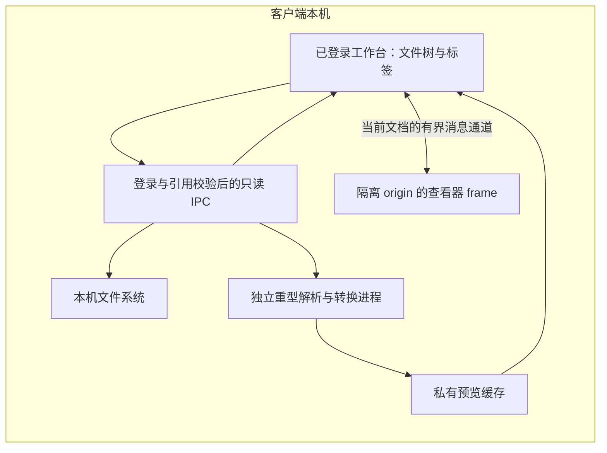

# SparkX 桌面端本地文件浏览设计

> 语言：简体中文 | [English](../../docs/desktop-local-file-browser-design.md)
>
> 日期：2026-10-29。状态：首版已按负责人要求安装到本机 Mac，源码验证见第 11 节，安装记录见第 12 节；原安装配置的完整验收及 Linux 验收仍待完成。已确认的范围是客户端本地浏览、浏览器旁的文件按钮、整台电脑文件树，以及 DSH 形式的文件树与预览标签。

SparkX 在登录后的桌面端增加只读文件面板。目录枚举、文件读取、文档转换、预览和缓存全部发生在这台电脑上。打开文件不会将其加入聊天附件，也不会授予 Agent 访问权限。文件入口和面板统一受现有桌面登录门禁约束，不提供未登录可用的功能；本机处理不等于免登录。

## 1 范围与数据归属

[客户端与后端归属边界](client-backend-architecture-design.md)及[当前工作台归属](workbench-release.md)继续生效：非邮件文档属于发起操作的客户端，后端只处理明确提交给任务的输入。本地文件浏览增加的是面向人的阅读能力，不增加 Agent 运行时或后端共享工作区。

| 项目 | 设计决定 |
|---|---|
| 目录名称、绝对路径、文件字节、预览 PDF 和阅读状态 | 留在客户端，不进入后端请求、模型上下文或远端诊断 |
| 磁盘上的既有文件 | 在原位置读取；浏览不自动导入聊天文件库 |
| 转换中间文件 | 仅保存在客户端私有、有容量限制的临时目录；不覆盖原件 |
| 聊天附件与生成文件 | 保留现有 ClientStore 归属和发送规则，可通过独立读取适配器进入同一查看器 |
| Agent 访问 | 浏览不注册工具、不追加提示词或会话事件、不创建附件、不提交任务 |
| 登录与连接状态 | 必须通过现有桌面登录门禁；登录后的短暂断线沿用原身份保留规则。本机处理不使用远端 capabilities.files 开关，也不为每次读取新增远端授权请求 |

本范围替代此前远端 Gotenberg／ISCP 预览建议。不新增 Gateway 预览服务、ISCP 操作或远端转换。既有后端文档工作流保持原状。

首期面向现有 Electron 桌面发行，优先验收 macOS，Linux 单独验收。普通 WebChat 网页不能枚举用户整台电脑，不得用 Gateway 文件系统替代这项能力。本期不包含编辑、批注、Agent 交互、删除／重命名／移动文件、拖入聊天、递归内容搜索或全盘索引。

## 2 入口与面板交互

在登录后的桌面标题栏现有浏览器图标旁边增加一个小文件夹图标。入口及面板位于现有 DesktopLoginGate 的受保护范围内，不在登录页提供文件入口。复用现有图标按钮、字号、悬停、焦点及选中样式。无障碍名称与悬停提示为“文件”，展开状态随实际可见面板变化。保留原左侧栏、输入框、浏览器控件和设置入口。

右侧区域一次展示一个内容面：浏览器或文件。通过小型协调器管理可见性，不替换 BrowserPanel，不销毁其原生页面。切到文件时必须同时隐藏原生浏览器视图及其 DOM 外壳；切回后恢复原标签、导航和页面状态。

| 操作 | 结果 |
|---|---|
| 第一次点击文件按钮 | 打开面板，显示固定的“文件”树标签 |
| 点击普通文件 | 在同一面板打开预览标签 |
| 再次打开同一资源 | 定位已有标签；不同路径的同名文件仍为不同标签 |
| 切回“文件” | 恢复目录展开、选中项和滚动位置 |
| 文件面板可见时再次点击文件按钮 | 收起面板，保留标签 |
| 重新打开面板 | 恢复上次活动标签，不重新转换全部保留文档 |
| 关闭文档标签 | 释放该标签的读者和视图资源；最后一个读者离开后取消共享任务 |
| 调宽或展开阅读 | 沿用现有并排／聚焦布局及原生全屏行为 |

以下仅表示结构，不替换现有样式体系：

```text
现有标题栏                                  [浏览器] [文件]
现有左侧栏 | 对话区                          | 文件 | report.pdf | data.xlsx
           |                                 | -----------------------------
           |                                 | 文件树或当前文档预览
```

本期仅一个停靠在右侧的面板，不引入 DSH 的浮动窗口或多分栏布局框架。文件树支持标准方向键与 Enter，文档标签支持键盘定位和关闭。Escape 先关闭最上层局部浮层，再收起面板并将焦点返回入口；不占用既有全局快捷键。

## 3 整台电脑文件树

合成根节点为“此电脑”，登录后无需活动会话即可访问；根目录来自本机，不由后端工作目录决定。macOS 展示系统文件系统及已挂载卷，Linux 展示文件系统根目录及已挂载卷。桌面、文稿和下载可作为指向同一位置的快捷入口。不沿用 DSH 的会话工作目录限制。

- 每次只展开一个目录层级。采用增量枚举和继续加载游标，不递归扫描全盘，也不先把目录全部子项放入无界数组再截断返回。
- 已加载条目按文件夹优先和自然文件名排序。批次到达时保持选中行和滚动锚点；只有枚举结束才能标记目录完整。大目录必须可以继续访问其余条目。
- 列表使用虚拟化，并限制所有展开目录的累计条目／字节缓存；虚拟化不替代数据预算。当前枚举采用有容量限制的本机临时页存储支撑回看及排序，内存只保留可见窗口和相邻页，不承诺枚举结束前的全目录排序。临时页纳入第 7 节磁盘预算；到达容量限制时显示未完成状态和缩小范围／重试操作，不伪装完整列表。
- 游标绑定登录代次、目录身份、枚举代次和隐藏项／筛选条件。刷新、条件变化、目录变化或卷更换使原游标失效；旧批次不能混入新列表。参考 DSH 的 DirectoryNode 合并变化通知，每个目录同时只执行一次枚举；持续变化时保留已展示内容并提示刷新，不无限自动重启。
- 提供刷新、显示隐藏文件和明确标注的当前目录名称筛选。筛选针对当前列表，不暗示存在全盘搜索索引。
- 只监听已展开目录的直接子项和已打开文件。折叠／关闭后释放监听；面板隐藏时合并失效标记、不主动重读，恢复可见时再验证。监听数量有上限，超出后使用手动刷新，不隐藏内容。
- 权限失败只显示在对应节点。遵循操作系统权限，不自动申请管理员权限或整盘访问权限；用户明确打开受保护位置时可以进入正常系统授权流程。
- 链接显示为链接。跟随链接是显式操作，在本机解析目标并识别祖先循环；不默认递归展开链接目录。打开文件时重新验证解析后的目标。
- 特殊文件、套接字和设备节点显示为不支持，不作为普通文档读取。应用程序包默认保持折叠，用户明确查看包内容后才展开。
- 云盘占位文件不因枚举而自动下载，需要用户先通过系统下载时明确提示。网络挂载位置只显示本机已有的挂载元数据，不枚举远端目录或打开其内容。未挂载设备不触发发现或连接；符号链接和关联图片解析后的目标也适用这些限制。

文件树覆盖整台电脑；内容预览仅适用于操作系统允许读取、已经在本机可用的普通文件。权限不足不能被当成“空目录读取成功”。

## 4 本机能力与进程边界



新增独立 LocalFilesCapability 和窄范围 preload 接口，暂定名称为 sparkclawLocalFiles。不把 ClientStore 的私有附件读取器扩展成任意路径读取器；其身份隔离、自有文件检查和上传限额服务于另一种用途。

| 拟定操作 | 职责 |
|---|---|
| roots | 返回本机根目录／快捷位置元数据及不透明引用 |
| list | 分批枚举单个目录，并返回本机继续加载令牌 |
| stat | 返回类型、大小、显示路径及来源版本 |
| readBytes / readText | 对选中的普通文件进行有界字节或文本窗口读取 |
| watch / unwatch | 监听选中的目录或打开的文件，对失效通知做有界合并 |
| previewOffice | 根据获准的文件引用和预期版本生成本机预览 |
| cancel / release | 停止工作并释放句柄、监听或临时预览 |

以上属于应用内部接口，不是新增公共协议操作。UI 适配器可以接收 AbortSignal，preload 将取消映射为请求 ID，不直接通过 IPC 序列化 AbortSignal。

只有受信任的工作台顶层 frame 可以调用能力。沿用现有能力检查方式验证发送方 WebContents、frame 和应用 origin。嵌入浏览器页面、文档 frame 及 Agent 命令通道均不获得此桥接。保留 sandbox、contextIsolation、webSecurity 和 nodeIntegration=false，不暴露 fs、通用 IPC 发送器或 shell 命令接口。

所有格式查看器在独立的 `sparkclaw-preview://viewer` origin 的 sandbox iframe 内运行，不挂在拥有工作台桥接的顶层 React 上下文中。该 origin 只提供随包的查看器资源，不能映射任意磁盘路径；frame 无业务 preload、原生桥接、应用凭据或工作台存储。sandbox 仅开放查看器脚本及其独立 origin 所需能力，不开放顶层导航、弹窗、表单或下载；不得导航回工作台 origin。工作台 CSP 的 frame-src 仅允许该预览 origin，预览 CSP 和请求拦截拒绝远端连接、任意 file URL 及嵌套文档，PDF Worker 等仅加载随包资源。

工作台校验 frame 来源、消息结构、登录代次和文档代次后，为当前选中文档建立专用 MessagePort。白名单消息仅包括该文档的有界读取、阅读位置及明确的用户交互，不允许任意路径、目录枚举、通用 IPC 或任意网络 URL。查看器只持有通道内文档标识；范围读取与关联资源请求均由工作台／主进程重新校验。导航、刷新、关闭或登录失效时撤销端口，拒绝迟到响应。相对资源解析、查看器崩溃和取消不能绕过这一中介。

主进程管理规范路径解析和短期引用。资源模型区分本机定位信息、实际文件身份、来源版本、标签 ID 和请求代次；引用绑定当前登录范围及代次。标签按定位信息复用，不同路径的同名文件仍独立。文件原子替换或链接目标变化使旧版本失效，当前标签显示“已变化”，重新打开后才接纳新版本；卷身份变化不得仅凭相同挂载路径复用旧引用。

每次读取验证引用归属、文件类型、权限和版本；有界读取前后比较文件描述符元数据。读取期间文件变化返回 source_changed，旧请求结果不能覆盖新标签状态。分段读取必须对应同一验证过的来源版本；Office 转换使用验证过的私有输入快照和内容哈希。参考 DSH ResourceGroup 跟踪正文及本地关联资源的版本和成员变化。持久化标签状态只保存定位及阅读信息，不保存可复用的权限令牌。

登录判定由现有 DesktopLoginGate 和主进程的已验证本机身份共同约束，不能仅隐藏按钮。首次未配置、未登录、退出登录、身份冲突或已确认撤销时，拒绝新调用与缓存读取，关闭预览通道并取消任务；再次登录后重新验证引用。已登录用户处于现有门禁允许的 reconnecting／service_unavailable 状态时可继续本机阅读，不另造免登录离线模式。此能力不依赖活动会话，也不复用远端 capabilities.files；登录门禁不改变操作系统自身的文件权限。

## 5 渲染器选择

用一个小型本地注册表将受支持类型映射到按需加载的渲染器。容器管理资源身份、请求取消及加载／错误展示，各渲染器管理自己的格式控件。适用时检查文件签名或容器类型，不仅依赖后缀。

| 格式 | 选定方案 | 首期行为与限制 |
|---|---|---|
| PDF | react-pdf 配合 PDF.js | 分页、缩放、适应宽度及文字选择；限制同时绘制的页面／像素并取消过期加载。全文搜索需要独立实现，安装依赖不等于已有搜索 |
| DOC/DOCX、PPT/PPTX | 随客户端打包的 @deepseek-ai/libreoffice-kit 转 PDF，再用同一 PDF 查看器 | 静态版式预览，可取得缺失字体信息时反馈；不编辑、不播放幻灯片动画、不执行宏 |
| XLSX | ExcelJS 解析，FortuneSheet 只读展示 | 工作表、单元格选择／复制、已保存公式结果及支持的基础样式／合并单元格；不重算、不编辑、不导出修改版本 |
| CSV/TSV | PapaParse 配合同一表格视图 | 保留字面字符串、前导零和看似公式的文本；明确处理引号、多行字段及编码失败 |
| Markdown | react-markdown 与 remark-gfm | 只读排版；禁用原始 HTML；本地关联图片走受限解析器 |
| 文本／代码 | 有界文本视图与按需加载的 highlight.js 语言 | 换行、行定位与复制；没有编辑器命令或代码执行 |
| 位图及 SVG | 原生图片元素配合缩放 | SVG 作为图片加载，不内联可执行标记；不自动加载外部资源 |
| HTML 及未知文件 | 可以安全解码时仅显示文本／源码，否则显示元数据和不支持预览状态 | 本期不提供可执行 HTML 应用预览 |

首期表格预览不包含旧 XLS。后续如需加入，单独评估来自官方分发渠道的 SheetJS CE 适配器；不能悄悄降级为丢失内容的表格，也不能声称 ExcelJS 已支持 XLS。

原始字节与解析器使用的缓冲区分离。XLSX 在进入 ExcelJS 完整解析前检查压缩包条目数、单项及累计声明解压大小，并在有界流式解压过程中持续核对实际产出字节；发现超限、大小不一致或不支持的容器结构即中止。检查覆盖全部条目，不只检查最终显示的工作表；不能先整体解压再统计，也不能仅信任 ZIP 元数据。后续解析使用同一份已验证输入／受限中间结果，不能重新打开变化后的原路径绕过检查。

XLSX 和 Office 等重型解析运行在独立、可终止的工作进程中；进程内部可以使用 Worker，但 Worker 超时和单元格数量不是解压或进程内存上限。限制输入字节、单元格矩形面积和处理时间，生成传给查看器的受限只读模型；模型与跨进程复制也纳入预算。公式按字面文本和保存值展示，缺失缓存结果时明确表示不可用，不自行重算。检测并披露未支持的图表、绘图、透视表功能及条件格式，不能把静默缺失内容的工作簿当作完整还原。

FortuneSheet 的只读选项是必要条件，但不是完整保障。必须关闭编辑快捷键、粘贴、删除、拖拽填充、工作表修改及写回回调，独立验证公式栏／剪贴板转义和工作表切换。DSH 在这些位置维护了补丁；应先在 SparkX 当前 React 版本复现适用问题，再采用范围明确的修复，不能仅凭依赖声明的兼容范围判定接入合格。

所有渲染器都不自动请求远程图片、样式表、字体、超链接或任意 file URL。Markdown 相对资源通过受限通道解析，按解析后的实际目标检查文档目录边界、文件类型、版本、云盘和挂载属性；路径字符串前缀不构成边界。跳转到目录外需要用户显式操作并由工作台建立新的文档引用。文档内容与应用凭据、原生接口保持隔离。

## 6 本机 Office 转换与打包

采用独立发布的 LibreOffice kit，参考 DSH 的本机转换形式。该包提供 macOS 原生引擎及 Linux WASM 引擎。每种实际发行架构独立验收，不能用 Mac 结果推断 Linux 行为。

桌面协调器在独立、可终止的工作进程中运行 kit；Linux WASM 所用 Node Worker 也位于该工作进程内，不与 Electron 主进程共享故障范围。协调器建立私有临时任务目录，读取经过验证的输入快照，只向转换器提供该快照和输出位置，验证返回的 PDF，然后清理中间文件。不允许不可信文档自行重新打开原路径或把原路径作为任意转换输出位置。

转换进程及其子进程采用目标平台可验证的文件访问与网络隔离：只读范围为任务快照、引擎、获准字体及启动所需的明确列举的系统运行库，可写范围为本任务临时目录；不继承工作台凭据或业务通道。禁用宏、链接资源获取和自动外部刷新，并验证网络访问及允许范围外读写被拒绝。第一检查点须验证 Mac／Linux 各自的隔离启动方式；只有私有目录或正常样本“没有发起网络请求”不足以通过此项。平台隔离不能成立时，保留入口并禁用该平台对应的重型预览，不放宽整个工作台的权限。

打包时准备配套 API、引擎资源、PDF Worker 和查看器所需资源。可执行／原生资源按需要放在 ASAR 外，保留权限，发行准备包含所需许可、声明及对应源码材料义务。运行时不下载、不探测系统 LibreOffice、不自动回退到远端服务。使用本机已安装字体，不静默下载缺失字体。

只有精确安装包通过验收后，依赖版本才成为发行锁定值。2026-10-29 npm 返回 kit 0.2.3、Node >=22.19.0；darwin-arm64 引擎声明解包大小为 161,344,653 字节，约 154 MiB。这是包元数据，不是实测 SparkX 安装包增量，也不代表已验证 Electron 兼容性。Harness 源码引用过更早的 kit 版本范围，应匹配经过测试的 API／引擎组合，不混用不同版本。

主要代价为安装体积、原生签名与打包维护、CPU／内存开销和字体相关的版式差异。渲染结果不能保证与 Microsoft Office 的分页及复杂排版完全一致。引擎缺失时保留文件入口及其他查看器，只对对应预览显示可处理的不可用说明。

## 7 状态、缓存与资源限制

浏览状态和预览缓存使用独立的本机 profile 区域，并按当前桌面登录身份隔离，不写入会话、执行结果或远端存储。浏览不能向聊天历史追加记录，也不改变 ClientStore 附件归属。借鉴 DSH 的队列准入、输入／输出限额、共享转换、缓存淘汰和取消清理机制，以本机 IPC 与桌面生命周期替换其 Host Remote／Session 接入。

### 7.1 准入、执行与清理

- 读取完整源文件前按元数据进行队列准入和输入字节预留；同时限制排队任务数、读者数、输入总量及每任务输入／输出。相同登录范围内的相同来源版本可共享任务，内容哈希、引擎代次、字体环境和选项决定转换复用。每个读者独立取消，最后一个读者离开才停止共享任务。
- 客户端协调器统一管理并发与从请求受理开始的总等待时限，包含排队、输入读取、解析和输出验证。每个读者保留自己的截止时间，后加入者不能延长正在执行任务的截止时间；DSH 原转换 timeoutMs 不含队列等待，适配时必须补齐。超时可先反馈，但任务仍占用执行容量直至退出及清理完成。
- Office、XLSX 等重型任务由同一协调器调度，首期按单个重型任务运行，不为隐藏标签自动启动重型预读。具体并发和其他预算经目标安装包实测后确定，不直接照搬 DSH 默认值。
- 协调器监测工作进程及子进程的合计内存、任务临时目录和客户端全局临时目录占用，并为磁盘与应用其余部分保留余量。采样阈值是保护措施，存在采样间隔和终止延迟，不宣称严格硬上限；不能把原生子进程、WASM／缓冲区内存排除在外。输入、输出及解压计数属于可执行的字节边界，与进程监测明确区分。
- 取消、超时或超限后，先停止任务并阻止新输出，必要时升级为终止进程树；确认工作进程及其子进程退出，完成临时文件清理，然后释放执行容量。清理失败的任务仍占用相应容量并进入待清理状态，禁止虚假释放后继续积累资源；后续安全重试或重启清理只处理本功能拥有的任务目录。
- 本机阅读预算独立定义，不修改或复用 Agent 上传限制。PDF／文本尽量采用有界分段读取；表格及 Office 转换可读取完整但有界的输入。跨进程消息、输出模型和图像解码也有预算，不能仅约束源文件大小。

### 7.2 缓存与标签驻留

- Office 缓存身份包含本机 profile／登录范围、源内容哈希、引擎版本、字体环境和渲染选项。每次复用先验证登录和来源；来源版本索引只是重新验证的捷径，不是字节未变化的证明。不同登录身份不共用可读取的缓存引用。
- 使用私有临时文件和原子完成操作，同时按数量与字节上限淘汰。失败不持久缓存，取消后不保留部分输出；清理范围仅限文件浏览功能自身数据。kit 字体元数据缓存也定向到受管区域或禁用，避免预算之外的隐式缓存。
- 预算同时覆盖缓存表、已打开标签持有的文档数据／解析结果、PDF 页面图像、图片解码、Blob URL 和跨进程副本。共享数据按实际分配计数，复制另计；淘汰缓存条目不等于标签释放资源。非活动标签优先释放重型模型和页面，只保留定位／阅读状态；当前文档也须满足可见页／像素预算，无法满足时显示超限，不无限保留。
- 标签记录与已挂载视图分开管理，参考 DSH tab-lifetime。隐藏面板保留轻量标签状态、暂停刷新并释放可回收页面；关闭标签释放读者、解析模型、监听、端口和 Blob URL。只有登录及来源仍有效的缓存可用于恢复，不重新转换全部历史标签。
- 目录展开、打开定位信息和阅读位置仅本地保存。重启先清理可确认无活动所有者的任务残留；登录后重新验证，用户进入视图时只加载可见内容。提供清除本地预览缓存及阅读记录的操作，先取消受影响工作、释放引用，再清理受管数据，不删除原件或聊天附件。缓存保留期与容量策略在首个实施检查点实测定稿。

第一实施检查点用目标安装包的代表性文件和异常样本确定保守预算及监测间隔，覆盖目录继续加载、伪造 ZIP 大小／解压膨胀、页面像素、多个保留标签、解析超时、子进程、磁盘满和退出清理。记录实际峰值及超限后的终止／回收延迟；未测量前不把数值限制写成已验收能力。

视图状态为加载中、就绪、已变化、不可用、不支持和已取消。普通内容更新可保留明确标为旧版本的当前视图；文件删除、权限丢失、卷更换或登录失效时清除可见内容及可读取引用，禁止重新显示旧缓存。失败及超限只显示在对应节点／标签，需要用户处理的清理失败提供重试；不增加常驻传输或引擎技术状态横幅。

## 8 现有项目接入位置

| 现有位置 | 计划变更 |
|---|---|
| [登录门禁](../../apps/webchat/src/desktop/DesktopLoginGate.tsx)、[LocalWorkbench](../../apps/webchat/src/desktop/LocalWorkbench.tsx)、[客户端窗口](../../apps/webchat/src/components/clientWindow.tsx) | 保留登录保护，在其范围内增加文件按钮与面板；退出时撤销资源，恢复焦点 |
| [BrowserPanel](../../apps/webchat/src/desktop/BrowserPanel.tsx)、[浏览器布局](../../apps/webchat/src/hooks/useBrowserLayout.ts) | 协调可见性，复用尺寸／聚焦行为，保留浏览器状态及原生视图生命周期 |
| [桌面主进程](../../apps/desktop/src/main/main.mjs)、[工作台 preload](../../apps/desktop/src/preload/workbench.cjs) | 注册受登录保护的本机能力、独立预览 origin／消息通道和工作进程协调器，不开放通用文件系统桥接 |
| [ClientStore 能力](../../apps/desktop/src/main/client-store-capability.mjs)、[自有文件边界](../../apps/desktop/src/main/local-file-boundary.mjs) | 保留原检查；需要时仅增加自有附件的查看器适配 |
| [桌面打包](../../apps/desktop/package.json) | 准备各平台引擎和离线查看资源，核对实际安装路径与退出清理 |
| Gateway、ISCP、ToolHub 与 Agent | 不新增浏览操作、授权、工具、远端转换或文档同步 |

拟定组件为 LocalFilesPanel、LocalFileTree、LocalDocumentTabs、LocalDocumentPreview 和各格式适配器。名称表达职责，不要求另建框架或替换原组件。

## 9 实施顺序与验收

| 检查点 | 交付范围 |
|---|---|
| 1 | 登录后的文件按钮、本机 IPC、电脑根目录、有界文件树和浏览器面板共存；先在安装包验证查看器隔离、重型进程启动／终止／隔离及初始资源预算 |
| 2 | 隔离的 PDF／图片／文本／Markdown 查看器、文档标签、本机状态、取消及变化处理 |
| 3 | 随包本机 Office 引擎、确定性转换、缓存和安装包验证 |
| 4 | XLSX／CSV／TSV 适配、表格只读行为和格式限制 |

每个检查点都形成可用浏览能力，不启用 Agent 交互。全部纳入范围的渲染器及边界通过验收后，才算完成整个功能。

| 验收面 | 必须取得的证据 |
|---|---|
| 数据边界 | 登录后打开／展开／渲染本机样本不创建执行、附件或模型请求，不产生携带文档的 Gateway／Relay 流量；区分既有无关连接流量。查看器无法调用工作台桥接、读取应用存储或访问远端，转换进程的网络及任务范围外读写尝试被拒绝 |
| 登录与断线 | 首次未配置、未登录、退出及撤销时入口／面板不可用，直接 IPC、旧端口及缓存引用均拒绝；登录后的短暂断线仅沿用原门禁允许状态。本地样本渲染无需下载，重新登录不复活旧权限令牌 |
| 整机导航 | 系统根目录、用户目录、外接盘、隐藏文件、大目录累计缓存及回看、游标失效、权限拒绝、链接／循环、卷更换及占位文件均有明确行为；网络挂载不触发目录读取 |
| 原件保全 | 预览、取消、刷新、失败及应用重启前后源文件内容哈希一致；仅允许私有预览状态／缓存发生变化 |
| 文档展示 | 中文字体、长 PDF、损坏／加密输入、缺失字体、DOCX／PPTX 版式及不支持内容提示；样本与预期结果进行视觉比较 |
| 表格展示 | 包含零／false 的已保存公式值、缺失缓存结果、CSV 前导零、合并单元格、工作表切换、公式字面文本和安全复制；输入／粘贴／删除／拖拽不能改变文件或显示中的工作簿数据 |
| 资源生命周期 | ZIP 条目／单项／累计声明及实际解压量超限均在完整解析前中止；共享读者独立取消、排队超时、子进程增长、磁盘满、快速切换、迟到响应和退出均验证终止→退出确认→清理→释放容量。清理失败不释放容量；记录监测阈值的实际超调及回收延迟 |
| 缓存与恢复 | 被回收的非活动标签模型／页面图像确实释放，活动标签仍持有的资源继续计量，不能以删除缓存表条目冒充释放；隐藏标签不无限驻留；删除／权限失效不显示旧缓存；清除阅读记录、异常退出残留清理、相同路径文件替换及关联资源变化有验证证据 |
| 原生界面 | 浏览器页面在文件切换后保留，原生视图不遮盖文件；原侧栏／输入框／设置／历史、键盘／输入法、缩放、窄窗口、全屏及退出重启仍正常 |
| 发行 | 验证精确 Mac／Linux 安装制品，不仅验证 Vite 或 jsdom；保留既有 profile、凭据、会话和文件归属 |

本功能只涉及 SparkClaw 客户端。共享契约、后端存储与传输语义保持不变，因此其他簇项目无需实施跟进。后续若引入 Agent 访问或远端预览，必须依据既有边界另行设计。

## 10 参考取舍

参考资料核对日期为 2026-10-29。以下 DSH 链接固定到本轮审阅的 Harness 修订；独立发布的 kit 在实施时另行锁定版本。

- [DSH 文件树](https://github.com/deepseek-ai/deepseek-harness/blob/f3803c96974ad4a94195fb97e5c637e9c2a3afe3/packages/client/ui-sidebar-files/README.md)：文件树标签、逐目录加载和视图状态恢复。SparkX 用本机电脑根目录和 IPC 替代其会话范围 Remote 服务。
- [DSH 文档预览](https://github.com/deepseek-ai/deepseek-harness/blob/f3803c96974ad4a94195fb97e5c637e9c2a3afe3/packages/client/ui-sidebar-documentpreview/README.md)：共享加载／取消、按格式查看器及无模型侧注册。
- [DSH Office provider](https://github.com/deepseek-ai/deepseek-harness/blob/f3803c96974ad4a94195fb97e5c637e9c2a3afe3/packages/document/office-to-pdf/README.md)与 [LibreOffice kit](https://github.com/deepseek-ai/dsh-libreoffice-kit)：本机转换与独立引擎打包。
- [DSH 表格实现说明](https://github.com/deepseek-ai/deepseek-harness/blob/f3803c96974ad4a94195fb97e5c637e9c2a3afe3/.agents/notes/implemented/feature/2026-09-16-browser-excel-preview.md)：已保存公式结果、解析限制及需要复现的只读展示缺陷。
- [React-PDF](https://github.com/wojtekmaj/react-pdf)、[FortuneSheet](https://github.com/ruilisi/fortune-sheet)、[ExcelJS](https://github.com/exceljs/exceljs)、[PapaParse](https://www.papaparse.com/docs)、[react-markdown](https://github.com/remarkjs/react-markdown)、[highlight.js](https://highlightjs.org/)：组件接口与限制。

适配时优先采用已核对的机制，并保留 SparkX 的登录与本机边界：

| DSH 参考实现 | SparkX 采用与改良 |
|---|---|
| [ConversionQueue](https://github.com/deepseek-ai/deepseek-harness/blob/f3803c96974ad4a94195fb97e5c637e9c2a3afe3/packages/document/office-to-pdf/src/queue.ts) | 元数据准入、输入预留、共享转换、独立读者取消、清理后释放容量；补包含排队时间的截止、独立进程树及临时目录监测 |
| [OfficePreviewCache](https://github.com/deepseek-ai/deepseek-harness/blob/f3803c96974ad4a94195fb97e5c637e9c2a3afe3/packages/client/ui-sidebar-documentpreview/src/client/office/cache.ts) | 版本／引擎代次核验、共享请求和条目／字节淘汰；补标签模型、图像和跨进程副本预算 |
| [DirectoryNode](https://github.com/deepseek-ai/deepseek-harness/blob/f3803c96974ad4a94195fb97e5c637e9c2a3afe3/packages/client/ui-sidebar-files/src/client/directory-node.ts) 与 [ResourceGroup](https://github.com/deepseek-ai/deepseek-harness/blob/f3803c96974ad4a94195fb97e5c637e9c2a3afe3/packages/client/ui-sidebar-documentpreview/src/client/document/resource-group.ts) | 目录读取／监听生命周期、合并失效通知、正文与关联资源变化；补整机目录分页及游标、文件／卷身份和受限解析 |
| [tab-lifetime](https://github.com/deepseek-ai/deepseek-harness/blob/f3803c96974ad4a94195fb97e5c637e9c2a3afe3/packages/client/ui-sidebar-documentpreview/src/client/document/tab-lifetime.ts) | 轻量标签状态随标签记录生存，关闭时释放；增加隐藏标签重型资源回收与退出登录撤销 |
| [XlsxPreviewArchive](https://github.com/deepseek-ai/deepseek-harness/blob/f3803c96974ad4a94195fb97e5c637e9c2a3afe3/packages/client/ui-sidebar-documentpreview/src/client/excel/xlsx-archive.ts) | 借鉴不支持内容识别和原件保护；该修订使用 unzipSync 整体解压，不能直接视为解压预算保障，按第 5 节替换为先检查、持续计数的受限流程 |

DSH 提供参考形式和候选依赖。SparkX 保留既有 React／Electron 组件、桌面登录规则与数据归属；采用这些形式不等于引入 DSH 的 Agent 文件系统权限、插件架构或已有资源默认值。上述改良属于待实施设计，不代表 DSH 或 SparkX 已通过这些新增验收。


## 11 实施记录 — 2026-10-29

首版实现已在本地提交，保留现有工作台和 BrowserPanel，在原登录门禁内加入 Files 按钮，四个检查点均已有源码实现。该检查点尚未替换已安装应用、未改变生产服务、未推送；后续授权安装见第 12 节，第 9 节的完整发布验收尚未完成。

| 范围 | 已实现源码 |
|---|---|
| 根目录、引用、目录分页及登录作用域 | `local-files-capability.mjs`、`local-files-service.mjs`、`local-files-policy.mjs`、`local-files-pages.mjs`；窄接口 `sparkclawLocalFiles` preload、描述符/版本校验、本地挂载策略、SQLite 临时分页和有界监听 |
| 工作台 | `LocalFilesPanel.tsx`、`LocalFileTree.tsx`、`LocalDocumentPreview.tsx`；固定文件树标签、按路径区分文档、本地阅读状态、虚拟行、翻页、名称过滤、刷新、显式跟随链接及源文件失效处理 |
| 隔离查看器 | `src/local-preview/` 与 `local-preview-protocol.mjs`；PDF、图片、文本/代码、Markdown、只读表格运行于 `sparkclaw-preview://viewer`，不带业务 preload，通过文档专用 MessagePort 读取 |
| 重任务 | `local-preview-broker.mjs`、`local-preview-process.mjs`、`local-preview-sandbox.mjs`、`local-preview-worker.mjs`；单活动任务、共享读者/独立取消、含排队时限、快照、输出校验、清理后释放容量 |
| 表格解析 | `local-preview-zip.mjs`、`local-preview-spreadsheet.mjs`；全部 ZIP 条目实际解压计数、有界 ExcelJS/PapaParse 输出，保留零/false 等公式缓存值，不重新计算 |
| 打包 | kit/API 匹配 0.2.3；Mac 原生引擎置于 ASAR 外，Linux 保留 WASM；离线 PDF worker/字体/CMap、自动生成查看器依赖声明，并保留上游引擎许可证及源码材料 |

Browser 和 Files 复用现有右面板尺寸及专注阅读控件，切回 Browser 保留原生网页和标签。仅活动文档挂载查看器，隐藏标签保留轻量阅读记录。本机文件状态、预览和清理独立于 ClientStore 附件、Agent 执行及公开 ISCP 操作。

当前数值是保守的源码准入配置，不能视为已在所有平台完成验收的发布上限：

| 资源 | 初始限制 |
|---|---|
| 目录枚举 | 每页 128 项、每批扫描 1,024 项、每个列表 32,768 项；服务最多 24 个列表，UI 最多展开 16 个目录，临时分页存储 32 MiB |
| 本地读取/状态 | 单次读取 1 MiB、8 个并发读取、64 个监听、4,096 个引用、阅读状态 64 KiB、12 个文档标签 |
| 重任务准入 | 1 个活动任务、8 个排队任务、12 个读者；单任务输入/输出各 32 MiB、累计输入 64 MiB、表格模型 8 MiB；总时限 90 秒 |
| 压缩包/表格 | 4,096 个条目、单项解压 32 MiB、累计解压 128 MiB；32 个工作表、50,000 个有值单元格、100,000 格矩形面积 |
| 缓存/监测 | 96 MiB / 12 份缓存；单任务磁盘 256 MiB、累计磁盘 512 MiB、剩余空间保留 512 MiB；进程树内存阈值 768 MiB，每 250 毫秒采样 |

源码验证通过桌面端 579 项、前端 552 项测试及工作台/查看器生产构建。原生 Electron 验证通过原有 48 项浏览器布局和 12 项任务浏览器用例，Files/Browser 往返后网页输入及聊天草稿保留、原文件字节保留、五类隔离查看器正常。查看器检查覆盖网络/文件/应用存储访问拒绝、无 preload 桥接、表格复制/切表/禁止编辑、PDF 可选文本和像素预算、Escape 及导航隔离。同样五类检查也对候选包内精确的 223 份查看器资源通过，执行器仍是开发用 Electron；这是资源验证，不是已安装应用验收。

隔离 macOS arm64 目录候选包通过资源白名单审计：7,226 个应用条目、24 份工作台文件、223 份查看器文件。包内 78 份桌面源码与全部工作台/查看器资源逐字节匹配源码构建。Resources 共 236,557,867 字节，这不是安装包体积增量。保留了两次失败的本地证据：平台 files 设置覆盖公共白名单，随后 PDF.js 许可证文件被审计拒绝；最终配置保留白名单并显式允许这些许可证资源。本任务未改 Go，候选复用原 helper，不属于嵌入精确修订号的发布构建。

使用候选包自身可执行文件、broker、解析器及原生 Office 引擎的重任务验证也已通过：中文 DOCX 用时 2,246 毫秒生成 1 页、26,595 字节 PDF；采样进程树内存峰值 350,273,536 字节，临时存储 783,228 字节，进程 join 12 毫秒，目录清理 1 毫秒。CSV/XLSX 分别用时 127/137 毫秒，保留字面字符串、公式缓存零/false、缺少缓存的提示、合并及两个工作表，4 份原件哈希不变。引擎提示缺少 PingFang SC，人工检查 PDF 中后备字体可正常显示中文，未据此宣称字体完全一致。包内隔离 canary 拒绝越界读取、元数据、写入和回环网络。确认真实原生转换子进程启动后，取消到槽位释放 22 毫秒、broker 关闭 41 毫秒，输入/待清理预留均为零，任务目录清空。这些是样本采样结果，不是资源硬上限保证。[脱敏验证记录](../../docs/evidence/desktop-local-files-2026-10-29.json)保存检查结果及剩余验收项。

Go build/vet 通过。macOS 全量测试遇到既有 3 项 Linux `/dev/shm` 用例，以及 `/private/tmp` 字符串假设和回执清扫计时失败；后两项改用用户目录下规范临时路径单独复跑通过，不将全量 Go 报告为绿色。

剩余发布工作：原安装配置下精确验证登录/退出/撤销和 Quit/重启；旧版 DOC/PPT、加密/畸形输入与字体/版式完整样本矩阵；真实外接卷/云占位/权限变化；更广的安装包预算测量；Linux 隔离、引擎/打包与原生 UI 验收。Linux 使用独立 Bubblewrap 启动路径，无法建立隔离时对应重预览保持不可用。Mac 结果不能代替 Linux 验收。这些工作不要求其他簇项目修改接口。

## 12 负责人要求的 Mac 安装 — 2026-10-29

使用干净提交 `ca37d36c` 重新构建 UI、helper 及 arm64 DMG/ZIP。资源白名单、78 份源码/24 份工作台/223 份查看器资源匹配和 DMG 校验通过。helper 从干净源码重建，但未嵌入 VCS 修订号，以提交和 SHA-256 记录来源。

正常退出旧应用后，已备份原应用和 6 个 profile 位置。三个备份根目录含 75 个 SQLite 数据库、342 张表。Chromium 留有 WAL，因此在一次性数据库/WAL 副本上审计，没有 checkpoint 原库。启动前原配置和备份的字节/权限完全一致。安装后的全部 6,946 个文件/符号链接条目与 ZIP 内容及权限一致，旧应用保留供回滚。

`/Applications/SparkX.app` 沿用原登录配置启动，已有会话列表可见，Files 面板可打开，Desktop 展开真实目录。应用已停留在该面板供负责人操作。本轮未重跑完整文档格式、新版 Quit/重启、退出/撤销和 Linux 验证，这些验收仍开放。未改远端服务，未推送。详见[安装记录](../../docs/evidence/desktop-local-files-install-2026-10-29.json)。

## 13 安装版 PDF 分段读取修复 — 2026-10-29

负责人反馈 DOCX 预览失败。文件已成功转换成 41 页 PDF，但适配器把每个 64 KiB IPC 分块分别作为 PDF.js 区间响应。PDF.js 要求每个请求区间一次完整交付，后续分块因此找不到对应读者；错误清理又以已释放文档的 `getPage` 异常掩盖了最初原因。

源码 `db1ed7b9` 改为组装完整区间后回调，串行处理区间以只保留一个组装缓冲区，限制排队数量，并停止过期/出错后的页面读取。IPC 单次读取仍有界，原文件只读。新增不含用户内容的跨读取窗口 PDF 样本能复现旧版错误；修复后原生验证覆盖区间读取、翻页、缩放、阅读位置恢复和原有五类查看器。该原生用例加入 Electron CI，未宣称已运行 Linux CI。

552 项前端测试及生产构建通过。新 arm64 包通过源码/资源、DMG 和 6,946 条安装文件核验。配置已冷备（76 个数据库/343 张表），启动前字节/权限不变。安装版重新打开同一份原始 DOCX，第 1、2 页正文显示正常，总计 41 页；原件哈希不变。未推送、未改远端服务。详见[脱敏修复记录](../../docs/evidence/desktop-local-pdf-range-fix-2026-10-29.json)。更广的格式、字体和 Linux 验收仍开放。
