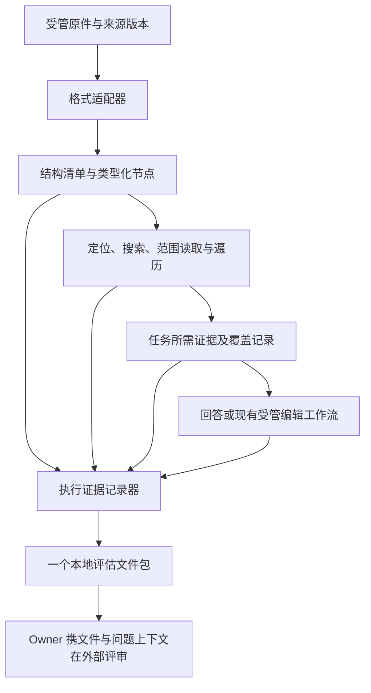

# 统一文档结构与评估证据设计

> 语言： [English](../../docs/document-structure-and-evaluation-design.md) | 简体中文

状态：仅设计，2026-11-05。Owner 已确定方向：所有大小的文档均可通过程序抽取结构、按需读取；
记录执行证据，由 owner 将评估文件与问题上下文交给外部评审模型。本文件不代表产品代码已实现、
迁移或部署，也不代表已经取得评估结果。

以下契约和阶段是这一方向的实施提案。程序不调用评审模型、不产生语义质量评分、不选择评审模型，
也不自动向外部提交证据。

Owner 范围确认，2026-11-05：首期不包含大文档局部编辑。每次任务自动记录执行链路，可交付的
报告／归档按需生成，不要求每次任务结束就生成。现有已支持的编辑能力继续保留。

## 1. 范围与既有契约的关系

统一 PDF、DOCX、PPTX、XLSX、纯文本和 Markdown 的文档访问。保留各格式的能力差异及明确的
不支持项。首版保留现有“一个受管文档”的 Workflow 边界，继续支持多轮来源选择；本设计不新增
跨文档推理。关联运行可以一起导出为评估证据。

[大文档上下文](large-document-context-design.md) 描述当前源码及其按大小触发的检索路径。
本提案在未来文档访问架构中替代该触发方式；其中的模型容量计算、tokenizer 准入、OCR 资源边界和
上传限制仍是独立约束。实施前，当前行为继续遵循该文件与[文档 Workflow](document-workflows.md)。

[证据所有权](workflow-evidence-ownership.md)、
[最小证据投影](workflow-minimum-evidence-projection-design.md) 与
[Workflow 执行](workflow-execution.md) 继续定义来源身份、runtime 绑定、模型决策、审批和持久执行。
本设计在这些边界内补充文档访问与事实导出契约。不纳入 InfiniCenter 协调。

保留原有页面、菜单、预览组件、布局及交互。不新增常驻索引状态、评估看板或评审模型设置。
首版导出通过受控本地管理／CLI 操作完成；新增面向用户的导出控件需要独立 UI 设计。

## 2. 已核对的源码基线

设计基线是本地 revision `cddda7d1`，不据此声明已安装或已部署二进制的行为。

| 当前组件 | 既有行为 | 需要演进的部分 |
|---|---|---|
| `internal/document` | 小文档已经规范化段落、表格、工作表、幻灯片、页面和 enrichment | 提供统一、带版本的结构访问，不要求先完成符合模型大小的整篇抽取 |
| `internal/docindex` | 目录、带锚点文本块和关键词搜索；小文档预建可能丢弃索引 | 让所有支持的文档都能查找，索引继续由权威结构派生 |
| `internal/toolhub/document_retrieval.go` | 支持的格式在源文件／文本超限后进入检索 | 结构和范围读取能力独立于这些阈值 |
| `internal/agent/document_read_retrieval.go` | 先完整读取，需要时进入有界检索 | 先确定任务范围，再根据覆盖情况继续读取 |
| `internal/trace/writer.go` | 按 run 输出 JSON，含运行、消息、调用、审批和审计 | 增加带冻结上下文、可解析完整载荷的文档评估导出 |
| `app.ModelCall` 与投影审计 | 模型身份、token、耗时以及投影来源／数量 | 捕获每次相关模型调用真正发出的输入和返回的输出 |

当前文本索引不是无损文档表示。例如，搜索分块的规范化文字和重叠内容不能作为逐字原文或编辑定位。
现有 trace 文件本身也不能证明每次模型输入及其引用的来源均可取得。

## 3. 架构与职责



原始字节及其版本是权威来源。结构是可重建的解释，搜索索引用于加速访问，投影是交给某次消费方的
有界证据。它们共享来源关系，不形成互相独立的原文事实副本。

Runtime 负责权限、文档／版本绑定、定位符、允许范围、覆盖统计、续读和检查。现有任务模型负责
语义目标选择、组织检索、总结及生成回答或修改内容。记录器观察这些操作，不因此新增模型调用。
外部评审完全由 owner 负责。

切换模型不得改变文档节点身份或取消范围读取能力。模型容量改变批次大小和投影；文件大小可以影响
解析调度、存储及资源准入，但不再决定文档属于哪一套能力分支。

## 4. 统一结构契约

### 4.1 来源与节点身份

继续使用 `DocumentRecord` 作为持久文档身份。新增派生结构清单，以 owner／workspace 范围、
文档 ID、来源 SHA-256、解析器版本及结构 schema 版本组成键。不同 owner 不因文件哈希相同而
获得访问权。即使不可变载荷在物理存储中去重，独立获取仍保留各自的事件身份。

每个节点包含：

| 字段组 | 必须表达的含义 |
|---|---|
| 身份 | 不透明节点 ID、来源版本、父节点、有序位置和节点类型 |
| 定位 | 格式原生定位：包部件／段落、工作表／单元格范围、幻灯片／形状、PDF 页／区域或文本字节范围 |
| 结构 | 子节点引用、已知标题、结构关系和完整性 |
| 内容 | 原文／类型化值、显示文字、公式、资源及适配器支持的格式属性引用 |
| 来源 | 原生解析、OCR 或推断结构；获取事件 ID 及适用的实现／模型版本 |
| 可用性 | `available`、`unread`、`unrecognized`、`unsupported` 或 `failed`，附原因 |

节点 ID 在一个来源／解析器／schema 版本内稳定。文件或解析器变更后，旧定位符和续读游标失效；
映射到新版本必须显式完成，不能假设相同序号仍指向相同内容。基于已验证的不可变快照构建，或对
同一个打开的来源在抽取前后验证，发生变化就丢弃结果；不得发布混合两个来源版本的索引。

延迟 OCR 或结构增强还携带 `structure_generation` 和 enrichment 版本，不能静默重新编号现有
原生节点。读取固定一个 generation；有序范围变化后，旧游标必须拒绝或按明确规则迁移，不能在
另一份节点列表上直接续读。OCR 缓存键包含来源／页面及 provider／model／prompt／预处理版本。

原生文字、搜索规范化文字和生成摘要分开存放。保留单元格值／公式／显示值差异，以及表头、单位、
合并锚点、注释和支持的交叉引用。范围读取自动带入这些必要依赖，并记录补入的节点。搜索重叠不得
造成穷举、计算或覆盖统计中的重复计数。

### 4.2 格式保真与延迟处理

DOCX 标题、PPTX 幻灯片、XLSX 工作表在存在时提供原生结构。PDF 书签可用于导航，但不能证明
逻辑结构完整或阅读顺序正确。没有可靠标题时，暴露带来源信息的物理页／块，不虚构章节。
OCR 和推断关系必须与原生解析明确区分。

每份文档都可获得轻量结构清单。这不意味着导入时就进行全量 OCR、图片理解、embedding 或章节
总结。昂贵内容按需生成。部分解析器必须扫描整个包才能发现结构；应记录真实 I/O，不能宣称具备
物理随机读取能力。模型可见内容仍然可以按节点选择。

按版本键缓存结构与索引。可选导入预建与分析阶段补建共享同一次构建，保留现有有界 worker／队列
行为，不为附加第二份索引而重复解析。活跃读取固定所需缓存项；缓存淘汰不得删除权威原件或已保存
的评估证据。OCR 可用性及每个失败页面始终明确保留。

## 5. 统一访问与任务执行

### 5.1 访问操作

在既有工具／适配器下扩展，不另建文档 runtime。下表是拟议逻辑契约；具体公共 schema 变更需要
版本化，并通过现有 ToolHub 目录注册。

| 操作 | 范围及结果 |
|---|---|
| 结构／目录 | 分页节点层级、格式能力、来源版本及未知范围 |
| 定位 | 解析 runtime 可证明的页／单元格／序号定位；语义歧义返回有界候选 |
| 搜索 | 映射到权威节点范围的关键词命中、带分数片段及实际搜索／索引范围 |
| 范围读取 | 节点 ID 或类型化范围、原始内容及必要依赖、覆盖情况和续读游标 |
| 遍历 | 按来源顺序枚举声明的子树／范围，携带版本绑定的游标 |
| 总结 | 遍历所需单元，对有界部分总结，再保留来源引用和覆盖情况进行合并 |

以 `document.outline`、`document.search`、`document.read_range` 和 `document.summarize`
为起点。遍历可以是范围读取的游标模式，不一定增加模型可见工具。现有格式 reader 适配同一底层来源，
保留自己的格式 qualifier。

游标绑定来源／解析器版本、结构 generation、选择范围及排序。Runtime 校验并拒绝过期或外来游标。请求节点和必要
上下文优先于可选相邻段落；过大节点在支持的边界切分，并明确续读。如果无法保留其必要语义，应
返回限制，不能悄悄替换为其他段落。

### 5.2 任务范围与完成条件

通过现有 preflight 冻结原始请求和选中文档。记录 `task_mode`、要求覆盖的来源范围，以及该范围
如何确定。拟议模式为 `targeted`、`exhaustive`、`whole_summary`、`comparison`、
`calculation` 和 `edit`。它们描述覆盖要求，不另建语义路由器或硬编码请求关键词表。现有语义
准入选择任务；Runtime 绑定可证明的选择条件，并对歧义进行澄清。

| 任务 | 必须满足的执行条件 |
|---|---|
| 局部问答 | 读取所选证据及相关表头、注释和限定条件，保留引用位置 |
| 穷举抽取 | 遍历全部声明范围；搜索 top-k 不能作为穷举结果 |
| 全文总结 | 覆盖每个所需章节／物理范围，未识别和省略单元在各层摘要中持续保留 |
| 比较 | 读取所选各方及必要上下文，记录缺失的一方 |
| 计算 | 读取声明的类型化数据集与单位，记录程序／计算输入和结果，去除重叠计数 |
| 编辑 | 完成第 6 节的目标及影响范围检查 |

分别记录结构发现、内容获取、模型实际所见和任务覆盖。每项都有明确的要求／已覆盖／缺失范围，
分母区分已知和未知。`complete`、`partial`、`unknown` 相对于声明范围成立；读完一个引用段落
不代表读完文档。覆盖完整也不证明语义正确，语义质量留给外部评审。

短文档在符合任务和预算时可以一次读取所有必需节点。确定性的页／单元格选择无需模型搜索。
即使全文放得下，也始终提供同一套按需接口。整篇读取优化记录理由及覆盖，不形成另一条小文档
Workflow。

搜索未命中时，可以扩大查询或遍历声明范围。重复调用必须增加覆盖，或遵循明确恢复路径。
使用 Workflow 预算约束单次工作、总尝试次数、OCR 页数、墙钟时间及取消。不要求所有文档都在当前
六次尝试的检索形态内完成；新 profile 需要版本化续读及明确剩余工作状态。预算用尽时输出携带缺失
范围的 partial／blocked 结果，不虚报穷举完成，也不静默启动自主续跑。

保留 tokenizer 准入及证据投影预算。单次调用装不下所需内容时，调度有界读取／分段，并保留中间
产物的来源引用。抽样只可用于明确声明部分覆盖的结果，不能满足穷举或全范围完成声明。

## 6. 编辑边界

记录所有现有文档编辑运行，包括不支持和被阻止的情况。Owner 已明确首期不包含大文档局部编辑。
保留现有编辑准入和不支持结果；来源可以通过统一结构读取，不代表取得编辑资格。保留现有 Policy、
Approval、原件哈希检查、新副本命名、保真校验及各格式限制。

未来另行确定范围的专项通过适配器验收后，才可在不依赖总文件大小的情况下开放局部修改，前提是能够证明：目标
稳定；目标及依赖证据完整；影响范围已知；写入保持格式；输出可重新打开／读取；目标修改得到验证；
允许修改范围之外的内容得到保留。部分格式仍需解析或写入整个包，即使只改少量文字，其成本也必须
符合资源预算。

搜索文本块和生成摘要不能授权修改。不支持的目标或不完整的必要证据必须在写入前阻止执行。
已批准编辑继续通过现有 Workflow；本设计不为只读结构访问或证据记录新增审批步骤。

## 7. 每次执行的证据记录

### 7.1 记录范围

记录所有进入文档读／写处理的运行，包括澄清、绑定失败、拒绝、超时、取消、部分结果和恢复。
通用 run 记录器必须保留进入文档流程前的路由决策；导出器也接受显式指定的有权访问 run ID，
使误路由的文档请求可以被检查，不从样本中消失。不使用第二套关键词分类器识别文档案例。

冻结各次决策实际看到的请求与相关上下文。记录附件候选、选中目标和实际使用的版本，标注缺失
文件。不能把之后增长的整段会话作为执行时已有上下文导出。用户补充的评审上下文独立标注，
不回写原始请求或 trace。

### 7.2 事件与模型调用

每个事件有 `event_id`、`run_id`、run 内 `seq`、时间、父／原因事件 ID、节点／阶段、尝试次数、
状态、来源版本、输入／输出载荷引用、耗时及类型化错误。并行分支用原因 ID 关联；序号本身不能
证明因果关系。重试和缓存操作保留独立事件，并引用原获取事件／缓存项。

记录来源绑定、解析／索引／OCR、范围选择、搜索、范围读取、覆盖变化、证据投影、模型发送／响应、
工具执行、审批、验证和最终输出。失败尝试与最后成功尝试都保留。大载荷只存一份，通过哈希引用。

在完整上下文组装、投影、token 适配及 runtime 绑定之后，于实际发送边界捕获应用请求。包含消息
角色及顺序、工具定义、响应 schema、图片／附件、可获得的实际模型身份、生成参数和真实返回结果。
区分“准备好但未发送”与“已经发送”。不能事后用已变化的模板重建提示词，也不能只记录模板名。
覆盖参与本次运行的路由、步骤、决策、OCR／视觉、章节总结和最终化调用。不要求获取模型隐藏思维。

分别记录请求范围、工具返回范围和模型实际看到的节点范围，包含裁剪、抽样、丢弃邻居、OCR 缺口及
缓存使用。缺少 token 或成本遥测时标记 `unknown`，不能填零。资源指标包括解析与索引耗时、OCR
页数、输入／输出 token、调用、重试和总耗时；区分冷缓存与热缓存。

### 7.3 持久性与记录失败

复用 run／call／audit 身份、artifact 存储及现有 trace writer。在操作边界增量持久化有界事件，
在终态原子封存 run 清单。崩溃／重启后保留最后持久事件，标记中断区间。不能推断已开始的工具
一定成功或一定未执行。业务恢复仍遵循现有规则；导出不得为了补齐历史缺口而重执行工具或模型。

记录状态与业务状态分开。记录器失败不得把已经完成的用户操作变成失败，也不能触发重复编辑。
标记 `capture_complete=false`，保留缺失区间／原因，并通过现有有界诊断报告。如果连该记录也无法
写入，恢复／导出时必须报告缺失，不能声称每次运行都有完整记录。等待审批的快照标为非终态，
不能编造最终结果。

在获取时保留精确不可变来源字节的引用，覆盖证据保留期。可变工作区文件流式生成版本快照；已有
已验证、权限正确的 artifact 可以复用。派生输出也应在其路径被后续编辑替换前留存。仅保存路径
和哈希无法恢复被覆盖的原件。未能留存字节是明确的记录缺口，导出器不得静默使用旧路径上的当前文件。

## 8. 一个可移交的评估文件

### 8.1 交付形式

每次运行自动形成本地证据清单。任务结束只封存执行记录，不生成交付报告或 ZIP。当 owner 请求
导出时，受控导出器从该冻结运行生成 `report.md`，并打包成一个文件
`document-evaluation-<run_id>.zip`。ZIP 是传输容器，不假定评审模型能直接打开 ZIP。
Owner 可解包后，将 `report.md`、所需载荷和原件连同问题上下文提交。SparkClaw 不执行上传。

```text
document-evaluation-<run_id>.zip
  report.md                   可直接阅读的事实时间线及限制
  evaluation.json             版本化清单与事件／载荷目录
  events.jsonl                带因果关联的有序执行事件
  calls/<call_id>.json         模型实际发送输入与真实返回输出
  evidence/<payload_id>        解析结果、读取结果和投影
  sources/<source_id>/<name>   绑定版本的原始文件字节
  outputs/<output_id>/<name>   回答或派生文档及验证数据
  assets/<asset_id>            实际存在的图片／渲染证据
```

显式选择多次运行时，形成一个批次归档，包含相同的每 run 布局、顶层运行清单及按哈希共享的资源。
关联 run 链接本身不授予其他 owner 或会话的导出权限。

`report.md` 由记录事实确定性生成，包含请求、来源清单、范围／覆盖、时间线、模型可见证据引用、
最终结果、失败、资源使用及缺失证据。不增加质量结论、推测的推理过程或生成式的成功原因说明。

### 8.2 清单契约

拟议 `schema_version` 为 `document_evaluation_v1`。

| 字段 | 契约 |
|---|---|
| `run` | ID、起止时间、业务状态、Workflow／Catalog revision、代码 revision 及工作树修改标记 |
| `request_context` | 原始请求、冻结的相关消息／附件及来源关系 |
| `sources` | 文档／版本／哈希、格式、大小、解析器／索引／增强版本、结构 generation 和包内条目 |
| `task_scope` | 声明的模式、选择条件、所需范围和范围选择事件 |
| `coverage` | 结构、获取、模型所见和任务范围，带明确缺失／未知范围 |
| `events` / `model_calls` | 事件／调用目录与包内条目，包含失败尝试 |
| `outputs` / `checks` | 实际输出以及确定性检查名称／版本／输入／结果，不含语义评分 |
| `metrics` | 原始测量值、单位、可用性和缓存条件 |
| `payloads` | 稳定载荷 ID、类型、相对包内路径、字节数、SHA-256、来源及脱敏记录 |
| `capture` | `capture_complete`、必需／缺失区间、原因和捕获边界 |
| `export` | `package_complete`、缺失条目、脱敏、来源转换及导出版本 |
| `review` | `mode: owner_external`、`status: not_performed`；无模型选择或评审执行 |

一个失败任务可以被完整记录，即 `capture_complete=true`；一个成功任务也可能记录不完整。
包包含所有已经捕获的载荷时可以完整，但捕获本身仍不完整；两个标志都不代表答案正确。报告分别
展示这两个标志及任务覆盖。

### 8.3 来源证据、隐私与资源边界

授权导出默认包含绑定版本的精确原件；涉及版面时，附带已有的原始渲染证据。只有派生解析文本不能
独立证明解析正确。原件或视觉证据缺失时明确列为评审限制。不能用重新生成的文件替代历史来源。
另外请求的事后渲染必须标注时间／版本，不能宣称它是当时模型看到的证据。

把内部 artifact 引用解析成包内条目；本机路径或会过期的 URL 不能作为可移交证据。受权存储来源
齐备后，导出必须可以离线执行。校验哈希，拒绝路径穿越、符号链接及选定权限范围之外的条目。
条目路径采用不透明 ID，另行保留显示名称并消除重名冲突。

复用现有脱敏规则，明确排除凭据、传输 token 及无关会话数据。记录每处脱敏的位置与原因；导出
字节的哈希与原来源版本身份分开。不能声称文本脱敏规则已经处理原始二进制文件。用户另行要求
的脱敏副本标为派生文件并使用自己的哈希；省略原件必须标为缺口。

在有限、可配置的字节／时间／存储预算内流式导出，不为适应评审模型上下文而截断载荷。完整导出
超出预算时明确返回失败／大小清单；显式请求的仅诊断导出必须逐项声明省略。解包拒绝归档路径穿越
及解压预算超限。默认值和保留期必须在 P0 验证后才能启用实现；本设计不授权新增无限保留，也不
授权静默删除现有历史。

## 9. 外部评审与能力覆盖

Owner 在 SparkClaw 外选择评审模型、提供评估文件及问题上下文，并解释评审结果。程序不设评审
队列、评分函数、judge prompt、评审模型 API、自动改进循环或自动吸收评审响应的流程。执行用户
文档任务所需的普通模型调用保持原有职责。

评估文件应当支持外部回答下列问题，但程序不替评审者作答：

| 能力 | 外部评审者所需的证据 |
|---|---|
| 意图与绑定 | 原始请求／上下文、路由候选／决策、选中的来源 |
| 解析与结构 | 原件字节、节点、顺序、原生／推断来源和 OCR 缺口 |
| 定位与读取 | 搜索范围／结果、选中范围、依赖及省略范围 |
| 回答与总结 | 模型实际输入、输出、引用、完整／部分范围证据 |
| 计算 | 类型化值、单位、计算过程、输入和实际结果 |
| 编辑与保真 | 前后原件、目标／影响范围、审批和验证 |
| 效率与恢复 | 时间线、缓存状态、token、重复读取、失败和重试 |

维护一份人工固定的案例清单，覆盖任务模式和格式，并纳入日常成功与失败样本。开发案例与保留比较
集分开；前后比较冻结原件及问题措辞，记录变化的模型／服务商版本，不承诺随机模型可完全重放。
如有人提供参考答案或评审说明，作为独立标注材料保存，不对执行任务的模型可见。大小与上下文容量
仍是有用的测试维度，只是不再决定产品能力分支。

## 10. 实施顺序与兼容

| 阶段 | 工作 | 完成证据 |
|---|---|---|
| P0：记录基线 | 改读取策略前扩展现有 run 捕获、实际模型输入载荷及可移交导出；冻结导出预算／保留期和案例清单 | 旧路径成功、失败、中断均能诚实导出；测量有界记录开销 |
| P1：统一结构 | 版本化清单／节点、格式适配器、来源验证和小文档结构复用 | 各支持格式提供稳定节点，诚实标注不支持范围，不依赖模型上下文 |
| P2：统一读取 | 大小文档共用操作；任务范围、遍历、依赖、续读；保留一次性全文优化 | 固定案例覆盖局部与全范围任务、预算不足和冷／热缓存 |
| P3：Workflow 切换 | 版本化读 profile／工具 schema，保留持久计划解码，完善覆盖／结果处理 | 原有交互、恢复、来源绑定及三种 store 后端均验证 |

首期实施范围为 P0–P3。大文档局部编辑推迟到本期之外；第 6 节只记录未来另行要求的专项前提，
不构成自动进入的下一实施阶段。

记录器围绕现有 `internal/agent`、`internal/modelrouter`、文档／OCR 适配器、`internal/trace`
和 artifact 边界接入。`internal/document` 负责结构语义，`internal/docindex` 负责可重建查找，
`internal/toolhub` 暴露注册操作。不建立第二套 Workflow 引擎或 store。若需要修改 store 接口／
schema，必须同时覆盖 memory、file snapshot、PostgreSQL，并配套版本及迁移。

旧持久 Workflow 计划继续使用其声明 revision，不能把进行中的旧读取重新解释为新遍历流程。
旧 trace 导出明确标记当时没有保存的请求载荷。旧派生索引可以延迟重建；原件、文档记录、审批和
历史 observation 保留。部署及任何共享传输变更分别验收。

## 11. 验收矩阵

以下是实现检查和证据要求，不是自动模型质量评分。每个案例保存同一种拟议评估文件包。

| ID | 案例 | 必须观察到的行为 |
|---|---|---|
| A01 | 短 DOCX，只问一个段落 | 可用结构及直接目标读取，无关正文无需进入模型 |
| A02 | 短文档全篇任务 | 允许一次有界全文读取，声明范围和覆盖仍明确 |
| A03 | 同一来源切换短／长上下文模型 | 来源／节点身份和操作不变，只改变批次／投影 |
| A04 | 原文件大于 8 MiB 或文本超过旧抽取上限 | 在解析／资源准入范围内仍可统一访问 |
| A05 | 压缩 Office 文件抽取出大量内容 | 有界解析，明确续读或资源拒绝 |
| A06 | 扫描 PDF 有／无书签及 OCR 禁用／失败 | 保留物理结构和未知／未识别页面，不虚构完整文字 |
| A07 | 表格值带表头、单位、合并单元格及注释 | 所选值附带必要依赖 |
| A08 | XLSX 公式、显示值及隐藏数据 | 保留类型差异和请求范围，不虚构重算结果 |
| A09 | PPTX 备注／形状或不支持对象 | 保留支持的文字及结构，明确指出不支持内容 |
| A10 | 穷举抽取与不存在的断言 | 要求完整声明搜索／遍历范围，top-k 未命中不能证明不存在 |
| A11 | 全文总结，末尾有例外且某页未读 | 调度末尾范围，缺失页面贯穿合并和最终说明 |
| A12 | 跨重叠文本块计算 | 每个来源值只计一次，输入范围可复核 |
| A13 | 构建期间／两次读取间来源变化，或延迟 OCR 改变结构 | 拒绝混合版本结果，旧来源／generation 游标不能继续 |
| A14 | 重复／并发请求及缓存淘汰 | 共享构建、独立事件、正确缓存来源和活跃读取保护 |
| A15 | 现有支持编辑与大文档局部编辑请求 | 保留审批／新副本／保真行为；大文档即使可结构化读取仍阻止局部编辑，两类 trace 都存在 |
| A16 | 超时、取消、重复搜索及预算耗尽 | 有界停止、剩余范围、partial／blocked 结果且无静默续跑 |
| A17 | 崩溃或记录器磁盘／写入失败 | 明确中断／缺失区间，不为修复 trace 重复业务操作 |
| A18 | 输入适配、schema 修复与模型重试 | 分别记录每次真正发送的载荷／输出，包含省略情况 |
| A19 | 澄清、来源失败和误路由请求 | 可按有权限的 run ID 导出，包含已捕获的文档流程之前决策 |
| A20 | 离线移交到全新目录 | 必需载荷均在包内解析，哈希匹配，不依赖内部路径 |
| A21 | artifact 缺失、导出超预算及脱敏 | 诚实缺口／清单，不静默截断或虚报原始字节 |
| A22 | 跨 owner ID、路径穿越及归档膨胀 | 权限及资源拒绝，不导出无关载荷 |
| A23 | 既有 WebChat／桌面交互 | 保留页面、菜单、预览、审批、结果和恢复行为 |
| A24 | 任务结束后由 owner 请求导出，并统计网络调用 | 结束时只封存本地记录，不生成交付报告／ZIP；请求导出后才生成文件包；零评审模型调用、零自动外部提交 |

## 12. 设计完成记录

本次明确了架构、来源／版本边界、任务覆盖、记录生命周期、单文件导出和人工移交评审。程序记录
事实和确定性检查，owner 使用外部模型完成能力判断。实现、资源默认数值、基线案例执行、runtime
迁移及发布留待后续阶段。
Owner 已确认首期不包含大文档局部编辑，也不要求每次任务结束就生成可交付评估文件。
