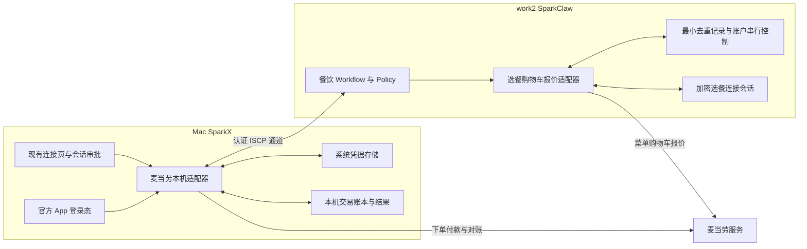
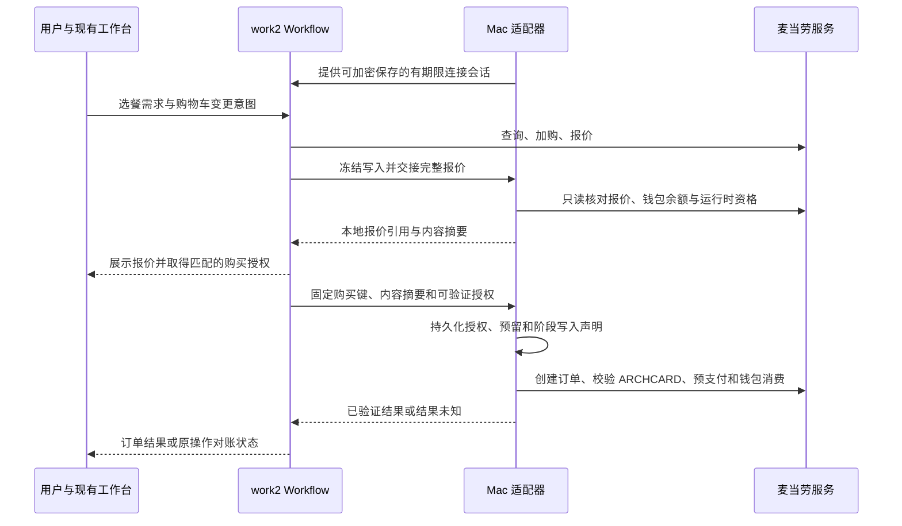

# EzMcDonalds 分端接入设计

> Language: 简体中文 | [English](../../docs/ezmcd-split-integration-design.md)

日期：2026-11-16。修订：R3，第 8 节同步已确认的点餐 R4。状态：分端接入与单一点餐 Workflow 已在本工作树源码实现；G1 当前构建 v4／v5 只读与历史指定取餐 G2 已有证据。[实现与发布门槛](ezmcd-adapter-implementation.md)区分夹具、上游付款和真实产品验收。所有启用开关默认关闭；11 月 16 日源码尚未重新打包或部署，不代表功能已上线。

**Mac SparkX 获取和更新麦当劳会话凭据，执行下单、付款与支付对账；work2 SparkClaw 执行门店查询、选餐、购物车和报价。** 工作流编排、模型调用和 Policy／审批决策继续属于 SparkClaw；Mac 运行确定性的本机适配器，校验授权并执行被批准的动作。本文定义目标设计，实际代码与验收进展单独记入上述实现检查点；上游交接已完成一笔单独授权的订单，本轮实现没有新增订单或付款，也未部署产品能力。

付款方式固定为上游当前的麦当劳钱包通道 `ARCHCARD`。本次接入不扩展付款渠道；报价展示、授权摘要、收银检查和实际消费都绑定该通道。

## 1. 基线与验证范围

设计基于 SparkClaw `32143be1fa81519413c1b6271ac21a0e781c1787`，以及 [EzMcDonalds 固定提交](https://github.com/Chiiz0/EzMcDonalds/tree/2497334e4ff1b2331773a36890db74136b288537)，上游版本 `0.1.0a50`、MIT 许可。后续通过固定版本的适配层使用其协议、商品解析和交易保护；保留许可声明，不跟随浮动分支自动升级。

2026-11-12 16:19（Asia/Shanghai）完成了真实 Mac → work2 → Mac 验证：[脱敏结果](../../docs/evidence/ezmcd-credential-portability-2026-11-12.json)。

| 项目 | 已取得的证据 | 对接入的含义 |
|---|---|---|
| 账号来源 | 在用户允许系统访问后，读取已登录的官方 Mac App 本地会话；与用户指定账号匹配 | 本次复用了已有登录，没有发送短信；该基线未验收首次登录或官方账号自动刷新 |
| 签名 | 重建的 v4 Authorization 和请求体签名与官方缓存请求一致；每台执行主机独立生成新时间戳与 nonce | Linux 可以使用转交的会话和 v4 签名材料直接发请求 |
| A–B–A | Mac 钱包查询；work2 钱包、权益、收藏门店查询；Mac 再查钱包，共 5 次 GET，均 HTTP 200、业务成功 | 证明当时会话可跨主机使用，且验证后 Mac 会话仍有效 |
| 传输 | 认证 SSH 的 stdin 传递，远端仅内存使用 | 未把凭据写入远端文件；生产接入改用产品认证通道 |
| 运行环境 | Mac arm64 / Python 3.11.15；work2 Linux x86_64 / Python 3.14.4，使用独立探针 | 尚不等于完整上游 MCP 服务和依赖已在 Linux 验收 |
| 版本适配 | 官方 App 7.0.451；临时适配该版本的 v4 材料位置 | 上游原版固定支持的 7.0.440 不能直接当作当前版本的完整支持 |

11 月 12 日 16:19 的基线没有验证真实加购、清空购物车、报价交接、创建订单、付款、长期有效期或跨天续期；后续 G1／G2 和交接证据见实现文档。当前 App 7.0.451 的 v5 下单和支付运行时仍是独立验收项。证据中的 `passed` 仅指上述只读范围。

生产版本使用“App 版本 + 二进制 SHA-256 + 适配器版本”的显式支持表。7.0.451 实测二进制 SHA-256 为 `c7684499ea491e20004a8b748be4fc1472ef3e2047b5f9656c7150daeb6b28e4`。未知构建返回不支持，不绕过上游版本检查。仓库、日志和发行包不包含账号会话、解码后的签名常量或官方 App 二进制。

## 2. 总体架构

复用[当前架构](architecture.md)与[工作台统一设计](workbench-runtime-convergence-design.md)的业务／本机资源边界。麦当劳会话同步是用户已授权的专用集成能力，不扩大为同步任意 App 数据或浏览器 Profile。

首版面向发起任务的 Mac 安装实例和其连接的 work2；一个麦当劳会员同时只有一个支付权威安装实例。账号别名不能绕过会员身份的并发限制。其他工作台不会自动获得此 Mac 的凭据、订单历史或支付权；跨工作台委托和支付主机迁移另行设计。现有 Info／LocalMind 家庭级配置语义不变。

首条验收链路采用 ISCP；LAN 适配器只能调用相同的类型化服务，独立通过资格检查后开放。未通过的传输保留入口、禁用操作，选择 ISCP 时不静默改走 LAN。

## 3. 上游 38 个 MCP 工具的分配

以下是固定上游的完整清单及目标映射，不表示将 38 个工具原样开放给模型。维护、授权和支付能力只通过专用入口调用。

| 业务 | 工具 | 目标执行位置与规则 |
|---|---|---|
| 能力与连接指引（2） | `capabilities`、`account_connection_instructions` | SparkClaw 聚合两端资格；本机登录指引由 Mac 提供 |
| 账号与运行时（6） | `accounts_list`、`account_diagnose`、`account_check`、`account_refresh`、`account_runtime_check`、`account_runtime_restore` | Mac；work2 仅获得脱敏状态，可对自己的已导入会话做只读健康检查；刷新和修复始终由 Mac 执行 |
| 偏好（2） | `preferences_get`、`preferences_save` | 发起工作台本地持久化，通过类型化读写适配器访问 |
| 餐单规划（1） | `meal_plan` | work2，使用本次明确提供的偏好副本 |
| 门店与取餐（6） | `cities_list`、`stores_search`、`stores_favorites`、`store_get`、`pickup_slots`、`pickup_methods` | work2 |
| 菜单与权益（5） | `menu_list`、`product_detail`、`membership_assets`、`coupons_list`、`coupon_products` | work2 |
| 购物车读取与写入（4） | `cart_get`、`cart_clear`、`cart_add_simple`、`cart_add_configured` | work2；写入串行、绑定原始意图和稳定操作键，清空须基于新鲜 `cart_ref` 及移除意图 |
| 购物车恢复（3） | `cart_add_status`、`cart_operations_list`、`cart_operation_retire` | work2 协调当前操作；完整历史回执保存在 Mac。retire 只用于符合上游条件的过期本地意图，不证明官方写入失败 |
| 普通报价（1） | `checkout_quote` | work2，生成可交接的完整报价 |
| 切换取餐方式与查询（2） | `checkout_quote_pickup`、`checkout_quote_pickup_status` | work2；切换会写入官方状态，按购物车变更管理，不能归类成纯查询 |
| 下单付款（2） | `checkout_submit`、`order_pay` | 仅 Mac 执行；`checkout_submit` 可能连续创建订单并支付，必须作为完整购买动作授权 |
| 订单与对账（4） | `order_status`、`orders_list`、`official_orders_list`、`official_order_detail` | Mac，统一关联本机交易账本与官方证据；work2 只接收当前任务需要的脱敏结果 |

### 3.1 适配方式

上游服务只有 stdio，而 SparkClaw 当前通用 MCP 集成要求 HTTP(S)。本设计在两端分别运行受管 Python helper，通过私有 stdio 连接固定上游核心；Gateway 用类型化选餐适配器调用 Linux helper，Mac main 调用本机 helper。不开放公共 MCP 监听端口，也不在 `mcp_servers` 中配置一个全权限远程服务器。

两个 helper 共享固定上游版本和协议测试，使用不同入口、能力白名单、存储适配器和凭据提供器。Linux 的 v4 提供器接受经验证的材料，不读取 Mac App 路径；Mac 保留本机 v5／支付运行时。发行时固定并打包受支持 Python 与依赖，不在首次使用时临时执行 pip 安装。取证探针的 Python 3.14 成功不能替代 helper 打包验收。

上游只读工具多数标注 `open_world_hint=true`，现有通用 MCP 安全分类会把它们当作危险变更；默认禁止 mutation 时只剩 `cart_operations_list`、`orders_list`。因此使用经审查的固定工具能力定义，区分外部读取、购物车变更、本机维护与购买；保留上游注释用于审计，不放宽通用 MCP 的规则。商品详情即使使用 HTTP POST，也按实际只读语义分类。

上游业务失败可表现为 MCP `isError=false` 且结果 `{ok:false,error:...}`。适配器必须校验业务结果、结构与必需字段后生成 `ToolOutcome`。购物车、金额、取餐方式等关键字段不完整时停止交接；菜单使用筛选、分页与有界投影，不把截断内容当作完整菜单。

## 4. 会话获取与同步契约

### 4.1 Mac 是会话更新的唯一写入方

1. 从受支持且身份可验证的官方 App 安装定位当前账号；仅访问其相关容器，不固定本次实测的容器 UUID。
2. 优先复用有效登录；确需登录时由 Mac 引导官方登录流程，手机号与验证码仅用于该流程。需要系统 App 数据访问许可时由用户处理系统提示。
3. 在 Mac 做本地格式检查、版本匹配与真实只读会话验证，将敏感内容保存在系统凭据存储；数据库只保存不透明引用和版本。
4. 用户启用该连接后，经已认证的产品通道提供有期限、可跨任务复用的选餐连接会话，允许 work2 加密保存。每次任务仍独立进行身份、权限、上下文和资源准入；持有会话不等于获得新的业务意图。work2 不执行独立刷新；失效时请求 Mac 更新。

凭据不经 renderer、模型上下文、普通工具参数、URL、进程参数、环境变量或通用 trace。helper 通过私有 stdin 接收；不得把原始 headers／完整缓存数据库当作包发送。只允许已确认的请求头，拒绝 CR/LF；实测缓存存在不能直接发送的内部 header。

### 4.2 `SelectionSessionEnvelope v1`

这是内部机密消息，不是模型工具输入。公共状态只展示账号别名、可用性与必要的恢复动作。

| 字段组 | 内容与约束 |
|---|---|
| 身份绑定 | `deployment_id`、`owner_id`、`client_id`、`installation_id`、不透明 `account_ref`、经验证会员绑定摘要 |
| 版本与生命周期 | `schema_version`、稳定 `connection_id`、单调递增 `credential_revision` 与 `grant_revision`、`adapter_revision`、`issued_at`、`session_not_after`；官方到期时间仅在可验证时记录 |
| 最小机密材料 | 当前会话、所需设备身份、允许的客户端头、固定版本的 v4 签名材料；具体字段由逐接口契约测试确定 |
| 范围 | 固定选餐操作集、签名配置版本、请求限额；不得由调用者扩展 host、path 或 method。每次执行另外绑定 `execution_id`、原工作台身份和业务授权 |
| 幂等 | `provision_request_id` 与规范化包摘要；相同 ID／摘要查询原结果，不同摘要拒绝 |

refresh token、v5 运行时、支付专用材料和本机消费授权不下发。**v4 会话本身不等于官方签发的只读或选餐限定 token**；限制来自 SparkClaw 适配器和部署边界，不能宣称后端持有会话后在密码学上绝无其他官方权限。

work2 helper 必须收窄至固定官方 host 和逐项方法／路径模板，禁止任意 URL、重定向及创建订单／收银／钱包消费路由。报价所需的取餐方式切换属于允许的有限写入。新接口必须补充能力分类和资格证据。

### 4.3 持久化、租约、轮换与撤销

后端把选餐会话作为必要的集成服务配置存入既有加密 Vault，密文绑定部署、Owner、Client、安装实例、账号与连接 ID；仅受信任适配器可以解密，公共设置接口不能读回机密。采用原子替换和版本检查，数据库保存不透明引用；解密材料仅在 helper 运行时短暂驻留内存。这不改变菜单、购物车正文和订单历史的工作台归属。

首版连接租约默认 24 小时，允许配置更短值，上限 24 小时；由 Mac 在真实只读验证成功后签发 `session_not_after`。若官方会话存在可信的更早到期时间，取较早值；无法确定官方期限时不作推断。这个值是本集成的使用上限，与执行期限、报价 120 秒期限及结果交付 24 小时期限分别管理。Mac 在线且连接仍启用时，可重新验证并续租；work2 自身不能续租，任务、重试、读取密文或重启也不能续租。

work2 重启后先核对持久化的身份、版本／撤销高水位和绝对到期时间，再解密做只读健康检查；通过后可处理正常准入的选餐执行，无需等待 Mac 再次导入。健康检查失败、时钟不可信或密文损坏时禁用该会话，不回退旧版本。恢复凭据不恢复或重放任何业务写入。

`credential_revision` 表示实际会话／签名材料变化；`grant_revision` 表示租约或授权范围变化。相同版本只允许相同摘要重传；低版本拒绝。同一凭据的续租只增加 `grant_revision`，不会因此改变购买内容或废弃有效报价。凭据变化、权限收窄或撤销会取消受影响执行、使旧报价及未消费购买授权失效；已开始的写入保留原键并转入对账。

主动断开账号、退出、设备撤销或身份变化立即停止可到达两端的新操作，删除对应 Vault 密文并清理内存。到期或确认官方会话失效时同样停止使用并清理机密；版本／撤销高水位和操作去重记录独立保留，防止旧 provision 消息恢复会话。网络分区中未收到撤销的一端至 `session_not_after` 最多仍可运行；恢复后先同步撤销。Mac 本机退出立即阻止本机购买。

显式撤销还会持久化该 `connection_id` 的关闭状态；更高版本的迟到 provision 也不能自动重新启用。用户再次启用时建立新的连接 ID 并重新绑定，旧关闭记录继续有效。普通到期只要求 Mac 重新验证续租，不视为用户撤销。

Mac 暂时离线时，work2 仍可在有效连接会话内完成选餐，并承接具备原工作台身份、授权和所需上下文的正常新选餐执行；其他工作台不会因此自动取得该连接权限。各执行独立受原始期限约束，结果按既有交付期限等待原工作台接收。Mac 离线不影响 `mcd.selection` 的既有资格，但 `mcd.checkout` 不可用；不能新发起购买、续租或改由 Linux 付款。重连先协调未知操作，再按需要更新会话和报价。

## 5. 购物车与报价交接

### 5.1 单一购物车写入权

同一真实会员的官方购物车可能被不同门店上下文、会话、别名或官方 App 共同影响。work2 按会员绑定摘要串行化所有购物车与取餐方式写入，每次写前检查门店、时间、商品配置和前置摘要。不要为新任务自动清空已有购物车。

上游文件锁仅在单机有效，不能直接承担跨机器协调。新增持久、无正文的账户控制记录：当前操作键、摘要、阶段、epoch 和截止时间。Mac 开始购买前，work2 确认没有未解决的购物车写入，冻结该会员写入并签发绑定该购买的交接 epoch。Mac 导入后记录接受回执。

交接超时不自动释放冻结：先判断 Mac 是否接受、是否已发起官方写入。已有写入或结果未知时只对账。官方 App 的外部修改由 Mac 下单前实时核对发现；冻结只约束 SparkClaw，不能锁住官方 App。

### 5.1.1 撤销购买准备与解冻

新增 `mcd.checkout.abort`，只撤销本地购买准备，不取消官方订单、不退款。请求绑定 `purchase_id`、交接 epoch、稳定操作键和原因（用户放弃、报价刷新或执行终止）。

1. work2 持久化 `abort_requested`，停止为该 epoch 发送新的 commit；账户仍冻结。
2. Mac 将 prepare、commit、abort 按会员与购买串行处理。在同一本地事务内检查尚无官方写入声明，作废该 epoch 及其未发送的预留，持久化 `aborted_before_write` 墓碑，然后返回回执。即使 prepare 尚未到达，也记录该 epoch 的墓碑，拒绝随后迟到的 prepare／commit。
3. 若已有官方写入声明、交易已进入执行或无法证明尚未写入，返回原 attempt／`reconciliation_required`，不报告撤销成功。用户取消不能清除未知交易。
4. work2 收到并持久化 Mac 的 `aborted_before_write` 回执后，才推进账户 epoch 并解冻。响应丢失则查询原操作或以相同键重传 abort；Mac 离线时保留 `abort_requested`，不能把超时或一次 `not_found` 当作未写入证明。

用户放弃会终止该购买并撤销其未消费授权。因报价到期而撤销准备时，可保留同一 `purchase_id` 下仍有效、未消费的授权，按 5.4 节建立新报价版本和新交接 epoch。旧 epoch 永久不可提交；正常已验证终态的解冻也须先持久化对应交易回执。

### 5.2 `CheckoutQuoteEnvelope v1`

上游 `quote_id` 是单机数据库中的引用；`quote_summary` 不是完整可提交对象。适配层必须从受信任服务端读取完整报价并规范化交接，不能只传 `quote_id`，也不能直接复制整份 SQLite。

| 字段组 | 必需内容 |
|---|---|
| 绑定 | 版本、部署／Owner／Client／安装实例、账号及会员摘要、凭据版本、执行 ID、报价引用、稳定 `purchase_id`、递增 `quote_revision`、交接 epoch |
| 上下文 | 原始规范化 CheckoutInput、门店、取餐时间及其时区、取餐方式、商品／数量／规格／套餐选择、优惠选择 |
| 价格与证据 | 币种及整数分金额、完整条目与优惠、精确下单 `body`、购物车摘要、`checkout_digest`、上游 `intent`、固定 `payment_method=ARCHCARD`、来源与适配器版本 |
| 时效 | 原始生成／到期时间，保留上游 120 秒报价上限；传输、导入、重连不能重新开始计时 |
| 取餐选择 | 如适用，完整 `pickup_selection` 与一次切换回执、其上下文／摘要／来源绑定 |
| 完整性 | 固定版本规范化规则、整个传输包的 `envelope_digest` 与购买内容的 `purchase_digest`；字段白名单、大小上限、拒绝未知关键字段 |

这是一份私有传输对象，模型和展示层只获得必要的商品、价格、门店、时间及取餐方式投影。规范化统一字段顺序、金额整数、时间表示、空值和数组顺序；两端共享测试向量，避免“展示一致、授权摘要不一致”。生产 envelope 不允许 `simulation=true`。

### 5.3 Mac 导入与重新核对

1. 验证传输身份、包摘要、账号／凭据版本、期限、交接 epoch 和本机支付权威绑定。
2. 使用 Mac 当前会话实时核对官方购物车、结算内容、会员身份、钱包余额与本机运行时资格。prepare 不创建订单；依赖真实 `orderId`／`payId` 的收银渠道与 `payment_ready` 检查只能在授权创建订单后执行。含 `pickup_selection` 时走上游相应的重新验证路径；不能直接重新调用普通报价覆盖已选取餐方式，因为初始读取可能仍返回默认方式。
3. 对金额、商品、优惠、门店、时间、方式和语义摘要逐项比对；无法证明相同或关键证据缺失时，返回 work2 重新报价，不猜测补齐回执。
4. 在 Mac 交易账本生成本地 `quote_id`，映射原始后端报价引用，保留原到期时间；此时尚未获得购买许可。
5. SparkClaw 通过现有审批流程出示同一报价。已有明确且匹配的授权按 5.4 节复用；否则取得绑定 `purchase_digest` 的一次购买授权。Mac 在实际写入前再次执行期限、内容和本机消费政策检查。

Mac 同时保留上游的重复订单检查、余额检查、消费限额和逐阶段写入声明。不得因为后端已报价而跳过。上游默认 checkout 禁用；本机适配器只依据可验证的业务授权建立相应的本地政策，不接受模型调用去扩大长期消费额度。

### 5.4 报价刷新与授权复用

`envelope_digest` 校验整个传输包（不含摘要自身），包括报价 ID、版本、时间、epoch 和回执；每次刷新可以改变。`purchase_digest` 绑定会员身份、规范化版本、`ARCHCARD` 和上游 `quote_authorization_fingerprint`，因此覆盖所有商品／配置、优惠、价格、门店、取餐时间／方式、精确下单 body、intent 与 checkout digest。不得为了让两次报价“相同”而删除这些业务字段；两端计算结果必须一致。

报价 ID、到期时间、钱包余额等上游明确排除的刷新元数据不进入购买内容摘要；钱包是否充足仍在实际付款前重新检查。传输身份、凭据版本、执行权限和 epoch 作为独立条件检查，不能仅凭 `purchase_digest` 相同通过。

| 情形 | 处理 |
|---|---|
| 报价仍新鲜、授权有效且内容一致 | 使用当前 Mac 已导入报价提交 |
| 报价过期或剩余时间不足以完成核对，且无官方写入声明 | 按 abort 协议作废旧准备，work2 重新向官方取报价，Mac 再导入；保留 `purchase_id`，增加 `quote_revision` 并使用新 epoch |
| 新报价与原 `purchase_digest` 完全一致，原授权仍有效、未消费，身份及凭据版本未变 | 复用原审批决定，不要求重复确认；建立绑定新报价引用的本地 scoped policy |
| 商品、优惠、金额、门店、取餐时间／方式、付款通道或其他受绑定业务内容变化 | 使旧授权失效，展示新报价并按 Policy 取得新决定；价格降低也不能自动视为同一内容 |
| 原授权到期、已撤销／消费、身份变化或存在未知写入 | 不复用；到期或变化需新授权，未知写入先对账 |

审批记录包含 `approval_id`、`purchase_id`、`purchase_digest`、原执行及身份范围、固定 `approval_not_after` 和一次消费状态。授权期限不晚于原执行期限；自动刷新报价不能延长它，也不能借同一授权产生第二个购买意图。官方每份新报价仍只有其原始 120 秒期限。

Mac 在事务内把授权从未使用变为预留，并在首个官方写入声明落盘时标记已消费。未写入的准备只能通过上述 abort 事务解除预留；已有声明即使响应丢失也不能恢复成未使用。已消费授权只覆盖同一 attempt 的既定交易流程，后续阶段仍受各自写入声明和上游可继续条件约束，不能用于第二个 attempt。

新报价使用新的提交操作键和输入摘要，原键保持原结果，不能借刷新覆盖幂等冲突。同一 `purchase_id` 最多自动刷新两次，计数持久化且不跨原执行／授权截止时间；仍无法取得可提交报价时返回可恢复状态。用户后续主动继续可重新取报价，但不恢复已撤销／到期的授权，也不能清除未知写入。

## 6. 购买流程、授权和结果未知

授权绑定账号、安装实例、原始购买意图、`purchase_digest`、币种／金额、门店、时间、取餐方式、固定 `ARCHCARD`、凭据版本及有效期。renderer 负责展示和提交用户决定；后端 Policy 负责业务决策，Mac main 独立验证来源、范围及本机保护条件。普通模型文本、账号连接授权、购物车授权和静态 capability 不可充当付款授权。

会话捕获、写入购物车和购买是不同操作。已授权的选餐意图不应导致每个只读接口或每个实现步骤都弹窗；清空非空购物车、内容变化或超出已授予范围时才按现有 Policy 补齐必要决定。

唯一支持的付款方式是麦当劳钱包 `ARCHCARD`，沿用上游“创建订单 → 检查钱包渠道和金额 → 预支付 → 获取钱包 token → 消费 → 官方对账”的顺序。token 不提前获取，也不交给 work2。余额不足、钱包渠道不可用或官方要求额外验证时停止自动支付，展示对应处理提示；已有订单保持原 attempt 并查询恢复。不自动充值、不切换其他付款渠道、不绕过官方验证，也不新增退款或取消订单能力。

| 状态（集成层） | 允许的下一步 |
|---|---|
| `selecting` | work2 按原意图继续选餐；有未知写入时先协调 |
| `quoted` / `prepared` | Mac 校验和用户授权；到期或内容变化回到重新报价 |
| `authorized` | Mac 在所有条件仍有效时预留该购买；不因页面重复点击创建新购买键 |
| `abort_requested` / `aborted_before_write` | 前者保持冻结并协调原准备；后者凭 Mac 持久回执作废旧 epoch 后解冻，刷新仅按 5.4 节复用未消费授权 |
| `submitting` / `paying` | 写入前持久化声明；中断后查询原交易 |
| `unknown` | 仅按原操作键／attempt 查询和核对，禁止自动重下单或重扣款 |
| `paid` / `failed_before_write` / `unpaid_verified` | 展示已证实的结果；后者不等同已取消订单，后续支付须满足原 attempt 的上游可继续条件与授权 |

这些是拟新增的业务投影，保留上游 `RESERVED`、`CREATED`、`UNKNOWN` 等原始状态用于确定性映射。网络成功或创建订单成功不等于付款成功；只有官方支付证据达到上游验证条件才能显示“已支付”。

每个购买意图有稳定的 `purchase_id`，各阶段有稳定操作键、输入摘要和本机 attempt。相同键／摘要返回已有状态，摘要漂移拒绝。报价刷新前若任何写入可能已发生，必须先解决原购买；只有证明尚未发出写入，才能用新报价及按 5.4 节复用或新取得的授权建立新的提交操作。`order_pay` 也不能用来重放已有未知扣款。

## 7. 数据、恢复与传输边界

| 数据 | 权威位置和生命周期 |
|---|---|
| 完整凭据、刷新能力、支付材料 | Mac 系统凭据存储；helper 按需短暂持有 |
| 后端选餐会话 | work2 加密 Vault 中的有期限连接配置；可跨执行与重启复用，撤销／到期／确认失效时删除密文并清理内存；任务结束仅清理该执行的机密副本 |
| 偏好、展示历史、完整购物车操作回执 | 发起工作台本地；首版为 Mac ClientStore／受管本地存储 |
| 选餐上下文、菜单、活动购物车与报价 | work2 有界临时执行资源；结束／取消／到期清理，不写长期历史库 |
| 待交付结果 | 既有有界加密交付机制，Mac 持久化 ACK 后尽早删除；最迟生成起 24 小时，不因重连重置 |
| 购买授权、报价导入、预算、attempt、订单与付款声明 | 唯一支付 Mac 的本机交易账本；按会员身份共享预算，不能因新别名或重启重置 |
| 去重与并发控制 | work2 和 Mac 各自持久保存必要的作用域 ID、摘要、epoch、枚举状态和时限，包括撤销高水位、购买准备墓碑与授权消费状态；不含菜品正文、凭据或完整订单 |

沿用[工作台实施记录](workbench-convergence-implementation.md)和[原 R3 资源边界](../../docs/client-r3-implementation.md#frozen-storage-identity-and-capacity)中仍适用的限额与 24 小时交付规则。当前 desktop 基线包含 32 MiB／任务、256 MiB／Owner 临时内容及 8 MiB 结果上限；新增会话与报价结构还需收窄自己的编码大小上限，不能借接入扩大公共容量政策。执行临时磁盘继续使用既有隔离 tmpfs，待交付内容使用加密 spool。

上游默认 SQLite 同时持久化账户、购物车准备、报价和支付记录，不能整库放在 work2 长期运行。后端使用临时 Store 适配器，加独立持久最小去重控制；完整回执交给 Mac。网络写入前必须先提交去重声明。进程崩溃后，即使临时 Store 丢失，也只能恢复为待核对，不能再次发送。无足够证据时保持未知；允许按上游规则明确退役过期的本地选餐意图，但保留原键，且不得退役支付声明来解锁重试。

敏感请求与报价正文不能进入通用 ISCP 七天业务回执归档。[现有 ISCP 回执](iscp-receipt-retention.md)继续保留其原契约；新增操作只把不含正文的接受状态、引用和摘要写入通用回执，秘密传递直接写入受控加密 Vault，传输记录不保存秘密正文，完整结果走上述有界交付。内容清理和去重记录保留相互独立，容量满时拒绝新操作而非删除旧去重证据。

### 7.1 类型化操作与能力协商

下列是拟新增名称，在实现阶段同步登记到 operation registry 与两端生成契约：

| 方向 | 操作 | 关键语义 |
|---|---|---|
| Mac → work2 | `mcd.session.provision`、`mcd.session.revoke` | 专用机密载荷路径、双版本与绝对期限检查、Vault 原子写入／删除；回执不含机密 |
| work2 → Mac | `mcd.account.ensure` | 检查本机会话／提示必要登录；会话通过 provision 返回，不放进普通响应 |
| work2 → Mac | `mcd.checkout.prepare` | 完整报价交接、重新验证、本地持久化；不创建官方订单 |
| work2 → Mac | `mcd.checkout.commit` | 验证授权后执行一次购买；稳定购买／操作键 |
| work2 → Mac | `mcd.checkout.abort` | 仅撤销无官方写入声明的本地准备；持久化 epoch 墓碑，回执之后解冻 |
| work2 → Mac | `mcd.operation.status`、`mcd.orders.query` | 查询原操作／本机与官方订单；未知状态不触发写入 |
| 双向交付 | 既有结果交付与 durable ACK | 回执、报价与结果的受限投影和本机持久化；不复用普通历史归档 |

复用 ISCP 的部署／Owner／Client／installation、当前 PeerSession 和授权 revision 校验。新增独立 `mcd.selection`、`mcd.checkout` 能力，分别表达 supported／permitted／dependenciesReady／qualified／enabled。需要扩展现有只允许浏览器反向命令的协商和 main 分发；不能直接假设换一个 operation 名称就能工作，也不把餐饮动作伪装成浏览器命令。

未知能力、版本不匹配、App 不支持或对应 helper 不可用时返回类型化不可用原因。Mac 离线只使本机购买／维护能力不可用，有效的后端连接会话仍可支持选餐。会话刷新或网络恢复可以恢复能力；不会自动重放购买。遵守通道帧和对象大小限制，先做编码后 admission；需要分块时复用已认证的有界对象机制，完整摘要验证完成前不导入报价。秘密对象不得进入通用文件产物存储。

## 8. Workflow 与界面接入

[点餐 Workflow R4](mcd-ordering-workflow-refactor-design.md) 将原读取、购物车、报价、购买、状态五个叶子合并为唯一的 `dining.mcd_order`（`draft`、`RequireQuery: true`）。九个节点 `guard → intent → context → menu → offer → cart → quote → pay → settle` 在提问表单和付款审批前后均沿同一次执行继续；模型只解析意图、排序官方候选，确定性阶段负责工具调用和最终回复。浏览菜单、查询上一单不进入点餐。不要复用 Happy 编码 Workflow 或全局任意 MCP 执行分支。

门店与配置问题复用既有审批表单，使用可选且纳入摘要的 `submit_label`。购物车按冻结计划写入，不逐次审批；清空不同的非空购物车仍需确认。优惠选择计入已选加料，最多允许一次去券重报。付款继续要求完整不可变的审阅内容与 `ARCHCARD` 授权；`settle` 核对本单，`guard` 在开始新单前核对未决原操作。状态访问独立于购物车／付款开关，可证明未发出的准备通过既有状态路径持久化退休。既有适配器能力和 ISCP 操作完整保留，不新增操作或消费授权，三个启用开关继续默认关闭。

沿用现有 `Connections` 目录及详情面板，加入麦当劳连接项，提供账号连接、必要的登录恢复和断开操作；在既有会话、工具结果和审批组件中展示菜单、购物车、报价及订单。原页面、菜单、布局、样式、返回导航和交互均保留；不新增常驻凭据版本、后端地址或探针状态等技术信息。

`External MCP access` 是 SparkClaw 被外部调用的入站入口，不能用它配置此出站业务集成。不可用时保留麦当劳入口并禁用依赖该能力的动作；仅在需要用户登录、更新 App、重新报价或处理未知结果时给出恢复提示。

## 9. 实施拆分与验收门槛

### 9.1 最先完成的两项技术验证

在全面接入 Workflow 和 UI 前，用最小 helper 原型完成以下验证，分别记录真实、fixture 和未覆盖部分；本次文档修订不执行这些测试。

| 验证 | 方法 | 通过标准与边界 |
|---|---|---|
| G1 当前版本钱包支付适配可行性 | 固化 7.0.451 构建识别和 v4；用可获得的官方样本／fixture 校验 v5 签名与订单请求构造，核对本机支付运行时依赖及钱包路径；线上只做允许的只读检查 | 支持表、签名／请求测试和依赖结果可复现。没有可信 v5 样本或依赖不满足时明确阻塞购买功能。不能为预检创建测试订单、预支付或消费；依赖真实订单的渠道检查及真实扣款仍留在 P3，不宣称支付已验收 |
| G2 work2 → Mac 最小报价交接 | work2 对经授权使用的现有购物车生成完整报价，经原型通道交给 Mac 新的隔离 Store；Mac 导入并重新验证，最后撤销准备 | 两端购买摘要一致、原始 120 秒期限不变；不依赖复制整库或后端旧进程；无创建订单／预支付／消费。普通报价与含 `pickup_selection` 的报价分别记录；后者使用已有有效回执，或另行授权的非购买取餐切换测试。fixture 不能替代相应真实路径资格 |

G2 的 Mac Store 不预置该报价记录，测试必须包含缺字段、错误会员、过期报价和篡改回执的拒绝路径；同键同内容重复导入返回原本地报价引用，同键内容漂移拒绝。某种取餐方式不能跨端核对时，该方式保持不可用，不用普通报价绕过。G1/G2 未解决的关键问题先修正适配层和交接契约，不推迟到完整购买阶段才发现。

### 9.2 交付阶段

| 阶段 | 主要改动位置（拟新增项明确标注） | 验收出口 |
|---|---|---|
| P0 前置验证与 helper | 新增 `tools/ezmcd-adapter/`；固定上游、许可、依赖、版本支持表、规范化、G1/G2 原型 | 明确 G1/G2 通过范围，完成目标路径最小报价交接；无真实订单或付款；未验收路径保持关闭 |
| P1 会话与只读 | 新增 desktop `src/main/mcd/`；Gateway `internal/mcdintegration/`；Vault 与 ISCP registry、capabilities、main 分发 | 产品通道同步及加密恢复；Mac 离线／work2 重启后仍可在期限内选餐；轮换、续租、失效、撤销、串改、越权和泄露检查通过 |
| P2 购物车与报价 | 新增 `internal/mcddining/`、Workflow／能力注册；临时 Store、账户控制、Mac 回执、prepare／abort | 简单／套餐商品、优惠、显式清空、取餐切换、完整交接；过期重新报价与同内容授权复用、取消解冻、迟到 commit 拒绝；未知写入不重放；尚不开放支付 |
| P3 Mac 钱包购买 | Mac 交易账本、commit、既有 Policy／审批适配；固定 `ARCHCARD` | G1 兼容性加上真实收银渠道检查；授权消费、去重、恢复通过；以用户选定且批准的真实订单验证钱包消费和官方对账 |
| P4 界面与配对发布 | 原连接页、会话结果与审批组件接入适配器；打包、manifest 与运维指引 | Mac／work2 配对版本资格、旧 UI 回归、真实故障矩阵；按能力开放，保留未知交易账本后回滚 |

关键代码依据：Gateway [`workflow_registry.go`](../../services/gateway/internal/agent/workflow_registry.go)、[`mcpintegration/manager.go`](../../services/gateway/internal/mcpintegration/manager.go)、[`mcptools/tools.go`](../../services/gateway/internal/mcptools/tools.go)、[`reverse_session.go`](../../services/gateway/internal/iscpworkbench/reverse_session.go)；desktop [`iscp-transport.mjs`](../../apps/desktop/src/main/iscp-transport.mjs)、[`iscp-capabilities.mjs`](../../apps/desktop/src/main/iscp-capabilities.mjs)；[设置与连接配置](settings-integration-configuration-design.md)。实现检查点记录了这些扩展点现已接入的代码及独立发布门槛。

必须覆盖以下行为：

- 身份与凭据：Vault 跨重启恢复、Mac 离线新选餐准入、24 小时连接上限、同凭据续租不废弃报价、凭据变更使旧授权失效；同键重传、低版本／跨成员／跨 Owner／跨安装实例拒绝；撤销高水位阻止旧密文或旧消息恢复会话。
- 购物车：跨任务／别名串行、官方 App 并发修改、清空前置条件、提交前后崩溃、响应丢失；退役不改写原结果或解锁扣款重试。补充 abort 先于 prepare、abort／commit 竞争、撤销回执丢失、Mac 离线、重启后迟到 commit 和已有写入声明拒绝撤销。
- 报价：G2 两类报价、120 秒边界、时钟偏差、内容不变自动刷新不重复确认、任一受绑定字段变化重新确认、授权到期／已消费不得复用、刷新次数上限；缺字段、伪造 pickup 回执、过大载荷与分块缺失均不进入提交。时钟不可信时停止交接，不能自行延长报价。
- 钱包支付：仅 `ARCHCARD` 可通过；余额不足、渠道变化、官方额外验证均不自动消费或改用其他渠道；重复点击、断网、挂起、两端重启、预支付／消费响应丢失只协调原 attempt，不自动产生第二次创建或消费。
- 存储与安全：Vault 密文损坏、到期／撤销清理与内存清理、磁盘满时停止写入、ACK 丢失、24 小时结果过期、去重及 epoch 墓碑仍有效；模型、日志、trace、通用回执、崩溃输出均不泄露机密。
- 界面：原连接目录／返回、原有 provider、会话与审批路径、离线／恢复行为均保留。功能测试通过不能代替旧 UI 交互验收；Mac 验收使用本工作树独立 `SPARKCLAW_DESKTOP_USER_DATA_DIR`。

每阶段运行受影响的 Go／desktop／webchat 测试；改变 ISCP 契约时运行 `npm run check:workbench-contract`，涉及现有浏览器路由时补充浏览器回归。真实购买验证在具体订单与授权就绪后执行，不能把本设计任务当作付款许可。

## 10. 实现证据与发布门槛

[实现检查点](ezmcd-adapter-implementation.md)记录代码、测试、manifest 和运维边界。加密会话持久化、临时购物车适配、完整报价导入、本机审批绑定钱包执行和原界面适配已实现。原消费预算和不确定写入围栏保持有效，已建立账本缺失时不能初始化替代账本。

1. G1 已有当前构建的 v4／v5 只读证据，上游交接也验证了一笔明确授权的钱包付款；这不代表新的产品购买工作流完成验收。
2. 指定取餐 G2 已有真实 work2 → 全新 Mac Store 证据；本机完整分块传输、授权消费和原尝试恢复另有跨语言离线覆盖。普通报价可移植性仍未取得资格。
3. 匹配的已安装 Mac／work2 产品 ISCP、真实断连／重启／丢回执矩阵和单独授权的工作流购买仍需真实验收，对应能力取得资格之前默认关闭。
4. 更广泛的真实菜单／自选套餐／优惠／取餐行为、新账号获取和跨天官方刷新仍不在现有证据范围；导入已验证账号及续租产品会话不能替代这些验证。

上游依据：[MCP 工具定义](https://github.com/Chiiz0/EzMcDonalds/blob/2497334e4ff1b2331773a36890db74136b288537/src/ezmcd/mcp_server.py)、[业务与交易保护](https://github.com/Chiiz0/EzMcDonalds/blob/2497334e4ff1b2331773a36890db74136b288537/src/ezmcd/service.py)、[存储](https://github.com/Chiiz0/EzMcDonalds/blob/2497334e4ff1b2331773a36890db74136b288537/src/ezmcd/storage.py)、[官方接口适配](https://github.com/Chiiz0/EzMcDonalds/blob/2497334e4ff1b2331773a36890db74136b288537/src/ezmcd/provider.py)。
