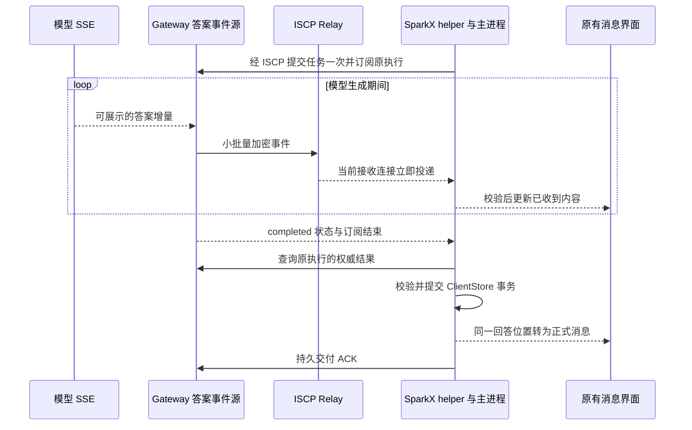

# ISCP 与 SparkClaw 真正流式输出设计

> 语言：简体中文 | [English](../../docs/iscp-application-stream-design.md)

- 状态：设计草案，待讨论；关联 InfiniCenter ProjectGroup-2 决策 **0036 proposed**。本轮只生成文档，不实施、发布或部署。
- 日期：2026-10-16。
- 用户确定的容量原则：自有 ISCP 传输部署取消人为请求频率、并发数量和累计额度，只按服务器实际资源处理背压与过载。此原则取代本文早期“沿用上游配额调参”的建议；实现仍待讨论，本轮不改代码或线上配置。
- 核对基线：SparkClaw `b8952d8cf6ec2395d55b1b4ad049090932f82690`；ISCP 本地 fork `47f1f6c231c56c92eff6b6c5d398e037ebcf9602`。SparkClaw 当前依赖 `v0.2.0-rc.1`，对应 `2707cce6922768882f77c5bdaddaef74db759a73`；这两个 ISCP revision 的差异只有 `AGENTS.md`，协议和实现相同。

## 1 结论和目标

**ISCP 可以承载真正的增量推送，不必先改加密协议；SparkClaw 必须补齐持续订阅、增量事件、恢复和界面接续。同时，使用原始上游参考 Relay 时，还须解决持续接收和容量问题。仅切换到最新 ISCP fork 不会自动获得流式输出。**

SSE 专指 HTTP 的 `text/event-stream`。本方案保留模型端 SSE，把其中允许展示的答案增量转换成 ISCP 加密事件，由 SparkX 连续接收。这提供与 SSE 相同的服务端持续推送体验。ISCP 通道中无需封装完整 HTTP 响应，也无需让桌面绕过 ISCP 直连 Gateway HTTP。已有浏览器 HTTP SSE 可继续作为另一种传输绑定。

“真正流式”的判断是：模型仍在生成时，后端已产生的多批答案内容持续到达原界面；客户端不为每一批再请求一次 progress；没有先等完整答案再拆字播放。模型本身一次返回全部内容、任务没有可公开文本、答案已经完成后才打开会话时，允许一次显示；这些场景不能作为流式性能的证明。

此前“先一个字、随后全文”的现象存在多条可解释路径：进度快照合并、Agent 对部分输出整段缓存、最终消息替换预览、前端按到达间隔补播。另一台电脑当次原始流记录不可用，因此不能把此次源码分析写成已经确认了该次事故的唯一原因。

## 2 当前链路和目标链路

| 环节 | 当前事实 | 目标行为 |
| --- | --- | --- |
| 模型 | `stream:true`，逐条解析 SSE 并发出 `text_delta` | 保留真实增量来源 |
| Agent | 普通文本可转发；以 `{` 或反引号开头的答案可能缓存至 `done` | 按明确的答案格式提取可展示增量，避免误把普通代码块当结构化包装 |
| 执行进度 | 累计快照，单任务 8 KiB；截断后不再追加 | 独立的答案投影和事件源，支持增量及有界恢复 |
| ISCP 应用适配 | 一次请求只接收一个 Response；收到后删除 pending | 一次订阅接收多条事件，最后才结束订阅 |
| 桌面 helper 与 IPC | 单次 `call` 和单次响应 | 显式开流、事件、结束和取消 |
| 前端 | 轮询累计快照，预览用打字动画；正式消息另行渲染 | 按实际收到的内容更新原组件，正式结果连续接续 |
| 上游参考 Relay | 一次认证后取最多 100 条现有消息，发送 `drained` 后关闭 | 在有界连接窗口内等待并投递新到消息，支持换连接和撤销 |

图中提交、订阅、查询和 ACK 均通过原 ISCP 通道。模型结束与最终落库是不同事件；后者可以由原有恢复流程先发现，不依赖流结束通知一定送达。

## 3 ISCP 和 SparkClaw 的职责边界

| 所属 | 建议修改 | 保持的边界 |
| --- | --- | --- |
| ISCP Core | 流式功能不要求修改 SecureEnvelope、会话握手或密码套件 | 原身份、Trust Grant、PoP、密文路由与重放防护继续适用 |
| ISCP 可选应用扩展 | 在本地 fork 提议通用 stream frame/schema、编解码、序号校验和一致性夹具，候选位置 `pkg/iscp/appstream` | 不包含执行任务、LLM、SparkClaw 操作名或消息 UI；尚非上游标准 |
| ISCP 参考 Relay | 整理持续接收补丁，取消人工额度和健康连接的固定轮换，按服务器资源处理过载；保留连接替换、撤销和故障恢复 | Relay 仍只处理不透明信封，不解析 token、正文、任务 ID 或应用流状态 |
| SparkClaw ISCP Endpoint | 新增流调用生命周期、事件分派、订阅取消、顺序恢复和明确能力协商 | 普通一问一答 RPC 保持原义；新事件不得冒充重复的普通 Response |
| SparkClaw Gateway | 新增 `execution.progress.stream`，把可公开答案的生产事件接到订阅；保留身份围栏和结果交付 | 订阅不能创建或重新执行任务；不改变 JingSi Runtime、App-CLI 或 IMMS 的既有契约 |
| SparkClaw Agent | 明确普通文本与结构化 final 包装的输出模式；增量提取最终答案 | 不输出规划、思考、工具参数或未经允许的中间数据 |
| SparkClaw 桌面 | helper、Electron transport/auth、ExecutionProgressClient 接收持续事件并恢复 | 账号、设备、安装实例、会话和授权代次必须始终匹配 |
| SparkClaw UI | 原组件内接入新投影、按绘制帧合并通知、正确接续最终消息 | 页面、菜单、布局、样式、附件、审批、取消和会话切换入口保留 |

通用流 SDK 是推荐的职责归属，不是 ISCP Core 的新前置能力。若先复用已经支持持续接收的 Relay，SparkClaw 可以在现有安全信封上完成应用绑定；但本地 fork 的通用扩展、参考 Relay 整理仍需分别评审。避免把两个仓库各维护一份同名流协议作为最终形态。

### 3.1 Relay 的实际前提

上游 `47f1f6c` 的 connect 处理只 drain 一次，默认所有 HTTP 请求共享 120 次/分钟的 clientKey 限额。2026-10-16 只读核验的 TEST1 实际进程配置为 3600 次/分钟、55 秒接收窗口；源码中的 issuer 转发路由另有 600 次/分钟和 32 并发门槛。这些数字只记录待移除的现状，不作为目标部署的设计约束。

SparkClaw 已有 `internal/iscprelayreference/receive.go` 的持续接收实现：单接收 owner、连接替换、唤醒加一秒兜底、Ping/Pong、最多 55 秒的接收窗口、关闭和撤销处理。既有部署记录显示 TEST1 曾启用该补丁；本设计的事实基线是源码和既有记录，不把它当作上游默认能力，也不把历史记录当作本轮线上验收。

建议复用并评审这份补丁，目标部署允许有权限且健康的接收连接持续工作，取消强制 55 秒轮换和正常换连后固定一秒等待。保活使用独立节奏，不以每条消息先等一次 Pong 作为正常投递条件；仍保留连接 owner 围栏、实时撤销、失活检测与失败事务回滚。旧 Relay 的 `drained` 仍可兼容，正常续接保持逻辑接收过程；真实断线、鉴权失效或会话重建进入应用恢复。保持已有 ready/envelope/drained 帧兼容，不新增隐含的私有 Relay wire 协议。

Relay 还须核对每设备和全局排队字节、数据库积压、写失败后的 claim/release、过期密文清理。当前内存队列和 PostgreSQL 分支的容量及交付行为不同，不能用一个内存队列测试代表生产行为。Relay 写入连接成功也不代表 SparkX 已展示或持久保存。

## 4 应用层流契约

以下是待冻结的接口设计，名称和字段不表示已经实现。

### 4.1 开流和身份

新增显式协商能力 `execution_stream` 与操作 `execution.progress.stream`。客户端必须在原执行已受理后订阅；若结果已经完成，直接走权威结果查询即可。每次订阅生成新的随机 `subscription_id`，可直接使用该次流 RPC 的 ID，但必须区别于执行的 `request_id`。

开流参数包含原 `request_id`、`input_digest` 和可选恢复游标。服务端从已认证上下文取得 owner/client/installation，不能信任正文自报身份。订阅绑定 deployment、owner、client、installation、execution、input digest、ISCP session、authorization revision 及本地 auth generation；任何一项失效都不能把晚到事件显示到新上下文。

### 4.2 通用帧和业务事件

| 层次 | 字段或行为 | 含义 |
| --- | --- | --- |
| ISCP 外层 | `message_id`、`session_id`、`sequence` | 密文消息与会话安全；不代表某个答案的连续顺序 |
| 通用数据帧 | `schema_version`、`subscription_id`、`stream_seq`、`body` | 候选 payload type 为 `iscp.application.stream.v1`；body 对通用 SDK 保持不透明 |
| SparkClaw 事件 | `kind`、`request_id`、`input_digest`、`epoch`、`generation`、`revision` | 绑定执行与可见答案版本；revision 是源事件版本，不是订阅帧序号 |
| 内容范围 | `from_offset`、`to_offset`、`text`、`content_digest` | offset 按 UTF-8 字节；delta 为追加后缀；摘要校验当前完整答案投影 |
| 订阅结束 | 原 RPC 的唯一终结响应携带 `last_stream_seq`、`reason` | reason 区分 terminal、renew、canceled、gap、resource_limit 等；业务成功与否由权威结果决定 |
| 取消与失效控制 | 显式流控制消息，指向原 subscription；失效另绑定 snapshot ID 与源版本 | 取消只结束观察；失效只撤销旧候选；均幂等，不是 `execution.cancel` 或展示新正文的许可 |

通用数据帧独立于普通 Response。开流后有零条或多条数据帧；服务端正常结束最多发送一个终结响应，本地订阅状态机只结算一次。断线、撤销和超时允许本地异常结束，不保证远端结束响应送达。仅正常 terminal/renew 结束需要连续处理到 `last_stream_seq`；结束响应提前到达时先等待缺失数据，超时按 gap 恢复。用户取消立即释放本地预览资源，无须等待尾帧。若已经取得并持久保存权威结果，也可直接结束预览，不再补帧。

业务事件包括：`snapshot_begin`、`snapshot_chunk`、`snapshot_end`、`delta`、`state` 和 `reset`。snapshot 建立基线，delta 追加，state 表达 accepted/running/approval 等现有执行状态，reset 显式替换或清空先前投影。completed 仅提示去查询正式结果。失败、取消、交付过期、授权失效导致的清空不能伪装为空 delta。

终结响应的失败码、取消与失效控制的 wire 形状、各事件必需字段及数值边界须在实施前以严格 schema 和夹具冻结。控制消息同样须验证信封、方向、原订阅绑定、新鲜授权和源版本；不能由任意对端取消其他订阅或用旧控制清空新快照。正文和嵌套元数据均计入大小预算；未知字段、非法 UTF-8、非法整数、身份漂移和不一致摘要不得推进接收状态。

### 4.3 顺序与并发

每条订阅有一个发送 owner，`stream_seq` 从 1 连续增加；不同订阅可以交错。ISCP 会话序号不能代替它：当前 SDK 主要检测重复，Relay 优先级与数据库取队列也不能保证所有应用消息按发送顺序返回。

接收器在通过信封认证、业务绑定和授权检查后，将事件放入按字节和等待时间限制的重排区，只连续应用下一序号。应用事件重发必须重新加密，使用新的外层 message_id 和 sequence，保留原 stream_seq 与内容；原密文重复仍走现有重放防护，不能绕过解密验证。以有界摘要窗口比较已处理的应用序号：等价重发忽略，冲突拒绝；窗口外旧帧显式拒绝或恢复，不能假称已比较过内容。无法补齐、预算超出或乱序超时则终止该预览流并恢复，不跳过缺口继续拼正文。累计摘要必须连续验证。

加密接收 owner 只做必要解密和短时分派，不等待网络授权或 UI 回调。发送、授权批处理和通知使用独立的有界工作状态；禁止每个 token 启动一个无限增长的 goroutine。订阅取消只释放该订阅资源，不能复用当前普通 Call 取消时重置整个会话的路径。

取消控制可能比开流先到。开流须绑定有上限的最晚有效时间；服务端对同身份、同会话、同 subscription ID 保留取消围栏直至该时间，晚到开流必须被拒绝。围栏按字节计费且禁止通过提前淘汰重新开放旧开流；资源不足时拒绝新开流。旧会话取消不能作用于新订阅，取消与正常结束由同一状态机仲裁。

## 5 Gateway 的答案生产和恢复

### 5.1 真实答案来源

复用 `execution_workflow.go` 的 `text_delta` 接入点，但新增答案投影和订阅源，旧 `ReadProgress` 的 8 KiB 快照协议保持兼容。不能简单给旧快照套一个循环：那仍会在 8 KiB 后停止增长，也无法精确表示跳过的事件。

Agent 必须先确定输出格式：普通最终答案按收到的文本直接产生 delta；结构化 final 包装只增量解析允许展示的答案字段，并处理 JSON 转义、分片和 Unicode 边界。不能因一个反引号就把整个 Markdown 代码块缓存。需要全文才能验证的格式可以暂不流式，但必须在能力和测试范围中明确，不能展示包装中的规划或工具字段，也不能把最终拆块算作真实流式。

一次回答中的答案替换或重试改变 `generation` 并发 reset；执行进程重启改变 `epoch`。同一 generation 内的 delta 只能追加，最终正式答案允许经验证后有格式归一化差异。

### 5.2 投影与回放

服务端维护当前可见答案投影和短期事件回放环，两者为临时显示数据，不成为第二份永久对话历史。投影最大值不得突破既有结果预算（当前整体结果上限 8 MiB，包含其他结果内容）；回放环按字节有界。旧 progress 8 KiB 限制不沿用到新流。任务运行中，投影在已预留资源内保留；结束后只在短恢复窗口和既有交付保留期内保留，取更短者。ACK、撤销和清理不得被预览订阅延后。

恢复游标包含 `epoch`、`generation`、`revision`、offset 和摘要。游标只是客户端声称已收到的位置，服务端必须匹配自身数据，不能把它当成交付 ACK。

1. 游标仍在回放范围内：在同一短临界区校验游标、固定回放上界并登记实时观察者；先发送该上界内的回放，再发送已排队的后续事件，不能在两者之间漏字。
2. 游标过旧但当前投影完整：显式开始 snapshot。捕获快照基线和登记后续事件必须在同一短临界区完成，防止“快照完成到订阅开始”之间漏字。
3. snapshot 超过单帧预算：分块传输，使用固定的基线 revision、总字节与摘要；客户端先放在候选缓冲，完整验证后才原子替换当前投影，再应用基线之后的 delta。
4. 快照发送期间继续生成的内容进入有界队列；排队超限则显式 gap/resource_limit 并结束预览，不能无限追赶或阻塞模型。
5. 服务端已丢失投影或重启后无法恢复：返回 reset/preview_unavailable，继续原执行的状态和最终结果恢复。不能重新运行任务来补造 token 历史。

同身份且仍获授权的短暂网络重连可保留最后已验证文字，直到候选快照验证完成；不得把长预览先缩成首块再逐步长回。身份切换、撤销或授权不可验证时停止交付并隐藏临时正文。恢复后的新订阅使用新的 subscription ID 和从 1 开始的帧序号，原执行 ID 不变。

每次快照具有独立 snapshot ID，并绑定基线 epoch/generation。终止性清空、generation/epoch 变化立即废弃发送端旧候选；客户端收到对应 reset、生命周期通知或已保存权威结果时立即废弃旧候选，禁止晚到的 chunk/snapshot_end 再发布旧正文。失效控制不能排在大快照后等待；它沿经认证且绑定原订阅的优先控制路径发送，允许提前撤销候选，但不能跳号应用正文。无法送达控制时，断流并恢复，不再继续旧快照。客户端只能对已获知的失效作保证，不宣称能够预知尚未送达的远端状态。

恢复按原因调度：正常 renew 可直接续接；瞬时断线或 gap 使用有上限的退避和抖动；持续 resource_limit 等待资源变化或后续常规 reconciliation，不能立即循环重开；不可恢复的 preview_unavailable 停止预览重试，仅恢复权威结果。服务端可给出 retryable/retry_after，客户端仍须防止重试自旋，且所有重试受原任务和授权期限约束。

## 6 授权和资源控制

### 6.1 授权不得随流式改造变弱

当前发送路径只对普通 Request/Response 做新鲜授权查询。新流 payload 必须显式纳入同一边界；只往分派 switch 添加类型会绕过现有保护。

第一阶段保留“开流及每批交付检查新鲜权限”的语义。发送批次在开始检查前固定内容和截止时间；接收批次先验证密文和身份，再经新鲜权限检查后交给应用。检查期间新到的内容进入下一批，不能无期限加入已获批的批次。使用现有允许的重叠查询协调，不建立未经批准的跨批成功缓存。每次释放还须复验 session、Grant 有效期、revision、取消与撤销标志。

这会让授权往返成为真实延迟下限，应单独测量。取消 Relay 和 issuer 的固定请求额度不会消除桌面到 issuer 的网络耗时。实施前必须确认授权调度能否满足目标显示节奏；若需要流授权租约或 Gateway 委托，先明确有效期、撤销时效和失联策略并评审信任契约，不能以“放开额度”为由跳过授权或默许数秒缓存。

撤销或身份更换停止新发送，清理排队事件和临时展示；暂时无法验证权限时停止释放并进入认证恢复，不能误标为永久撤销。Relay Access/PoP、ISCP Trust Grant 与 SparkClaw 执行可见权限是不同边界，长连接建立成功不能替代后两者。

### 6.2 取消人工额度

用户已明确：当前自有 Relay 无须沿用原项目的限流和限额方案。目标是让硬件与运行资源决定实际吞吐，不预设商业或业务额度，也不把旧上限从较小数字改成另一个较大数字。

| 当前人工门槛 | 目标规则 |
| --- | --- |
| Relay 按 IP/clientKey 的每分钟请求数及配置最大值 | 取消固定频率与累计计数拒绝；健康且资源充足时持续接收请求 |
| issuer 转发路由 600/min、32 并发及路由解析固定槽位 | 一并取消作为产品配额的门槛，避免瓶颈从 Relay 转移到授权入口；工作池根据真实资源容量调度 |
| Endpoint、helper 或订阅的固定 4/16 等数量门槛 | 保持协商的 concurrent=0；不得换名增加固定任务或订阅配额 |
| 累计请求、任务、传输量或消息条数触发的传输拒绝 | 不设按使用历史增长的额度；会话密码学计数边界通过安全换密钥和恢复处理，不把它变为任务上限 |
| 健康连接强制 55 秒轮换及一秒固定冷却 | 允许持续连接，只有故障、撤销、凭据或会话更新等实际需要才重连 |

范围是本次 ISCP 传输及其授权转发链路。单帧编码、协议有效范围、完整性检查和权限期限继续有明确语义；大内容通过分块传输，不把某个分块大小当作请求总量或流总长额度。既有业务结果格式和其他项目的持久交付契约独立评审，不能把取消 Relay 配额解释为删除这些契约。

### 6.3 小批量和资源背压

不按 token 发网络请求。候选策略为首个非空增量尽快发送，随后按 50–100 ms 或 4 KiB 原始文本触发小批量，哪个先到用哪个；这些是待测参数，不是性能承诺。4 KiB 指 UTF-8 文本，实际编码后的整帧还必须满足现有 64 KiB 消息预算，包括 JSON 转义和元数据。

| 资源 | 控制方法 | 满额时行为 |
| --- | --- | --- |
| 事件与发送积压 | 单帧大小、每流字节、每设备和全局字节预算 | 合并尚未分配序号的连续 delta；仍超限则终止该预览并给出恢复原因 |
| 恢复数据 | 当前投影预算加按字节有界的回放环 | 淘汰旧回放后显式 snapshot；不能静默删除尚被声明为连续的数据 |
| 接收重排与 IPC | 字节预算、缺口等待期限、写入背压 | 释放订阅资源并恢复，不阻塞整个加密接收循环 |
| Relay 与 issuer 实际容量 | CPU、可用内存、带宽、连接/文件描述符、数据库连接池、IO 和队列等待 | 资源有余量时不按次数拒绝；真实过载时公平背压并给出可恢复的资源原因 |
| renderer | 每绘制帧合并通知，同会话读取序号保护 | 只应用最新合法投影，防止旧异步读取覆盖新内容 |

保留已经协商的 `concurrent=0`。每条订阅即使没有正文也要计入状态、计时器、等待者、授权任务、重排/去重摘要、取消围栏和动态正文的真实成本。共享工作队列与内存预留依据服务器可用资源配置和测量，不能沿用上游固定条数作为用户额度；增加服务器资源后应能随之扩展。资源耗尽时背压或明确结束预览，不能无限等待直到 OOM。控制、最终结果、ACK、取消和握手有受信调度保障；持续流共享接收连接。保留 typed overload、可用时的 retry_after 与按资源域协调的退避，不能把过载变成所有会话反复重握手。

容量测量覆盖实际请求/秒、加密字节/秒、每请求 CPU/数据库成本、活跃连接内存和队列延迟，用于确认服务器瓶颈，不再用 120/600/1200/3600 等旧额度倒推允许的流频率。可配置的内存/连接池预算必须对应实例、容器或 OS 的真实可用容量与必要预留，不是隐藏的用户限额。第一阶段仍使用原有信封 POST；若 HTTP 或数据库成本成为瓶颈，再评审批量传输，不能仅解除计数器就宣称延迟已解决。

## 7 桌面接入与最终消息接续

helper 在原 JSON 行协议旁增加已协商的 `stream_call`、`stream_event`、`stream_cancel`，普通 call/response 保持不变。Electron 增加独立流 API，统一拥有取消信号、会话绑定和结束响应；ExecutionProgressClient 从循环查询改为订阅消费。旧 helper 与新 Electron 的不匹配必须在 IPC 能力检查时识别，不能等正文来了才猜类型。

订阅有截止时间和可续接语义，其长度由业务期限、Grant 有效期和能力期限约束，不照搬普通 RPC 超时，也不与 55 秒 Relay 窗口绑定。正常续订保持原任务，只更换订阅。关闭会话页面可取消观察；只有原有“停止任务”动作调用 `execution.cancel`。

保留 `TaskProgressMessage`、`MessageBubble` 和现有容器，在原位置更新内容。新流的已到达文字直接展示，最多按浏览器绘制帧合并；取消按字数和网络间隔补播的等待。LocalWorkbench 不应每收到一块就无序触发整个会话的并发读取，应合并通知并丢弃过时的读取结果。

最终结果继续执行原流程：lookup 原任务 → 验证完整 payload digest → 本地事务保存消息和回执 → 切换显示并清理临时投影 → 后台 ACK。保存和 ACK 不等动画，不依赖预览是否完整。

切换显示以原 request ID 关联同一回答位置。正式正文与预览一致时只改变持久状态；为前缀扩展时立即显示剩余已取得内容；存在规范化或修正时原子采用权威结果，不伪造追加或重复气泡。若流预览先消失而正式消息尚未可读，应由原视图状态统一完成这次替换。历史消息立即显示，不能因新传输而重新播放。

## 8 兼容和依赖发布

| 组合 | 行为 |
| --- | --- |
| 新桌面、新 Gateway、新流能力已验证 | 使用一次订阅和事件推送 |
| 新桌面、旧 Gateway | 明确未协商 execution_stream 时保留旧 progress 长轮询 |
| 旧桌面、新 Gateway | 仅返回旧端能识别的 operation 集和响应结构 |
| Electron 与 helper 版本不匹配 | 依据本地能力选择已支持路径，明确失败；不猜测远端能力 |
| 新流已协商但出现鉴权、摘要、乱序或传输错误 | 恢复原流或查询原执行；不自动降级来绕开错误 |
| 使用原始 drain Relay | 兼容接收可以保留，但不得仅据此宣称连续推送延迟验收通过 |

新能力必须显式 opt-in。现有 negotiation 对 operation 集有严格匹配，新服务端向旧端多返回一个操作也可能破坏连接。降级顺序先去掉 execution_stream，再沿用既有 progress/unbounded 兼容路径；只对只读协商的明确不支持响应重试，不重放业务提交，不因流能力缺失丢掉已支持的 unbounded 标志。

本地联调可以用临时 Go workspace 指向 fork；交付构建必须固定可取得的 fork commit 或版本，记录来源与许可证，禁止依赖某台电脑的绝对路径 replace。纯 Go SDK 改动、Relay 二进制、Gateway/helper、Electron 资产分别记录 revision。回滚停止新订阅并回到已协商的旧路径，不重置数据库或重提原任务。

## 9 实施分段和验收

### 9.1 分段

1. **冻结应用契约和能力矩阵。** 在 0036 下评审通用帧、SparkClaw 事件、结束/取消、授权、恢复与资源边界；影响两项目的接口在接受后实施。已有其他项目契约保持原义。
2. **验证传输与 SDK。** 固定 Relay 来源，验证无人工额度、持续接收、服务器实际资源边界、乱序与断线；建立通用帧的正反例和接收状态机。
3. **接通服务端到桌面。** 先用受控逐批生产源贯穿加密 Endpoint、helper、IPC 和原 UI，再接真实模型 SSE、结构化答案提取和可靠最终结果。
4. **兼容和故障验收。** 覆盖旧端、超过接收窗口的长流、容量压力、授权变化和恢复；完成后才讨论打包、单节点验证与部署。

### 9.2 必须证明的行为

| 场景 | 通过条件 |
| --- | --- |
| 受控 600 字生产 | 生产器明确分多批产生；完成前原界面至少出现三次真实内容增长，且流模式只有一次订阅、没有逐块 progress RPC |
| 真实模型长回答 | 记录实际模型 delta 到达、Gateway 发出、桌面校验和绘制；证明多批内容在模型 done 前到达，不能使用 mock 成品拆块替代 |
| 超过 8 KiB、含代码块和多字节字符 | 不受旧预览 8 KiB 截断影响；无 UTF-8 截断、重复或丢字，最终结果校验成功 |
| 持续运行超过旧 55 秒窗口、兼容旧窗口与真实断线 | 新部署不因固定时间断开健康连接；旧端换连和新会话恢复不重复 submit 或工具执行 |
| 重复、乱序、丢帧、取消先于开流、结束提前、摘要错误 | 不错误拼接；有界等待后恢复；终结响应不吞尾帧；取消围栏阻止晚到开流 |
| snapshot 或有效游标回放与实时增量交错 | 两条恢复路径捕获基线均不漏字；旧预览不闪退到短快照 |
| 多块 snapshot 中取消、ACK 或 reset，旧结束帧晚到 | 候选失效后旧 chunk/snapshot_end 不能恢复正文，不能覆盖已保存的新结果 |
| 失败、取消、ACK、过期和重启 | 明确 reset/结束；不保留不应继续展示的临时正文，不靠重新执行恢复 |
| 撤销、续权、账号或节点切换 | 旧事件和排队帧不能越界；授权失败不能通过降级绕开 |
| 超过旧请求频率/并发门槛和长时间累计使用 | 资源充足时无旧计数配额拒绝；Relay、issuer、Endpoint、helper 不残留等效门槛 |
| 慢消费者、空订阅压力、服务器饱和和多流 | 内存与队列匹配资源容量；控制/结果/ACK 不饥饿；真实压力退避、资源恢复后继续；不反复开流自旋 |
| 最终结果先于流终结到达 | 一次保存、一次逻辑交付，ACK 按原有幂等恢复；不等待动画或尾帧 |
| 原有界面 | 菜单、会话、附件、审批、取消和设置交互保持；新增流功能通过不替代 UI 回归 |

计时以同进程单调时钟计算阶段耗时，跨主机关联同一 request/subscription/seq；没有时钟误差界限时不直接相减两台机器的绝对时间。建议记录首个模型可见 delta、首批发送/接收/绘制、批间间隔、fresh authorization、Relay POST、队列等待、最终落库与 ACK。日志仅记 ID、大小、摘要和时长，不记正文或凭据。

50–100 ms 合并窗口、4 KiB 文本块、回放字节数、总内存预算和订阅租期均为待测配置。硬性验收先证明“生成期间持续到达”和有界恢复，再按真实 issuer/网络/Relay 容量确定延迟目标；文档不承诺尚未测得的 P95 数字。

## 10 讨论时需要定下的事项

1. **代码归属：** 推荐通用帧和校验器进入 ISCP 可选应用扩展，SparkClaw 持有业务流与 IPC；Relay 复用现有补丁整理，避免两份实现长期漂移。
2. **授权：** 取消请求额度不改变权限。实施前确认每批新鲜检查的延迟；需要授权租约或委托时先冻结撤销和失联语义。
3. **答案格式：** 推荐优先保证普通文本与 Markdown 真流式；结构化 final 包装只有在增量提取可验证时开放，其他格式明确保留至完整校验。
4. **恢复范围：** 推荐临时投影加短期回放，不永久保存所有 token；断线恢复当前文本和权威结果，不承诺精确重放历史动画节奏。
5. **容量与发布：** 用户已确定不沿用人工额度，剩余工作是测定服务器资源和并发工作集，选择对应预算并验证过载恢复。接口接受后才实施；本地决定不代表上游或其他托管平台接受。

另有一项独立 SDK 审查事项：当前 `envelope.Decrypt` 在 AEAD 验证前调用 `MarkReceived`，失败输入可能先占用序号。未来实现须为“认证失败不推进接收状态”补充负例，并由 ISCP 维护侧评审处理；该问题不能误写为本轮已修复，也不是本次一字后全文现象的已证实原因。它不要求改变加密 wire 格式。

## 11 源码与既有记录

以下行号对应上述基线；相对链接指向仓库源码，ISCP 链接固定 revision。

| 事实 | 证据 |
| --- | --- |
| 模型 SSE 与 Agent 缓存 | [router.go](../../services/gateway/internal/modelrouter/router.go) 612、642、672；[agent.go](../../services/gateway/internal/agent/agent.go) 960–994 |
| 执行增量接入和旧快照 | [execution_workflow.go](../../services/gateway/internal/gateway/execution_workflow.go) 120；[progress.go](../../services/gateway/internal/execution/progress.go) 11、86、128、154；[execution_progress.go](../../services/gateway/internal/gateway/execution_progress.go) 43 |
| 一次响应及 payload 分派 | [endpoint_rpc.go](../../services/gateway/internal/iscpworkbench/endpoint_rpc.go) 27、67、156、273；[endpoint.go](../../services/gateway/internal/iscpworkbench/endpoint.go) 557、635 |
| 协商与新鲜授权 | [negotiation.go](../../services/gateway/internal/iscpworkbench/negotiation.go) 201、224；[authorization.go](../../services/gateway/internal/iscpnodeclient/authorization.go) |
| helper、客户端和 UI | [helper](../../services/gateway/cmd/iscp-workbench/main.go) 153、246、291；[execution-progress.mjs](../../apps/desktop/src/main/execution-progress.mjs) 77；[execution-client.mjs](../../apps/desktop/src/main/execution-client.mjs) 243、261；[LocalWorkbench.tsx](../../apps/webchat/src/desktop/LocalWorkbench.tsx) 225、476；[messages.tsx](../../apps/webchat/src/components/messages.tsx) 94 |
| SparkClaw Relay 补丁 | [receive.go](../../services/gateway/internal/iscprelayreference/receive.go)；[部署记录](public-iscp-node-deployment.md)；[既有延迟测量](iscp-latency-optimization.md) |
| ISCP 信封和接收序号 | [envelope.go](https://github.com/Infinimesh-ai/ISCP/blob/47f1f6c231c56c92eff6b6c5d398e037ebcf9602/pkg/iscp/envelope/envelope.go#L34)；[session.go](https://github.com/Infinimesh-ai/ISCP/blob/47f1f6c231c56c92eff6b6c5d398e037ebcf9602/pkg/iscp/session/session.go#L243) |
| 上游 Relay drain、配额和队列 | [server.go](https://github.com/Infinimesh-ai/ISCP/blob/47f1f6c231c56c92eff6b6c5d398e037ebcf9602/services/relay-reference/internal/relay/server.go#L546)；[PostgreSQL claim](https://github.com/Infinimesh-ai/ISCP/blob/47f1f6c231c56c92eff6b6c5d398e037ebcf9602/pkg/server/repository/relay.go#L254) |
