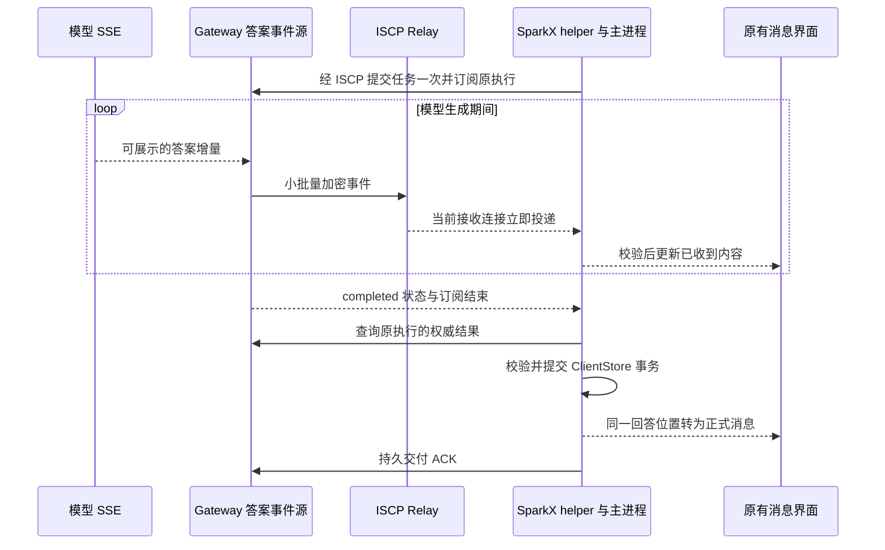

# ISCP 与 SparkClaw 真正流式输出设计

> 语言：简体中文 | [English](../../docs/iscp-application-stream-design.md)

- 状态：设计草案，待讨论；关联 InfiniCenter ProjectGroup-2 决策 **0036 proposed**。本轮只生成文档，不实施、发布或部署。
- 初稿：2026-10-16；修订：2026-10-18（内部使用方案 v3）。
- 本期范围：有效授权本地复用、后台刷新，不逐批等待远端；取消自有传输人工额度；资源调度和旧版本兼容暂不设计。本文取代旧稿对应要求，仅完善文档，不修改代码、配置或部署。
- 参数性质：本版授权缓存、恢复期限和时延数值为设计默认值，不是已实现或实测保证。
- 初稿历史源码基线（不代表本次重新验收）：SparkClaw `b8952d8cf6ec2395d55b1b4ad049090932f82690`；ISCP 本地 fork `47f1f6c231c56c92eff6b6c5d398e037ebcf9602`。SparkClaw 当前依赖 `v0.2.0-rc.1`，对应 `2707cce6922768882f77c5bdaddaef74db759a73`；这两个 ISCP revision 的差异只有 `AGENTS.md`，协议和实现相同。

## 1 结论和目标

**ISCP 可以承载真正的增量推送，不必先改加密协议；SparkClaw 必须补齐持续订阅、增量事件、恢复和界面接续。自有 Relay 采用持续接收并取消人工额度；本期不展开资源调度。仅切换到最新 ISCP fork 不会自动获得流式输出。**

SSE 专指 HTTP 的 `text/event-stream`。本方案保留模型端 SSE，把其中允许展示的答案增量转换成 ISCP 加密事件，由 SparkX 连续接收。这提供与 SSE 相同的服务端持续推送体验。ISCP 通道中无需封装完整 HTTP 响应，也无需让桌面绕过 ISCP 直连 Gateway HTTP。已有浏览器 HTTP SSE 可继续作为另一种传输绑定。

“真正流式”的判断是：模型仍在生成时，后端已产生的多批答案内容持续到达原界面；客户端不为每一批再请求一次 progress；没有先等完整答案再拆字播放。模型本身一次返回全部内容、任务没有可公开文本、答案已经完成后才打开会话时，允许一次显示；这些场景不能作为流式性能的证明。

此前“先一个字、随后全文”的现象存在多条可解释路径：进度快照合并、Agent 对部分输出整段缓存、最终消息替换预览、前端按到达间隔补播。另一台电脑当次原始流记录不可用，因此不能把此次源码分析写成已经确认了该次事故的唯一原因。

## 2 当前链路和目标链路

| 环节 | 当前事实 | 目标行为 |
| --- | --- | --- |
| 模型 | `stream:true`，逐条解析 SSE 并发出 `text_delta` | 保留真实增量来源 |
| Agent | 普通文本可转发；以 `{` 或反引号开头的答案可能缓存至 `done` | 按明确的答案格式提取可展示增量，避免误把普通代码块当结构化包装 |
| 执行进度 | 累计快照，单任务 8 KiB；截断后不再追加 | 独立的答案投影和事件源，支持增量及有界恢复 |
| ISCP 应用适配 | 一次请求只接收一个 Response；收到后删除 pending | 一次订阅接收多条事件，最后才结束订阅 |
| 桌面 helper 与 IPC | 单次 `call` 和单次响应 | 显式开流、事件、结束和取消 |
| 前端 | 轮询累计快照，预览用打字动画；正式消息另行渲染 | 按实际收到的内容更新原组件，正式结果连续接续 |
| 上游参考 Relay | 一次认证后取最多 100 条现有消息，发送 `drained` 后关闭 | 健康且获授权时持续接收新消息，按故障、换密钥或撤销结束连接 |

图中提交、订阅、查询和 ACK 均通过原 ISCP 通道。模型结束与最终落库是不同事件；后者可以由原有恢复流程先发现，不依赖流结束通知一定送达。

## 3 ISCP 和 SparkClaw 的职责边界

| 所属 | 建议修改 | 保持的边界 |
| --- | --- | --- |
| ISCP Core | 流式功能不要求修改 SecureEnvelope、会话握手或密码套件 | 原身份、Trust Grant、PoP、密文路由与重放防护继续适用 |
| ISCP 可选应用扩展 | 在本地 fork 提议通用 stream frame/schema、编解码、序号校验和一致性夹具，候选位置 `pkg/iscp/appstream` | 不包含执行任务、LLM、SparkClaw 操作名或消息 UI；尚非上游标准 |
| ISCP 参考 Relay | 整理持续接收补丁，取消人工额度和健康连接的固定轮换，保留连接替换、撤销和故障恢复；本期不设计资源调度 | Relay 仍只处理不透明信封，不解析 token、正文、任务 ID 或应用流状态 |
| SparkClaw ISCP Endpoint | 新增流调用生命周期、事件分派、订阅取消、顺序恢复和成套版本确认 | 普通一问一答 RPC 保持原义；新事件不得冒充重复的普通 Response |
| SparkClaw Gateway | 新增 `execution.progress.stream`，把可公开答案的生产事件接到订阅；保留身份围栏和结果交付 | 订阅不能创建或重新执行任务；不改变 JingSi Runtime、App-CLI 或 IMMS 的既有契约 |
| SparkClaw Agent | 首期流式输出明确标记的普通文本与 Markdown 最终答案 | 不输出规划、思考、工具参数或未经允许的中间数据 |
| SparkClaw 桌面 | helper、Electron transport/auth、ExecutionProgressClient 接收持续事件并恢复 | 账号、设备、安装实例、会话和授权代次必须始终匹配 |
| SparkClaw UI | 原组件内接入新投影、按绘制帧合并通知、正确接续最终消息 | 页面、菜单、布局、样式、附件、审批、取消和会话切换入口保留 |

通用流 SDK 是推荐的职责归属，不是 ISCP Core 的新前置能力。若先复用已经支持持续接收的 Relay，SparkClaw 可以在现有安全信封上完成应用绑定；但本地 fork 的通用扩展、参考 Relay 整理仍需分别评审。避免把两个仓库各维护一份同名流协议作为最终形态。

### 3.1 Relay 的实际前提

上游 `47f1f6c` 的 connect 处理只 drain 一次，默认所有 HTTP 请求共享 120 次/分钟的 clientKey 限额。2026-10-16 只读核验的 TEST1 实际进程配置为 3600 次/分钟、55 秒接收窗口；源码中的 issuer 转发路由另有 600 次/分钟和 32 并发门槛。这些数字只记录待移除的现状，不作为目标部署的设计约束。

SparkClaw 已有 `internal/iscprelayreference/receive.go` 的持续接收实现：单接收 owner、连接替换、唤醒加一秒兜底、Ping/Pong、最多 55 秒的接收窗口、关闭和撤销处理。既有部署记录显示 TEST1 曾启用该补丁；本设计的事实基线是源码和既有记录，不把它当作上游默认能力，也不把历史记录当作本轮线上验收。

本期复用并评审这份补丁：健康且获授权的连接持续接收，取消强制 55 秒轮换和正常换连后固定一秒等待。保活使用独立节奏，不以逐条等待 Pong 作为投递条件；保留连接 owner 围栏、已获知撤销、失活检测及失败事务回滚。核心信封及既有 Relay 帧定义不变；旧 Relay 适配和混合版本验收移出本期。

目标部署使用 PostgreSQL，交付与失败回滚也在该路径验证。Relay 写入连接成功不代表桌面已展示或持久保存。本期不设计多租户公平、动态工作池、资源预留或大规模负载调度。

## 4 应用层流契约与状态机

### 4.1 开流和身份

内部成套版本声明 execution_stream 和 execution.progress.stream，通过匹配版本的显式能力确认启用。原执行受理后才能订阅；已有权威结果则直接走正式交付。每次使用新的随机 subscription_id，与流 RPC ID 相同，与业务 request_id 不同。

开流包含原 request_id、input_digest、最晚开流时间及可选游标。服务端从认证上下文取得 deployment、owner、client、installation；订阅绑定 execution、ISCP session、authorization revision、本地 auth generation。自报身份不能覆盖认证上下文。开流复用有效授权快照；无有效快照时等待一次权限确认，详见第 6 节。10 秒开流时间在权限就绪、实际发出开流时才开始。

### 4.2 数据、控制和终结

| 层次 | 字段或行为 | 规则 |
| --- | --- | --- |
| ISCP 外层 | message_id、session_id、sequence | 会话与重放防护，不代表答案顺序 |
| 通用帧 | schema_version、subscription_id、stream_seq、body | payload type 为 iscp.application.stream.v1；body 对 SDK 不透明 |
| 业务绑定 | kind、request_id、input_digest、epoch、generation、revision | 同一订阅固定 epoch/generation，revision 是源版本 |
| delta | from_offset、to_offset、text、content_digest | UTF-8 字节偏移，严格追加；摘要为追加后完整正文 SHA-256 |
| snapshot_begin | snapshot_id、基线 revision、总字节数、完整摘要 | 建立候选，不覆盖原预览 |
| snapshot_chunk | snapshot_id、偏移、文本 | 只写候选，不拆断 UTF-8 字符 |
| snapshot_end | snapshot_id、总字节数、完整摘要 | 全部验证后原子发布候选 |
| state | 绑定及原业务状态 | 不作为正文或交付凭证 |
| 独立控制 | cancel、invalidate、原 subscription、源版本、reason | 不占正文序号；只能结束观察或废弃旧投影，不能发布正文 |
| 唯一终结响应 | 原 RPC ID、last_stream_seq、reason | terminal、renew、canceled、reset、auth_expired、gap、preview_unavailable；不代表业务成功 |

摘要采用 UTF-8 原文的 SHA-256 小写十六进制，不做 Unicode 归一化。偏移从 0 起，stream_seq 从 1 起；整数在 JavaScript 安全整数范围内。实现前由同一份严格 schema 冻结必填字段及正反例。未认证、未知版本、非法 UTF-8/整数、绑定漂移和摘要错误不能推进应用接收状态。

开流后允许零条或多条帧，正常结束最多一个 RPC 响应；断线不保证收到终结。terminal/renew 先到时，最多等待 2 秒补齐至 last_stream_seq，再结算；未补齐进入恢复。cancel、invalidate、已知撤销和正式结果已保存无需等正文缺口。控制仍须通过身份、方向、订阅及版本校验，并复用有效本地授权；到期或已知撤销的本地清理不依赖远端查询。

### 4.3 顺序与取消

每条订阅只有一个发送 owner，帧连续编号；不同订阅可交错。信封认证与本地授权通过后，只按连续序号应用正文。应用重发重新加密并使用新外层 message_id/sequence，保留原 stream_seq 与内容。等价重复忽略，冲突拒绝；无法证明等价的旧帧不应用。缺口最多等 2 秒，再恢复原任务；不跳号拼接。

同一 epoch/generation 中，revision 对应确定的正文位置与摘要，state 可不改变正文。snapshot 固定基线，随后只接该基线之后的增量。进程重启改变 epoch，答案替换/重试改变 generation。任一变化都发 invalidate 并以 reset 终结旧订阅，重新订阅新基线；不在旧订阅内跨 generation 拼接。失败或业务取消可发 invalidate 清空临时正文，仍由原结果流程交付失败/取消结果；正常 completed 保留预览至正式结果接续。

接收循环不等待远端授权、UI 回调或完整快照；订阅状态与发送串行推进。取消观察只释放该订阅，不重置共享会话、不调用 execution.cancel。同一桌面进程对同一原执行复用一个订阅，最后观察者离开才 cancel；独立订阅互不取消。

开流最晚有效时间默认为发出后 10 秒，服务端使用既有时钟容差校验。cancel 携带原开流最晚时间；先到时，为同身份、会话和 subscription 保存围栏至该时间及既有时钟容差。服务端拒绝超过开流允许窗口的自报时间，重复控制不能延长围栏；过期开流拒绝。已终结订阅不能由迟到帧重新开启。

### 4.4 统一状态转换

下表描述观察过程，区别于业务状态；身份、授权与落库事件由同一状态 owner 仲裁。

| 当前状态 | 事件 | 下一状态与动作 |
| --- | --- | --- |
| opening | 确认或首个合法事件 | receiving；建立基线或处理增量 |
| opening | 超过开流期限 | recovering；查询原任务，不重提 |
| receiving | delta/state | receiving；验证应用后通知原组件 |
| receiving | 完整合法 snapshot | receiving；原子替换，再处理后续增量 |
| receiving | 断线、缺口或源版本变化 | recovering；废弃旧候选，按第 5 节续接 |
| receiving/recovering | 后台刷新失败，但快照仍有效 | 状态不变；继续流式并后台重试 |
| 任意未关闭状态 | 授权到期未续上 | auth_paused；关闭旧订阅，隐藏临时正文，保留原任务身份 |
| auth_paused | 权限重新确认且恢复期限未耗尽 | recovering；新订阅取完整快照 |
| receiving | 正常终结且尾帧齐全 | awaiting_result；保留合法预览，查询正式结果 |
| recovering/auth_paused | 本次恢复期限耗尽 | awaiting_result；停止自动预览恢复，保留原结果恢复 |
| 任意未关闭状态 | 正式结果完成校验和本地事务 | closed；原位置展示正式结果，独立 ACK |
| 任意未关闭状态 | 取消观察或最后观察者离开 | closed；仅释放观察，不取消业务任务 |
| 任意未关闭状态 | 已知撤销、账号/安装实例切换 | closed；清除该身份临时数据，拒绝旧帧 |
| closed | 旧帧、旧结束、旧刷新结果 | closed；忽略，不复活 |

每次发布正文和提交最终结果前，先复验身份、授权有效期和代次。已知撤销/身份变化先于尚未提交的正文或落库动作；不追溯删除此前合法保存的历史。正式结果已提交后，reset、尾帧、动画和候选都不能覆盖它。取消观察不阻止原任务既有持久恢复。源版本失效先废弃候选再建立基线；正常终结在补齐缺口或正式结果已保存后结算。

## 5 答案格式与恢复

### 5.1 首期格式

首期保证普通文本和 Markdown 真流式，包括代码块、中文和其他多字节字符。由可信工作流在调用前确定输出模式，不凭首字符判断：普通文本以大括号或反引号开头仍可流式。仅转发最终答案阶段可公开的 text_delta，不输出规划、思考、工具参数或未经允许的中间数据。

结构化 final 包装首期不做增量提取，完整解析校验后直接展示正式答案，不事后拆字播放，也不计为真流式成功样本。未来再单独定义允许字段、重复键、转义、分片和最终校验失败规则；该解析器不是本期实施或验收前置条件。

### 5.2 投影、游标与热重连

服务端维护临时答案投影与短期回放，不永久保存 token 历史。正文及候选受既有业务结果格式约束：当前整体结果上限 8 MiB，包含其他结果内容；新流不沿用旧 progress 的 8 KiB 上限。回放保留最近 30 秒，并受现有正文大小边界约束；ACK、撤销和结果清理不被订阅延后。

游标包含 epoch、generation、revision、offset 和完整正文摘要。只有内存中同时保有对应已验证正文，客户端才可提交游标；它不是交付 ACK。恢复使用新的 subscription 和从 1 起的 stream_seq，业务 request_id/input_digest 不变。

1. 游标在回放范围内：同一短临界区验证游标、固定回放上界并登记实时观察者，先回放再发后续事件。
2. 游标过旧但投影完整：同一短临界区捕获 snapshot 基线并登记后续增量；验证完整候选后原子替换。
3. 同身份、授权快照有效且源版本未变：短断线保留已验证正文；旧半份候选不跨连接续传。
4. epoch/generation 改变、授权过期或身份变化：废弃候选及失效预览。服务端无当前投影则返回 preview_unavailable，仅恢复正式结果。
5. 已取得并保存正式结果：立即停止预览恢复，候选及晚到帧不得覆盖正式消息。

### 5.3 冷启动和长快照

首期不持久化临时正文、游标或半份 snapshot。桌面/helper 重启后，从持久任务记录取回原 request_id/input_digest 并查询：完成则保存结果；仍运行且可预览则取完整 snapshot；无投影则等正式结果。不能恢复没有正文的孤立游标，不能重新提交或执行任务。

snapshot 绑定独立 snapshot_id、固定基线与完整摘要，按编码后 64 KiB 消息预算打包，不强制使用实时 delta 的 4 KiB 触发值。JSON 转义和元数据计入大小，块在 UTF-8 字符边界切分。期间生成的增量排在基线之后，完整验证后再应用。

同身份、scope、revision 和会话的授权/能力续期只更新截止时间，不丢候选、不重开订阅或从头传输。权限缩减或版本变化结束旧订阅，新权限下取新基线；真实会话重建也使用新订阅。传输断线后的候选从头获取，不承诺半份快照断点续传。

每次故障从首次断线/缺口或授权过期起共用 30 秒恢复期限；冷启动首次 snapshot 从发起观察计时。开流失败、连接更换、候选重建和权限等待均不重置期限。30 秒内无法形成完整基线并追上实时内容，就结束本次自动预览恢复并返回 preview_unavailable，只保留原任务结果查询；权限仍不可用时查询也服从其原授权规则。重新打开会话可发起一次新观察。

短暂错误按 250 ms、500 ms、1 秒、2 秒、最多 5 秒间隔重试，始终受总期限约束；已知撤销不重试。这是单次故障的恢复期限，不是累计请求额度。snapshot 中遇到 cancel、invalidate、已知撤销或正式结果提交，立即废弃候选，无须等 snapshot_end。

## 6 授权和内部使用边界

### 6.1 本地授权快照与后台刷新

采用开流复用有效授权快照、逐批本地校验、后台定期刷新的方案。不新增 issuer 签名租约 wire，不引入 Gateway 跨主体委托；复用现有可验证权限查询结果，在可信 Endpoint 内存中限制复用期限。

| 项目 | 本版设计默认值或规则 |
| --- | --- |
| 绑定 | deployment、owner、client、installation、对端身份、Grant、session、scope、authorization revision、本地 auth generation |
| 建立 | 无有效快照时查询一次；仅来源和签名/信任验证通过的 active 结果可建立快照 |
| 期限 | 最长 5 分钟，且不超过 Grant/能力期限；从检查发起时计算，不从慢响应到达时延后 |
| 刷新 | 每 60 秒后台刷新，已知权限期限更近时提前刷新；同一绑定共享刷新工作 |
| 查询与重试 | 单次查询最多 10 秒；失败后每 5 秒后台重试；有效快照内继续流式 |
| 逐批校验 | 本地校验身份、会话、scope、有效期、revision、取消/撤销及完整性，不等待远端 |
| 到期或已知撤销 | 停止发送/展示正文，隐藏临时预览并结束旧订阅；到期可重新确认权限，已知撤销不可复活 |
| 重启或换会话/身份 | 不复用旧内存快照，重新绑定并确认权限 |

这是明确的有限缓存语义，不保证每批权限实时新鲜。正常情况下，远端撤销在下一次成功刷新或已验证通知到达时被发现；查询耗时计入发现延迟。失联且没有撤销通知时，可沿用到该检查发起后最多 5 分钟及更早的 Grant/能力期限。一旦本地得知撤销，立即清理，不等缓存到期。

TTL 使用同进程单调计时；Grant/能力绝对期限按既有时钟误差规则转换，系统时钟回退不能延长权限。响应到达时已过截止时间则不能建立快照。刷新结果发布前复验其启动时的身份、session 和 auth generation；旧成功结果不能覆盖后到的撤销或身份切换。同权限版本续期只延长有效期，不重开订阅、不丢弃候选快照；revision 或 scope 改变则关闭旧订阅，以新权限恢复。

权限查询本身不续签 Grant 或能力；它们由既有续期流程在后台单独更新，成功且权利不变时接续，未续上则原截止时间仍生效。

发送端与接收端分别执行这些规则。策略只适用于本方案开流、流事件与订阅控制；业务 submit、审批、工具执行、execution.cancel、权威结果 lookup/ACK 保持各自既有授权契约。PoP、Trust Grant、密文验证、业务可见范围及撤销围栏继续生效。纯本地清理不需要有效权限或网络调用。

### 6.2 取消人工额度，暂不设计资源调度

本期按内部低并发使用规划。自有 Relay、issuer 转发及流调用链路取消固定请求频率、并发数量和累计使用额度，不以调大旧数字替代取消，不强制轮换健康连接。

多租户公平、优先级资源预留、动态工作池、容量建模、慢消费者调度和大规模压力验收均移出本期。采用普通发送队列、可取消操作和明确错误处理，不引入独立资源调度系统。消息大小、有效期、完整性、既有业务结果大小及恢复期限保留原义，不变成累计请求或任务额度。

### 6.3 实时发送节奏

首个非空答案增量立即发送；随后以 50 ms 或 4 KiB UTF-8 原文触发合并，哪个先到用哪个；结束时立即发送余量。50 ms 是合并等待，不是打字速度。编码后每帧仍满足 64 KiB 消息预算，包含 JSON 转义和元数据；过大的单次模型 delta 拆成合法帧。

发送不等待下一次授权刷新或完整答案；Relay 不逐条等待 Pong；桌面只按绘制帧合并已到达内容，不增加打字等待。这是低并发下消除人为停顿的规则，不是资源调度方案。

## 7 桌面接入与最终消息接续

helper 与 Electron 成套支持 stream_call、stream_event、stream_cancel，普通 call/response 保持原义。订阅不套用普通 RPC 总时长，也不绑定 55 秒接收窗口；同权限版本的授权/能力续期维持原订阅，真正到期或会话重建才进入状态转换。关闭页面只取消观察，原有停止任务入口才调用 execution.cancel。

保留 TaskProgressMessage、MessageBubble 和全部原页面、菜单、布局、样式、附件、审批、设置及会话交互。已到达内容直接进入原组件，最多等下一绘制帧；合并通知，并以同会话读取版本防止旧异步读取覆盖新正文。不新增常驻传输技术状态。

最终结果继续按原流程：lookup 原任务 → 验证完整 payload digest → 复验身份/权限/代次 → ClientStore 事务保存消息和回执 → 同位置替换预览 → 后台 ACK。保存和 ACK 不等动画、尾帧或完整预览；失败沿原持久交付恢复。

相同正文只改变持久状态；正式结果为前缀扩展时立即展示余量；有归一化或修正时原子采用权威结果。替换与清除临时投影在同一视图更新中完成，不先空白、不产生重复气泡。历史不重播。授权仍有效的短重连保留已验证正文；到期、撤销或身份切换按状态机隐藏临时预览，只在需要用户处理时显示原有错误提示。

## 8 内部成套版本与发布边界

用户明确当前未公开使用，旧版本兼容、自动降级、混合版本矩阵和旧 Relay 适配均不在本期范围，也不是实施或验收前置条件。

Gateway、helper、Electron、ISCP 扩展和 Relay 使用一份内部发行清单，记录各自 revision 及 stream schema 版本。开流前确认本地 IPC 与远端 schema 匹配；不匹配则明确拒绝新流操作并要求成套更新，不猜测字段、不静默回退到 progress。此为版本正确性检查，不是向后兼容设计。

本地联调可使用临时 Go workspace；交付构建固定可取得的 commit/版本，不依赖某台电脑的绝对路径 replace。将来公开或混合部署时再另行设计兼容。回退使用经验证的完整发行组合，保留业务数据库、身份与任务记录，不重提任务；不承诺组件独立降级可互通。

本轮只完善文档，不构建、安装、推送、部署或改变现有公共契约。通用扩展继续 proposed，不把内部使用决定写成 ISCP 上游接受。

## 9 分段与验收标准

### 9.1 分段

1. 冻结流帧 schema、授权快照、状态转换与恢复规则并形成正反例；资源调度及旧版本兼容不作为前置工作。
2. 用受控逐批生产源贯穿加密 Endpoint、连续 Relay、helper、IPC 和原 UI，验证逐批正文不等待远端授权。
3. 接入真实模型普通文本/Markdown，完成热重连、冷启动、最终消息接续和原 UI 回归。
4. 核验内部成套版本与以下时延目标，之后再讨论打包、单节点验证和部署。

### 9.2 功能与故障验收

| 场景 | 通过条件 |
| --- | --- |
| 受控 600 字 | 每 100 ms 产生 6 个中文字符，共 100 批；done 前至少 90% 字符已显示；一次订阅，无逐块 progress RPC 或事后打字 |
| 真实模型普通文本/Markdown | 生成中持续增长；仅实际产生多批可见 delta 的样本计为真流式 |
| 代码块、大括号开头、超过 8 KiB、多字节 | 不按首字符整段缓存，不受旧预览截断；无丢字/重复/乱码，正式结果校验成功 |
| 结构化 final 包装 | 完整校验后直接展示，不泄漏内部字段、不冒充真流式 |
| 后台授权慢或失败 | 有效快照内发送/展示不中断，逐批无远端查询依赖 |
| 到期、已知撤销、切换身份、旧刷新晚到 | 失效后不发布正文，旧成功结果不复活权限，清理不等网络 |
| 同版本续期及权限版本变化 | 同版本不丢候选/重开流；变更关闭旧流并以新权限恢复 |
| 重复、乱序、结束提前、摘要错误 | 连续可验证；2 秒缺口规则生效，不吞尾帧 |
| cancel 先到、旧 invalidate/结束帧晚到 | 取消围栏有效，不匹配控制无效，终结后不复活 |
| 热重连、冷启动 | 热重连的正文与游标匹配；冷启动查原任务并取完整快照，无孤立游标或任务重提 |
| 大快照期间续期、断线、源变化或结果先落库 | 正常续期继续；失效废弃候选；重开不重置 30 秒期限；正式结果优先 |
| 恢复期限耗尽 | 停止自动预览恢复，原任务继续，无开流自旋 |
| 持续运行超过 55 秒 | 不按旧窗口强制断开，无固定一秒冷却 |
| 正式结果与预览并发 | 同位置一次逻辑交付，事务和幂等 ACK 不等动画/尾帧 |
| 本期版本及原界面 | 成套正确启流，不匹配明确拒绝；原菜单、会话、附件、审批、取消、设置保持 |

### 9.3 流畅性目标

以下为本版验收目标，不是实测结论。基准是一条活跃答案流、普通文本/Markdown、传输路径 RTT 不超过 150 ms、无人工注入丢包，端点/Relay 无已知故障；记录机器、网络、模型与发行版本，不要求大规模压力测试。用户提交到模型首个 delta 的推理/工具耗时单独记录。

| 指标 | 本版目标 |
| --- | --- |
| 已开流后首个可见 delta 到原 UI 绘制 | 不超过 500 ms |
| 持续生成时每批产出到绘制延迟 | P95 不超过 300 ms，P99 不超过 500 ms |
| 持续有可展示 delta 时的额外停顿 | 无超过 1 秒且非模型/真实断线造成的停顿 |
| 健康链路发送合并等待 | 最多 50 ms；首批和末批立即发出 |
| 网络恢复并认证完成后，最多 64 KiB 的投影恢复 | 最新合法正文恢复 P95 不超过 3 秒 |
| 故障恢复总期限 | 30 秒，不因重开延长；超时明确结束自动预览恢复 |
| ClientStore 提交到正式消息接续 | 正常绘制周期内切换，不额外等待动画 |

受控生产器与 UI 观测采用同一单调计时基准，或提供误差已量化的跨机计时。没有误差界限时仅报告各进程阶段耗时，不直接相减绝对时间宣称端到端 P95。至少运行 20 组受控 600 字样本统计分位数，另测长文本和真实模型，保留每批关联 ID 与样本数。

记录 request/subscription/seq、字节数、摘要、模型产出、发送、接收、验证、绘制、后台刷新及最终落库耗时，不记正文或凭据。不达标时定位阶段并评审方案调整，不能事后放慢生产器或偷偷放宽门槛。其他网络条件单独报告，不能冒用基准结论。

## 10 本版决策与后续边界

| 事项 | 本版结论 |
| --- | --- |
| 授权 | 有效快照本地校验，最长 5 分钟，每 60 秒后台刷新，不逐批等待远端 |
| 人工额度 | 自有传输及授权转发取消固定频率、并发数量、累计额度 |
| 资源调度 | 内部低并发，本期不设计、不作为验收前置条件 |
| 兼容 | 仅验证内部成套版本，不做旧端兼容或自动降级 |
| 格式 | 普通文本/Markdown 真流式；结构化包装完整校验后直接展示 |
| 恢复 | 热重连校验正文/游标，冷启动完整快照，30 秒期限，不重跑任务 |
| 生命周期 | 订阅固定 epoch/generation；统一状态机；旧帧不复活；正式结果优先 |
| 归属 | ISCP 可选扩展持有通用帧/校验；SparkClaw 持有业务流、授权快照、IPC/UI |
| 当前授权 | 完善双语设计及 InfiniCenter 记录，无产品代码或线上变更 |

5 分钟缓存、60 秒刷新、10 秒查询、50 ms 合并、2 秒缺口等待和 30 秒恢复是本版设计默认值。后续调整须同步双语说明、状态机与验收夹具。本轮无须继续设计资源调度或旧版本兼容。

SDK 接收认证顺序仍须审查：初稿发现 envelope.Decrypt 在 AEAD 验证前调用 MarkReceived。实施阶段应确保失败输入不推进安全接收状态，并补充负例；授权缓存不取消该要求，也不能把它当作历史一字后全文的已证实原因。无需改变加密 wire 格式。

## 11 源码与既有记录

以下行号对应初稿历史基线；相对链接指向仓库源码，ISCP 链接固定 revision。

| 事实 | 证据 |
| --- | --- |
| 模型 SSE 与 Agent 缓存 | [router.go](../../services/gateway/internal/modelrouter/router.go) 612、642、672；[agent.go](../../services/gateway/internal/agent/agent.go) 960–994 |
| 执行增量接入和旧快照 | [execution_workflow.go](../../services/gateway/internal/gateway/execution_workflow.go) 120；[progress.go](../../services/gateway/internal/execution/progress.go) 11、86、128、154；[execution_progress.go](../../services/gateway/internal/gateway/execution_progress.go) 43 |
| 一次响应及 payload 分派 | [endpoint_rpc.go](../../services/gateway/internal/iscpworkbench/endpoint_rpc.go) 27、67、156、273；[endpoint.go](../../services/gateway/internal/iscpworkbench/endpoint.go) 557、635 |
| 协商与新鲜授权 | [negotiation.go](../../services/gateway/internal/iscpworkbench/negotiation.go) 201、224；[authorization.go](../../services/gateway/internal/iscpnodeclient/authorization.go) |
| helper、客户端和 UI | [helper](../../services/gateway/cmd/iscp-workbench/main.go) 153、246、291；[execution-progress.mjs](../../apps/desktop/src/main/execution-progress.mjs) 77；[execution-client.mjs](../../apps/desktop/src/main/execution-client.mjs) 243、261；[LocalWorkbench.tsx](../../apps/webchat/src/desktop/LocalWorkbench.tsx) 225、476；[messages.tsx](../../apps/webchat/src/components/messages.tsx) 94 |
| SparkClaw Relay 补丁 | [receive.go](../../services/gateway/internal/iscprelayreference/receive.go)；[部署记录](public-iscp-node-deployment.md)；[既有延迟测量](iscp-latency-optimization.md) |
| ISCP 信封和接收序号 | [envelope.go](https://github.com/Infinimesh-ai/ISCP/blob/47f1f6c231c56c92eff6b6c5d398e037ebcf9602/pkg/iscp/envelope/envelope.go#L34)；[session.go](https://github.com/Infinimesh-ai/ISCP/blob/47f1f6c231c56c92eff6b6c5d398e037ebcf9602/pkg/iscp/session/session.go#L243) |
| 上游 Relay drain、配额和队列 | [server.go](https://github.com/Infinimesh-ai/ISCP/blob/47f1f6c231c56c92eff6b6c5d398e037ebcf9602/services/relay-reference/internal/relay/server.go#L546)；[PostgreSQL claim](https://github.com/Infinimesh-ai/ISCP/blob/47f1f6c231c56c92eff6b6c5d398e037ebcf9602/pkg/server/repository/relay.go#L254) |
