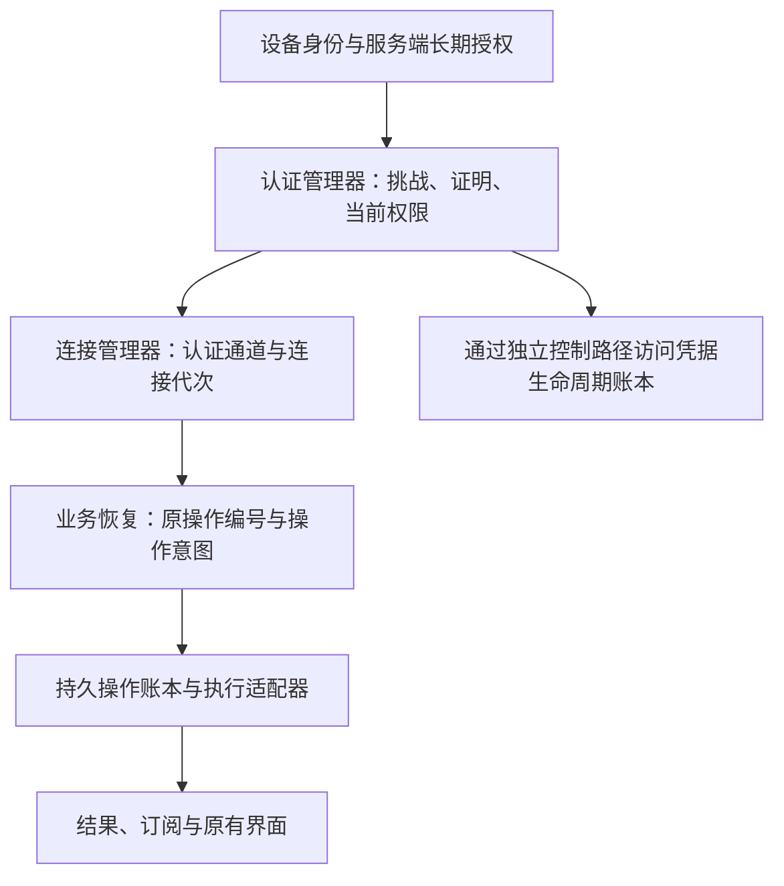

# ISCP 连接认证与业务操作恢复设计

语言：简体中文 | [English](../../docs/iscp-authentication-operation-recovery-design.md)

日期：2026-10-19。状态：设计提案，跨项目评审记录于 InfiniCenter 0041。源码基线：SparkClaw `cf9b81dec39b8872efc43650080bb8facaa58511`、ISCP fork `10fe37b3bd02a56b4f9d6cb8dc0333d7eec5356a`。本文定义职责与验收要求，不改变当前部署行为或已接受的契约。

## 1 决策与目标行为

将连接认证与持久的操作身份分离。连接层使用已登记的设备身份生成新证明、更新凭据并恢复认证通道；业务层通过该通道，使用原操作编号和不可变的操作意图，对账受理、执行与结果状态。

首次注册后，只要原长期授权仍有效，网络中断或连接凭据到期就不应要求重新使用邀请码或重新人工授权。恢复过程中仍须执行身份、撤销、任务权限、审批、截止时间与资源版本约束。有效签名证明私钥持有，服务端还必须独立确认当前权限。

目标设备注册策略持续有效，直到显式撤销/删除或经过授权的绑定变更。连接 token 的 TTL 或离线时长不能终止这一关系。长期授权独立于短期 Grant 存储，不能把确实限时的任务授权解释为永久权限。

目标链路为：**网络恢复 → 原设备身份重新认证 → 恢复可用连接 → 对账原业务操作 → 恢复订阅并取回已有结果**。连接恢复自动执行；操作恢复依赖该操作声明的语义与持久证据，不代表自动重做任意副作用。

本设计仅覆盖新协议下创建的业务操作与生命周期控制操作，不纳入旧请求迁移、导入适配器或旧摘要/密封格式兼容。它可以基于现有传输实现，也可以与[全双工 WSS 方案](iscp-duplex-websocket-design.md)结合；仅改成双工传输无法解除这一绑定。

## 2 当前故障及架构原因

客户端将完整 `LifecycleRequest` 写入加密的 `lifecycle.pending`，其中包含有时限的 `Proof` 和可选 `RelayProof`，重试时复用原请求。issuer 将去重与结果密封绑定到 `Digest(request)`，而此摘要包含这些证明。过期证明只有在服务端已经受理了完全一致的操作时才允许重放。断网期间创建的请求可能一直未送达，恢复网络时已超过 issuer 的五分钟证明窗口；原样重试持续失败，修改证明又会改变操作识别和结果解密使用的摘要。Relay 恢复存在相同结构，并有独立的一分钟证明窗口。

这实际上是两件事：**调用方要做什么操作**，以及**本次连接或请求现在是否已通过认证**。两者生命周期不同，不应共用一份不可变记录。延长证明有效期、永久保留第一次签名、清空 pending，或每次重连更换操作编号，都没有解决这个职责问题。

当前源码依据：[客户端持久化](../../services/gateway/internal/iscpnodeclient/lifecycle.go)、[issuer 摘要、时效与密封](../../services/gateway/internal/iscpnodeissuer/lifecycle.go)、[Relay 恢复](../../services/gateway/internal/iscprelayadapter/lifecycle.go)、[工作台生命周期](../../services/gateway/internal/iscpworkbench/node_lifecycle.go)。fork 中对应实现位于 `extensions/sparkclaw/`。

## 3 独立的生命周期与不变量

| 对象 | 生命周期与用途 | 到期或丢失的影响 |
| --- | --- | --- |
| 设备身份与私钥 | 稳定的已登记主体与持有证明 | 私钥丢失进入显式身份恢复；重连不能自行创建替代身份 |
| 长期授权 | 服务端管理的注册关系、资源绑定、scope 和撤销 revision | 撤销或真正的授权到期会阻止恢复；仅持有私钥不能恢复权限 |
| 认证证明与连接租约 | 新挑战响应、access 凭据与认证通道 | 续期或重新认证，不改变操作意图 |
| 任务授权与业务截止时间 | 某项行为、目的、审批与时间范围内的持久权限 | 按该操作契约决定能否继续、读取或取消；重连不能延长 |
| 操作身份与结果 | 持久的受理、执行与去重历史 | 跨连接替换保留；结果保留期与执行期限分别管理 |
| 订阅与界面投影 | 实时传递任务当前状态 | 从游标或快照恢复，不创建新任务 |

必须满足以下不变量：

1. 认证时间戳、挑战、证明签名、bearer token、连接编号和会话编号，均不进入 v2 操作语义摘要。
2. 原任务授权、审批、副作用范围、目标、输入、业务截止时间和前置条件必须进入该摘要。排除短期连接 Grant，不意味着排除名称相似的任务 Grant。
3. 同一主体、操作命名空间和操作编号只对应一份不可变意图。同一个键携带不同意图必须冲突；新的认证上下文不产生第二次执行。
4. 传输受理、业务受理、执行完成与客户端应用结果是不同的确认。
5. 超时、HTTP 403、查不到记录或保留期结束，都不能证明副作用未发生。
6. 更新认证不能复活已撤销权限、延长任务截止时间、重放旧加密会话，或把操作转移给另一个身份。

## 4 分层职责与依赖方向



| 责任方 | 负责什么 | 职责边界 |
| --- | --- | --- |
| 身份存储 | 保存原私钥、可信 issuer/Relay 身份和端点 pin | 不把某一次握手证明缓存为持久授权 |
| 认证管理器 | 获取新挑战并签名、续租、检查当前授权和撤销 | 不决定业务动作是否重做 |
| 连接管理器 | 建连、重新认证、退避、隔离旧连接回调并发布就绪状态 | 不删除待处理操作或重建其编号 |
| 业务恢复协调器 | 读取操作日志、逐项查询对账、恢复结果或订阅 | 接收已认证通道，不获取原始私钥或自行生成 PoP |
| 操作处理器与账本 | 校验业务权限、原子受理不可变意图、持久状态、副作用对账 | 去重不依赖临时认证字段 |
| 原有 UI 适配器 | 反映当前能力与原任务状态，保留草稿和历史 | 不因重连成功而产生第二个业务操作 |

凭据续期本身也是持久控制操作。它的账本属于连接子系统，同样分离意图与认证，通过不要求业务通道 READY 的控制路径运行。某个业务操作卡住不能阻止重新认证。issuer 与 forwarder 的服务身份也必须能独立恢复；控制流经过服务 peer，并不能免除这一前提。

## 5 操作意图与认证上下文

以下为建议的逻辑类型，不是在已接受的 v1 schema 中直接添加字段：

```text
OperationIntentV2 {
  version, namespace, operation_id, kind,
  subject_binding, target,
  task_authorization, payload,
  business_deadline, preconditions
}

semantic_digest = SHA256(domain_separator || Canonical(OperationIntentV2))

AuthenticatedContext {                       // 由验证器生成
  principal, audience, verified_scopes,
  authorization_revision, authentication_epoch,
  connection_generation, expires_at
}

RequestEnvelope {
  protocol_version, attempt_id,
  action, operation_id, semantic_digest, intent_or_query,
  authentication_binding, optional_result_delivery_binding
}
```

复用 ISCP 的严格解析与规范编码，并使用带版本的域分隔符。实施前冻结字段存在性、整数与时间格式、未知字段拒绝规则及测试向量。`subject_binding` 必须与已验证主体一致，不能通过自报字段建立身份。去重键为 `(authenticated principal, namespace, operation_id)`，包含 domain/tenant 隔离边界。

在已认证的端到端通道中，接收方从验证过的会话派生 `AuthenticatedContext`，使用现有会话保护认证请求。业务代码不再往意图里填持有证明。跨进程传递上下文时，必须通过受保护的可信适配器或可验证绑定，不能信任自报主体的请求头。Relay 的传输认证不能单独授权 Gateway 业务操作或获知其加密内容。

无状态 HTTPS 控制请求由连接适配器在意图之外提供新认证。认证绑定选定协议、接收方/audience、服务端挑战、方法与路径、排除 `authentication_binding` 后的规范请求摘要、结果投递密钥，以及使用凭据时的凭据哈希。证明不递归签署自身。挑战短期有效并原子消费；认证响应丢失后获取新挑战，不要求重放同一次认证尝试。新证明可以覆盖旧意图摘要，但不成为该摘要的一部分。

`attempt_id` 关联一次交互，可以更换；`operation_id` 与 `semantic_digest` 固定。信封 message ID、端到端序列号与订阅编号具有各自生命周期，不能替代操作编号。

不可变结果包含操作键、语义摘要、结果版本与结果摘要；其规范内容和 issuer 签名不依赖连接。投递加密再绑定这些值、已认证接收者及投递上下文，使**同一结果**可以重新密封给新的已授权通道。更换投递 wrap key 需要当前经过认证的持有证明和完整性保护，不能改变已存结果或接收者身份。凭据秘密在存储与传输中均保持加密。

## 6 连接认证与恢复流程

连接生命周期为 `DISCONNECTED → CONNECTING → AUTHENTICATING → READY`。传输失败进入重连与退避。旧权限仍有效时可以在 READY 中更新凭据；权限一旦到期，业务受理和投递立即暂停，直到重新认证成功。已验证的撤销进入 `AUTHORIZATION_REVOKED`，身份材料缺失进入 `IDENTITY_RECOVERY_REQUIRED`，两者不属于普通网络重试状态。

1. 定位原先固定信任的授权方，通过受保护的控制入口获取新挑战。发放挑战不泄露账户详情，也不授予业务权限。
2. 使用原设备私钥签署新绑定。服务端检查私钥持有、audience、挑战时效与消费状态、注册关系、当前长期授权及 revision。恢复路径不要求旧短期租约仍可作为有效权限使用。
3. 通过这一已认证控制上下文对账凭据生命周期操作，取得可用短期租约。常规 refresh token 轮换可以作为快捷路径；access 和 refresh 凭据**全部过期**后，仍可通过原身份与长期授权恢复。
4. 在各自权限边界认证 Relay 连接和目标 Gateway/端到端会话。确认真实可用能力后，才发布业务通道 READY。
5. 将当前连接代次传给业务恢复协调器。只恢复属于该代次、原身份和原资源绑定的操作。

首次注册成功建立长期身份关系。已消费的邀请码只保留历史关联，不成为可重复使用的凭据。如果当前策略刻意把长期授权设为限时，真正到期仍需要授权；改变这一产品策略属于另一个决策。服务端不能把客户端“过去连接成功”的标记视为授权。

每个身份、domain 与目标绑定只运行一轮认证/凭据恢复，自动和手动重连共同等待它。使用指数退避、抖动与现有响应时间边界；合并认证不能串行化相互独立的业务操作。新代次隔离旧回调、旧凭据写入与旧 UI 投影。服务端的操作准入和撤销/连接所有权切换需要共享串行化边界，单靠客户端计数器无效。准入时校验当前权限，并在业务契约要求的副作用或披露边界再次校验。

单个操作超时只结束该操作的等待，不销毁共享连接。可重试的证明到期响应触发新认证，不能将设备标记为撤销。通用拒绝或授权服务不可达属于尚未解决的认证失败；只有经过验证的权威状态才能支持终态撤销判定。证明时效由服务端时间决定，重复时钟错误应可诊断，不能通过放宽验证消除。

全双工方案中的限时仅认证状态及独立 HTTPS 恢复仍适用。取得数据连接凭据不能循环依赖该数据连接已经通过认证。

## 7 READY 后的业务操作恢复

第一次发送前，将不可变意图与操作键持久写入本地日志。先记发送尝试，再发送，防止崩溃后把不确定的发送误认成从未发送。连接断开时保留日志、终态结果、流游标与用户草稿。

| 服务端权威状态 | 恢复动作 |
| --- | --- |
| 本地确定从未尝试发送 | 重新校验当前权限与前置条件后提交原意图 |
| 已受理或执行中 | 附着到原操作，查询状态或恢复订阅 |
| 已成功、失败或取消 | 取回原终态结果，持久应用到本地后确认 |
| 完整去重历史证明尚未受理 | v2 处理器可以在同一个键上原子执行查找或受理原意图 |
| 受理或外部副作用结果不明 | 保留原键继续对账，只在需要处理时提示；不另造操作 |
| 结果正文已到保留期，但存在完成墓碑 | 返回保留的终态处置，不能为了重新生成结果而再次执行 |
| 同一个键携带不同语义摘要 | 返回冲突，不覆盖原记录 |
| 权限撤销或任务截止时间已过 | 按原操作的停止、读取和取消规则处理，不隐式更新业务授权 |

对于支持该能力的 v2 处理器，`Recover(intent)` 是服务端原子的**查找或受理**，不是客户端“先 GET 查不到，再 POST 新操作”。它返回已有操作；只有服务端能证明受理历史覆盖完整，且当前授权允许准入，才受理同一份原意图。延迟到达的首次请求竞争同一个持久唯一键。单纯查询不预留执行权限。不具备这些保证的处理器只支持查询和附着，不宣告查找或受理能力。

按操作类型声明恢复行为：可重新读取的查询、持久幂等变更、可续接执行、必须对账的副作用。连接层不能根据 HTTP 方法或 RPC 名称推断这些分类。重新读取当前状态不等于重现旧快照。

已有契约优先于通用提案。已接受的 SparkClaw–JingSi Runtime v1 要求不确定提交后调用 lookup；其中 `not_started` 是**永久禁止该键被受理的持久否定围栏**，不是这里的 v2 可准入缺席状态。保持它完整的任务授权摘要、原 grant/key 要求。本设计不向该契约或 IMMS 绑定添加字段、自动重提或新含义。

应用流使用原 request/execution 身份和绑定新会话的订阅恢复，游标不能重放时读取快照，遵守[应用流设计](iscp-application-stream-design.md)。同一会话重新认证且权限未变时不必重置投影。端到端会话替换后必须分配新序列号和信封，不能重发旧密文。重连或流预览超时都不能延长原执行截止时间。

## 8 操作账本、并发与副作用

至少持久化：主体与命名空间、操作编号、语义摘要和不可变意图、准入时授权快照、状态/版本、执行引用、结果或处置摘要、副作用对账引用、客户端结果处置，以及时间信息。认证尝试进入独立审计记录，不覆盖准入时授权快照。

准入事务必须原子校验当前授权和前置条件、建立唯一意图记录并预留执行。分派和 worker 恢复使用该持久预留。同库业务状态与回执应在同一事务提交；跨存储时使用持久 outbox 和下游操作键。每次 worker 或执行所有者接管，都需要以存储中的执行版本隔离旧执行者。

对于事务以外的副作用，先持久记录分派意图，在下游支持时传递幂等键。如果邮件或供应商已经接受动作，但响应丢失且没有可靠对账机制，保留 `effect_unknown`，不能因为网络恢复就重发。这里保证的是一次逻辑准入，以及处理器支持范围内的去重恢复，不是任意外部执行的普遍 exactly-once 保证。

取消是绑定原操作与授权调用方的持久期望状态请求。在账本中对账取消与完成的竞争，重连不能把取消的操作变成新提交。连接租约到期本身不取消已受理任务；能否继续执行仍服从原任务授权、撤销和截止时间规则。

结果正文可以比去重元数据更早清理。只要命名空间仍允许接收请求，就为其中的操作保留不可变墓碑，不能让清理后的旧完成编号重新成为可准入缺席。清理去重历史前可以持久关闭命名空间，之后所有该空间请求都拒绝。历史不完整或数据库恢复情况不明时返回 unknown 或命名空间已关闭，不能从查询结果为空推断历史完整。保留期与关闭规则属于协议接受门槛。

## 9 续期与 Relay 恢复同样属于控制操作

issuer renew/recover、Relay 凭据签发与 refresh 轮换都使用同样的分离方式。稳定意图包含原主体/绑定、控制操作类型、请求 scope 及持久的预期资源/授权版本。短期证明、bearer token、连接代次与投递 wrap key 留在意图之外。当前授权必须允许请求的 scope，续期不能扩大权限。

通过持久凭据 generation 和预期版本串行化相互冲突的凭据变更。同一操作即使跨越新的认证会话，对账也只返回原来的不可变签发结果。并发的第二次续期不能在本地静默覆盖更新的凭据。安装前检查身份、generation 和凭据时效，先持久安装，再确认。

如果已有操作的签发结果在安装前已经过期，先恢复其终态，记录显式 `acknowledged_expired` 或等价的签名处置并关闭该操作，然后才能建立关联前驱及当前凭据 generation 的后继控制操作。不能把过期凭据标成“已安装”，不能修改旧结果，也不能在原操作结果不明时不断新建后继。

issuer 到 Relay 的恢复是跨服务事务。持久保存由父操作与步骤派生的稳定子操作键，以新 Relay 认证复用该键，在完成父操作前对账子回执。断网前已提交的子操作重放时不能再次轮换凭据。Relay 证明时效也必须解除绑定；只修 issuer 证明，会把同一故障留在下一跳。父子状态转换与过期子结果都必须持久对账后，才能产生后继。

## 10 接口与仓库职责

建议的内部接口为 `EnsureAuthenticated(binding) → ChannelLease`、`ConnectionChanged(generation)`、`Submit(intent)`、`Lookup(key, digest)`、仅供声明支持的处理器使用的 `Recover(intent)`、`Subscribe(execution, cursor)`，以及 `AcknowledgeResult(key, resultDigest, disposition)`。租约在使用时由接收方校验，持有客户端对象本身不构成权限。这些名字需经过 schema/API 评审，不是公开 v1 方法扩展。

| 变更领域 | 维护仓库与职责 |
| --- | --- |
| 协议/schema、Relay 传输及服务端认证/会话规则 | ISCP fork 定义带版本的服务契约，与 0038 提案对齐 |
| issuer、控制转发与 Relay 凭据生命周期 | ISCP fork 维护长期授权校验、凭据签发/恢复及控制操作账本 |
| 客户端建连、新设备证明、凭据安装与本地代次隔离 | SparkClaw 连接适配器按公开协议消费 ISCP 服务；持有证明在设备私钥所在端生成 |
| 操作日志、具体业务恢复、订阅和任务/结果投影 | SparkClaw 应用运行时与 Gateway 适配器 |
| 桌面重连入口与能力呈现 | SparkClaw helper/主进程适配器与原 UI 组件调用连接层 |
| 后续若需要改 JingSi/IMMS 对外契约 | 另行通过 InfiniCenter 决策接受和契约协同修订 |

用户已明确归属：SparkClaw 使用 ISCP 服务，各仓库维护各自职责。ISCP 服务端变更与 SparkClaw 客户端/业务变更通过公开线上协议协调，双方独立构建和发布。兼容不要求共享源码、共享 workspace、同一提交或引入 fork Go 模块。仓库职责已确定，实施前冻结的是协议版本与兼容性验收。已撤回的 0040 源码删除和依赖迁移计划保持撤回。

## 11 错误分类与用户体验

| 错误类别 | 责任方与处理 |
| --- | --- |
| 网络不可达、挑战到期、租约到期 | 连接管理器重试或使用新证明重新认证 |
| 已验证身份撤销、长期授权结束、私钥不可用 | 停止自动恢复权限，进入原有需要用户处理的授权/恢复流程 |
| 操作仍执行或已有结果 | 业务恢复层附着原操作或取回结果 |
| 操作冲突、业务权限或截止时间失败 | 在原操作上报告结果，不触发全局重连循环 |
| 结果不明或结果正文到保留期 | 保留处置和编号，使用已有的适当对账/读取行为 |
| 协议不兼容或时钟配置错误 | 说明纠正方式，不删除身份或 pending |

保留已有页面、菜单、组件层级、样式和交互。原控件根据已验证能力启用，草稿、会话和任务视图持续保留。重连成功恢复能力，不新增常驻技术状态面板。每项业务独立恢复，一个副作用结果不明不能禁用不相关的读取能力。重建订阅不能让界面把执行中任务显示成新提交任务。

诊断日志可以记录阶段、错误类别、代次和脱敏操作编号；不能记录私钥、bearer/refresh token、原始持有证明、任务秘密或解密后的凭据结果。连接就绪和操作对账分别记录，避免把“在线”误当成已完成交付。

## 12 实施顺序与验收门槛

1. **冻结契约。** 按上述仓库分工完成认证/意图分离、规范编码向量、恢复状态与保留期评审后，接受 InfiniCenter 0041。与 0038 协调，但不要求先切换 WSS 才能分离职责。实施前冻结协议命名、版本与范围。
2. **实现 ISCP 服务。** 在 ISCP fork 建立服务端认证、凭据生命周期账本和不可变控制结果/处置，验证 issuer/Relay 原子性、父子操作对账与崩溃行为。
3. **接入 SparkClaw。** 连接适配器负责生成新证明、调用 ISCP 凭据/连接服务和隔离本地代次；业务运行时负责操作日志、权限校验、恢复、订阅与结果应用。使用声明的线上协议，共享源码依赖不是接入前提。
4. **互通验收与协同发布。** 分别独立构建 ISCP 服务和 SparkClaw 客户端，验证支持的协议版本组合、新协议操作、版本不匹配与持久执行围栏。部署前检查原生 UI 与原始数据；兼容版本可以使用不同提交和发布日期。本文本身不授权发布部署。

| 验收场景 | 必须观察到的结果 |
| --- | --- |
| 断网超过证明 TTL，再超过 access 与 refresh TTL | 原身份获取新证明/租约，无新邀请码，业务操作编号不变 |
| 原请求从未到达服务端 | 新认证和具备条件的原子恢复只受理一次原操作 |
| 服务端已受理/提交，但响应丢失 | 新会话取回原操作/结果，无重复副作用或凭据轮换 |
| issuer 已受理而 Relay 未受理，或 Relay 提交后 issuer 丢失响应 | 稳定子键与新子认证对账出唯一父结果 |
| token 更新成功但响应或连接丢失 | 再安装或轮换前先对账凭据操作 |
| 签发结果安装前过期 | 显式关闭过期结果并建立关联后继，不虚假确认已安装 |
| 自动重连与多次手动重连重叠 | 合并为一轮认证，旧代次不能覆盖新状态 |
| 撤销或权限缩减与准入竞争 | 服务端共同围栏阻止未授权新准入/披露，不复用邀请码 |
| 原任务权限或截止时间已过 | 连接可恢复，任务不会因此续权 |
| 同 ID 修改输入或换成另一主体 | 冲突或拒绝访问，原记录不变 |
| 日志写入、分派、提交、结果落盘、ACK 前后崩溃 | 每个边界都有确定的对账规则，不把缺记录当作未发送 |
| 清理回执或恢复数据库后历史不完整 | 返回墓碑/命名空间已关闭或 unknown，不把旧操作重新准入 |
| 外部副作用已被接受但无法确认 | 保持结果不明，不自动重复发送 |
| 新端到端会话、旧事件与取消/完成竞争 | 使用新信封和订阅，隔离旧投影并保留原终态 |
| 协议版本不匹配、私钥丢失、错误 audience、nonce 重放、时钟偏差 | 类型明确的失败，不重置身份或绕过验证 |
| 原 UI、已存会话、非空草稿与能力恢复 | 全部保留，重连不额外触发模型或消息副作用 |

文档验收检查双语镜像和本地链接；实现验收必须针对上述边界增加故障注入、真实持久存储验证和原生 UI 验收。文档检查通过不代表运行时恢复保证已经成立。

## 13 与既有设计的关系

- [公共 Relay 与 node issuer](public-iscp-relay-node-issuer-design.md)：保留初次注册、信任 pin 与撤销，在新协议中独立定义操作意图与认证。
- [桌面连接](desktop-iscp-connection-design.md)：保留身份/资源绑定及原 UI 适配器。
- [应用流](iscp-application-stream-design.md)：恢复订阅和投影，不重启业务执行。
- [全双工 WSS 传输](iscp-duplex-websocket-design.md)：共用连接认证和独立凭据恢复，传输回执仍不同于业务结果。
- InfiniCenter 0039 已接受 fork 基线归并，不代表接受 0038 或本提案。迁移决策 0040 已撤回；0041 记录本提案和跨项目评审门槛。已接受的 SparkClaw–JingSi 契约继续约束现有 API。
