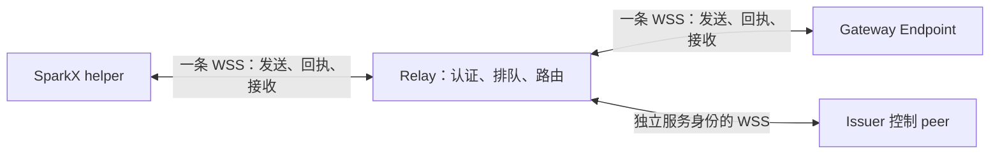

# ISCP 全双工 WebSocket 传输设计

语言：简体中文 | [English](../../docs/iscp-duplex-websocket-design.md)

日期：2026-10-19。状态：设计提案。源码基线：SparkClaw `cf9b81de`、ISCP fork `10fe37b3`（在上游 `47f1f6c` 上导入）；SparkClaw 依赖仍为 `v0.2.0-rc.1`。本方案新增 Relay 传输绑定，不修改核心加密信封，不代表已实现或发布。InfiniCenter 提案 0038 记录跨项目评审边界。

## 1 结论与范围

每个设备身份与一个 Relay 之间建立一条经过认证的常驻 WSS 连接，同时发送和接收 ISCP 信封。请求、响应、应用流事件、取消、加密会话握手和业务交付 ACK 均复用该连接。多个任务和端到端会话可以共享连接，不为每个任务重新连一次。桌面与 Gateway 分别连接 Relay，不是桌面直连 Gateway 的一条 socket。

在新部署的数据通路中取消 `POST /v2/relay/envelopes`，成套切换后退役旧的单向接收绑定，不自动回退 HTTP 发送。保留 HTTPS 发现、设备注册、access/Grant 续期、凭据恢复、管理接口和 WebSocket 建连握手，使没有有效 WSS 连接时仍可恢复身份。issuer forwarder 的 ISCP 信封也迁移到双工 WSS；其 Unix socket 事务接口仍属于本机控制面。模型供应商 SSE 和已接受的 JingSi Runtime HTTP binding 是独立接口。

保留现有应用流、原 UI 组件、普通 RPC 行为及正式结果 lookup/ACK。本期不增加通用字节流 API，不更换密码套件，不把连接层确认当作任务完成。

ISCP fork 负责 Relay、协议及 ISCP 认证/授权服务的开发维护。SparkClaw 继续作为独立客户端使用 ISCP 服务。全双工需要客户端连接适配与协议兼容，不要求仓库迁移、共享源码或使用同一发行提交。InfiniCenter 0040 中已取消的消费方源码/依赖迁移保持撤回。

### 1.1 已确认的发布与交付范围

2026-10-19 用户确认并随后扩大范围：升级当前整套 ISCP 服务链路，覆盖共享 Relay、当前 work1–work5 的 Gateway/节点 issuer、全部相关控制 forwarder/peer，以及连接这些服务的配套客户端。允许短暂维护，不保留旧客户端兼容，不自动回退 HTTP 发信封。部署前以实际服务、路由、身份和客户端清单核对完整性；本节规定发布范围，本次任务仍是补齐设计文档。

本期保留业务结果确认、查询与恢复，以及流式预览快照恢复。不会新增接收端持久收件箱、逐信封接收确认或补投保证。Relay 原有离线排队和写失败后的队列处理继续保留；同 ID 查询/去重是核对发送受理结果，不是要求接收端逐帧可靠交付。服务改动归 ISCP fork，客户端适配归 SparkClaw，独立构建后统一验收协议兼容性。

## 2 现有代码需要调整的地方

| 当前行为 | 设计要求 |
| --- | --- |
| `RelayClient.submit` 带 access 凭据与 HTTP PoP 发 POST，`RunOnceReady` 单独拥有接收 WebSocket | 合并为连接管理器，抽取可复用的信封受理服务 |
| Relay 认证后的 reader 只预期控制帧 | 增加 submit、query、重新认证的已认证分派器 |
| 接收回调可能再次调用 `Submit` | 回调不能在唯一 socket reader 上执行并等待发送确认 |
| `iscpnodecontrol.Peer.Run` 在开接收连接前调用 `begin` | 改为双工 READY 后才能发端到端 Hello，控制 peer 与桌面都要迁移 |
| PostgreSQL `StoreMessage` 遇同 ID 覆盖内容，消息和回执分两次写入 | 开启重试前必须补齐不可变去重和事务受理 |
| Relay 写 socket 成功后标记投递 | 保留这一有限含义；最终业务交付仍需原应用 ACK |

依据：[客户端](../../services/gateway/internal/iscpbridge/relay.go)、[Relay](../../services/gateway/internal/iscprelayreference/server.go)、[接收事务](../../services/gateway/internal/iscprelayreference/receive.go)、[控制 peer](../../services/gateway/internal/iscpnodecontrol/peer.go)。这些路径用于说明已核对的基线；后续服务实现按第 9 节归属 ISCP fork。仓储函数位于固定版本 ISCP 模块的 `pkg/server/repository/relay.go`。

## 3 连接拓扑与生命周期



本设计选定入口 `GET /v2/relay/duplex`，WebSocket 子协议为 `iscp.relay.duplex.v1`；它们尚非已发布公共能力。签名发现文档声明入口、绑定版本及编码后消息上限。客户端必须核对精确子协议，不能仅凭 HTTP 101 或旧的 `ready` 判定支持双工。

状态为 `DISCONNECTED → CONNECTING → AUTHENTICATING → READY → CLOSING → DISCONNECTED`。重新认证在旧权限仍有效时于 READY 内进行。普通凭据轮换/到期可进入最多 10 秒的 `REAUTH_REQUIRED`：仅允许重新认证，停止数据受理/投递；续期成功回到 READY，超时关闭。确认设备撤销或身份替换则立即关闭。健康连接没有固定最大存活时间或周期 drain。单次操作超时只结束该操作的等待。

Relay 分配随机 connection ID 和 owner generation。同一认证 domain/device 只有一个活跃 owner，这是防止竞争接收的所有权规则，不是请求额度。新连接替换旧连接时，围住旧的受理、投递和回调。受理提交与所有权/撤销切换必须有共同串行化点：切换前已受理的事务可以完成，旧连接不能在切换后开始新受理。首期参考实现面向单个活跃 Relay 进程；多副本必须实现跨进程同等所有权约束后才能宣称该保证。

## 4 帧协议

每个 WebSocket 文本消息包含一个严格 UTF-8 JSON 对象。SecureEnvelope 字段与密文字节保持原样；应用流帧继续位于现有加密信封内。传输控制受 WSS 和连接认证保护，不属于端到端任务回执。

| kind | 方向 | 含义 |
| --- | --- | --- |
| `challenge` | Relay → 端点 | connection ID、新挑战、选中的绑定版本 |
| `authenticate` | 端点 → Relay | access 凭据与绑定连接上下文的设备 PoP |
| `ready` | Relay → 端点 | 已认证 owner generation、权限截止时间、协商上限 |
| `submit` | 端点 → Relay | 传输 request ID、原 message ID、信封摘要及信封 |
| `accepted` | Relay → 端点 | 持久提交后的关联受理回执 |
| `rejected` | Relay → 端点 | 确认本次没有新增受理的关联拒绝 |
| `delivery` | Relay → 端点 | 发给认证接收方的原 message ID 与不透明信封 |
| `submit.query` / `submit.status` | 端点 ↔ Relay | 按原 ID 与摘要核对未知发送结果 |
| `reauth.request` / `reauth.challenge` / `reauthenticate` / `reauthenticated` | 双向 | 请求新挑战，用新 PoP 将续期凭据绑定到原 socket |
| `closing` | Relay → 端点 | 替换、到期、撤销、重启或协议失败原因 |

认证后帧带绑定版本与 connection ID。传输 request ID 只关联本连接内的交换；`message_id` 标识跨重连不可变的信封；加密正文内的业务 request ID、流 subscription ID 保持原义，Relay 不解析。版本化 schema 拒绝未知字段/类型、重复 JSON key、非法 UTF-8 和不安全整数。

保活使用原生 WebSocket Ping/Pong，不另造 JSON ping，不等待 Pong 后才发送正文。本版不增加接收端 `delivery.ack`：写 socket 仍只是传输投递尝试，不代表接收端已持久保存。若要增加持久接收箱和信封至少一次投递，应另行变更交付语义。

### 4.1 v1 格式、字段与版本规则

以下为本提案选定的 v1 规范，不是已发布能力。入口固定为 `/v2/relay/duplex`，子协议固定为 `iscp.relay.duplex.v1`。发现文档沿用原签名包装，在既有字符串型 `metadata` 中声明 `duplex_protocol`、`duplex_path`、`duplex_limits_sha256`；不要向严格的核心 descriptor 对象私加字段。客户端校验已固定信任的 Relay 签名、有效期和 HTTPS/WSS origin，再精确匹配子协议。首版只协商 v1，不猜测兼容版本。

所有帧必含 `v:1`、`kind`、`connection_id`；除初始 challenge/authenticate 外均含 `owner_generation`，ready 首次告知该值。connection ID、challenge ID 和 history ID 是 32 字节随机值的无填充 base64url；generation 为持久单调递增 uint64 的十进制字符串。客户端 request ID 为从 1 开始严格递增的 uint64 十进制字符串，响应原样回显；只允许同一重新认证交换的 request/response 复用该 ID，其他复用属于协议错误。连接更换后 request ID 可以重新从 1 开始，旧回执不能跨连接匹配。

以下表中的字段全部必需；`?` 表示按注明条件出现，不能用 null 代替缺省。各层对象拒绝未知字段、重复 key 和缺失字段。

| kind | 公共头之外的字段 |
| --- | --- |
| `challenge` | `relay_id, domain_id, challenge_id, challenge, expires_at, history_id, limits`；尚无 owner generation |
| `authenticate` | `request_id, challenge_id, access_token, proof`；尚无 owner generation |
| `ready` | `request_id, domain_id, device_id, authority_expires_at, history_id, limits` |
| `submit` | `request_id, history_id, message_id, envelope_digest, not_after, envelope` |
| `accepted` | `request_id, message_id, envelope_digest, receipt` |
| `rejected` | `request_id, message_id, envelope_digest, code`；仅表示本次尝试未新增受理，不证明此前从未受理 |
| `delivery` | `message_id, envelope_digest, envelope`；无传输 request ID，无接收端 ACK |
| `submit.query` | `request_id, history_id, message_id, envelope_digest, not_after` |
| `submit.status` | `request_id, message_id, envelope_digest, state, reason?, receipt?`；state 为 `accepted/expired/absent/unknown`，前两种必须带原 receipt，unknown 必须带 reason，其余条件字段不得出现 |
| `reauth.request` | `request_id`；客户端发起 |
| `reauth.challenge` | `request_id, challenge_id, challenge, expires_at`；服务端回应 |
| `reauthenticate` | `request_id, challenge_id, access_token, proof`；沿用本次 reauth.request 的 ID |
| `reauthenticated` | `request_id, authority_expires_at` |
| `closing` | `code`；初始认证失败时 generation 为字符串 `"0"` |

`envelope` 严格符合既有 SecureEnvelope v2 schema；Hello/Ready 也保留现有载体，不新建另一种明文任务通道。外层 message ID 必须等于内层，domain/sender/Relay 路由必须匹配认证上下文。令 `C` 为 fork 的 ISCP v2 canonical profile，`B64` 为无填充 base64url，则 `envelope_digest = B64(SHA256(C(envelope)))`。不要误用去掉 signature 的签名规范化函数来计算信封摘要。保留原信封字段和密文字节；JSON 空白/字段顺序不影响摘要。

`not_after` 是客户端首次入队时固定的绝对发送截止时间，随原信封保存；它与 history ID 一起属于不可变受理元数据，但不改动加密信封。首次受理要求服务端时间小于 not_after，且 not_after 不晚于当前时间加信封 TTL；`expires_at=min(not_after, accepted_at+ttl_seconds)`。重复提交不得更改 not_after，也不得重算 TTL。与已存记录匹配的查询/重复回执在过期后仍可返回，不再重新排队。

`receipt` 使用新的 `iscp.relay.acceptance.v1` 对象，字段固定为 `type, receipt_id, relay_id, domain_id, history_id, message_id, sender_device_id, recipient_device_id, envelope_digest, not_after, accepted_at, expires_at, signature`。receipt ID 为 16 字节随机值的 B64，signature 沿用 Ed25519 的 `alg/kid/value` 对象及 ISCP 签名规范。它由原持久 Relay signer 签名并原样持久保存；不能用会随投递改变 status 的旧 delivery receipt 代替。accepted 与重复查询返回同一份签名对象。

`submit.status` 通常回答 query；若 submit 的事务提交结果不确定，也可用同 request ID 返回 state=unknown，reason=`commit_unknown`。这不是 rejected。其他 unknown reason 固定为 `history_unavailable, legacy_record, barrier_timeout`，只能描述传输历史，不泄露其他主体记录。命中其他 sender 或同键不同摘要/截止时间时返回 rejected/code=`message_conflict`，query 同样适用。

### 4.2 编码、大小与错误处理

C 沿用 fork `spec/canonical-jcs-v2.md`：严格 UTF-8、按 Unicode code point 排序 key、Go JSON 兼容转义、无 Unicode 归一化；拒绝重复 key、孤立 surrogate、小数、指数、尾随 JSON/垃圾。帧数值限制为 0 至 9007199254740991 的整数；uint64 代次/计数器使用无符号、无前导零的十进制字符串，最多 18446744073709551615；0 仅用于明确标注的初次认证 generation。时间统一 UTC `YYYY-MM-DDTHH:MM:SSZ`。ID 等普通标识字符串非空且最多 256 个 UTF-8 字节，access token 最多 8192 字节，摘要解码恰好 32 字节，Ed25519 签名恰好 64 字节。各自核心 schema 的更严限制继续适用。

limits 对象固定为下列整数属性，challenge 与 ready 必须一致，并与发现声明的规范对象摘要一致：`max_frame_bytes=1114112`、`max_envelope_bytes=1048576`、`max_control_bytes=65536`、`max_ttl_seconds=86400`、`query_recovery_seconds=604800`。大小按重组后的 UTF-8 JSON 实际字节计量；控制帧指不含 envelope 的应用 JSON，不含原生 Ping/Pong。递归深度最多 16；submit/delivery 同时满足信封和整帧上限。队列另按实际可用资源约束。这些是首版发行配置，修改需重新声明并验收，不是累计调用或业务并发配额。

| 条件 | 返回与客户端动作 |
| --- | --- |
| 受理前信封、摘要或截止时间非法 | `rejected: envelope_invalid / digest_mismatch / deadline_expired`；本次不新增受理 |
| 当前连续历史内同键内容、sender 或截止时间冲突 | `rejected: message_conflict`；不返回原主体回执，不换 ID 重做业务 |
| 权限到期、发送方不匹配、受理前资源耗尽 | `rejected: auth_required / sender_mismatch / resource_exhausted`；已受理历史不受此结果否定 |
| 数据库 COMMIT 回答丢失或连接中断 | unknown；新连接按原 ID 查询；只有明确已回滚才可返回 `rejected: storage_unavailable` |
| 非法 JSON/字段/kind/版本、request ID 复用或连接/代次不匹配 | 尽可能发 `closing: protocol_error`，关闭 1002；非法 UTF-8 用 1007，过大消息用 1009 |
| 挑战过期、证明无效、已验证撤销/身份替换 | `closing: challenge_expired / authentication_failed / revoked / replaced`，关闭 1008；撤销不做普通重连恢复 |
| 维护或内部故障 | `closing: maintenance / internal_error`，分别关闭 1001/1011；未决发送全部保留为 unknown |

请求新入口但缺少或指定错误子协议时返回 HTTP 426、`transport_upgrade_required`，不进行 101 升级。退役的 envelope POST 和旧 connect 入口按第 10 节返回 HTTP 410。非法结构没有可信 request ID 时直接关闭，不能编造关联 rejected。关闭帧或 Ping/Pong 本身不是业务结果。

history ID 不匹配或历史不完整优先按第 7 节处理：query 返回 unknown/history_unavailable，新增 submit 在受理前返回 rejected/code=history_unavailable；不把它伪装为普通内容冲突。关联字段本身类型/编码非法则关闭 protocol_error，不回显违反 schema 的字段。仅认证状态 10 秒超时关闭 auth_required/1008；无法安全受理的队列耗尽关闭 resource_exhausted/1011，未决发送仍是 unknown。

## 5 认证与凭据续期

旧接收连接的设备证明不能直接获得新增发送权限。首次认证必须同时验证 access 凭据和设备持有证明，绑定同一 domain/device，检查当前设备状态及 Relay audience。PoP 对具有域分隔的规范上下文签名，包含绑定版本、入口路径、Relay ID、服务端 connection ID、新挑战和 access token 摘要；DeviceProof 原有 nonce、签发时间继续参与防重放与新鲜度验证。精确规范字节与向量见第 5.1–5.2 节，实施时转换为机器夹具。凭据不进入 URL、子协议名或日志。

每个 submit 对照已认证连接核验 sender，保留信封元数据校验。受理与投递检查当前本地权限、到期和已知撤销，不逐帧远程查询 issuer。数据库里的 access/设备变更必须失效本地状态，或在事务边界核验；不能确认当前权限时不受理新工作。端到端 Trust Grant 校验、应用流自身有期限的授权快照继续遵循各自规则。

通过原控制接口刷新 access，再在当前 socket 请求新挑战并重新认证。同设备、同权限续期只延长本地截止时间，不重建端到端会话、不丢 pending、不重开订阅。身份/scope/revision 改变则终止旧权限下的工作。迟到的续期成功不能覆盖撤销或后继连接。原权限到期仍未续上，就停止数据受理/投递；若 refresh 先失效旧 token、随后才挂接新 token，则进入有期限的仅认证状态，不给予数据权限宽限，也不能复活已撤销设备。旧排队工作继续前须按当前权限重新验证。重新认证不等于延长 Grant；恢复过程不能完全依赖已经过期的控制 peer WSS。

### 5.1 精确 PoP 字节与认证提交

复用现有 DeviceProof v2 结构和 Ed25519 设备密钥，不把新传输字段塞进严格的 proof schema。将完整连接上下文的摘要放入原 proof.challenge，使用以下唯一编码；所有字段必需，context 不包含 proof 或 signature，因而不存在递归签名：

```text
context = {
  purpose, protocol, method, path, relay_id, domain_id, device_id,
  connection_id, owner_generation, history_id,
  challenge_id, challenge, request_id, access_token_sha256, limits_sha256
}
access_token_sha256 = B64(SHA256(UTF8(access_token)))
limits_sha256 = B64(SHA256(C(limits)))
proof.challenge = B64(SHA256(
  UTF8("ISCP-RELAY-DUPLEX-AUTH-V1") || 0x00 || C(context)
))
signature_input = UTF8("ISCP-V2-SIGNATURE") || 0x00 ||
                  UTF8("iscp.device.proof.v2") || 0x00 ||
                  C(proof with the entire signature member removed)
proof.signature.value = B64(Ed25519.Sign(device_private_key, signature_input))
```

purpose 只能是 `authenticate` 或 `reauthenticate`；protocol、method、path 固定为上述子协议、`GET` 和原始入口路径。初次 owner_generation 为 `"0"`，续期使用当前 generation。其他值取自该 socket 的挑战、已验证身份、对应 request ID 以及实际提交的 token。新 token 按原始 UTF-8 字节取摘要，不加 Bearer 前缀、不 trim。proof.domain_id/device_id 与上下文一致，audience 等于 relay_id，kid 必须匹配服务端登记的设备公钥。receipt 使用相同签名输入规则，但对象类型为 `iscp.relay.acceptance.v1`，签名者为 Relay。

challenge 为 32 字节随机数，初次和每次续期均重新生成；challenge ID 同样随机。挑战仅在原连接、原用途内有效，10 秒到期，同一连接只允许一个未完成认证交换。proof.nonce 每次使用新的至少 16 字节随机值；issued_at 最多落后服务端 60 秒、最多超前 30 秒，且不能绕过挑战本身的 10 秒截止。服务端验证后原子消费挑战和 proof nonce，并在同一认证提交边界核验当前授权、安装 owner/租约。失败不能替换健康 owner；响应丢失后取新挑战或新连接，不复用旧 proof。

初次认证提交持锁递增持久 generation、隔离旧 owner，再发送 ready。同身份同权限的续期只更新租约，不重建端到端会话；权限/身份发生变化则关闭并重新建立授权上下文。到期后只处理重新认证、原生保活及关闭，排队数据与尚未写出的回执同样暂停，最多 10 秒后断开。Relay ready 只代表中继通道就绪，业务能力必须等端到端会话和业务授权也通过后才启用。

### 5.2 固定向量与认证恢复对齐

下面是测试专用 context 的规范 UTF-8 字节（代码块末尾换行不计入输入），token 为 `test-token`，limits 为第 4.2 节的固定值。期望 proof.challenge 为 `ztgbgIFC8M-jWkH-qAaODa7VVTNpPL73ut8RRKH7WxU`：

```json
{"access_token_sha256":"TF3Jt3CJBfd_Xl0WMWtd-0JeaMsybc1VqGDpCncHAx4","challenge":"AwMDAwMDAwMDAwMDAwMDAwMDAwMDAwMDAwMDAwMDAwM","challenge_id":"AgICAgICAgICAgICAgICAgICAgICAgICAgICAgICAgI","connection_id":"AAAAAAAAAAAAAAAAAAAAAAAAAAAAAAAAAAAAAAAAAAA","device_id":"device-test","domain_id":"domain-test","history_id":"AQEBAQEBAQEBAQEBAQEBAQEBAQEBAQEBAQEBAQEBAQE","limits_sha256":"JbOt-VgyDcLNvVMLYsuq6Af0zIB4X_Puotqmi0_mRY8","method":"GET","owner_generation":"0","path":"/v2/relay/duplex","protocol":"iscp.relay.duplex.v1","purpose":"authenticate","relay_id":"relay-test","request_id":"1"}
```

实施时必须据此产生机器可执行的 schema/签名向量，并补齐 wrong-purpose/path/token/connection/generation/limits、跨连接重放、挑战二次消费、错误 kid、重复 key、非法 Unicode、过期/超前时间、最大帧边界用例。该向量已核对摘要算法，不能据此宣称服务端验收完成。

与[认证和业务恢复设计](iscp-authentication-operation-recovery-design.md)保持共同边界：连接恢复使用新证明；旧 access/refresh 都失效时从独立 HTTPS 控制入口按原身份和当前长期授权恢复；控制续期的原操作编号保持，issuer/Relay 父子操作先对账。WSS proof 不进入业务操作语义摘要，也不改变原任务授权、期限或审批。此方案定义 WSS 的认证字节；独立 HTTPS 控制请求按该恢复设计绑定各自方法、路径和意图摘要，不能照搬 WSS proof。本次不扩展到旧业务请求迁移，也不假设仅改 WSS 就已实现完整业务恢复。

## 6 双向并发实现

每条连接使用一个 socket reader、一个普通数据 writer，以及独立的有界分派队列。reader 将 `accepted/rejected/status` 直接路由给传输 pending，将 `delivery` 放入端点处理队列。处理 worker 可以发端到端回复并等待受理，此时 reader 继续收确认；reader 内不执行业务/授权处理，不持连接锁等待回调。[Gorilla 并发约束](https://pkg.go.dev/github.com/gorilla/websocket#hdr-Concurrency)要求最多一个并发 reader 和一个并发 writer；`WriteControl`、`Close` 有单独的并发许可。

包括受理回执和投递在内的普通 JSON 都经同一个 writer。Relay 的 claim 事务必须等待真正写入完成后才能标记投递，放进 writer 队列不算成功。排队耗时计入既有有界事务/写超时；超时、失败或 owner 替换则回滚。

提供返回回执 future 的异步入队接口，以及等待 future 的同步兼容封装。流式生产者可流水发送多帧，不逐个 delta 等一轮网络 RTT；未确认字节按真实内存容量约束。流结束屏障检查此前发送结果；批次未知/拒绝则进入预览恢复，权威结果 lookup 独立进行。保存正式答案或发送业务 ACK 不等待预览完成。

同一端到端会话的 sequence 分配、加密和入队放入一个短串行流程，不持其锁等待 Relay 回执。队列保留该会话顺序；跨会话调度和传输控制优先级不能重排已经加密的同会话消息。Relay 的优先级选取和重连仍可能影响实际到达顺序，因此保留既有端到端防重放和应用流序号/缺口检查，不能用 WebSocket 有序替代。

队列饱和时，唯一 reader 不能阻塞等待一个需要它收确认才能腾空的队列。能在受理前拒绝的 submit 返回明确错误；否则以资源错误断开，将尚无结论的发送标记 unknown。不能静默丢弃后报告成功。原结果查询与预览快照恢复在既有权限规则下处理连接失败。

## 7 受理、幂等和未知结果

沿用数据库唯一域 `(domain_id, message_id)`，不可变绑定认证 sender、recipient、规范信封摘要、原到期时间和原受理回执。摘要对完整信封使用既有 canonical JSON 规则计算，不包含传输关联字段；规范化前先严格校验编码。

- 首次合法 submit 在同一事务保存消息及不可变受理回执，提交后才发 `accepted` 并唤醒接收方。
- 同 key、同 sender、同规范信封返回原受理回执，不延长到期、不改优先级、不重新排队已投递消息、不生成第二份回执。
- 同 key 但 sender、内容或路由不同则冲突拒绝，不泄漏其他发送方的回执。
- 已提交但回执丢失属于 unknown，不属于拒绝。恢复当前权限后用原 message ID 和摘要查询。
- `submit.status` 区分 accepted、expired、仍在完整保留范围内的 absent 与 unknown；保留期缺口不能当作未受理证明。去重墓碑至少保留到最大合法信封寿命加受支持重试/恢复期限，迁移保留旧身份与回执。

客户端在核对未知结果期间保留原编码信封和第一次尝试的截止时间。仅当原端到端会话、权限、截止时间均有效时重发完全相同的字节；不能因为受理回执丢失就换 message ID 或延长 TTL。会话已替换，或进程失去旧内存加密状态后，按应用持久保存的原 request ID 和 lookup/幂等契约恢复。传输层 absent 本身不能授权创建第二个业务操作。

写入开始后的调用超时可能已经在 Relay 提交，应返回明确 unknown-outcome。取消本地等待不撤回已发消息；只有确定写前取消或明确受理前拒绝才能证明本次未受理。三个含义必须分开：`accepted` 是 Relay 持久受理；写 socket 成功是传输投递尝试；业务 ACK 才是该应用定义的持久接收。不宣称网络 exactly-once。

### 7.1 持久模型与唯一受理事务

新增独立的不可变 admission 表，不复用会改变投递状态的旧 receipt 行。唯一键仍为 `(domain_id,message_id)`；字段包含 history ID、sender/recipient、规范信封摘要、not_after、accepted_at/expires_at、原签名 receipt，以及实现格式版本。消息队列只引用该键，投递状态单独维护。初次投递、GC、查询和重复 submit 均不能改写 admission 的内容或签名。正式部署要求 PostgreSQL 持久化；内存测试后端不能宣称 durable acceptance。

history ID 是持久受理历史的连续性标识，首次受控切换时生成并保存到 scope 状态行；正常重启、重连及兼容版本回退保持它。它不是设备身份、端到端会话或可由客户端选择的租户。旧记录仍按原键保留；没有足够历史证据的旧记录返回 unknown/legacy_record，不能伪造新 accepted，也不能覆盖后重新受理。

首次受理执行以下同一数据库事务，成功提交才返回 accepted：

1. 确认服务持有当前数据库 writer epoch，并确认该 scope 的历史连续且允许写入。
2. 按稳定顺序锁定相关 domain/device 权限与 owner 行，再取该 message key 的事务锁；所有 submit/query/撤销/owner 切换/claim 路径遵守相同锁序。不同 message key 可以并发，受理临界区只做有界数据库操作，不等待网络回执。
3. 锁内重新核验 token/设备当前状态、sender、generation、scope 及截止字段的编码；不能只依靠读取帧时的缓存。not_after 是否仍在未来仅约束第 5 步的新受理，不能提前阻止第 4 步查询旧回执。
4. 若键已存在，先核对当前调用方，再比较 history、摘要及 not_after：完全一致则读原 receipt；冲突则拒绝；旧/不完整历史则 unknown。重复返回不更新 TTL、投递状态或业务操作。过期仅阻止新增受理，不阻止有权调用方核对已有记录。
5. 新键严格校验信封后，在事务中同时插入不可变 admission、签名 receipt 和队列行。唯一约束冲突走同一比较分支，禁止 upsert 覆盖。保存首次时间和固定截止，数据库成功提交后才唤醒接收者。

崩溃发生在 commit 前，整笔事务回滚；commit 后回执丢失，重连读取同一 admission。数据库连接在 COMMIT 时丢失，仅凭错误无法判断是否已提交，必须标记 unknown，不能猜测 rejected 或立即换 ID。签名/写队列失败同样不能留下部分 accepted。锁等待和事务超过 5 秒时先终止本事务；确定回滚可拒绝，结果无法确认则 unknown。

撤销和 owner 替换也锁定同一权限行，所以“原事务提交”与“权限变更生效”有明确先后；已提交事实不会被撤销抹掉，之后的投递/回执披露仍检查当前权限。新进程接管必须提高数据库 writer epoch，旧进程的数据库角色/写会话被隔离；启动检查不能替代每次写入的 epoch 校验。

### 7.2 查询顺序与 absent 的有限含义

socket reader 对每个 message key 按接收顺序排 submit/query 到同一有界工作队列，回执 reader 和其他 key 不受其网络等待阻塞。query 必须越过该键此前所有 submit 的提交/回滚屏障，再在同一数据库锁序下读取。不能先读数据库空行，再让早先排队的 submit 提交。

新连接取得更高 owner generation 后，旧连接已持锁事务要先提交或回滚；旧排队任务重新核验 generation 时被拒绝。query 同时核验客户端带回的原 history ID。只有历史连续、屏障完成、当前身份有权查询，并且无 admission/旧遗留冲突记录时，才返回 absent。屏障超时返回 unknown/barrier_timeout，数据库恢复或 history 不匹配返回 unknown/history_unavailable。其他 sender 的键只返回统一冲突，不泄漏其 receipt。

| 查询结果 | 精确定义 | 允许的后续行为 |
| --- | --- | --- |
| accepted | 找到匹配的不可变受理记录，且服务器时间尚未到 expires_at；不表示已投递或任务完成 | 返回原 receipt；等待业务结果或按原操作查询 |
| expired | 找到同一记录，但当前时间已到 expires_at；过去可能已经成功投递 | 返回原 receipt；恢复业务结果，不重新排队 |
| absent | 在完整历史和已完成提交屏障下，此次查询的线性化时点无受理记录 | 仅在原 E2E 会话、权限及 not_after 仍有效时，可再提交原信封及原元数据 |
| unknown | 历史/事务结果/屏障无法证明上述状态 | 保留原编号并继续对账，或交给业务层恢复；不能自动创建替代业务操作 |

absent 不是永久“不执行”承诺。查询之后新到达的 submit 仍可受理，因此客户端不得一边查询一边为同一键创建不同尝试；重试只复用完全相同的信封和元数据。重连已替换 E2E 会话时，即使得到 absent，也按业务原操作编号恢复，不往新会话重放旧密文。传输层不提供业务 `not_started` 否定证明。

### 7.3 保留期、清理与历史缺口

信封最大 TTL 固定 86400 秒；客户端从第一次入队保存 not_after，不因断线、排队或重试延长。首版支持在原 not_after 后 604800 秒内查询未知受理结果；这一窗口不延长业务期限或现有 30 秒预览自动恢复窗口。超过窗口转业务结果恢复；若服务器仍保有完整记录，可以继续回答查询，但不会因此重新准入。

队列密文按原投递/到期规则清理。admission 的 ID、主体、history、摘要、原时间和签名 receipt 至少保存首次受理后 8 天，而且**只要该主体的受理命名空间仍开放就不删除这些去重证据**。首版不以固定日期自动 GC 墓碑。原因是既有信封没有签名的绝对创建时间：删除所有证据后，不能可靠区分旧 ID 重放和新提交。容量不足按真实存储压力拒绝新增受理，不能清空墓碑后继续宣称可去重。

由于唯一键是 domain/message ID，只有持久关闭整个 domain 的受理命名空间、隔离域内全部生产者并永久拒绝其请求后，才可按后续维护规则清理；单设备撤销不足以清理域内唯一键证据。关闭标记本身保留，禁止复用关闭 domain 来重新准入旧 ID。数据库曾恢复旧快照、缺失日志、迁移跳过记录或发现不完整历史时，标记历史不完整并停止相关 scope 新受理，查询返回 unknown。需要先恢复并核对真实历史；不能只生成新 history ID 或看到空表就恢复正常受理。本期不迁移旧业务请求，也不把历史缺口当成业务重做授权。

## 8 恢复、资源和时间参数

故障重连采用带随机抖动的指数退避，建议从 250 毫秒增至最多 5 秒，稳定 READY 一段时间后重置；健康流量没有冷却等待。传输重连独立于既有 30 秒预览自动恢复窗口，预览超时不终止原任务，也不重置其恢复期限。

首期保留真实 socket 丢失后重建端到端会话的现有保守行为，API 上分开 Relay 重连和端到端建会，未来恢复会话需明确另行支持。核对未知受理，按原 ID 恢复任务，在当前权限下恢复预览快照；旧连接迟到回执不能完成新连接的等待者。原连接内 access 续期成功不触发这条恢复流程。

建议参数：20 秒 Ping、60 秒没有有效 Pong 则失活、首次认证 10 秒、单次写入 5 秒；这些是待验收的设计默认值，不是测量值。代理空闲超时应高于保活间隔。限制按完整重组后的消息计量，包含元数据、转义和密文膨胀；旧服务端仅接收认证数据的 64 KiB read limit 不能原样套到新增 submit。声明编码后帧上限，保留既有信封大小和应用分块规则。首期关闭 WebSocket 压缩，密文无需再次压缩。

使用内存缓冲、pending 字节、数据库容量、文件描述符和写入期限做资源背压，不新增固定每分钟请求数、累计消息额度、健康连接轮换或业务并发配额。大对象继续走已有分块操作，避免整份附件占住唯一 writer。单 TCP 连接仍可能产生队头阻塞，不能单凭改成双工就承诺更低延迟。

## 9 实施归属

| 归属 | 改动 |
| --- | --- |
| ISCP fork | 维护 Relay、协议规范/schema/codec 和 ISCP 认证/授权服务，包括 issuer/控制 peer 恢复；在此实现双工受理、原子持久化及重复/query 夹具 |
| SparkClaw 连接适配 | 按约定的线上协议使用 fork 的服务；适配客户端连接生命周期、READY 后 Hello、异步发送和未知结果处理 |
| SparkClaw 应用 | 接入客户端传输结果，保留 Agent/业务逻辑、任务权限检查、业务结果 lookup/ACK 及存储 |
| SparkX | 按需适配 helper 的客户端连接；保留 IPC 流事件和原 UI、历史、草稿、审批、附件、结果交付 |
| Relay 运维及托管消费方 | 验收独立构建的服务/客户端发行版本的协议兼容性，确认发现声明、反向代理、升级范围及旧入口退出 |

两个仓库通过版本化服务接口交互，独立构建和发布。使用 fork 的服务，不要求 SparkClaw 引入其 Go 模块、使用同一提交、共享 workspace 或复制服务源码。是否复用 SDK 是单独的实现选择，不是本方案前提。SparkClaw 的应用权限检查消费 ISCP 授权结果，继续属于其业务行为；ISCP 授权服务实现由 fork 维护。

此次归属澄清不恢复已取消的 SparkClaw 源码删除、依赖及构建迁移。服务修改在 fork 实施，SparkClaw 只做必要的客户端连接适配。本提案不修改已接受的 JingSi/IMMS 契约。

## 10 切换与回退

### 10.1 全量服务清单与维护窗口

用户最终选择的是当前全部 ISCP 服务，不再限定 work2。发布清单覆盖共享 Relay/数据库写入者/代理入口、work1–work5 的 Gateway 与 issuer、全部 forwarder/control peer，以及各节点的桌面/helper 消费方。记录组件版本、协议版本、服务路由、身份、公钥 pin、数据格式读写范围和二进制摘要；两仓可使用不同提交。不得仅升级 work2 后在共享 Relay 全局关闭旧协议。离线客户端再次连接时也必须升级。

1. 根据本设计形成可执行 schema 和正反例，在 InfiniCenter 完成接口接受记录；fork 与客户端分别实现并固定发行清单。自管 fork 部署不以官方上游采用本协议为前提，也不修改官方托管平台的契约。
2. 在隔离 PostgreSQL 和独立构建的服务/客户端上验收完整组合，主动阻断全部 envelope POST，包括 Hello/Ready、控制 peer、重连和轮换。核对原 UI、配置、身份及业务数据保留。
3. 进入短暂维护：停止新业务提交及旧信封受理，暂停生产者，按原任务契约处理在途任务；不清空 pending、不自动重做副作用。等待有界数据库事务结束，对未明结果登记原 ID；超时不等于已排空。
4. 关闭旧 socket，停止全部旧 Relay 写入者与相关控制发送者，提升 writer epoch，撤销旧程序数据库写权限并终止遗留写会话。确认没有旧后台任务继续写后，执行增量数据准备、建立 history 连续性记录及数据库写保护。保留旧队列、回执、身份、凭据、任务和原编号，不导入或重新签发旧业务请求。
5. 安装全部兼容服务与客户端，再开放独立控制恢复、双工认证和原业务结果查询。核对各节点双向通信、原任务对账和恢复后，再开放新业务提交。全部服务生产者完成升级才能结束维护；未升级客户端只收到升级要求。
6. 同步发布签名发现声明和新入口。旧 `POST /v2/relay/envelopes` 和 `GET /v2/relay/connect` 返回 HTTP 410，响应固定为 `{"code":"transport_upgrade_required","protocol":"iscp.relay.duplex.v1","path":"/v2/relay/duplex"}`，不处理信封、不颁发发送权限、不升级旧 socket。保留 HTTPS 身份控制、管理及 WebSocket 握手。

旧队列仍按原 TTL 和现有交付规则处理，不重新排队已投递信封，也不将旧回执改写为新 acceptance。旧 E2E 载荷无法继续消费时，端点按原业务 ID 恢复结果/订阅；不能重加密后作为新业务执行。维护允许连接暂断，不授权丢弃任务、回退数据库或更换身份。

### 10.2 数据库写保护与兼容证明

数据库保存所需 writer format、writer epoch、history 连续性和激活状态。启动检查之外，还必须通过数据库角色权限和受控写函数/触发器强制执行：旧角色不得向双工范围写入；admission 不可改写；旧 `StoreMessage` upsert 不能覆盖受保护 message key；GC 和投递状态变化仅走专用路径。不能假设旧程序会检查新版本字段。暂停/回退时同样隔离旧写入者。

兼容回退包必须能读当前 schema/receipt/history，保持原子受理、同键冲突拒绝、提交不明查询、当前身份/撤销/凭据 generation，以及当前格式的任务和恢复记录。验证不止于“能启动”：用新格式建立已受理、已过期、已投递、unknown 和轮换中状态，再换候选包核对原字节、唯一性及权限。实际旧二进制向受保护测试库写入必须被数据库拒绝。

### 10.3 回退矩阵与停止条件

| 时点 | 允许的恢复动作 | 禁止的动作 |
| --- | --- | --- |
| 新协议尚未开放且没有任何新格式业务/控制写入 | 核对格式兼容及原数据后可中止切换，恢复原整套版本；这是上线前中止 | 仅凭没收到 accepted 就断定没有提交 |
| 已产生双工受理或新认证/恢复格式记录 | 仅使用上节实测的双工兼容组合，保留旧客户端退役状态和当前数据库 | 运行原 HTTP/upsert 实现、降级凭据记录或重新开放旧客户端 |
| 没有通过验证的兼容包 | 保持维护，用兼容恢复工具对账，修复当前实现后继续发布 | 清空账本、解除写保护或恢复旧数据库快照来恢复在线 |
| 历史缺失、未知提交未对账、身份或回执检查失败 | 停止相关 scope 新受理并保留证据，按第 7 节恢复历史 | 用新 history/message/device ID 掩盖旧操作 |

回退只替换经核对的软件和配置，保留最新持久数据库、私钥、设备、公钥 pin、凭据轮换结果、业务任务及原操作编号。新连接使用新 proof 并检查当前权限，不恢复已撤销权限。产生新格式写入后，不承诺可以退回基线 `10fe37b3`/`cf9b81de`；实现验收前也不宣称已存在可用的兼容回退包。本节规定未来发布操作，本次不执行部署。

## 11 验收门槛

| 场景 | 必需证据 |
| --- | --- |
| 真正双工 | 同一认证 socket 在双方操作尚未完成时同时收发；请求、答案 delta、反向调用与 cancel 可并行 |
| HTTP 取消 | envelope POST 为零，包括 Hello/Ready、控制 peer、重连、凭据轮换；允许的控制 HTTP 单独统计 |
| 仓库独立 | fork 服务与 SparkClaw 客户端分别构建，按声明的协议版本互通，不依赖跨仓源码路径或同一提交 |
| 编码与认证向量 | 第 5.2 节逐字节摘要相同；错误用途/token/path/代次/limits、跨连接 proof 和重复挑战均拒绝；所有帧按第 4 节严格解析 |
| 大小与截止边界 | 1 MiB 信封和 1088 KiB 整帧边界分别验证；超过上限拒绝，固定 not_after 不随重试增长 |
| 查询提交竞争 | 同连接先 submit 后 query、旧连接未完成 commit 后新连接 query、COMMIT 回答丢失、锁超时均不产生错误 absent |
| 清理与历史连续性 | 8 天后开放命名空间墓碑仍可核对；旧快照/缺日志返回 unknown 并禁止新受理；关闭标记不能被身份复用绕过 |
| 全量切换 | Relay、五节点及全部控制 peer/配套客户端清单完整；维护后旧 POST/connect 返回 410，新入口缺少子协议返回 426 |
| 回退写保护 | 实际旧程序不能 upsert 双工记录；兼容包保留 receipt、身份、凭据 generation 和任务；无兼容包保持维护 |
| 交付语义不扩大 | 接收端无逐信封 ACK/持久收件箱；故障后只按原业务结果确认和恢复规则处理，不宣称逐帧无丢失 |
| 读写行为 | 回调发送并等待受理无死锁；普通 writer 无并发竞争；流式每批不串行等待一次回执 RTT |
| 故障点 | 写前、写中、数据库提交后、回执发出前断线；无错误判拒、改信封重放或业务重复执行 |
| 幂等持久化 | 原样重放返回原回执，冲突不改数据，消息/回执事务通过 PG 重启，保留期缺口返回 unknown |
| 权限 | sender 不匹配、伪造/重放证明、到期、撤销、owner 替换、迟到重新认证均在双向受围栏约束 |
| 替换与背压 | 旧 owner 越界后不能受理/投递；writer 堵塞回滚 claim；队列耗尽不造成确认处理死锁 |
| 长连接 | 超过 55 秒、空队列、实际凭据轮换及网络中断，无健康强制重连、goroutine 泄漏或 pending 无界增长 |
| 原有体验 | 原菜单、消息气泡、滚动/选区、邮件、附件、审批及取消保留；一次权威结果保存及幂等最终 ACK |
| 性能 | 与原流验收相同生产源/RTT：20 组 600 字、6,000 字长文，源到绘制 P95 ≤ 300 ms/P99 ≤ 500 ms；另记发送到受理和 DB 耗时 |

## 12 协议依据

[RFC 6455](https://www.rfc-editor.org/rfc/rfc6455)定义建连握手、双向 WebSocket 消息、子协议协商和控制帧；上述应用复用、持久回执及重连恢复属于 ISCP 设计选择。[Gorilla WebSocket](https://pkg.go.dev/github.com/gorilla/websocket#hdr-Concurrency)提供实现并发约束。既有[应用流设计](iscp-application-stream-design.md)及[实现说明](iscp-application-stream-implementation.md)继续作为业务流式基线。
