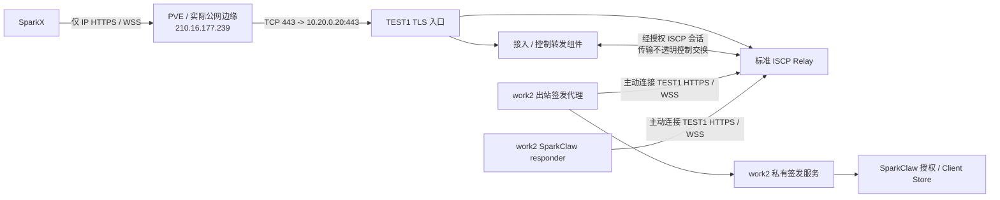
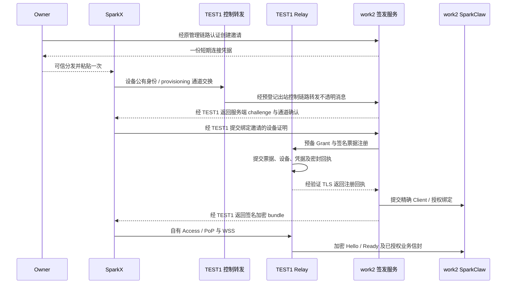

# 公共 ISCP Relay 与 SparkClaw 服务端凭证签发设计

> 语言：简体中文 | [English](../../docs/public-iscp-relay-node-issuer-design.md)
>
> 日期：2026-10-12。状态：本次部署及要求的验收已完成。TEST1 公网 IP HTTPS/WSS、work2
> 私有签发服务及 responder/控制 peer 已部署。原生 `16b00f17` 通过精确 Client
> 迁移/默认 Main 冷启动、原 UI/数据、新鲜授权/同 Grant 轮询修复、E 模型/
> 本机 ACK 与原界面撤销/冷启动拒绝；Linux/真实 PostgreSQL 及桌面测试通过。
> D 未确认原提交保持、不回放；最终 E 服务端/本机 ACK 一致性与六条撤销
> 配对检查点均通过。
> TEST1 是唯一新增公网应用入口；不使用域名，不新增 work2 开放端口。
> 执行负责人：本会话 Codex。当前服务端源码为 `3a9c2535`；后续桌面重试修复
> 单独记录于[执行记录](public-iscp-node-deployment.md)。

## 1. 目标与范围

通过 PVE 开放 TEST1 的 ISCP Relay，在 work2 的 SparkClaw 服务端配套部署凭证
签发服务，让全新 SparkX 只需粘贴该 SparkClaw 签发的一份连接凭据即可接入。
测试部署沿用在线 Relay 的协议与授权要求，不启用匿名注册、仅 bearer 投递或
专用测试协议。

SparkX 负责呈现与桌面本地数据；work2 负责业务执行、Owner/Client 授权与签发；
TEST1 保存自身 Relay 权限并转发加密信封。独立 TEST1 控制转发组件
加密接入及生命周期交换路由至 work2，不持有 work2 Grant 签名私钥或
SparkX 到 SparkClaw 的业务会话密钥。PVE 负责入口路由和虚拟机隔离。
[架构](architecture.md)、[现有 ISCP 联调](desktop-iscp-connection-design.md)与
[能力及授权设计](desktop-iscp-capability-expansion-design.md)继续约束数据归属、
权限和业务恢复。

**本次不设计、实施或验收 work2 的局域网客户端连接；保留现有 LAN 连接功能、
入口、监听与行为，不关闭。** work2 访问 TEST1 的服务器间连通是独立的基础
设施依赖，不等于局域网客户端验收。不得删除 HTTPS 适配器、改动其默认行为，
也不得将其用作 ISCP 业务的静默回退。

### 1.1 自托管签发权限与设备管理

work2 独立服务承担本部署所需的签发与设备授权管理，替代这条连接流程对
InfiniMesh Cloud 的依赖。复用现有 SparkClaw deployment/Owner/Client 权限，
不另建账户系统或第二套业务后端。独立进程、签名密钥与私有状态使签发具备
明确生命周期，与 Gateway 配套运行。出站控制代理属于该服务，无需成为
work2 的第三个守护进程。

| 职责 | 权威与持久化状态 |
|---|---|
| Owner 批准接入与设备管理 | work2 签发服务：待兑换邀请、公有设备密钥、精确 Owner/Client/installation 绑定、scope、授权修订、过期/撤销与脱敏审计 |
| 业务执行与 Client 归属 | 既有 work2 SparkClaw Gateway/Client Store，继续作为业务授权事实来源 |
| 业务 Grant 与 provisioning bundle | work2 签发服务，固定独立 Grant/bundle 签名身份 |
| 邀请验签权限 | TEST1 配置 work2 接入 signer 的公有身份；私钥保留 work2，用途与 descriptor 签名区分 |
| Relay 传输注册 | TEST1 Relay：设备记录、票据消费、Access/Refresh 轮换、PoP 重放记录与密文队列 |
| Relay Access/Refresh | TEST1 Relay 为 SparkClaw、每台 SparkX 和各控制 peer 分别签发及轮换 |
| 不透明控制转发 | TEST1 控制组件：已批准节点路由及有界转发回执，不持有 Grant 签发权 |

注册 SparkClaw 不会同时注册 SparkX，也不把 SparkClaw 的 token 交给它。
两端分别完成接入、密钥持有证明和 Relay 凭据获取；SparkX 还需访问选定
SparkClaw responder 的业务 Grant。实际 work2 responder 与两端控制 peer 现已
登记，分别持有自己的凭据；独立验证设备 A、B 已经由公网入口访问真实 work2
后端，A 随后主动撤销，B 继续可用。原生重启和既有安装迁移仍需单独验收。

## 2. 主机与管理边界

下表为用户提供的环境信息。修改网络前须核实 VMID、实际 PVE 节点名、接口、
路由及既有转发规则。密码和 API ticket 只通过操作员安全渠道提供，不进入本文、
Git、脚本、命令参数或验收材料。

| 主机 | 身份 | 地址与访问方式 | 职责 |
|---|---|---|---|
| PVE | 管理员 `root@pam`；realm 为 `pam` / Linux PAM standard authentication | [管理入口](https://210.16.177.239:8006) | VM 管理、实际公网边缘转发及相关防火墙规则 |
| TEST1 | VMID `100`；虚拟机账号 `ubuntu` | `10.20.0.20`；`ssh -p 22020 ubuntu@210.16.177.239` | 公共 Relay、TLS 入口、Relay PostgreSQL 与 signer，以及独立控制转发组件 |
| work2 | VMID `104`；虚拟机账号 `ubuntu` | `10.20.0.23`；`ssh -p 22023 ubuntu@210.16.177.239` | 现有 SparkClaw 后端及其签发、接入授权服务 |
| SparkX | 独立桌面设备与安装身份 | TEST1 的 IP HTTPS/WSS 入口，以及连接凭据携带的签发身份 | 本机生成私钥、接入、传输、本地持久化与原工作台界面 |

`root@pam` 是 PVE 管理身份，不是应用用户或签发凭据。保留 PVE `8006`、两条
SSH 映射和全部已有 work2 业务路由；上述信息不代表 PVE 自身 SSH 使用任一
虚拟机 SSH 端口。参见 [PVE 身份认证说明](https://github.com/proxmox/pve-docs/blob/master/pveum.adoc)。

## 3. 拓扑与端口

唯一新增公网应用映射指向 TEST1。work2 的两个代理主动连接同一公网入口；
签发服务通过加密控制转发抵达，不向客户端提供 work2 监听入口。

| 公网或虚拟机端口 | 已部署目标 | 开放范围与用途 |
|---|---|---|
| 公网 TCP `443` | TEST1 `10.20.0.20:443` | Relay HTTPS/WSS；先检查是否已有映射或监听占用 |
| 公网 TCP `8006` | 原 PVE 管理服务 | 保留管理访问，不承载应用业务 |
| 公网 TCP `22020` | 原 TEST1 SSH 映射至虚拟机 `22` | 保留 |
| 公网 TCP `22023` | 原 work2 SSH 映射至虚拟机 `22` | 保留 |
| TEST1 回环 `55117`、`5432` | Relay 进程与数据库 | 不做公网转发 |
| work2 本机签发 IPC | 既有或仅本机服务适配器，须经实际盘点 | 由出站代理调用；不新增 VM 入站或公网端口规则 |
| work2 已有业务与 LAN 端口 | 原配置 | 保留，本设计不重新分配或验收这些连接 |

若公网 `443` 已分配，保留原映射并明确选取可用的 Relay 入口端口，配套更新
全部对外地址及新签发凭据。不分配另一个 work2 应用映射。既有 work2 管理、
业务及 LAN 路由保留，但不属于 SparkX 的新增连接链路。

唯一应用入口为 [TEST1 HTTPS](https://210.16.177.239)，WSS 地址为
`wss://210.16.177.239/v2/relay/connect`。不使用域名。连接凭据携带该入口、
公有 TLS 信任材料及逻辑 work2 签发/控制身份，不携带 work2 直连 URL。

## 4. PVE 端口转发设计

防火墙允许某端口不等于建立目的 NAT 映射。单公网 IP 配合私网虚拟机时，须
确定真正持有该公网 IP 的边缘设备、转发规则和回程。PVE 可能直接负责，也
可能位于其他路由器之后；单独添加 PVE GUI 防火墙规则不能代替上游路由配置。
参见 [PVE 网络说明](https://github.com/proxmox/pve-docs/blob/master/pve-network.adoc)。

操作前记录 PVE 节点、虚拟机网卡/网桥/VLAN、网关、WAN 接口、IP forwarding、
NAT 所属层、实际 nftables/iptables 与 PVE 防火墙实现、规则持久化机制、端口
占用及主机/VM 过滤状态。将现有规则和配置保存到私有检查点。沿用当前网络
机制，不猜测 `vmbr0`，不混用防火墙引擎、不清空规则、不关闭防火墙；保持
控制台恢复与管理会话可用。

目标规则语义如下：

1. 仅新增公网 TCP `443` 到 TEST1 `443` 的转发，不添加 work2 应用映射。
2. 在实际主机/网桥/VM 过滤层允许对应新转发连接及已建立连接回包，并在虚拟机
   内允许 TLS 监听。只放行宿主机 `INPUT` 不足以开放虚拟机转发。
3. 保留既有出站 NAT 和回程。仅在观测到的路径需要时增加源 NAT，精确限定
   来源、目标与端口。
4. 使用实际配置机制持久化带明确归属、可幂等应用的规则，给出逐条删除和恢复
   方法。评审后在控制台可恢复的条件下应用，立即核验管理入口。

work2 主动连接规范的 TEST1 IP HTTPS/WSS 入口。检查实际边缘是否提供所需
回程/反射；任何精确限定的反射属于 PVE 传输基础设施，不属于 work2 入站监听
或 LAN 客户端功能。不得改为 HTTP，或使用证书不匹配的私网 IP HTTPS 地址。
遵循实际 [PVE 防火墙配置](https://github.com/proxmox/pve-docs/blob/master/pve-firewall.adoc)。

## 5. TLS、信任与公网接口

TEST1 当前使用 IP 自签证书，部署记录中的到期时间为北京时间
2027-01-10 11:49:21。保持 TLS 校验；初始测试通过可信连接凭据和 work2
操作员配置分发公有证书/指纹。本次不使用域名、不增加证书验证公网端口，
也不配置 work2 独立公网证书。IP 证书须在到期前续期，经已验证通道或新
Owner 凭据分发替换信任材料，并明确身份连续性。不得关闭 TLS 校验或静默
信任未知替换证书。

保留 WSS Upgrade 头、有界代理/连接超时、合理读取超时、关闭响应缓冲及受限
信封大小。可信入口须覆盖来源转发头，不采信客户端自报来源 IP。
参见 [Nginx WebSocket 代理](https://nginx.org/en/docs/http/websocket.html)。

| 接口范围 | 对外行为 |
|---|---|
| TEST1 发现 | `GET /.well-known/iscp/relay`，返回签名身份与正确公网地址 |
| TEST1 传输 | 标准信封提交、WSS、访问凭据刷新和撤销，保留各自认证要求 |
| TEST1 注册 | 标准 actor 授权 bootstrap，或正确配置的签名票据接入；不增加测试绕过 |
| TEST1 管理 | `/v2/relay/admin/*` 与 metrics 保持私有 |
| TEST1 接入/控制入口 | 版本化 SparkClaw 应用转发接口，将已证明、有界的操作路由至选定 work2 签发服务，不提供签发服务直连 URL |
| work2 Grant 生命周期 | 通过已认证出站代理到达私有签发/授权逻辑；结果保留固定 work2 签发身份的签名 |
| work2 管理 | 既有 Owner/admin 接口或本机管理；不新增凭据创建、权限、密钥及审计公网入口 |

Relay 只声明真正实现的可选生命周期能力；Relay access 不等于工作台 Grant，
独立签发服务仍是 Grant 权威。标准传输行为见
[Relay 规范](https://github.com/Infinimesh-ai/ISCP/blob/47f1f6c231c56c92eff6b6c5d398e037ebcf9602/spec/relay.md)。
用户指定的 [ISCP 项目](https://github.com/Infinimesh-ai/ISCP)是协议与服务基准。
README 介绍参考服务和一致性工具，并未指定固定厂商入口。以项目公开接口为
基线，不虚构托管服务地址，也不将应用转发解释为 ISCP 标准端点。

| 凭据或密钥 | 存放位置与边界 |
|---|---|
| PVE/虚拟机登录信息 | 操作员安全渠道 |
| Relay descriptor signer | TEST1 私有持久存储，服务重启保持稳定 |
| Relay actor/admin 权限 | 受信任服务端注册适配器，不进入 SparkX 或可粘贴凭据 |
| work2 Grant 签名私钥 | work2 签发服务私有存储，不进入 TEST1 |
| 注册授权方公有身份 | 由对应接入验证器固定，与 Relay descriptor/业务 Grant 的签名用途区分 |
| SparkX 设备私钥 | SparkX 本机生成、保存在原生安全存储，不由 work2 发放 |
| 每个 peer 的 Relay access/refresh | 该 peer 受控存储，不把 SparkClaw 的副本交给 SparkX |

TLS 证书更新不轮换 Relay 或签发 signer。复制的公钥本身不能建立首次接触
信任，须结合经验证的 TLS 和可信连接凭据中的预期身份。动态 descriptor 哈希
包含有效期时间，不能将其当作不变的 signer 锚点。

## 6. work2 签发服务与注册授权

### 6.1 经 TEST1 到达私有签发服务

work2 签发代理以操作员批准的身份登记，经既有 Relay HTTPS 提交与 WSS 接收
接口主动建立出站连接。TEST1 独立控制转发组件使用自己的已注册设备身份，
建立 work2 批准、仅允许接入/生命周期转发的会话，使用独立应用权限，例如
`sparkclaw.issuer.control.v1`。该控制权限不授予普通
工作台业务操作。两端密钥与会话状态独立于 Relay 进程及 SparkX–SparkClaw
业务会话。

初始控制链路由操作员配发：先注册两个控制 peer、固定其身份、建立受限控制
授权，再允许桌面兑换。此过程不能依赖尚未兑换的 SparkX 凭据或 SparkX
直连 work2。

转发组件只在 TEST1 HTTPS 接受版本化、白名单应用控制请求。已实现的应用路径为
`POST /api/sparkclaw/iscp-control/v1/exchange`；版本化封装携带 issuer/deployment
路由、稳定 operation ID、步骤、设备公有身份/证明及不透明配发/生命周期帧。
修改前以已实现的应用契约/测试固定字段类型、错误码、重放规则及密码 transcript
绑定。这是版本化 SparkClaw 接口，不是 ISCP 标准路径。不将 `/v2/relay/connect` 改为任意
WebSocket RPC，也不修改标准信封/证明流程。选定签发身份只能解析为操作员
批准的节点路由。每次操作绑定 issuer、deployment、输入摘要、设备及期限，
限制未完成请求数并执行限流；不接受调用方指定上游 URL，也不提供通用 TCP/
HTTP 隧道。

该组件经受限控制会话将客户端 provisioning 通道消息转发至 work2，并返回
加密、由 work2 签名的结果。TEST1 不获知 bootstrap secret 或最终配发明文；
公开路由/证明元数据不属于业务数据。work2 代理只调用本机私有签发适配器。
代理离线时返回明确的暂不可用错误，保留原持久化操作，重连后重放同一操作。
不允许 work2 直连回退、替代 signer 或向 TEST1 转移签发权。

签发能力发现与续签沿同一已认证转发链路，保留 work2 的签名、证明及幂等校验，
仅声明已验收能力。既有 ISCP 可选生命周期端点只有在其请求、错误与元数据
语义通过一致性验证后才可开放；不支持的能力保持缺省。应用控制转发不声明
为新增 Relay wire 能力。

已部署桥接是 Relay 旁的独立应用/平台适配器。上游参考 Relay 本身不提供
远端签发转发；普通 ISCP 客户端保留原标准 wire 入口及认证。

### 6.2 签发与 actor 授权

签发服务配合 work2 的 SparkClaw 生命周期部署，持有私有可写状态、备份和
独立固定的签名身份。保留业务执行、Owner/Client、模型/TLS 配置及已有凭据。
仅允许已认证 Owner 创建连接凭据，以及已证明、已授权设备兑换，不提供任意
公网 Grant 签发。

本部署先以操作员 actor 授权 bootstrap 稳定的 SparkClaw responder，作为
已授权邀请设备。后续 SparkX 使用签名 `iscp.pairing_ticket.v3` 加入，固定
`purpose=invite`、应用 consumer role 为 `sparkx_workbench_client`、audience
为该 SparkClaw 设备、permission 为 `sparkclaw.workbench.v1`。角色名称是
应用政策，ISCP session initiator 不自动等于接入 controller。签发前须针对
真实 Owner 与已注册邀请设备验证邀请权限，不对每台加入的 SparkX 重新走
bootstrap，也不反转 Grant audience。SparkX 自行生成以 ticket ID 为 challenge
的证明，服务端原样转发，不冒充设备。

当前参考服务以操作员 token 表示 actor 权限。Relay admin token 保留 TEST1；
初始 responder bootstrap 经操作员适配器，使用服务端生成、存储并设定期限
的 challenge，结合 peer 独立生成的证明与 actor 权限。后续控制 peer 使用
角色匹配、操作员批准的服务邀请；不将 ticketless bootstrap 用作加入设备的
捷径。work2 日常签发进程和 SparkX 不获取全局 Relay admin
token。常规客户端接入使用配置的邀请 signer 及签名票据路径，先完成
`TicketIssuer` 配置、事务式持久消费与跨重启负例，再开放兑换。未就绪模式
保持拒绝。上述角色边界依据
[ISCP provisioning](https://github.com/Infinimesh-ai/ISCP/blob/47f1f6c231c56c92eff6b6c5d398e037ebcf9602/spec/provisioning.md)。

工作台 Grant 保持当前方向：

| Grant 绑定 | 必须满足 |
|---|---|
| Subject | 正在接入的 SparkX 设备 |
| Confirmation | 该 SparkX 设备公钥指纹 |
| Audience | 选定的 work2 SparkClaw responder |
| 权限载体 | 现有 `sparkclaw.workbench.v1`，应用操作 scope 另行检查 |
| Relay 约束 | 选定、已验证的 Relay ID |
| 授权 | 精确 deployment/Owner/Client/installation 与当前撤销修订 |

不能套用 agent 邀请模板反转方向，不能在续签时扩大权限，也不能将传输注册
当作读取业务数据的授权。应用角色以现有
[工作台校验器](../../services/gateway/internal/iscpworkbench/config.go)为参考。

### 6.3 私有签发实现与权威记录

在 `services/gateway/cmd/iscp-node-issuer` 增加节点签发入口及签发、控制转发、
持久操作包。复用 ISCP identity/trust/provisioning 原语及现有业务授权服务，
不将固定设备对的 `iscplocalissuer` 改为任意签发接口。源码属于本 SparkClaw
仓库；TEST1 控制/注册持久化适配器及必要参考服务 patch 版本化、另行打包，
记录固定上游修订、patch 摘要和可复现构建清单。上游 ISCP wire schema 固定。

work2 实际 unit 为 `iscp-node-issuer.service`，二进制位于
`/opt/sparkclaw-iscp/bin/iscp-node-issuer`，私有状态根目录为
`/home/ubuntu/.local/share/sparkclaw/public-iscp-node`。它调用原 Gateway 的
受限 Unix 管理适配器，自有管理 socket 为 `issuer-socket/issuer.sock`，不监听
虚拟机网络。精确配置、注册表和配对回滚路径见执行记录。

work2 签发操作/回执使用 PostgreSQL 持久存储，数据库账号/schema 仅拥有必要
权限。业务 Client 与授权记录通过既有 Gateway store 接口访问；扩展接口时
同时实现 memory、file 与 PostgreSQL。Client 的 Owner/scope/撤销不在独立
签发账户库重复维护；签发记录引用权威修订，以事务预留与对账协调。

持久记录包括邀请、设备绑定、预备 Grant、兑换操作、续签/恢复尝试、加密
结果回执、撤销任务和审计。数据库约束保证单次邀请消费及设备/密钥唯一绑定。
保存 bootstrap secret 的验证材料；仅在建立密码通道确需原 secret 时，以
独立受保护存储密钥加密保存。不记录 secret，也不明文保存可粘贴凭据。
操作回执、待完成通道/wrap 私钥及暂存 Relay 凭据加密保存并限制访问。发布前
明确有界保留、垃圾回收和配对备份；未知操作及撤销 tombstone 不能仅靠 TTL
清除。

使用独立稳定的邀请和 Grant/bundle 签名密钥，明确公有用途与验证配置；两者
均不是 Relay descriptor signer 或客户端密钥。已实现的私有应用运行时采用
schema 2、`mode=node-managed`、显式 issuer/控制路由、TLS 信任及多 peer
注册表引用。旧 local-test schema 继续沿原校验路径读取；这是应用配置版本，
不重新命名 ISCP wire 对象或自动迁移信任。

首轮至少支持同一既有 Owner 的两台独立 SparkX。存储及调用继续隔离 Owner；
邀请不根据客户端输入创建或选择另一个 Owner。

### 6.4 Relay 注册事务与丢响应恢复

消费票据前，work2 验证已 ready 的 provisioning 通道与设备证明，预留精确
Client/授权绑定并准备设备绑定 Grant。经认证链路向 TEST1 注册适配器提交
预备记录：ticket ID、固定设备/密钥绑定、公开签名 Grant 及摘要、operation
ID，以及 work2 为回执生成的 wrap 公钥。此内部记录不新增公开 ISCP 请求
字段。只有批准的签发路由可提交，须验证 Grant 签名与全部 ticket/Grant 绑定。

标准票据注册处理器在同一 Relay 数据库事务内提交票据消费、设备记录、
Access/Refresh 哈希、预备签名 Grant 引用和密封签发回执，不沿用当前参考
处理器的顺序独立写入或内存票据表。凭据只经已授权、已验证的 provisioning
链路返回。预备 Grant 是公开授权材料；TEST1 保存签名副本不获得签名私钥或
修改权限。

work2 基于该回执幂等提交 Client/授权状态，全部必要记录一致后，才发布一份
签名加密 bundle。新 ISCP peer 在核验后的持久注册表/Grant 激活前没有业务
准入。既有 Client/LAN 授权仍由原 Gateway 管理；私有数据保留迁移仅为获准
操作复用该精确 Client。Relay
提交后 work2 崩溃，恢复原操作，不重复消费邀请。精确认证的私有状态/回执
操作只返回绑定 work2 wrap 公钥的原密封回执；标准未授权请求或重放注册证明
仍被拒绝，不将重放证明变成未保护的明文 token 查询。

已部署协作 prepare/commit 适配器实现此事务，不表示未修改的上游参考 Relay
具有相同原子性。隔离并发/重启/负例及实际公网接入证据，与原生安装、
UI/数据和业务验收分别记录。失败清理只影响该操作预备分配；未知提交先对账，
再决定撤销或重试，保留已有有效 peer。

### 6.5 多 SparkX peer 与 Relay 接收行为

节点管理的 responder 在原单 peer Endpoint 外增加注册表与分流器，
保持稳定 responder 身份，以及统一协调的 Relay 凭据/接收所有者。按设备、
密钥指纹、授权修订和 session ID，将已验证信封分流至隔离 peer/session
状态。从服务端注册表解析 Owner/Client，不采信消息正文的归属声明。Grant、
Hello、Ready 及能力校验通过后，复用原操作处理器和权限检查。有界限制 peer/
session 数、队列与设备任务；一台设备过期/撤销不重置其他设备。

不让多个 WSS drain worker 竞争同一个 responder 队列，也不为每个 Client
复制其 Refresh 状态。共享传输所有权，隔离 peer 会话密钥、草稿、待完成
结果与 ACK 屏障。公网运行时使用新版本的显式应用配置，不把旧 `local-test`
文件换 URL。按用途区分自托管接入权限与工作台 Grant signer；原本隔离测试
issuer 和 cloud root 的规则不能照搬，也不能简单删掉。

固定参考 Relay 在 `ready` 后 drain 当前队列、发送 `drained` 并关闭 WSS；
节点管理的 production 适配器已接受正常 drained 完成，不在每次轮询后
丢弃仍健康的上层加密会话；它与保持原状的 local-lab 路径分别验证。异常丢失、身份变化与握手失败继续
遵循协议恢复要求。保留标准 WSS 帧和 production PoP。盘点共享 IP 限额，
计入 responder/控制/客户端流量，以两台活跃客户端验证有界轮询、退避与部署
容量，不切换 local-lab 或用不同源 IP 掩盖限流故障。

### 6.6 经既有产品边界管理设备

通过原 Owner 设备/凭据管理组件创建邀请、复制凭据、查看已接入设备及撤销
选定设备。扩展适配器与服务端操作，保留布局、菜单、标签及确认行为。尚无
远端凭据时，操作员可经既有 SSH 使用本机管理完成设置和首次邀请，无需
新增 work2 应用端口。接入后，经原 ISCP 工作台控制链路执行 Owner 管理。

管理视图区分未兑换邀请与活跃设备。撤销先提交业务授权修订，停止续签和新
业务准入，失效 peer 会话，再持久排队撤销 Relay 凭据。TEST1 不可用时记录、
重试第二步；必需阶段均有回执才显示完成。删除本机一条记录不等于完成 Relay
撤销。

## 7. 单份凭据与设备绑定兑换

Owner 为特定 work2 deployment 和 Client 创建一份不透明、短期连接凭据。
SparkX 尚未生成密钥时，它是有限接入授权，不是最终设备绑定 Grant。凭据
提供唯一 TEST1 入口与信任信息、逻辑 work2 签发/控制及 responder 身份、预期
Owner/Client 范围、兑换 ID/challenge、期限和单次 bootstrap secret；不含设备
私钥、操作员 token 或预共享后端 access。应用封装须明确版本化，与现有仅 HTTPS 的
`sparkclaw-connect-v1` 编码区分，不能声称新增了 ISCP 标准对象。

用户在原连接页面粘贴一次，main/helper 自动完成：

1. 校验凭据封装与 TEST1 信任绑定，创建本机设备密钥，并持久化兑换操作和不可变
   输入摘要。
2. 针对相应服务端 challenge 证明设备持有，并用 bootstrap secret 与固定身份
   的 work2 签发方建立 provisioning 安全通道；全部网络交换经 TEST1 转发。
   secret 本身始终位于客户端/work2 的密码通道内。
3. work2 校验 Owner 接入授权、设备绑定和期限，为该设备完成正确授权的
   v3 邀请/Grant 准备及事务式 Relay 注册。
4. 完成服务端持久化 Client/授权和设备绑定 Grant 签发，经已经 ready 的安全
   通道返回经验证、绑定设备的 provisioning 结果；通道 ready 前不释放凭据。
5. 将核验后的凭据保存至原生安全存储，完成接入恢复，再建立 ISCP Hello/Ready，
   校验工作台身份和能力后，在原工作台显示已连接。

固定 SDK 的 [`EstablishLocalChannel` 示例](https://github.com/Infinimesh-ai/ISCP/blob/47f1f6c231c56c92eff6b6c5d398e037ebcf9602/pkg/iscp/provisioning/provisioning.go)
在同一进程构造两端，并非已经实现的跨进程网络握手。须沿用密码原语及规范
provisioning 绑定，实现、验证分布式
transcript/密钥确认；本机赋值 `Ready=true` 或双端测试夹具不能证明远端就绪。

TEST1 注册与 work2 签发不能共享一笔数据库事务。采用持久化协调器、稳定
operation ID、分阶段记录与对账，向客户端提供原子完成语义。完成前的阶段性
注册不给业务访问；响应丢失时恢复同一次签发，失败清理仅撤销此操作未使用
分配。结果未知时不重复副作用、不重新生成设备密钥。同一 operation 绑定
不同密钥或输入时冲突，另一设备不能复用已完成的单次授权。幂等响应和签发
状态共同提交，并保留足够的加密回执以在重启后恢复同一结果。

不要求用户组装 JSON、密钥或 Grant。保留旧 HTTPS 凭据格式，但其兼容检查
不等于新增 LAN 开发。
保留已有页面、菜单及组件；不可用操作保留入口并逐项禁用，不增加常驻技术
状态面板。正常续签和恢复保持安静，仅在需要用户处理时反馈。

### 7.1 已实现的凭据与控制契约

已实现的独立应用前缀为 `sparkclaw-iscp-connect-v1.`，采用规范 base64url
编码、严格版本 schema 及 48 KiB 解码上限。字段包括：schema 版本、TEST1
HTTPS 入口、公有 TLS 信任、domain/Relay ID 及 signer pin、issuer 身份、
逻辑签发路由、responder 公有身份、deployment/Owner/Client 或预留绑定、
invitation ID、创建/到期时间、预期 scope，以及至少 32 字节随机 bootstrap
secret。公开约束签名，Owner 带外提供凭据构成首次信任边界。secret 是单次
接入授权，不是 Relay token 或设备私钥。保留原 HTTPS 前缀，构造 helper
transport 前严格按格式分流。

TEST1 exchange 只允许通道 setup/finished、redeem、operation status、issuer
生命周期及密封回执步骤。使用稳定 operation ID、不可变载荷摘要、单调校验
的通道序号和版本化错误。建议：格式/版本错误 400、无效证明 401、拒绝/撤销
403、操作冲突 409、过期/已消费 410、限流 429 携带 `Retry-After`、签发方暂
不可用 503。未知节点/设备不能被用于探测存在性。这些是应用错误，不虚构
ISCP reason token。

公开路由或不透明载荷本身不能证明权限。work2 校验接入 secret、设备证明、
预期路由及 transcript；控制组件限制准入并验证控制 peer 路由。拒绝重定向、
调用方 URL、超限帧与记录 secret 的日志。编码前冻结规范签名/MAC 输入及
完整握手 transcript，绑定协议/版本、两端身份和临时密钥、operation、邀请、
deployment 与期限；双向验证区分角色的 finished 证明后才 ready。新会话使用
新密钥，恢复操作重新认证并保持持久化设备/输入绑定。

### 7.2 操作状态与本机存储激活

协调器持久记录邀请、设备、通道绑定、预备 Grant/回执及 bundle 就绪。续签和
恢复结果只有在客户端先完成本机持久保存，再收到签名确认后才进入 `applied`。
这些是语义阶段，具体可执行状态名和字段由 `internal/iscpnodeissuer` 定义，
本文不另设一份 schema。过期/撤销/失败
状态阻止新副作用；未知提交进入对账状态。发布下一状态前，持久化每个转换、
原始输入与回执。以 compare-and-swap 将一份邀请预留给一个设备密钥，其他
设备并发兑换冲突。

只有 bundle 签名及设备/密钥/issuer/Relay/Grant 绑定均通过后，SparkX 才激活
新连接 profile。网络修改前将设备私钥保存在原生安全存储并持久化操作。安全
存储失败时保留原活跃 profile、本机工作台与可恢复状态，提示需处理的失败。
设备私钥、Relay token 和解密 bundle 不进入 renderer。粘贴凭据是临时输入，
交给 main/helper 后使用并清除，不保存在 UI 存储、诊断或崩溃日志；剪贴板
访问限于用户要求的复制/粘贴。删除待完成连接前对账远端阶段，不能静默遗弃
已消费邀请。

## 8. 续签、撤销与失败恢复

分别管理 bootstrap 凭据、Relay access/refresh、短期 Grant、能力 manifest
和应用长期授权的生命周期。按现有产品决定，长期授权持续至手动删除；它
不是无限 bearer，也不能靠修改过期时间实现。节点签发扩展须版本化、声明
并测试，不能冒充在线 Relay 标准能力。ISCP 项目公开的生命周期语义与已声明
部署政策约束兼容验收，测试环境不能例外。

签发续签经 TEST1 控制转发，使用设备证明、原 scope 连续性和持久化幂等；
结果未知时重发原始请求字节，遵守有界退避与服务端节奏。刷新轮换各 peer
自己的 Relay 凭据。
删除提交权威撤销修订，阻止业务副作用和后续续签，旧 Grant 或延迟结果不能
恢复权限。参见[既有授权语义](desktop-iscp-capability-expansion-design.md#22-权限与授权续签)
及 [ISCP 生命周期](https://github.com/Infinimesh-ai/ISCP/blob/47f1f6c231c56c92eff6b6c5d398e037ebcf9602/spec/device-lifecycle.md)。

传输恢复生成新的会话密钥并重新验证应用 manifest，同时保留 installation、
原业务 request、已保存结果和 ACK 屏障。入口变更和服务重启不授权自动重发
结果未知的任务或邮件。业务仍走 ISCP；HTTPS 签发/控制请求不成为业务 HTTP
旁路。参见 [session 规范](https://github.com/Infinimesh-ai/ISCP/blob/47f1f6c231c56c92eff6b6c5d398e037ebcf9602/spec/session.md)。

### 8.1 过期政策与冷启动恢复

当前发布默认值：邀请有效 15 分钟、单次使用；工作台 Grant 有效 900 秒，
在签发方已验证的续签窗口内刷新；长期授权为 `until_revoked`。已观察 Relay 的 Access 为
15 分钟、Refresh 为 24 小时。传输期限独立管理并读取实际签发元数据，不将
长期授权转为永久 token。

既有设备在 Grant 和 Refresh 均过期后，仍须用原设备密钥与服务端授权恢复。
无有效 Relay access 时，SparkX 仍能访问 TEST1 HTTPS：新建认证的 work2
签发控制通道，续签原 scope Grant，再按生命周期规范的存储密钥证明、wrap
公钥绑定、密封结果、撤销门禁与原子幂等回执恢复原设备 Relay 凭据。不消费
新邀请，也不要求已经过期的 bootstrap secret。只有全部规范门禁、schema/
错误与负例通过后才声明标准 Relay 可选恢复能力；否则明确保持不可用。

续签必须先更新 Relay 验证过的 Grant/撤销引用，再用它恢复凭据；原 Grant
副本过期后不能继续授权恢复。work2 保持设备权限与撤销权威，协作恢复门禁
要求当前认证签发确认，包含固定密钥、scope 与授权修订。权威不可达或修订
不一致时返回暂不可用，不依靠过时缓存授权恢复。延迟预备/续签结果不能覆盖
更新的撤销。服务 peer 恢复使用独立存储的操作员授权，不能续签普通客户端
业务权限。

控制 peer 和 bootstrap responder 也需要独立恢复方案。规范要求时使用受限
`relay.recovery` anchor，它不授予工作台访问。操作员预登记的服务 peer 不得
依赖已过期控制会话才能恢复：TEST1 受限适配器检查存储的操作员批准 peer
密钥及新鲜证明，使用本机受保护 actor 权限，返回密封、设备绑定结果。仅
接受预登记服务 peer，不新增接入；此平台恢复链路与标准设备生命周期端点
分别验收。设备密钥丢失或授权撤销必须重新明确授权。

常规 refresh 按设备串行轮换，在同一 Relay 事务提交后继凭据和密封回执，
持久保存后使用；已实现适配器补齐原参考服务顺序写入的缺口。公网设备 A
已实际轮换两类凭据，旧 Refresh 返回 401；隔离测试覆盖并发、丢响应和重启。
未知操作保持原证明、wrap 密钥及输入。原生重启和配对服务重启的验收单独记录，
不能由这些测试推定完成。

## 9. 已部署状态与验收边界

| 部分 | 已实现或部署的证据 | 边界 |
|---|---|---|
| 公网入口 | PVE `pve-iscp-443.service` 仅新增 TCP 443 至 TEST1；PVE 外部 TLS、health、discovery 通过；公网 admin/metrics 返回 403 | 保留管理、SSH 和 work2 原端口；不增加域名或 work2 入站 |
| Relay/设备注册 | 持久 signer、PostgreSQL 票据消费、受信邀请验签；实际 work2 responder 与控制 peer 已登记 | 保留标准 ISCP 认证、actor 角色和重放拒绝；实际 Relay/签发/控制组件配对重启通过，signer/TLS 稳定 |
| 节点权威 | work2 独立签发进程、原 Gateway Unix 管理、加密 PostgreSQL 状态、固定 Owner/Client scope、设备自有密钥 | 不复制账号权威，不将 Relay admin token 交给 work2/SparkX |
| 单入口控制 | TEST1 组件与 work2 出站代理通过普通认证 ISCP session 传送白名单 RPC | 转发方不能签发 Grant、解密 provisioning 结果或成为业务 HTTP 代理 |
| Provisioning | 两端各自 X25519、带外 secret/transcript 绑定、双向 finished MAC、签名密封结果及跨重启操作回放 | 未知结果对账原操作；不新建设备密钥、不二次消费邀请 |
| 注册/刷新/恢复 | 事务票据/设备/凭据回执、持久 refresh 轮换链及密钥绑定恢复；真实 A 刷新和双过期恢复通过 | 应用服务 peer 恢复与标准可选生命周期能力明确区分 |
| 多 peer 工作台 | responder 单接收者、私有 peer 注册表、隔离 scope/session、实时 Client 校验；撤销 A 不影响 B；B/C 身份、真实结果/摘要/ACK、原界面撤销/自身删除及两者冷启动拒绝通过 | 撤销后 ClientStore IPC 锁定，离线结果/ACK 保留；另一已投递 QA 被政策阻断，不表示全部模型请求成功 |
| SparkX 接入 | 原适配器/UI/原生密钥；`16b00f17` 默认 Main 启动、原创建/复制/设备列表、Main/E 注册/身份、真实 E 模型/本机 ACK、原 UI 撤销/冷启动拒绝与包一致性通过 | 最终 E 服务端/本机输入、结果、持久 ACK sequence 1 与 qualified 检查点匹配；无 TTL 缓存、不共享 peer、不改配额/预算；已知撤销/真实变化隔离旧活跃结果，已验证同值轮询不取消检查 |
| 既有数据绑定 | 当前 Mac 保留精确 deployment/Owner/Client/installation；两条会话/九个设置及全部 14 表/owned files 摘要保留；迁移例外已移除，最终服务端备份完成 | 无归属重写或新增迁移 Client；本节点保留 Main 活跃、六条完整验证撤销 tombstone，其他既有 Gateway Clients 保留，不声称整机已重启 |
| 验证 | Desktop/WebChat 289/299 通过；文件/真实 PG race 和包/helper 一致性通过；`16b00f17` Linux 全套 70 pass/10 包无测试，真实 PG opt-in 通过；SDK/conformance 通过；本机 P0 为 31 pass/0 fail/6 skip | 六项 service/CLI 无 endpoint 证据，本机 conformance 不证明托管服务/原生验收 |
| LAN | 原适配器、listener 与 UI 入口保留 | 不增加 work2 LAN 发布或物理 LAN 验收 |

[执行记录](public-iscp-node-deployment.md)负责当前路径、配对备份、发布 manifest
和证据边界。服务端源码为 SparkClaw `3a9c2535`，基于固定 ISCP `v0.2.0-rc.1`；
规范检查使用上游 `47f1f6c231c56c92eff6b6c5d398e037ebcf9602`。内部持久化与
应用适配器不改变固定 ISCP wire 对象。官方本机 runner 不连接远端 endpoint，
因此实际公网 SDK 注册、加密连接、刷新、恢复和撤销证据分列。健康检查或这些
测试不能代替实际安装、数据及业务验收；这些验收独立记录。

## 10. 实施阶段与验收

| 阶段 | 工作 | 完成证据 |
|---|---|---|
| P0 盘点/冻结 | 检查主机/路由/真实注册，配对检查点；冻结角色、凭据/控制 schema、迁移与事务/恢复方案 | 不猜测注册或端口；当前状态回执、源码摘要与具体回滚 |
| P1 隔离实现 | 实现签发/store、TEST1 控制/注册事务、分布式通道、公网接收生命周期与多 peer responder | 两个独立设备；错误证明/角色/密钥，并发兑换、崩溃/丢响应、refresh/恢复及 Owner 隔离通过 |
| P2 TEST1 准备 | 安装已验证控制/持久化适配器，配置邀请 signer，bootstrap/固定实际 responder 与控制 peer，再经 PVE 只开放 IP HTTPS/WSS | 外部 TLS/WSS；独立持久注册/凭据、稳定 signer、管理/旧路由保留 |
| P3 work2 发布 | 在既有 Gateway/Client 状态上部署独立签发/出站代理及已注册多 peer responder | 签发仅私有 IPC；Owner 可创建邀请；原 Client/执行/配置无损 |
| P4 SparkX 发布 | 构建/审计凭据及 main/helper 适配，切换既有安装前先验证独立原生 profile | 全新粘贴接入、两设备并发、安全存储及原 UI/数据/HTTPS 格式保留 |
| P5 完整生命周期/业务 | 真实模型 request/result/ACK、离线过期、重启、撤销及实际公网链路 | 原始准入一次、摘要/ACK 一致、Grant+Refresh 均过期恢复、撤销后立即拒绝业务，零直连业务 HTTP 回退 |
| P6 项目兼容/收尾 | 固定 ISCP 一致性验证参考实现/TEST1，归档源码/配置/二进制/注册/验收回执与回滚 | 标准 wire 互操作、明确应用扩展、区分已实现/部署/验证 |

公网验收必须来自 PVE 之外；SSH 隧道和本机 curl 仅作预检。覆盖 WSS challenge/
ready 与实际加密投递、Relay 重启后的离线队列、旧 refresh 失效、跨重启 PoP
重放拒绝和稳定 signer。覆盖另一设备复用凭据、各阶段崩溃、过期/撤销凭据、
错误 issuer/Relay/peer 与角色反转。票据或恢复能力尚不支持时标为不可用，
不能跳过校验。

还须在全部 work2 客户端直连路径不可达时验证全新接入与过期 Grant 续签，
记录 SparkX 仅访问 TEST1 HTTPS/WSS。独立中断/重启出站代理及控制组件，原
操作须在输入不变、仅一次签发的条件下对账恢复。覆盖篡改 issuer 路由、
provisioning MAC/transcript 失败与转发拒绝；控制组件不能解密配发明文或
接受业务操作。

两套独立原生 SparkX profile/设备并发，证明密钥、Client 绑定、Refresh 轮换、
结果与 ACK 不串用；撤销一台，另一台继续可用。覆盖超过两类协议期限的离线、
控制 peer 冷启动、无预备 Grant 的票据消费、事务故障注入及 refresh 响应
丢失。切换当前 Mac profile 前验证源码/包/helper/UI 一致性与配对安装回滚。
合成设备或健康检查不能代替这些证据。

UI 验收覆盖原页面、菜单、样式、日程、重命名/删除、邮件/附件及适用的草稿
保留。传输单测不等于界面保留；通过针对性回归确认 LAN 适配器和入口保留，
不把 work2 LAN 部署或物理连通测试设为本项目门禁。本连接设计不授权真实
外部邮件或其他发送行为。

## 11. 回滚、协调与本会话执行

PVE 保存原规则/配置，回滚时仅移除此发布拥有的映射/过滤，保留管理和旧 VM
路由。TEST1 配对恢复 signer、数据库、TLS/配置和确切二进制。work2 配对
检查数据库 schema、执行/授权记录、签发状态及运行配置，不能将旧二进制
放到不兼容 ledger 上。SparkX 配对备份应用、profile、原生凭据、启动选择与
SQLite/文件，不为切换传输删除工作台。原 Mac Relay/issuer 保留到新链路验收，
再按获准发布范围退役旧依赖。

各级约定锚点均无 InfiniCenter，本文记录仓库内实施，不是中枢已接受契约。变更
限于 SparkClaw 拥有的适配器、已部署参考服务配置及内部持久化修复，复用
冻结 ISCP 对象。如果实现确需改变外部契约或跨项目修改，先恢复规定的簇
decision/contract 流程；不另造中枢验收。当前不计划修改上游 ISCP wire 契约。

本会话 Codex 负责 P0–P6 的代码、主机部署、验收与文档。用户已选择直接执行，
不再交接给其他 AI。本次部署及要求的验收已完成，每个里程碑保留可恢复
证据。服务端部署、精确 Client 迁移、原生业务/UI 生命周期及最终配对备份
已记录。已安装的 `16b00f17` 通过默认 Main 冷启动和独立 E 验收；最终
qualified 检查点前后，E 服务端/本机输入、结果及持久 ACK sequence 1 一致。
节点签发记录保留 Main 活跃、六条验证撤销完成，其他既有 Gateway Clients
保留。D 未知提交保持屏障、不回放。不声称 InfiniCenter 接受、六项跳过的
官方 service/CLI 验收、物理 LAN 或整机重启。

交付记录包含唯一 TEST1 IP 入口、公有信任用途、真实设备注册回执、签发
创建/续签/撤销行为、源码/二进制清单、原生验收和确切回滚。原 UI/LAN、
既有业务状态及无关待完成/未知操作保持。配对回滚文件及现有本机服务/
profile 保留，退役需另有授权。独立 SparkX 已经 TEST1 使用真实 work2 后端，
过期/重启后恢复，并在明确测试撤销后失去访问。这些实际运行结果使要求的
范围闭环，文档完成不能代替运行证据；不确定的 D 提交保持原样。
